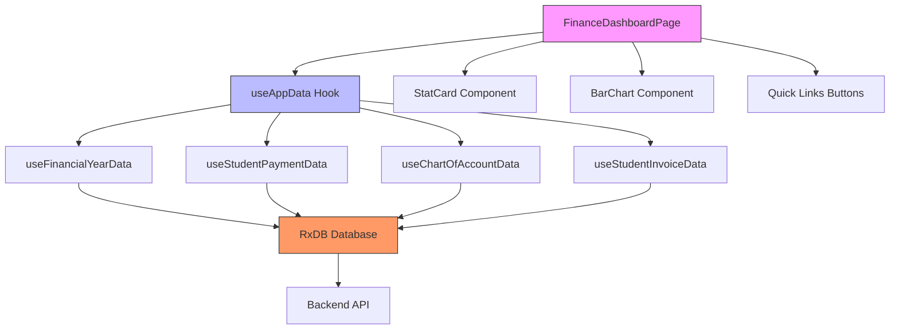
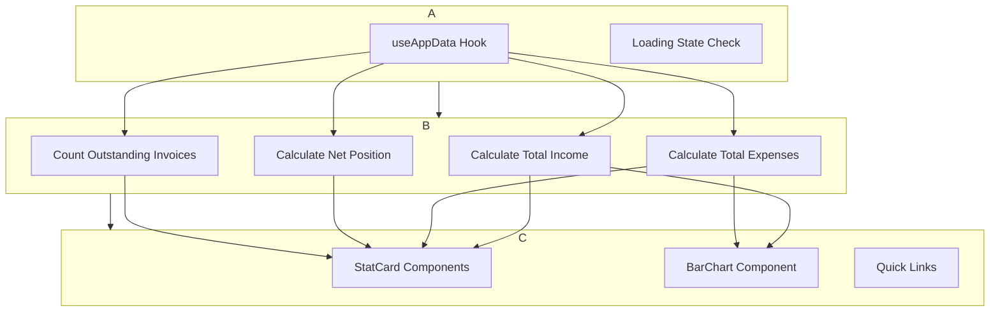
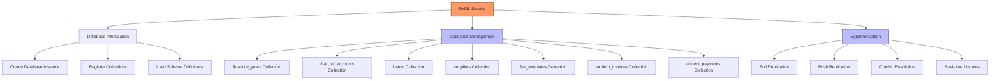
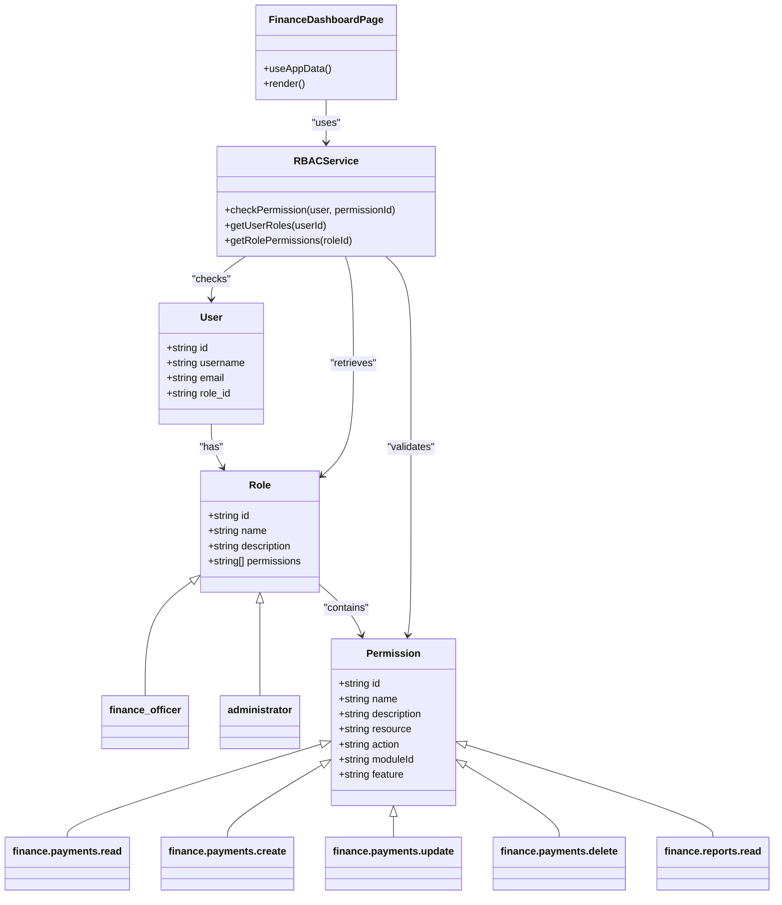
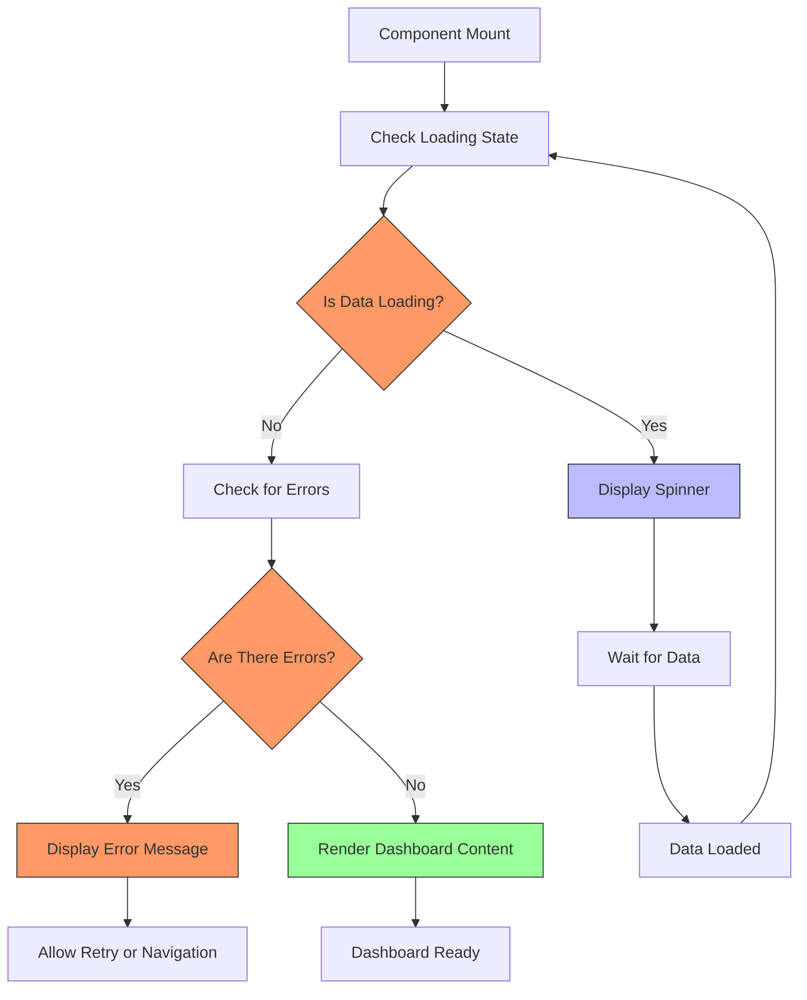

# Finance Dashboard

<cite>
**Referenced Files in This Document**   
- [FinanceDashboardPage.tsx](file://src/modules/finance/pages/FinanceDashboardPage.tsx)
- [useFinancialYearData.ts](file://src/modules/finance/data/useFinancialYearData.ts)
- [useStudentPaymentData.ts](file://src/modules/finance/data/useStudentPaymentData.ts)
- [rbac.ts](file://src/modules/finance/rbac.ts)
- [TabbedWorkspace.tsx](file://src/components/tabbedWorkspace/TabbedWorkspace.tsx)
- [rxdbService.ts](file://src/services/rxdbService.ts)
- [collections.ts](file://src/modules/finance/data/collections.ts)
- [schema.ts](file://src/modules/finance/data/schema.ts)
- [types.ts](file://src/modules/finance/data/types.ts)
- [useAppData.ts](file://src/hooks/useAppData.ts)
</cite>

## Table of Contents
1. [Introduction](#introduction)
2. [Core Components and Architecture](#core-components-and-architecture)
3. [Data Integration and Visualization](#data-integration-and-visualization)
4. [Layout and User Interface](#layout-and-user-interface)
5. [Data Management and Synchronization](#data-management-and-synchronization)
6. [Security and Access Control](#security-and-access-control)
7. [Error Handling and Loading States](#error-handling-and-loading-states)
8. [Common Issues and Troubleshooting](#common-issues-and-troubleshooting)
9. [Performance Optimization](#performance-optimization)
10. [Conclusion](#conclusion)

## Introduction

The Finance Dashboard serves as the central hub for financial insights within the schoolpilot3 educational management system. This comprehensive interface provides administrators, finance officers, and authorized personnel with real-time visibility into the institution's financial health through key performance indicators (KPIs), revenue summaries, outstanding balances, and payment trends. The dashboard consolidates critical financial data from multiple sources, presenting it through intuitive visualizations and summary cards that enable quick decision-making and financial oversight.

Built as a React component within the modular architecture of schoolpilot3, the Finance Dashboard leverages modern web technologies and data management patterns to deliver a responsive and interactive user experience. It integrates seamlessly with the application's tabbed workspace interface, allowing users to navigate between financial and non-financial modules without losing context. The dashboard's design emphasizes usability, with quick access links to common financial operations such as recording payments, creating expenses, and managing fee templates.

This document provides a comprehensive analysis of the Finance Dashboard's implementation, covering its architecture, data integration patterns, user interface components, security model, and performance characteristics. By understanding these elements, administrators and developers can effectively utilize and extend the dashboard's capabilities to meet evolving financial management needs.

**Section sources**
- [FinanceDashboardPage.tsx](file://src/modules/finance/pages/FinanceDashboardPage.tsx#L0-L125)

## Core Components and Architecture

The Finance Dashboard is implemented as a React functional component that orchestrates multiple specialized components to create a cohesive financial overview. At its core, the dashboard relies on the `useAppData` hook to retrieve financial data from the application's global state, which is populated through RxDB synchronization with the backend database. The component structure follows a modular pattern, with the main `FinanceDashboardPage` component composing smaller, reusable elements such as `StatCard`, `Card`, and `BarChart`.

The architecture follows a clear separation of concerns, with distinct layers for data retrieval, state management, and presentation. The dashboard consumes data through the `useAppData` hook, which acts as a facade over multiple module-specific data hooks, including `useFinancialYearData` and `useStudentPaymentData`. These hooks provide a consistent interface for accessing financial data while abstracting the underlying database operations and synchronization logic.



**Diagram sources**
- [FinanceDashboardPage.tsx](file://src/modules/finance/pages/FinanceDashboardPage.tsx#L0-L125)
- [useFinancialYearData.ts](file://src/modules/finance/data/useFinancialYearData.ts#L0-L41)
- [useStudentPaymentData.ts](file://src/modules/finance/data/useStudentPaymentData.ts#L0-L57)

**Section sources**
- [FinanceDashboardPage.tsx](file://src/modules/finance/pages/FinanceDashboardPage.tsx#L0-L125)
- [useFinancialYearData.ts](file://src/modules/finance/data/useFinancialYearData.ts#L0-L41)
- [useStudentPaymentData.ts](file://src/modules/finance/data/useStudentPaymentData.ts#L0-L57)

## Data Integration and Visualization

The Finance Dashboard integrates financial data through specialized hooks that provide access to various financial entities. The primary data integration mechanism is the `useAppData` hook, which aggregates data from multiple sources including banks, chart of accounts, suppliers, fee templates, and student invoices. This aggregated data is then used to calculate key financial metrics such as total income, total expenses, net position, and outstanding invoices.

For data visualization, the dashboard employs the `BarChart` component to display income versus expenses over the last six months. The chart data is structured as an array of objects, each representing a month with income values mapped to the "uv" property and expenses to the "pv" property. This visualization provides a clear graphical representation of the institution's financial performance over time, enabling users to identify trends and seasonal patterns.



**Diagram sources**
- [FinanceDashboardPage.tsx](file://src/modules/finance/pages/FinanceDashboardPage.tsx#L0-L125)

**Section sources**
- [FinanceDashboardPage.tsx](file://src/modules/finance/pages/FinanceDashboardPage.tsx#L0-L125)

## Layout and User Interface

The Finance Dashboard is integrated within the application's tabbed workspace interface, which provides a flexible and organized layout for managing multiple financial and non-financial modules simultaneously. The tabbed workspace allows users to open multiple financial reports, forms, and dashboards in separate tabs, facilitating efficient multitasking and context switching.

The dashboard's user interface is designed with a responsive grid layout that adapts to different screen sizes. On larger screens, the summary cards are displayed in a four-column layout, while on smaller screens they stack vertically. The interface includes several key elements:

- **Summary Cards**: Four primary KPI cards displaying total income, total expenses, net position, and outstanding invoices, each with a distinctive icon and color scheme.
- **Quick Links**: A section with buttons providing direct access to common financial operations such as recording payments, creating expenses, and managing fee templates.
- **Bar Chart**: A visual representation of income versus expenses over the last six months, enabling trend analysis.
- **Central Message**: A prominent section highlighting the dashboard's purpose as a financial management hub.

The layout is implemented using Tailwind CSS utility classes, with the `grid` and `gap` utilities creating the responsive card layout, and the `flex` utilities aligning elements within the StatCard component. The interface also incorporates accessibility features such as proper semantic HTML structure and ARIA attributes.

```mermaid
graph TD
A[Finance Dashboard] --> B[Header Section]
A --> C[Summary Cards Section]
A --> D[Quick Links Section]
A --> E[Bar Chart Section]
A --> F[Central Message Section]
B --> B1[Title: Finance Dashboard]
B --> B2[Shadow and Background Styling]
C --> C1[Total Income Card]
C --> C2[Total Expenses Card]
C --> C3[Net Position Card]
C --> C4[Outstanding Invoices Card]
D --> D1[Record Payment Button]
D --> D2[New Expense Button]
D --> D3[Fee Templates Button]
D --> D4[General Receipts Button]
E --> E1[Income vs Expenses Chart]
E --> E2[Last 6 Months Data]
F --> F1[Financial Management Hub Title]
F --> F2[Description Text]
F --> F3[Enhancement Badge]
style A fill:#f9f,stroke:#333
style C fill:#bbf,stroke:#333
style D fill:#bbf,stroke:#333
```



**Diagram sources**
- [FinanceDashboardPage.tsx](file://src/modules/finance/pages/FinanceDashboardPage.tsx#L0-L125)
- [TabbedWorkspace.tsx](file://src/components/tabbedWorkspace/TabbedWorkspace.tsx#L0-L199)

**Section sources**
- [FinanceDashboardPage.tsx](file://src/modules/finance/pages/FinanceDashboardPage.tsx#L0-L125)
- [TabbedWorkspace.tsx](file://src/components/tabbedWorkspace/TabbedWorkspace.tsx#L0-L199)

## Data Management and Synchronization

The Finance Dashboard relies on RxDB for real-time data synchronization and local data persistence. RxDB is a client-side database that provides a reactive interface for working with data, enabling the dashboard to display up-to-date financial information even when network connectivity is intermittent. The synchronization process is managed by the `rxdbService`, which handles database initialization, collection creation, and data synchronization with the backend server.

Financial data is organized into multiple RxDB collections, each representing a specific financial entity. The finance module defines collections for entities such as financial years, chart of accounts, banks, suppliers, fee templates, student invoices, and student payments. These collections are defined in the `collections.ts` file and use schemas defined in the `schema.ts` file to ensure data consistency and validation.



**Diagram sources**
- [rxdbService.ts](file://src/services/rxdbService.ts#L0-L199)
- [collections.ts](file://src/modules/finance/data/collections.ts#L0-L73)
- [schema.ts](file://src/modules/finance/data/schema.ts#L0-L199)

**Section sources**
- [rxdbService.ts](file://src/services/rxdbService.ts#L0-L199)
- [collections.ts](file://src/modules/finance/data/collections.ts#L0-L73)
- [schema.ts](file://src/modules/finance/data/schema.ts#L0-L199)

## Security and Access Control

The Finance Dashboard implements a robust role-based access control (RBAC) system to ensure that financial data and operations are accessible only to authorized personnel. The security model is defined in the `rbac.ts` file within the finance module, which specifies the permissions required to perform various financial operations.

The system defines several key permissions for financial operations, including:
- **finance.payments.read**: View payment information
- **finance.payments.create**: Create new payments
- **finance.payments.update**: Update payment information
- **finance.payments.delete**: Delete payments
- **finance.reports.read**: View financial reports

These permissions are organized into roles, with the finance module defining default roles such as "finance_officer" and "administrator" that have access to financial data and operations. The RBAC system integrates with the application's authentication and authorization framework, ensuring that users can only access financial features for which they have the appropriate permissions.



**Diagram sources**
- [rbac.ts](file://src/modules/finance/rbac.ts#L0-L51)

**Section sources**
- [rbac.ts](file://src/modules/finance/rbac.ts#L0-L51)

## Error Handling and Loading States

The Finance Dashboard implements comprehensive error handling and loading state management to ensure a smooth user experience. When data is being loaded from the backend, the dashboard displays a spinner to indicate that content is being retrieved. This loading state is determined by checking the `loading` object returned by the `useAppData` hook, which contains flags for various data entities such as banks, chart of accounts, suppliers, fee templates, and student invoices.

The loading state logic uses a compound condition to determine if the page is still loading:
```typescript
const pageIsLoading = loading.all || loading.banks || loading.chartOfAccounts || loading.suppliers || loading.feeTemplates || loading.studentInvoices;
```

If any of these loading flags are true, the dashboard displays a full-screen spinner centered in the viewport. This prevents users from interacting with incomplete or potentially inconsistent data. Once all required data has been loaded, the dashboard renders the full interface with financial metrics and visualizations.

For error handling, the underlying data hooks such as `useStudentPaymentData` include error state management with try-catch blocks that set an error message if data retrieval fails. While the main dashboard component does not explicitly handle errors beyond the loading state, the application's error boundary components would catch and display any unhandled exceptions.



**Diagram sources**
- [FinanceDashboardPage.tsx](file://src/modules/finance/pages/FinanceDashboardPage.tsx#L0-L125)
- [useStudentPaymentData.ts](file://src/modules/finance/data/useStudentPaymentData.ts#L0-L57)

**Section sources**
- [FinanceDashboardPage.tsx](file://src/modules/finance/pages/FinanceDashboardPage.tsx#L0-L125)
- [useStudentPaymentData.ts](file://src/modules/finance/data/useStudentPaymentData.ts#L0-L57)

## Common Issues and Troubleshooting

The Finance Dashboard may encounter several common issues that affect its functionality and data accuracy. Understanding these issues and their troubleshooting steps is essential for maintaining the reliability of financial reporting.

**Stale Data Display**: One potential issue is the display of stale or outdated financial data. This can occur when the RxDB synchronization process fails to update the local database with the latest information from the server. To troubleshoot this issue:
1. Check network connectivity to ensure the application can communicate with the backend server
2. Verify that the RxDB replication process is running correctly by checking browser developer tools for synchronization errors
3. Manually trigger a data refresh by navigating away from and back to the dashboard
4. Clear the local database cache if the issue persists

**Incorrect Balance Calculations**: The dashboard currently uses mock data for calculating total income, total expenses, and net position. This can lead to discrepancies between the dashboard values and actual financial records. To address this:
1. Replace the mock calculations with actual data aggregation from student payments and expense records
2. Implement proper data validation to ensure all financial transactions are accounted for
3. Add reconciliation functionality to compare dashboard totals with ledger balances
4. Implement audit logging to track changes to financial calculations

**Loading Performance Issues**: With multiple data dependencies, the dashboard may experience slow loading times. To optimize performance:
1. Implement lazy loading for non-essential data
2. Optimize database queries to retrieve only necessary fields
3. Implement data caching strategies to reduce redundant API calls
4. Consider pagination for large data sets such as student invoices

**Permission-Related Access Issues**: Users may encounter access issues if their roles do not have the required permissions. To resolve this:
1. Verify the user's role assignments in the administration module
2. Check that the role has the necessary financial permissions assigned
3. Ensure the RBAC service is properly initialized with the user's permissions
4. Test with a user account that has administrator privileges to isolate the issue

**Section sources**
- [FinanceDashboardPage.tsx](file://src/modules/finance/pages/FinanceDashboardPage.tsx#L0-L125)
- [useAppData.ts](file://src/hooks/useAppData.ts)
- [rxdbService.ts](file://src/services/rxdbService.ts#L0-L199)

## Performance Optimization

Several performance optimization opportunities exist for the Finance Dashboard to improve loading times, reduce resource consumption, and enhance user experience.

**Data Loading Optimization**: The current implementation loads multiple data entities simultaneously, which can create performance bottlenecks. Optimization strategies include:
- Implementing code splitting to load only essential data on initial render
- Using React's `Suspense` and `lazy` for component-level code splitting
- Implementing virtualized rendering for large data sets
- Adding skeleton screens to improve perceived performance

**State Management Optimization**: The dashboard can benefit from more efficient state management patterns:
- Memoizing expensive calculations using `useMemo` to prevent recalculation on every render
- Using `React.memo` for the StatCard component to prevent unnecessary re-renders
- Implementing selective state updates to minimize re-renders
- Using React's `useCallback` for event handlers to prevent recreation on every render

**Network Optimization**: To reduce network overhead and improve data retrieval speed:
- Implement data compression for API responses
- Use HTTP/2 for multiplexed requests
- Implement request batching for multiple small data requests
- Add client-side caching with appropriate cache invalidation strategies

**Rendering Optimization**: The visual components can be optimized for better rendering performance:
- Debouncing or throttling chart updates during rapid data changes
- Implementing windowing for large lists or tables
- Using CSS transforms for animations instead of layout-affecting properties
- Minimizing re-repaints by optimizing CSS and layout structure

**Section sources**
- [FinanceDashboardPage.tsx](file://src/modules/finance/pages/FinanceDashboardPage.tsx#L0-L125)
- [useAppData.ts](file://src/hooks/useAppData.ts)
- [rxdbService.ts](file://src/services/rxdbService.ts#L0-L199)

## Conclusion

The Finance Dashboard in schoolpilot3 serves as a comprehensive financial management hub that provides real-time insights into the institution's financial health. Through its integration of key performance indicators, data visualizations, and quick access to financial operations, the dashboard enables administrators and finance officers to effectively monitor and manage financial activities.

The dashboard's architecture leverages modern web technologies and design patterns, including React components, RxDB for data synchronization, and a role-based access control system for security. Its integration within the tabbed workspace interface allows for efficient multitasking and context switching between financial and non-financial modules.

While the current implementation provides a solid foundation for financial oversight, opportunities exist for further enhancement, particularly in the areas of data accuracy, performance optimization, and user experience. By addressing the identified issues and implementing the recommended optimizations, the Finance Dashboard can evolve into an even more powerful tool for financial management in educational institutions.

Future development should focus on replacing mock data with actual financial aggregations, improving data loading performance, and enhancing the dashboard's analytical capabilities with more sophisticated visualizations and reporting features.