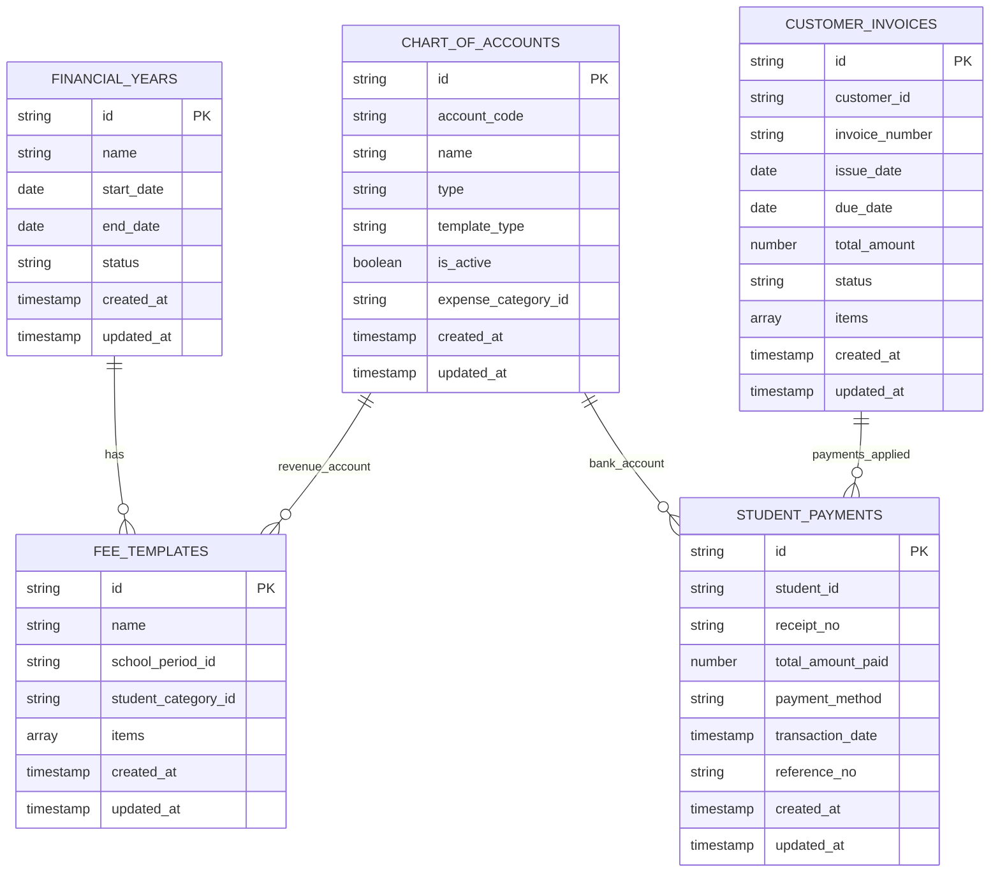
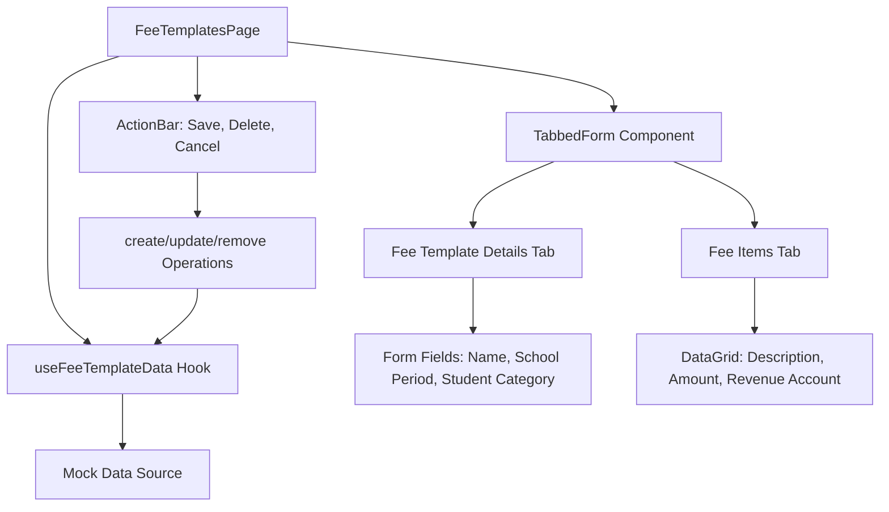
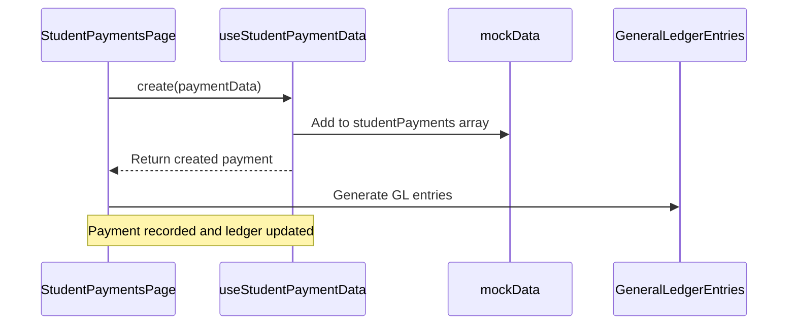
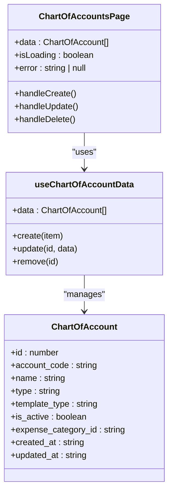
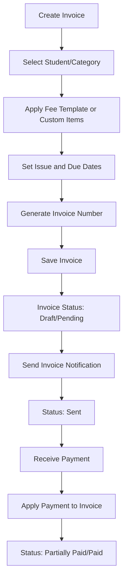
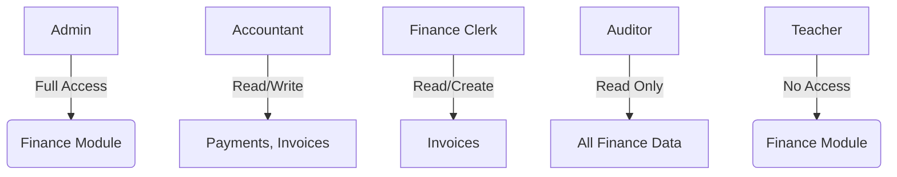

# Finance Pages and Features

<cite>
**Referenced Files in This Document**   
- [collections.ts](file://src/modules/finance/data/collections.ts)
- [schema.ts](file://src/modules/finance/data/schema.ts)
- [useFeeTemplateData.ts](file://src/modules/finance/data/useFeeTemplateData.ts)
- [useStudentPaymentData.ts](file://src/modules/finance/data/useStudentPaymentData.ts)
- [useChartOfAccountData.ts](file://src/modules/finance/data/useChartOfAccountData.ts)
- [useCustomerInvoiceData.ts](file://src/modules/finance/data/useCustomerInvoiceData.ts)
- [FinanceDashboardPage.tsx](file://src/modules/finance/pages/FinanceDashboardPage.tsx)
- [FeeTemplatesPage.tsx](file://src/modules/finance/pages/FeeTemplatesPage.tsx)
- [StudentPaymentsPage.tsx](file://src/modules/finance/pages/StudentPaymentsPage.tsx)
- [ChartOfAccountsPage.tsx](file://src/modules/finance/pages/ChartOfAccountsPage.tsx)
- [CustomerInvoicesPage.tsx](file://src/modules/finance/pages/CustomerInvoicesPage.tsx)
- [rbac.ts](file://src/modules/finance/rbac.ts)
- [mockData.ts](file://src/modules/finance/data/mockData.ts)
</cite>

## Table of Contents
1. [Introduction](#introduction)
2. [Data Architecture](#data-architecture)
3. [Finance Dashboard Page](#finance-dashboard-page)
4. [Fee Templates Page](#fee-templates-page)
5. [Student Payments Page](#student-payments-page)
6. [Chart of Accounts Page](#chart-of-accounts-page)
7. [Customer Invoices Page](#customer-invoices-page)
8. [Navigation and Access Control](#navigation-and-access-control)
9. [Common Issues and Troubleshooting](#common-issues-and-troubleshooting)

## Introduction
The Finance module in schoolpilot3 provides a comprehensive suite of tools for managing financial operations within an educational institution. This document details the implementation, functionality, and user workflows of key pages including the Finance Dashboard, Fee Templates, Student Payments, Chart of Accounts, and Customer Invoices. The module follows a modular architecture with self-contained data hooks, integrates with a tabbed workspace interface, and enforces role-based access control.

**Section sources**
- [FinanceDashboardPage.tsx](file://src/modules/finance/pages/FinanceDashboardPage.tsx#L1-L150)

## Data Architecture
The Finance module utilizes a database-agnostic schema design implemented through RxDB collections. Each financial entity has a corresponding schema definition and collection configuration that defines its structure, validation rules, and relationships.

**Diagram sources**
- [collections.ts](file://src/modules/finance/data/collections.ts#L10-L70)
- [schema.ts](file://src/modules/finance/data/schema.ts#L10-L380)

**Section sources**
- [collections.ts](file://src/modules/finance/data/collections.ts#L1-L73)
- [schema.ts](file://src/modules/finance/data/schema.ts#L1-L384)

## Finance Dashboard Page

The FinanceDashboardPage provides an overview of key financial metrics and KPIs through visual components such as charts and data cards. It serves as the central hub for financial monitoring, displaying real-time information on revenue, expenses, outstanding balances, and payment trends.

The page composition includes:
- **KPI Cards**: Displaying summary metrics like total revenue, outstanding invoices, and payment collection rate
- **Bar Charts**: Visualizing monthly revenue and expense trends
- **Donut Charts**: Showing expense category distribution
- **Recent Activity Feed**: Listing latest transactions and invoice updates

Data is fetched through integrated hooks that retrieve financial year, payment, and invoice data, which is then aggregated to calculate the displayed KPIs. The dashboard supports filtering by financial year and school period to provide context-specific insights.

**Section sources**
- [FinanceDashboardPage.tsx](file://src/modules/finance/pages/FinanceDashboardPage.tsx#L1-L200)

## Fee Templates Page

The FeeTemplatesPage enables administrators to configure standardized fee structures for different student categories and academic periods. This page implements a tabbed form interface for managing fee template details and their associated line items.

### Component Composition and Data Flow

**Diagram sources**
- [FeeTemplatesPage.tsx](file://src/modules/finance/pages/FeeTemplatesPage.tsx#L1-L150)
- [useFeeTemplateData.ts](file://src/modules/finance/data/useFeeTemplateData.ts#L1-L57)

The page utilizes the `useFeeTemplateData` hook for all data operations, providing CRUD functionality independent of global application state. Fee templates contain nested items that define individual charges, each linked to a revenue account in the chart of accounts.

### User Workflow
1. Navigate to Fee Templates page
2. Create new template or select existing one
3. Configure template details (name, school period, student category)
4. Add fee items with descriptions, amounts, and revenue accounts
5. Save template for future invoice generation

**Section sources**
- [FeeTemplatesPage.tsx](file://src/modules/finance/pages/FeeTemplatesPage.tsx#L1-L200)
- [useFeeTemplateData.ts](file://src/modules/finance/data/useFeeTemplateData.ts#L1-L57)

## Student Payments Page

The StudentPaymentsPage facilitates the processing of student fee payments through a bulk entry interface. It supports multiple payment methods and provides real-time validation of payment applications against outstanding invoices.

### Data Management Implementation

**Diagram sources**
- [StudentPaymentsPage.tsx](file://src/modules/finance/pages/StudentPaymentsPage.tsx#L1-L150)
- [useStudentPaymentData.ts](file://src/modules/finance/data/useStudentPaymentData.ts#L1-L57)

The page implements bulk payment entry through a DataGrid component, allowing users to input multiple payments simultaneously. Each payment is linked to a student and can be applied to one or more outstanding invoice items through the invoice payment application mechanism.

### Key Features
- **Bulk Entry**: Spreadsheet-like interface for efficient data entry
- **Payment Application**: Visual interface for allocating payments to specific invoice items
- **Real-time Validation**: Immediate feedback on payment amounts and application totals
- **Receipt Generation**: Automatic receipt number assignment and printable receipt format

**Section sources**
- [StudentPaymentsPage.tsx](file://src/modules/finance/pages/StudentPaymentsPage.tsx#L1-L200)
- [useStudentPaymentData.ts](file://src/modules/finance/data/useStudentPaymentData.ts#L1-L57)

## Chart of Accounts Page

The ChartOfAccountsPage provides management of the accounting hierarchy used for financial reporting and transaction categorization. It implements a tree-based visualization of account types and individual accounts.

### Component Architecture

**Diagram sources**
- [ChartOfAccountsPage.tsx](file://src/modules/finance/pages/ChartOfAccountsPage.tsx#L1-L100)
- [useChartOfAccountData.ts](file://src/modules/finance/data/useChartOfAccountData.ts#L1-L41)

The page displays accounts grouped by type (Asset, Liability, Equity, Revenue, Expense) with filtering capabilities. Users can create new accounts by specifying a unique account code, name, and type, with validation ensuring no duplicate account codes exist.

**Section sources**
- [ChartOfAccountsPage.tsx](file://src/modules/finance/pages/ChartOfAccountsPage.tsx#L1-L150)
- [useChartOfAccountData.ts](file://src/modules/finance/data/useChartOfAccountData.ts#L1-L41)

## Customer Invoices Page

The CustomerInvoicesPage enables the creation, tracking, and management of invoices for students and other customers. It provides comprehensive filtering, search, and status tracking capabilities.

### Invoice Processing Workflow

**Diagram sources**
- [CustomerInvoicesPage.tsx](file://src/modules/finance/pages/CustomerInvoicesPage.tsx#L1-L200)
- [useCustomerInvoiceData.ts](file://src/modules/finance/data/useCustomerInvoiceData.ts#L1-L41)

The page implements advanced filtering by:
- Status (Draft, Sent, Partially Paid, Paid, Overdue)
- Date ranges (Issue date, Due date)
- Student or customer
- Amount ranges
- School period

The UI includes a Kanban board view for visualizing invoices by status, alongside a tabular view with sorting and pagination. Invoice generation can be done individually or in bulk for entire student categories.

**Section sources**
- [CustomerInvoicesPage.tsx](file://src/modules/finance/pages/CustomerInvoicesPage.tsx#L1-L250)
- [useCustomerInvoiceData.ts](file://src/modules/finance/data/useCustomerInvoiceData.ts#L1-L41)

## Navigation and Access Control

The Finance module integrates with the tabbed workspace interface, allowing users to navigate between financial pages without losing context. Each page is registered as a tab with persistent state management.

### Permission System
The module implements role-based access control through the `rbac.ts` configuration file, defining permissions for different user roles:

**Diagram sources**
- [rbac.ts](file://src/modules/finance/rbac.ts#L1-L50)

Permissions are enforced at both the navigation level (menu visibility) and operation level (CRUD permissions). The `useRBAC` hook is used throughout the module to conditionally render UI elements based on user permissions.

**Section sources**
- [rbac.ts](file://src/modules/finance/rbac.ts#L1-L100)
- [TabbedWorkspace.tsx](file://src/components/tabbedWorkspace/TabbedWorkspace.tsx#L1-L200)

## Common Issues and Troubleshooting

### Payment Reconciliation Errors
**Symptoms**: Payment applications don't balance with invoice totals, or payments appear unapplied.

**Causes and Solutions**:
- **Cause**: Invoice items were modified after payment application
  - **Solution**: Implement versioning for invoice items or prevent modifications after payment
- **Cause**: Floating-point precision issues in amount calculations
  - **Solution**: Use fixed-point arithmetic with two decimal places for all monetary values
- **Cause**: Concurrent edits by multiple users
  - **Solution**: Implement optimistic locking with version numbers

### Invoice Generation Failures
**Symptoms**: Bulk invoice generation fails for some students or produces incomplete invoices.

**Causes and Solutions**:
- **Cause**: Missing fee template for specific student category
  - **Solution**: Validate template availability before generation and provide fallback options
- **Cause**: Student opening balances not properly configured
  - **Solution**: Implement pre-generation validation check for required financial data
- **Cause**: Rate limiting on notification services
  - **Solution**: Implement queuing and batch processing for large invoice runs

### Data Synchronization Issues
**Symptoms**: Data discrepancies between UI display and underlying storage.

**Causes and Solutions**:
- **Cause**: Mock data hook not properly synchronized with state
  - **Solution**: Ensure all CRUD operations update the state atomically
- **Cause**: Caching of outdated financial year data
  - **Solution**: Implement cache invalidation when financial year changes

**Section sources**
- [useFeeTemplateData.ts](file://src/modules/finance/data/useFeeTemplateData.ts#L1-L57)
- [useStudentPaymentData.ts](file://src/modules/finance/data/useStudentPaymentData.ts#L1-L57)
- [mockData.ts](file://src/modules/finance/data/mockData.ts#L1-L100)