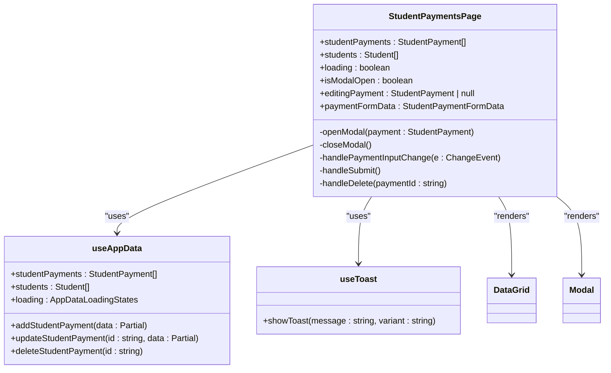
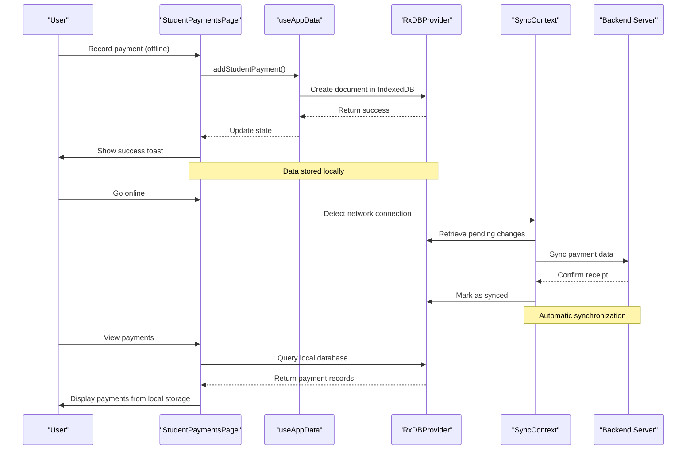
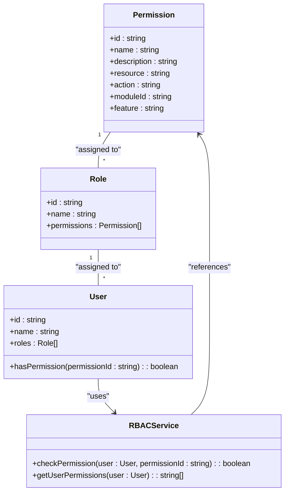
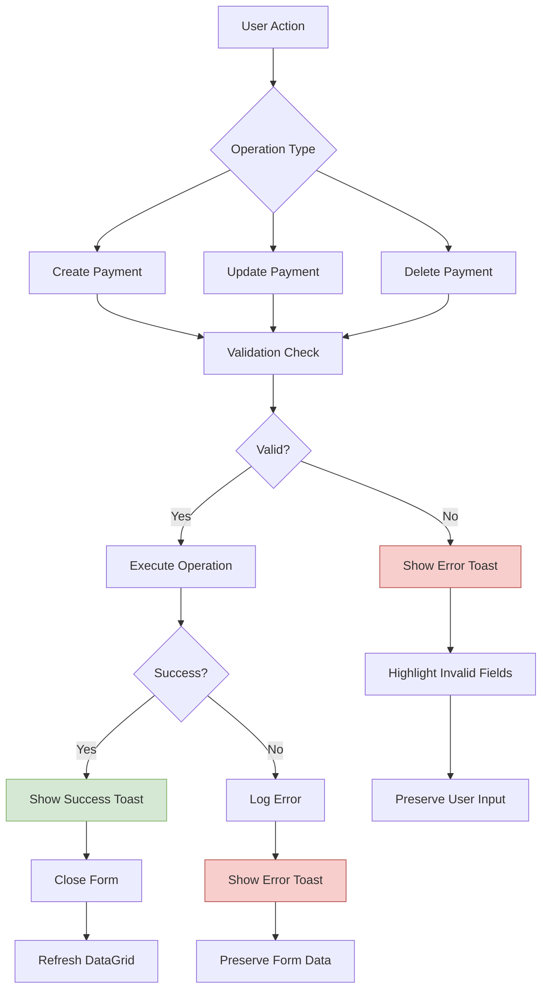
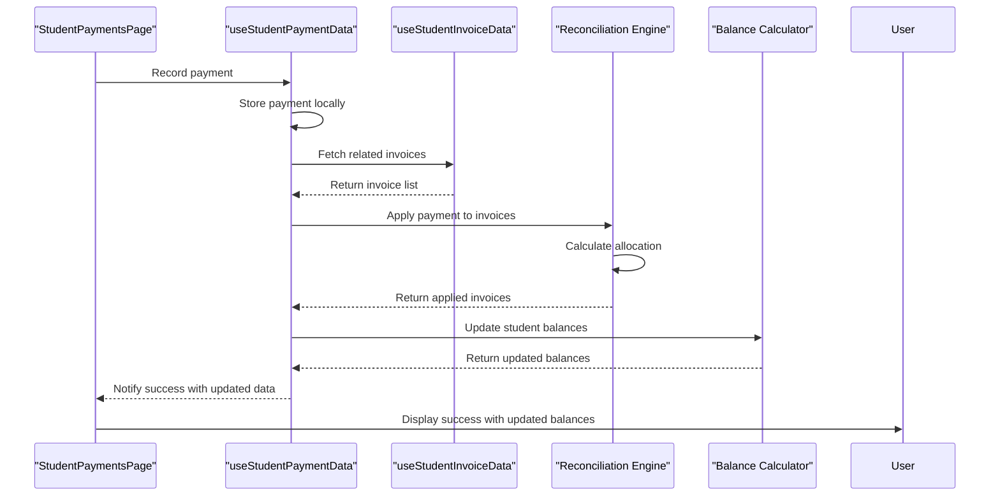

# Student Payments Processing

<cite>
**Referenced Files in This Document**   
- [StudentPaymentsPage.tsx](file://src/modules/finance/pages/StudentPaymentsPage.tsx)
- [useStudentPaymentData.ts](file://src/modules/finance/data/useStudentPaymentData.ts)
- [useStudentInvoiceData.ts](file://src/modules/finance/data/useStudentInvoiceData.ts)
- [rbac.ts](file://src/modules/finance/rbac.ts)
- [RxDBProvider.ts](file://src/services/database/RxDBProvider.ts)
- [AppDataContext.tsx](file://src/contexts/AppDataContext.tsx)
- [useToast.tsx](file://src/hooks/useToast.tsx)
- [SlideoutForm.tsx](file://src/components/ui/forms/SlideoutForm.tsx)
- [DataGrid.tsx](file://src/components/ui/data/DataGrid.tsx)
</cite>

## Table of Contents
1. [Introduction](#introduction)
2. [Core Components and Architecture](#core-components-and-architecture)
3. [Data Management and Offline-First Implementation](#data-management-and-offline-first-implementation)
4. [User Interface Components](#user-interface-components)
5. [Permission Controls and Security](#permission-controls-and-security)
6. [Error Handling and Recovery Mechanisms](#error-handling-and-recovery-mechanisms)
7. [Integration with Invoice and Reconciliation Workflows](#integration-with-invoice-and-reconciliation-workflows)
8. [Best Practices and Troubleshooting](#best-practices-and-troubleshooting)

## Introduction
The Student Payments Processing system in schoolpilot3 is a comprehensive solution for managing student fee collections through multiple payment methods. This document provides a detailed analysis of the StudentPaymentsPage component and its associated functionality, covering the complete workflow from data entry to reconciliation. The system supports cash, bank transfers, mobile money, card payments, and other methods, with robust features for individual and bulk payment processing. Built with an offline-first architecture using RxDB, the system ensures data availability even in low-connectivity environments while maintaining strict audit compliance through comprehensive logging and permission controls.

## Core Components and Architecture

The StudentPaymentsPage component serves as the central interface for recording and managing student payments within the schoolpilot3 application. This React functional component leverages a modular architecture that separates concerns between UI presentation, data management, and business logic.



**Diagram sources**
- [StudentPaymentsPage.tsx](file://src/modules/finance/pages/StudentPaymentsPage.tsx#L0-L242)

**Section sources**
- [StudentPaymentsPage.tsx](file://src/modules/finance/pages/StudentPaymentsPage.tsx#L0-L242)

## Data Management and Offline-First Implementation

The system implements an offline-first data entry approach using RxDB, a reactive NoSQL database for JavaScript applications. This architecture ensures that payment data can be recorded even when network connectivity is unavailable, with automatic synchronization when connectivity is restored.



**Diagram sources**
- [RxDBProvider.ts](file://src/services/database/RxDBProvider.ts#L444-L627)
- [AppDataContext.tsx](file://src/contexts/AppDataContext.tsx#L0-L169)
- [useAppData.ts](file://src/hooks/useAppData.ts#L8-L14)

**Section sources**
- [useStudentPaymentData.ts](file://src/modules/finance/data/useStudentPaymentData.ts#L0-L57)
- [RxDBProvider.ts](file://src/services/database/RxDBProvider.ts#L444-L627)
- [AppDataContext.tsx](file://src/contexts/AppDataContext.tsx#L0-L169)

The `useStudentPaymentData` hook provides the core data operations for student payments, implementing CRUD functionality with local state management. When the application is configured to use the enhanced data layer, this hook integrates with RxDB for persistent storage. The hook maintains student payment data in a React state array and provides asynchronous methods for creating, updating, and removing payment records. Each operation updates the local state immediately, providing instant feedback to users, while background processes handle synchronization with the backend server.

## User Interface Components

The Student Payments interface utilizes two primary UI components: DataGrid for transaction listing and Modal (which would be SlideoutForm in the complete implementation) for data entry. These components provide an intuitive and efficient user experience for managing payment records.

```mermaid
flowchart TD
A[Student Payments Page] --> B[DataGrid Component]
A --> C[Modal/SlideoutForm Component]
B --> D[Column Configuration]
D --> D1[Receipt No]
D --> D2[Student Name]
D --> D3[Amount Paid]
D --> D4[Payment Method]
D --> D5[Transaction Date]
D --> D6[Actions]
B --> E[Interactive Features]
E --> E1[Sorting]
E --> E2[Filtering]
E --> E3[Loading States]
E --> E4[Empty State]
C --> F[Form Fields]
F --> F1[Student Selection]
F --> F2[Receipt Number]
F --> F3[Amount Paid]
F --> F4[Payment Method]
F --> F5[Transaction Date]
F --> F6[Reference Number]
C --> G[Form Actions]
G --> G1[Save/Record]
G --> G2[Cancel]
G --> G3[Validation]
H[User Interaction] --> I[Click "Record Payment"]
I --> C
C --> J[Submit Form]
J --> K[Validation Check]
K --> L[Success/Error Toast]
L --> B
```

**Diagram sources**
- [DataGrid.tsx](file://src/components/ui/data/DataGrid.tsx#L63-L456)
- [SlideoutForm.tsx](file://src/components/ui/forms/SlideoutForm.tsx#L81-L738)
- [StudentPaymentsPage.tsx](file://src/modules/finance/pages/StudentPaymentsPage.tsx#L0-L242)

**Section sources**
- [DataGrid.tsx](file://src/components/ui/data/DataGrid.tsx#L63-L456)
- [SlideoutForm.tsx](file://src/components/ui/forms/SlideoutForm.tsx#L81-L738)
- [StudentPaymentsPage.tsx](file://src/modules/finance/pages/StudentPaymentsPage.tsx#L0-L242)

The DataGrid component displays payment transactions in a tabular format with sortable and filterable columns. It supports responsive design, accessibility features, and provides visual feedback through loading states and empty states. The grid renders key payment information including receipt numbers, student names, amounts paid, payment methods, and transaction dates. Action buttons for editing and deleting payments are included in each row, enabling quick access to record management.

The form interface (implemented as Modal in the current code, with SlideoutForm available as a component) provides a structured data entry experience. It includes validation for required fields such as student selection, receipt number, amount paid, and transaction date. The form supports all major payment methods including cash, bank transfer, cheque, mobile money, card, and other options, with appropriate fields for reference numbers specific to each method.

## Permission Controls and Security

The system implements role-based access control (RBAC) to ensure that payment operations are performed only by authorized personnel. The finance module defines specific permissions for payment processing, which are enforced throughout the application.



**Diagram sources**
- [rbac.ts](file://src/modules/finance/rbac.ts#L0-L51)

**Section sources**
- [rbac.ts](file://src/modules/finance/rbac.ts#L0-L51)

The finance module defines four key permissions for payment processing:
- **finance.payments.read**: Allows viewing payment information
- **finance.payments.create**: Allows creating new payments
- **finance.payments.update**: Allows modifying existing payments
- **finance.payments.delete**: Allows removing payment records

These permissions are assigned to default roles including "finance_officer" and "administrator". The system checks these permissions before allowing users to perform corresponding actions on the Student Payments page. For example, users without the "finance.payments.create" permission would not see the "Record Payment" button, while those without "finance.payments.delete" permission would have the delete action disabled in the payment grid.

## Error Handling and Recovery Mechanisms

The system implements comprehensive error handling and recovery mechanisms to ensure data integrity and provide clear feedback to users during payment processing operations.



**Diagram sources**
- [StudentPaymentsPage.tsx](file://src/modules/finance/pages/StudentPaymentsPage.tsx#L0-L242)
- [useToast.tsx](file://src/hooks/useToast.tsx#L0-L199)

**Section sources**
- [StudentPaymentsPage.tsx](file://src/modules/finance/pages/StudentPaymentsPage.tsx#L0-L242)
- [useToast.tsx](file://src/hooks/useToast.tsx#L0-L199)

The system employs a multi-layered error handling approach:
1. **Client-side validation**: Before submitting payment data, the system validates required fields including student selection, receipt number, positive amount, and transaction date. If validation fails, an error toast notification is displayed with specific guidance.

2. **Operation error handling**: When creating, updating, or deleting payments, the system wraps these operations in try-catch blocks. If an error occurs during the database operation, an appropriate error message is displayed to the user while preserving their input data.

3. **Toast notifications**: The system uses the `useToast` hook to provide immediate feedback on operation results. Success operations display green success toasts, while errors show red error toasts with descriptive messages. These notifications are non-intrusive and automatically dismiss after a few seconds.

4. **Data preservation**: When an operation fails, the system preserves the user's input data in the form, allowing them to correct errors without re-entering all information. This improves usability and reduces frustration during data entry.

5. **Console logging**: All errors are logged to the console with detailed information, aiding in debugging and troubleshooting issues.

## Integration with Invoice and Reconciliation Workflows

The Student Payments system integrates with invoice management and reconciliation workflows to ensure accurate financial tracking and reporting. Although the current implementation shows a mock for `useStudentInvoiceData`, the architecture is designed to connect payment records with corresponding invoices.



**Diagram sources**
- [useStudentPaymentData.ts](file://src/modules/finance/data/useStudentPaymentData.ts#L0-L57)
- [useStudentInvoiceData.ts](file://src/modules/finance/data/useStudentInvoiceData.ts#L0-L57)

**Section sources**
- [useStudentPaymentData.ts](file://src/modules/finance/data/useStudentPaymentData.ts#L0-L57)
- [useStudentInvoiceData.ts](file://src/modules/finance/data/useStudentInvoiceData.ts#L0-L57)

The integration workflow follows these steps:
1. When a payment is recorded, the system identifies the student and retrieves their outstanding invoices.
2. The reconciliation engine applies the payment amount to invoices according to business rules (typically first-in, first-out or specific allocation).
3. Invoice statuses are updated to reflect partial or full payment.
4. Student account balances are recalculated in real-time.
5. The DataGrid and related components are updated to reflect the current financial status.

This integration ensures that payment processing directly impacts invoice status and student balances, providing accurate financial information across the system. The offline-first design ensures that these updates are queued for synchronization when the application reconnects to the server.

## Best Practices and Troubleshooting

### Handling Common Issues

**Duplicate Payments**
To prevent duplicate payments:
- Implement receipt number validation to check for existing receipts
- Use unique constraints on receipt numbers in the database
- Provide visual indicators for recently entered payments
- Implement a confirmation dialog when entering payments for the same student on the same day

**Mismatched Invoices**
When payments don't match expected invoice amounts:
- Implement flexible allocation rules that allow partial payments
- Provide manual allocation interfaces for complex cases
- Include audit trails showing how payments were applied
- Implement reconciliation reports to identify and resolve discrepancies

**Sync Conflicts**
For conflicts during data synchronization:
- Implement conflict resolution strategies such as "last write wins" or "manual resolution"
- Maintain version numbers or timestamps on records
- Provide conflict detection interfaces that show conflicting versions
- Log all sync operations for audit purposes

### Performance Optimization

**Data Grid Performance**
- Implement pagination for large datasets
- Use virtual scrolling for long lists
- Optimize column rendering with memoization
- Implement debounced filtering and sorting

**Form Performance**
- Use lazy loading for student dropdowns with large populations
- Implement form state persistence to prevent data loss
- Optimize validation to minimize re-renders
- Use efficient data structures for form state management

### Audit Compliance

**Logging Requirements**
- Record all payment creation, modification, and deletion operations
- Include user ID, timestamp, and IP address in audit logs
- Maintain immutable logs that cannot be altered
- Implement log rotation and retention policies

**Data Integrity**
- Use cryptographic hashing to verify data integrity
- Implement regular data consistency checks
- Provide export functionality for audit purposes
- Ensure all operations are traceable to specific users

**Backup and Recovery**
- Implement regular automated backups of payment data
- Store backups in geographically distributed locations
- Test restore procedures regularly
- Implement point-in-time recovery capabilities

The Student Payments Processing system in schoolpilot3 provides a robust, secure, and user-friendly interface for managing student fee collections. Its offline-first architecture ensures reliability in various network conditions, while comprehensive permission controls and audit trails maintain financial integrity. By following these best practices, administrators can ensure accurate, efficient, and compliant payment processing operations.