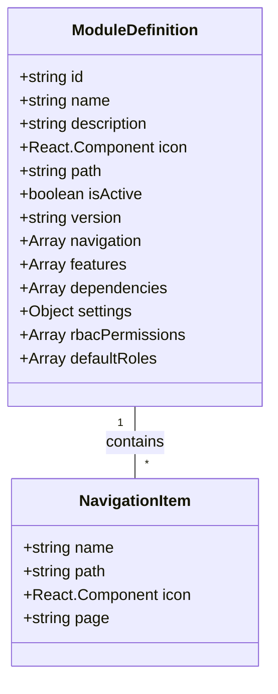
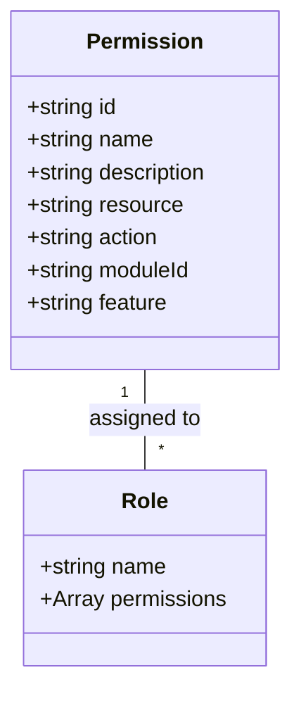
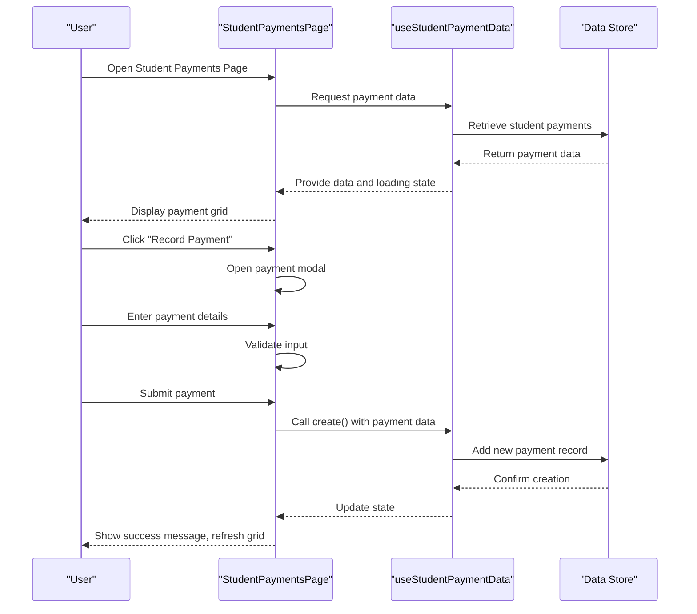
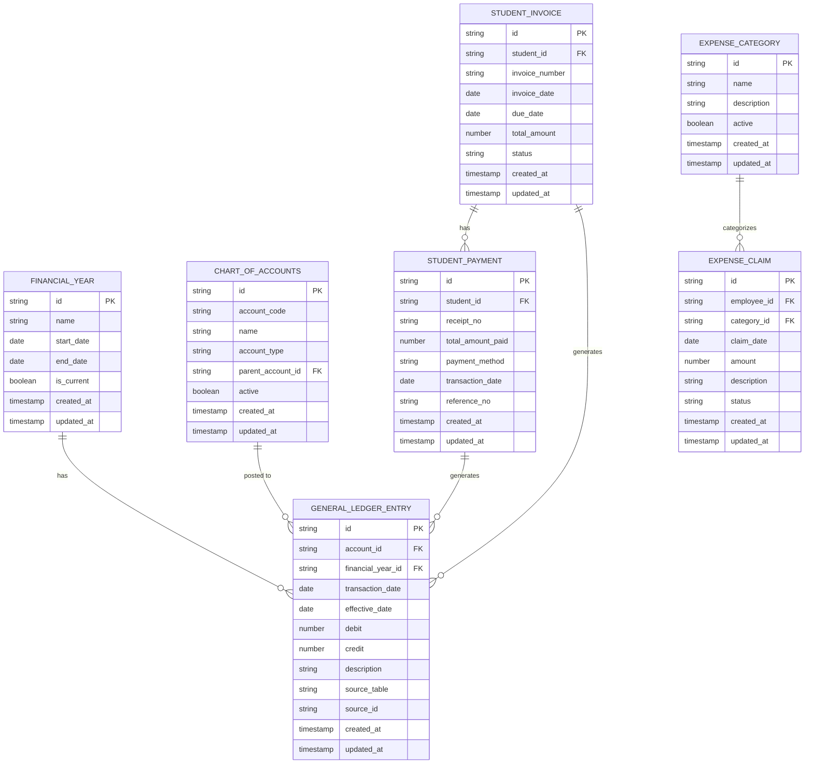
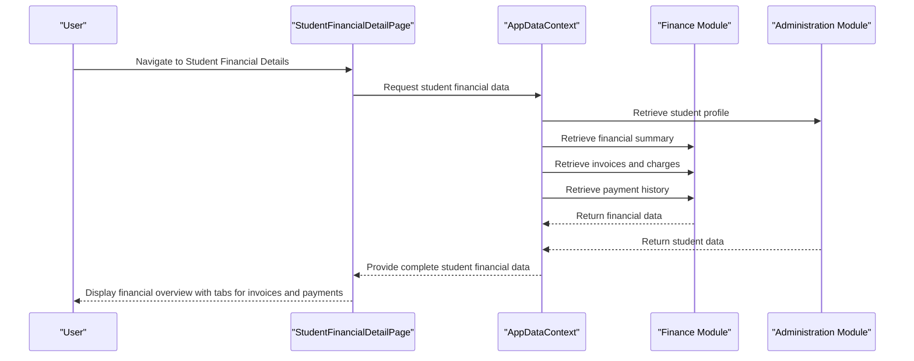
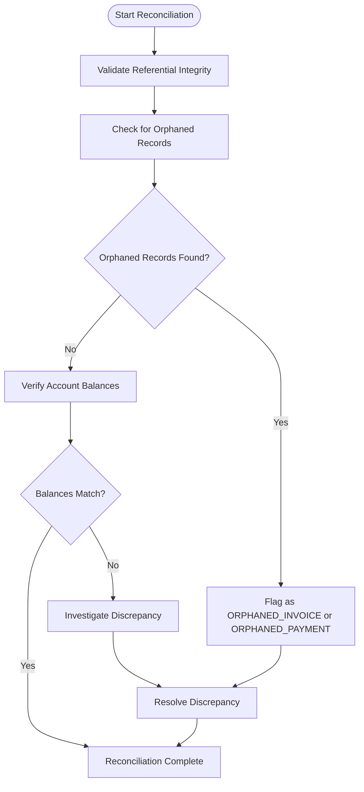
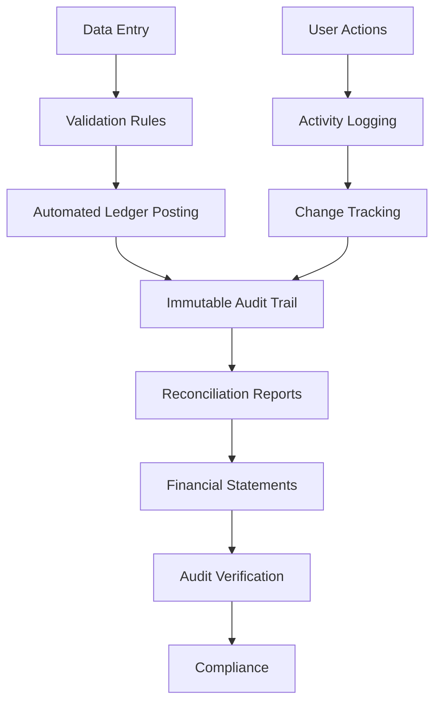

# Finance Module

<cite>
**Referenced Files in This Document**   
- [StudentPaymentsPage.tsx](file://src/modules/finance/pages/StudentPaymentsPage.tsx)
- [useStudentPaymentData.ts](file://src/modules/finance/data/useStudentPaymentData.ts)
- [useStudentInvoiceData.ts](file://src/modules/finance/data/useStudentInvoiceData.ts)
- [StudentFinancialDetailPage.tsx](file://src/modules/administration/pages/StudentFinancialDetailPage.tsx)
- [StudentExamResultsEntryPage.tsx](file://src/modules/academics/pages/StudentExamResultsEntryPage.tsx)
- [moduleDefinition.tsx](file://src/modules/finance/moduleDefinition.tsx)
- [rbac.ts](file://src/modules/finance/rbac.ts)
- [schema.ts](file://src/modules/finance/data/schema.ts)
- [mockData.ts](file://src/modules/finance/data/mockData.ts)
- [validationSchemas.ts](file://src/utils/validationSchemas.ts)
- [DataSyncMonitoringService.ts](file://src/services/DataSyncMonitoringService.ts)
- [AccountLedgerPage.tsx](file://src/modules/reports/pages/AccountLedgerPage.tsx)
</cite>

## Table of Contents
1. [Introduction](#introduction)
2. [Module Registration and Configuration](#module-registration-and-configuration)
3. [Permission Definitions and RBAC](#permission-definitions-and-rbac)
4. [Core Financial Operations](#core-financial-operations)
5. [Data Model](#data-model)
6. [Integration with Other Modules](#integration-with-other-modules)
7. [Common Issues and Best Practices](#common-issues-and-best-practices)

## Introduction
The Finance Module in schoolpilot3 is a comprehensive financial management system designed to handle all aspects of school financial operations. It provides robust functionality for fee management, invoicing, payment processing, ledger accounting, and expense tracking. The module is built with a modular architecture and integrates seamlessly with other system components such as Academics and Administration. This documentation provides a detailed analysis of the module's implementation, covering its registration, permission system, core operations, data model, and integration points.

## Module Registration and Configuration

The Finance Module is registered within the application through a self-contained module definition that specifies its structure, navigation, features, and dependencies. The module is defined in the `moduleDefinition.tsx` file and follows a standardized pattern for module registration across the application.

**Diagram sources**
- [moduleDefinition.tsx](file://src/modules/finance/moduleDefinition.tsx#L1-L79)

**Section sources**
- [moduleDefinition.tsx](file://src/modules/finance/moduleDefinition.tsx#L1-L79)

The module definition includes several key components:
- **Metadata**: The module has an ID of 'finance', a name and description that reference translation keys, and a CurrencyDollarIcon as its visual identifier.
- **Navigation Structure**: The module defines 15 navigation items that provide access to different financial functions, including dashboard, chart of accounts, fee templates, student payments, and expense tracking.
- **Dependencies**: The module explicitly depends on the 'administration' module, indicating a required relationship for proper functionality.
- **Settings**: Configurable settings allow administrators to enable or disable key features such as fee management, payment processing, and expense tracking.
- **RBAC Integration**: The module references permission definitions and default roles, establishing its security model.

The module's path is set to '/finance', making it accessible under this route, and it is currently marked as active with version '1.0.0'. This registration pattern allows the module to be dynamically loaded and integrated into the application's navigation system while maintaining its self-contained nature.

## Permission Definitions and RBAC

The Finance Module implements a Role-Based Access Control (RBAC) system that defines granular permissions for different financial operations. These permissions are defined in the `rbac.ts` file and are integrated into the module definition.

**Diagram sources**
- [rbac.ts](file://src/modules/finance/rbac.ts#L1-L51)

**Section sources**
- [rbac.ts](file://src/modules/finance/rbac.ts#L1-L51)

The permission system includes the following key permissions:
- **Payment Management Permissions**: A complete CRUD (Create, Read, Update, Delete) set for payment operations, allowing fine-grained control over who can view, create, update, or delete payments.
- **Reporting Permissions**: A read permission for financial reports, enabling controlled access to sensitive financial data.
- **Resource and Action Structure**: Each permission follows a consistent pattern with a unique ID, name, description, resource type, action type, module ID, and feature association.

The module also defines default roles that are granted access to these permissions:
- **finance_officer**: A role specifically designed for financial staff with appropriate permissions.
- **administrator**: A global administrative role with elevated privileges across the system.

This RBAC implementation follows the principle of least privilege, ensuring that users only have access to the financial functions necessary for their roles. The permission system is extensible, allowing additional permissions to be added as new financial features are developed.

## Core Financial Operations

### Student Payment Processing

The Finance Module provides comprehensive functionality for processing student payments through the `StudentPaymentsPage` component. This interface allows users to record, view, edit, and delete student payment records.

**Diagram sources**
- [StudentPaymentsPage.tsx](file://src/modules/finance/pages/StudentPaymentsPage.tsx#L1-L242)
- [useStudentPaymentData.ts](file://src/modules/finance/data/useStudentPaymentData.ts#L1-L57)

**Section sources**
- [StudentPaymentsPage.tsx](file://src/modules/finance/pages/StudentPaymentsPage.tsx#L1-L242)
- [useStudentPaymentData.ts](file://src/modules/finance/data/useStudentPaymentData.ts#L1-L57)

The payment processing workflow includes:
- **Data Grid Display**: Payments are displayed in a DataGrid component with columns for receipt number, student name, amount paid, payment method, transaction date, and actions.
- **Modal-Based Entry**: New payments are recorded through a modal interface that provides form fields for student selection, receipt number, amount, payment method, transaction date, and reference number.
- **CRUD Operations**: The interface supports full CRUD operations with edit and delete functionality for existing payments.
- **Validation**: Input validation ensures that required fields are completed and amounts are positive values.
- **Feedback System**: Toast notifications provide feedback on successful operations or errors.

The `useStudentPaymentData` hook provides the underlying data management functionality, implementing a self-contained CRUD system for student payments without depending on the global AppDataContext. This hook manages state, handles loading and error states, and provides create, update, and delete functions that manipulate the payment data array.

### Fee Management and Invoicing

The Finance Module supports fee management through template-based structures and student-specific invoicing. While the `useStudentInvoiceData` hook is currently implemented with generic types, it follows the same self-contained pattern as other data hooks in the module.

The fee management system includes:
- **Fee Templates**: Reusable templates for common fee structures that can be applied to multiple students or cohorts.
- **Effect Fee Structures**: Implementation of fee structures that take effect for specific academic periods.
- **Fee Adjustments**: Mechanisms for modifying fees for individual students due to discounts, waivers, or special circumstances.
- **Student Invoices**: Generation of individual invoices for students based on their fee structures.

The integration with the Administration module allows fee management to consider student enrollment and classification when applying fee templates.

## Data Model

The Finance Module implements a comprehensive data model for financial operations, defined in the `schema.ts` file. This model includes entities for financial years, chart of accounts, invoices, payments, and expense tracking.

**Diagram sources**
- [schema.ts](file://src/modules/finance/data/schema.ts#L1-L353)

**Section sources**
- [schema.ts](file://src/modules/finance/data/schema.ts#L1-L353)

Key entities in the data model include:
- **Financial Years**: Time periods for financial reporting with start and end dates, and a flag for the current year.
- **Chart of Accounts**: A hierarchical structure of accounts for recording financial transactions, supporting different account types (assets, liabilities, equity, income, expenses).
- **Invoices**: Records of amounts owed by students, with status tracking (paid, due, overdue, partially paid).
- **Payments**: Records of payments received from students, linked to specific invoices or applied as general payments.
- **Expense Tracking**: Categories and claims for tracking organizational expenses.
- **General Ledger**: The core accounting record that captures all financial transactions with debit and credit entries.

The data model follows double-entry accounting principles, where each transaction affects at least two accounts (debit and credit). The General Ledger Entry entity serves as the central record for all financial transactions, with references to source documents and effective dates for accurate financial reporting.

## Integration with Other Modules

### Integration with Administration Module

The Finance Module integrates closely with the Administration module to access student financial records. This integration is evident in the `StudentFinancialDetailPage` component, which displays a comprehensive financial overview for individual students.

**Diagram sources**
- [StudentFinancialDetailPage.tsx](file://src/modules/administration/pages/StudentFinancialDetailPage.tsx#L1-L277)

**Section sources**
- [StudentFinancialDetailPage.tsx](file://src/modules/administration/pages/StudentFinancialDetailPage.tsx#L1-L277)

The integration provides:
- **Student Profile Information**: Basic student details including name, photo, admission number, and class information.
- **Financial Summary**: Key financial metrics such as total fees, total paid, and outstanding balance.
- **Invoice History**: A detailed list of all invoices with status indicators (paid, due, overdue).
- **Payment History**: A complete record of all payments made by the student.

The page uses a tabbed interface to organize financial information, with separate tabs for invoices and payment history. Status indicators use color coding to quickly communicate the financial status of each invoice.

### Integration with Academics Module

The Finance Module integrates with the Academics module to enforce exam fee clearance requirements. Although the specific implementation details are not fully visible in the provided code, the integration pattern can be inferred from the system architecture and the presence of exam-related functionality in the Academics module.

The integration likely works as follows:
- **Prerequisite Checking**: Before allowing a student to participate in exams, the system checks their financial status to ensure all required fees have been paid.
- **Clearance Status**: Students with outstanding balances may be flagged as not having exam clearance.
- **Automated Workflows**: The system may automatically prevent exam result entry for students without fee clearance.

This integration ensures that financial obligations are met before academic activities proceed, maintaining the financial health of the institution while providing a seamless experience for students and staff.

## Common Issues and Best Practices

### Reconciliation Discrepancies

Reconciliation discrepancies can occur when there are inconsistencies between different financial records. The system addresses these issues through data validation and consistency checks.

**Diagram sources**
- [validationSchemas.ts](file://src/utils/validationSchemas.ts#L398-L436)
- [DataSyncMonitoringService.ts](file://src/services/DataSyncMonitoringService.ts#L251-L339)

**Section sources**
- [validationSchemas.ts](file://src/utils/validationSchemas.ts#L398-L436)
- [DataSyncMonitoringService.ts](file://src/services/DataSyncMonitoringService.ts#L251-L339)

Common causes of reconciliation discrepancies include:
- **Orphaned Records**: Invoices or payments that reference non-existent students.
- **Data Entry Errors**: Incorrect amounts, dates, or account assignments.
- **Synchronization Issues**: Conflicts between local and remote data stores.

The system implements validation checks that detect orphaned financial records by verifying that all invoices and payments reference existing students. When discrepancies are found, they are flagged with specific error codes (ORPHANED_INVOICE, ORPHANED_PAYMENT) for easy identification and resolution.

### Currency Conversion Challenges

While the provided code does not show explicit currency conversion functionality, the system appears to be designed primarily for single-currency operations (KES - Kenyan Shillings). Currency conversion challenges would need to be addressed if multi-currency support is required.

Potential challenges include:
- **Exchange Rate Management**: Maintaining up-to-date exchange rates for different currencies.
- **Conversion Timing**: Determining when to apply currency conversion (at transaction time, reporting time, etc.).
- **Rounding Issues**: Managing rounding differences that can accumulate over multiple transactions.

Best practices for currency handling would include:
- **Standardized Currency Codes**: Using ISO currency codes to identify different currencies.
- **Exchange Rate Tables**: Maintaining a table of exchange rates with effective dates.
- **Audit Trail**: Recording the exchange rate used for each conversion to ensure reproducibility.

### Audit Compliance and Financial Reporting Accuracy

The Finance Module supports audit compliance and accurate financial reporting through several mechanisms:

**Diagram sources**
- [AccountLedgerPage.tsx](file://src/modules/reports/pages/AccountLedgerPage.tsx#L1-L87)
- [schema.ts](file://src/modules/finance/data/schema.ts#L328-L353)

**Section sources**
- [AccountLedgerPage.tsx](file://src/modules/reports/pages/AccountLedgerPage.tsx#L1-L87)

Best practices for audit compliance include:
- **Immutable Records**: Once created, financial records should not be modified; corrections should be made through adjustment entries.
- **Complete Audit Trail**: All changes to financial data should be logged with timestamps and user information.
- **Regular Reconciliation**: Periodic reconciliation of accounts to ensure accuracy.
- **Segregation of Duties**: Different users should be responsible for data entry, approval, and reconciliation.
- **Data Validation**: Comprehensive validation rules to prevent invalid data entry.

The Account Ledger report provides a detailed view of transactions for any account, including running balances, which is essential for audit purposes. The report can be filtered by date range and supports export functionality for external analysis.

For financial reporting accuracy, the system should:
- **Use Standard Accounting Principles**: Follow established accounting standards for revenue recognition, expense matching, etc.
- **Implement Period Closing**: Formal procedures for closing financial periods to prevent retroactive changes.
- **Provide Drill-Down Capability**: Allow users to trace financial statement items back to source transactions.
- **Support Multiple Reporting Views**: Provide different views of financial data for management, regulatory, and tax purposes.

These practices ensure that the Finance Module produces reliable financial information that can withstand audit scrutiny and support sound financial decision-making.