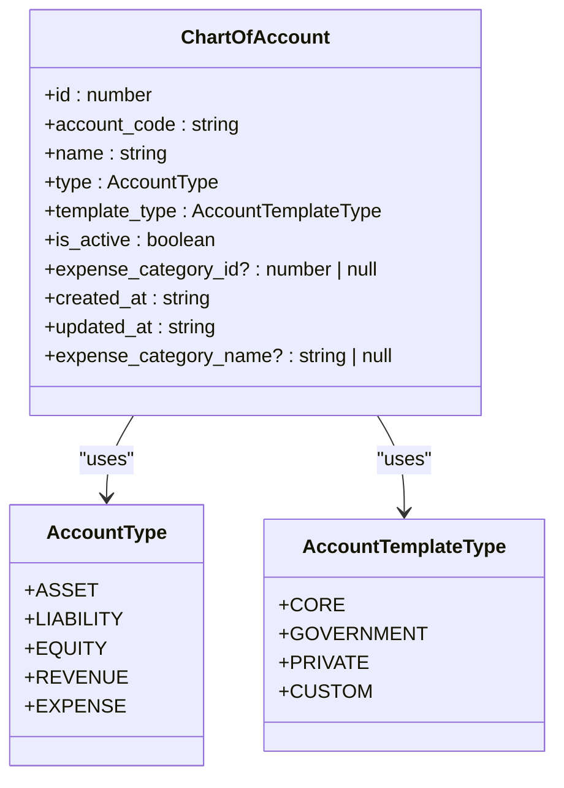
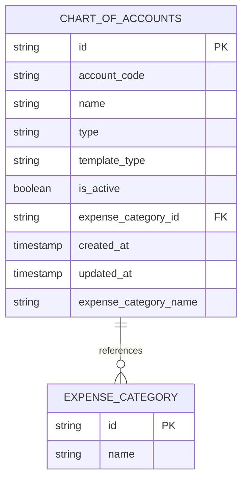
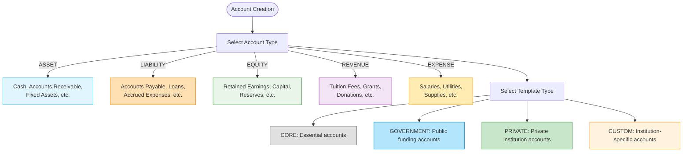
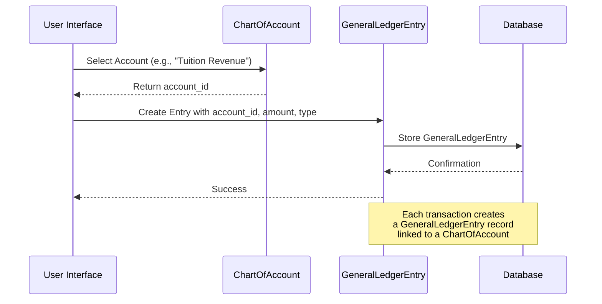
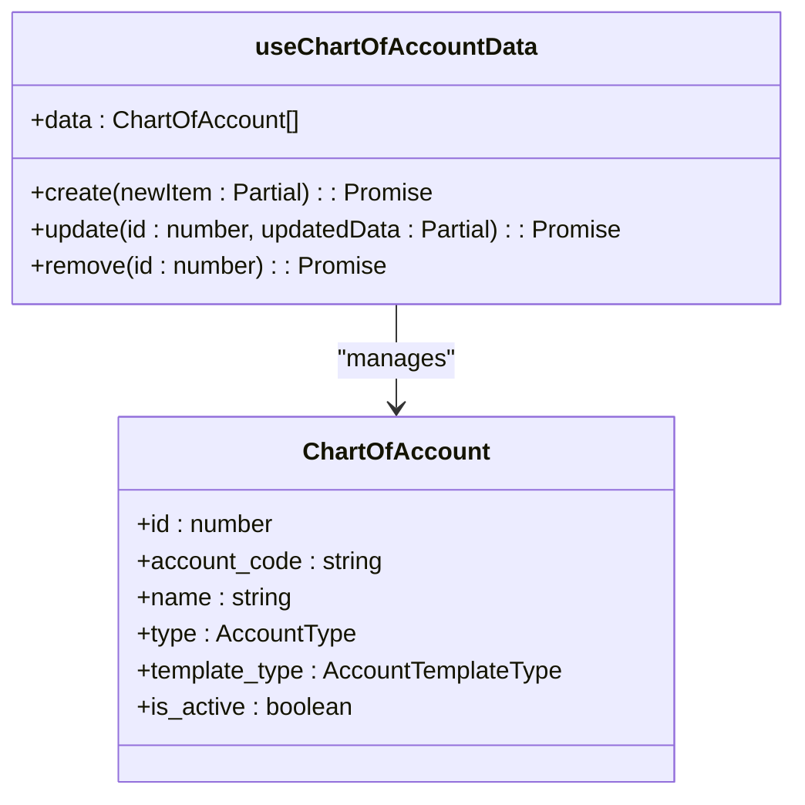

# Chart of Accounts Model

<cite>
**Referenced Files in This Document**   
- [types.ts](file://src/core/types.ts#L581-L593)
- [useChartOfAccountData.ts](file://src/modules/finance/data/useChartOfAccountData.ts#L0-L40)
- [schema.ts](file://src/modules/finance/data/schema.ts#L32-L58)
- [ChartOfAccountsPage.tsx](file://src/modules/finance/pages/ChartOfAccountsPage.tsx#L0-L199)
- [useGeneralLedgerEntryData.ts](file://src/modules/finance/data/useGeneralLedgerEntryData.ts#L0-L56)
</cite>

## Table of Contents
1. [Introduction](#introduction)
2. [Hierarchical Structure](#hierarchical-structure)
3. [Field Constraints and Validation Rules](#field-constraints-and-validation-rules)
4. [Account Type Classification](#account-type-classification)
5. [Linking to General Ledger Entries](#linking-to-general-ledger-entries)
6. [CRUD Operations via useChartOfAccountData Hook](#crud-operations-via-usechartofaccountdata-hook)
7. [Data Integrity and Validation Requirements](#data-integrity-and-validation-requirements)
8. [Standard Account Configurations](#standard-account-configurations)
9. [Conclusion](#conclusion)

## Introduction
The Chart of Accounts (COA) data model serves as the foundational structure for financial accounting within the SchoolPilot system. It provides a systematic framework for organizing financial transactions by defining accounts for assets, liabilities, equity, revenue, and expenses. This document details the implementation of the COA model, including its hierarchical structure, field constraints, integration with transaction posting through General Ledger Entries, and the mechanisms for data management via dedicated hooks. The model ensures data integrity through comprehensive validation rules and supports flexible account configurations for educational institutions.

**Section sources**
- [types.ts](file://src/core/types.ts#L581-L593)
- [ChartOfAccountsPage.tsx](file://src/modules/finance/pages/ChartOfAccountsPage.tsx#L0-L199)

## Hierarchical Structure
The Chart of Accounts model implements a flat structure with essential organizational attributes rather than a nested parent-child hierarchy. Each account is uniquely identified and categorized through key properties that enable logical grouping and reporting.

The primary structural components include:

- **account_code**: A unique identifier formatted as a string, used for referencing accounts in transactions and reports
- **name**: Descriptive name of the account for user identification
- **type**: Categorization of the account into one of five fundamental accounting types
- **template_type**: Classification indicating whether the account is core, government, private, or custom
- **is_active**: Boolean flag indicating whether the account is available for new transactions

While the model does not currently implement a parentAccount relationship for hierarchical nesting, the account_code field supports structured numbering that could facilitate hierarchical interpretation in reporting layers. The absence of explicit parent-child relationships simplifies data management while maintaining flexibility for financial reporting through the type and template_type classifications.



**Diagram sources**
- [types.ts](file://src/core/types.ts#L581-L593)
- [schema.ts](file://src/modules/finance/data/schema.ts#L32-L58)

**Section sources**
- [types.ts](file://src/core/types.ts#L581-L593)
- [schema.ts](file://src/modules/finance/data/schema.ts#L32-L58)

## Field Constraints and Validation Rules
The Chart of Accounts model enforces strict data integrity through comprehensive field constraints and validation rules defined in both the database schema and UI components.

### Schema-Level Constraints
The database schema defines the following constraints:

- **account_code**: Maximum length of 50 characters, required field
- **name**: Maximum length of 150 characters, required field
- **type**: Must be one of the predefined AccountType enum values (ASSET, LIABILITY, EQUITY, REVENUE, EXPENSE)
- **template_type**: Must be one of the predefined AccountTemplateType enum values (CORE, GOVERNMENT, PRIVATE, CUSTOM)
- **is_active**: Boolean value, required field
- **expense_category_id**: Optional string with maximum length of 100 characters



**Diagram sources**
- [schema.ts](file://src/modules/finance/data/schema.ts#L32-L58)

### UI-Level Validation
The ChartOfAccountsPage component implements additional client-side validation:

- **Required fields**: Account Code, Name, Type, and Template Type must be provided
- **Form validation**: The handleSubmit function checks for required fields before processing
- **User feedback**: Clear error messages are displayed when validation fails
- **Default values**: New accounts are initialized with default values for is_active (true) and template_type (CUSTOM)

The validation process ensures that all accounts have the necessary information for proper financial reporting and transaction posting.

**Section sources**
- [schema.ts](file://src/modules/finance/data/schema.ts#L32-L58)
- [ChartOfAccountsPage.tsx](file://src/modules/finance/pages/ChartOfAccountsPage.tsx#L68-L107)

## Account Type Classification
The Chart of Accounts model categorizes accounts into five fundamental accounting types, each serving a specific purpose in financial reporting and analysis.

### Account Types
The AccountType enum defines the following categories:

- **ASSET**: Resources owned by the institution (e.g., cash, accounts receivable, equipment)
- **LIABILITY**: Obligations owed by the institution (e.g., accounts payable, loans)
- **EQUITY**: Owner's interest in the institution (e.g., retained earnings, capital contributions)
- **REVENUE**: Income generated by the institution (e.g., tuition fees, grants)
- **EXPENSE**: Costs incurred by the institution (e.g., salaries, utilities, supplies)

### Template Types
The AccountTemplateType enum provides additional classification:

- **CORE**: Essential accounts required for basic financial operations
- **GOVERNMENT**: Accounts specific to government-funded institutions
- **PRIVATE**: Accounts specific to private institutions
- **CUSTOM**: Institution-specific accounts created to meet unique requirements

This dual classification system enables flexible account management while maintaining consistency with accounting standards.



**Diagram sources**
- [types.ts](file://src/core/types.ts#L581-L593)

**Section sources**
- [types.ts](file://src/core/types.ts#L581-L593)

## Linking to General Ledger Entries
The Chart of Accounts model integrates with transaction processing through the GeneralLedgerEntry model, enabling accurate financial reporting and audit trails.

### Relationship Structure
The connection between Chart of Accounts and General Ledger Entries is established through the account_id field:

- **GeneralLedgerEntry.account_id**: References the ChartOfAccount.id
- **Debit/Credit amounts**: Posted to the specified account
- **Transaction metadata**: Includes dates, descriptions, and source references

### Data Flow
When a financial transaction occurs:

1. The system identifies the appropriate Chart of Account
2. Creates a GeneralLedgerEntry with the account_id
3. Posts the debit or credit amount to the account
4. Updates account balances through reporting queries



**Diagram sources**
- [types.ts](file://src/core/types.ts#L844-L857)
- [useGeneralLedgerEntryData.ts](file://src/modules/finance/data/useGeneralLedgerEntryData.ts#L0-L56)

**Section sources**
- [types.ts](file://src/core/types.ts#L844-L857)
- [useGeneralLedgerEntryData.ts](file://src/modules/finance/data/useGeneralLedgerEntryData.ts#L0-L56)

## CRUD Operations via useChartOfAccountData Hook
The useChartOfAccountData hook provides a self-contained interface for managing Chart of Accounts data with comprehensive CRUD operations.

### Hook Implementation
The hook implements the following operations:

```typescript
export const useChartOfAccountData = () => {
  const [data, setData] = useState<ChartOfAccount[]>(initialMockChartOfAccounts);

  const create = async (newItem: Partial<ChartOfAccount>) => {
    const newDataItem: ChartOfAccount = {
      ...newItem,
      id: Date.now(),
      created_at: new Date().toISOString(),
      updated_at: new Date().toISOString()
    } as ChartOfAccount;
    setData((prev: ChartOfAccount[]) => [...prev, newDataItem]);
    return newDataItem;
  };

  const update = async (id: number, updatedData: Partial<ChartOfAccount>) => {
    setData((prev: ChartOfAccount[]) => prev.map((item: ChartOfAccount) => 
      item.id === id 
        ? { ...item, ...updatedData, updated_at: new Date().toISOString() }
        : item
    ));
  };

  const remove = async (id: number) => {
    setData((prev: ChartOfAccount[]) => prev.filter((item: ChartOfAccount) => item.id !== id));
  };

  return {
    data,
    create,
    update,
    remove
  };
};
```

### Operation Details
- **Create**: Generates a new account with current timestamps and unique ID
- **Update**: Modifies existing account and updates the timestamp
- **Remove**: Filters out the specified account from the dataset
- **Data Management**: Uses React state for client-side data persistence

The hook operates independently of AppDataContext, making it reusable across different components and contexts.



**Diagram sources**
- [useChartOfAccountData.ts](file://src/modules/finance/data/useChartOfAccountData.ts#L0-L40)

**Section sources**
- [useChartOfAccountData.ts](file://src/modules/finance/data/useChartOfAccountData.ts#L0-L40)

## Data Integrity and Validation Requirements
The Chart of Accounts model enforces data integrity through multiple layers of validation and constraints.

### Required Fields
The following fields are mandatory for all accounts:
- **id**: Unique identifier
- **account_code**: Account code
- **name**: Account name
- **type**: Account type
- **template_type**: Template type
- **is_active**: Active status
- **created_at**: Creation timestamp
- **updated_at**: Last update timestamp

### Validation Rules
- **Account Code Uniqueness**: Each account code must be unique within the system
- **Type Constraints**: Account type must be one of the five predefined values
- **Template Constraints**: Template type must be one of the four predefined values
- **Length Constraints**: Field lengths are enforced as defined in the schema
- **Timestamp Management**: created_at and updated_at are automatically managed

### Error Handling
The system implements the following error handling mechanisms:
- **Client-side validation**: Immediate feedback on form submission
- **Server-side validation**: Database schema enforcement
- **User confirmation**: Required for account deletion
- **Consistency checks**: Validation of related entities before operations

These rules ensure the integrity of the financial data and prevent common data entry errors.

**Section sources**
- [schema.ts](file://src/modules/finance/data/schema.ts#L32-L58)
- [ChartOfAccountsPage.tsx](file://src/modules/finance/pages/ChartOfAccountsPage.tsx#L68-L107)

## Standard Account Configurations
The system supports various standard account configurations through the template_type classification.

### Core Accounts
Essential accounts required for basic financial operations:
- **1000**: Cash in Bank
- **1100**: Accounts Receivable
- **1200**: Prepaid Expenses
- **2000**: Accounts Payable
- **3000**: Equity
- **4000**: Tuition Revenue
- **5000**: Salaries Expense
- **5100**: Utilities Expense

### Government Accounts
Additional accounts for government-funded institutions:
- **1300**: Government Grants Receivable
- **2100**: Government Liabilities
- **4100**: Government Grant Revenue

### Private Accounts
Accounts specific to private institutions:
- **4200**: Donation Revenue
- **4300**: Investment Income
- **5200**: Marketing Expenses

### Custom Accounts
Institution-specific accounts that can be created as needed:
- **Custom Revenue Accounts**: For specialized income streams
- **Custom Expense Accounts**: For unique cost centers
- **Custom Asset/Liability Accounts**: For specific institutional needs

These standard configurations provide a foundation for financial management while allowing flexibility for institutional requirements.

**Section sources**
- [types.ts](file://src/core/types.ts#L581-L593)
- [schema.ts](file://src/modules/finance/data/schema.ts#L32-L58)

## Conclusion
The Chart of Accounts model in the SchoolPilot system provides a robust foundation for financial management in educational institutions. The model implements a comprehensive structure with clear account classifications, strict validation rules, and seamless integration with transaction processing through General Ledger Entries. The useChartOfAccountData hook enables efficient CRUD operations, while the multi-layered validation system ensures data integrity. Although the current implementation uses a flat structure without explicit parent-child relationships, the account_code and type fields provide sufficient information for hierarchical reporting and financial analysis. This design balances simplicity with functionality, supporting both standard accounting practices and institution-specific requirements.