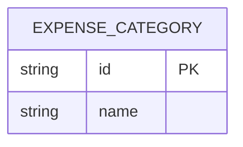
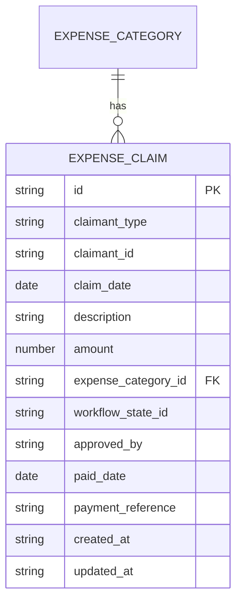
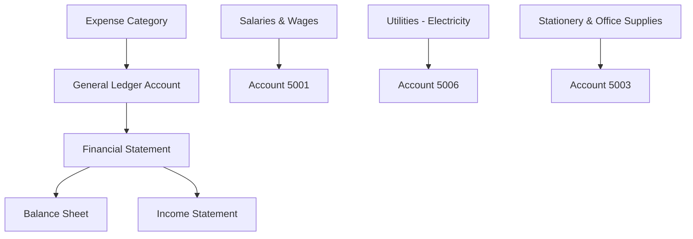
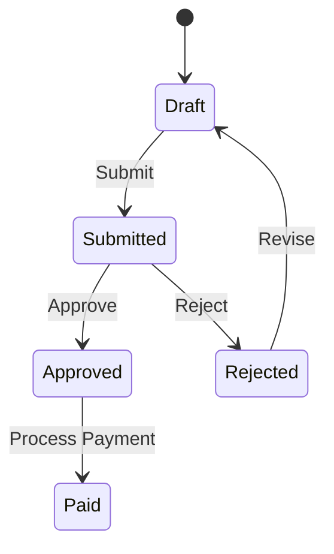
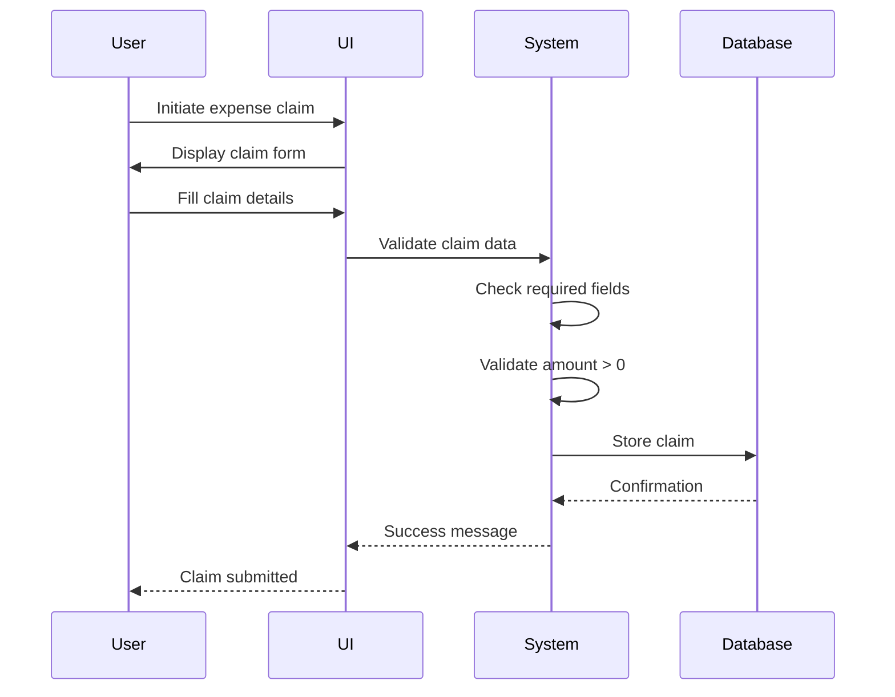
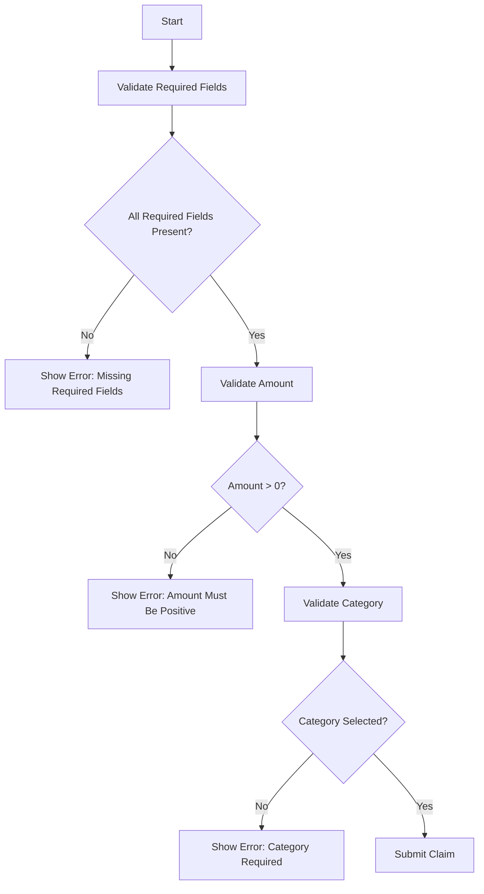
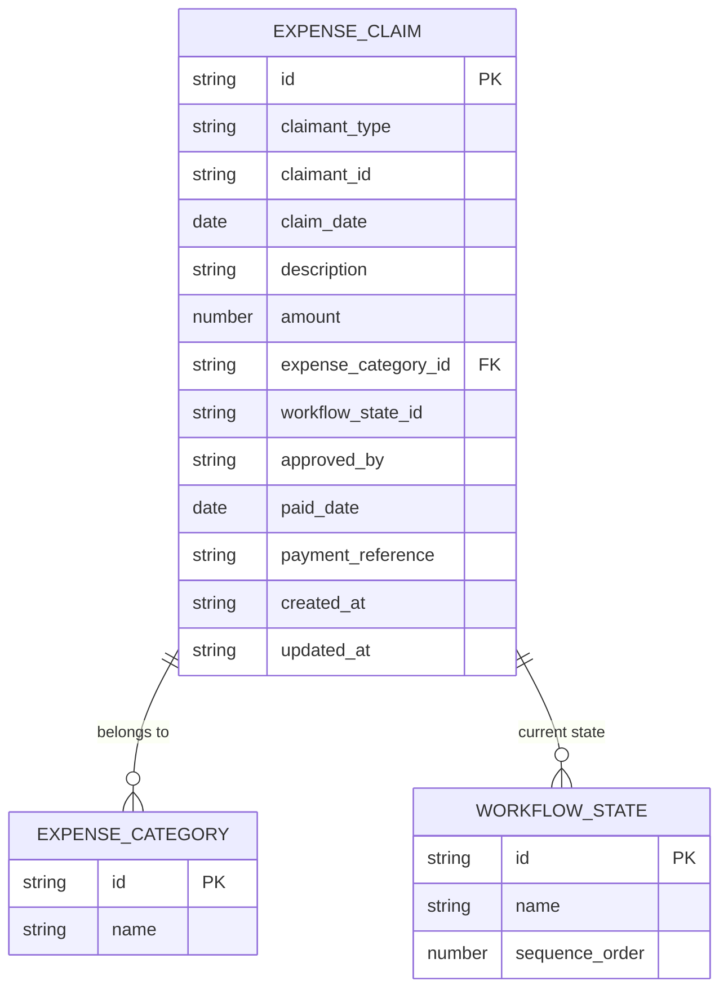
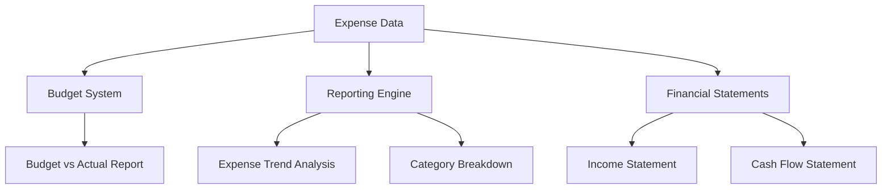

# Expense Model

<cite>
**Referenced Files in This Document**   
- [expenseCategoriesSchema](file://src/modules/finance/data/schema.ts#L78-L83)
- [expenseClaimsSchema](file://src/modules/finance/data/schema.ts#L143-L166)
- [ChartOfAccountsPage.tsx](file://src/modules/finance/pages/ChartOfAccountsPage.tsx#L265-L282)
- [ExpensesPage.tsx](file://src/modules/finance/pages/ExpensesPage.tsx#L94-L138)
- [types.ts](file://src/modules/finance/data/types.ts#L30-L35)
- [useExpenseCategoryData.ts](file://src/modules/finance/data/useExpenseCategoryData.ts)
- [useChartOfAccountData.ts](file://src/modules/finance/data/useChartOfAccountData.ts)
- [SettingsWorkflowsPage.tsx](file://src/modules/settings/pages/SettingsWorkflowsPage.tsx)
</cite>

## Table of Contents
1. [Introduction](#introduction)
2. [Expense Data Model](#expense-data-model)
3. [Expense Categories and Chart of Accounts](#expense-categories-and-chart-of-accounts)
4. [Expense Claim Workflow](#expense-claim-workflow)
5. [Validation Rules](#validation-rules)
6. [Audit and Compliance](#audit-and-compliance)
7. [Integration with Budgeting and Reporting](#integration-with-budgeting-and-reporting)

## Introduction
The Expense Model in the school management system provides a comprehensive framework for tracking, managing, and reporting on financial expenditures. This documentation details the data model, workflow, validation rules, and integration points for expense tracking and claims processing. The system supports hierarchical expense categories, workflow-based approval processes, and integration with the Chart of Accounts for financial reporting.

**Section sources**
- [ExpensesPage.tsx](file://src/modules/finance/pages/ExpensesPage.tsx#L1-L33)
- [types.ts](file://src/modules/finance/data/types.ts#L30-L35)

## Expense Data Model
The expense data model consists of two primary entities: expense categories and expense claims. The model is designed to capture all necessary information for financial tracking and reporting.

### Expense Category Schema
The expense category schema defines the structure for categorizing expenses:

**Diagram sources**
- [expenseCategoriesSchema](file://src/modules/finance/data/schema.ts#L78-L83)
- [types.ts](file://src/modules/finance/data/types.ts#L30-L35)

**Section sources**
- [expenseCategoriesSchema](file://src/modules/finance/data/schema.ts#L78-L83)
- [types.ts](file://src/modules/finance/data/types.ts#L30-L35)

### Expense Claim Schema
The expense claim schema captures detailed information about individual expense submissions:

**Diagram sources**
- [expenseClaimsSchema](file://src/modules/finance/data/schema.ts#L143-L166)
- [types.ts](file://src/modules/finance/data/types.ts#L50-L65)

**Section sources**
- [expenseClaimsSchema](file://src/modules/finance/data/schema.ts#L143-L166)
- [types.ts](file://src/modules/finance/data/types.ts#L50-L65)

## Expense Categories and Chart of Accounts
The system implements a hierarchical structure for expense categories that maps directly to the Chart of Accounts for financial reporting purposes.

### Category Hierarchy
Expense categories are organized in a flat structure with predefined types that align with standard accounting practices:

- **Stationery**
- **Repairs & Maintenance**
- **Utilities**
- **Travel**
- **Staff Welfare**
- **Teaching Materials**
- **Laboratory Supplies**
- **Sports & Recreation**
- **Transport & Fuel**
- **Professional Services**
- **Insurance**
- **Marketing & Advertising**
- **Security Services**
- **Communication**
- **Food & Catering**

### Chart of Accounts Integration
Each expense category is mapped to one or more general ledger accounts in the Chart of Accounts. This mapping ensures proper financial classification and reporting.

**Diagram sources**
- [ChartOfAccountsPage.tsx](file://src/modules/finance/pages/ChartOfAccountsPage.tsx#L265-L282)
- [schema.ts](file://src/modules/finance/data/schema.ts#L58-L77)

**Section sources**
- [ChartOfAccountsPage.tsx](file://src/modules/finance/pages/ChartOfAccountsPage.tsx#L265-L282)
- [schema.ts](file://src/modules/finance/data/schema.ts#L58-L77)

## Expense Claim Workflow
The expense claim workflow follows a structured process from submission to payment, with support for approval workflows.

### Workflow States
The system supports configurable workflow states for expense claims, though the implementation is currently pending:

**Diagram sources**
- [SettingsWorkflowsPage.tsx](file://src/modules/settings/pages/SettingsWorkflowsPage.tsx#L106-L140)
- [expenseClaimsSchema](file://src/modules/finance/data/schema.ts#L143-L166)

**Section sources**
- [SettingsWorkflowsPage.tsx](file://src/modules/settings/pages/SettingsWorkflowsPage.tsx#L106-L140)
- [expenseClaimsSchema](file://src/modules/finance/data/schema.ts#L143-L166)

### Claim Submission Process
The expense claim submission process involves the following steps:

1. User selects claimant type (Staff or Student)
2. User selects claimant from available options
3. User enters claim date, amount, description, and selects expense category
4. System validates input and submits claim
5. Claim enters workflow for approval
6. Upon approval, claim can be processed for payment

**Diagram sources**
- [ExpensesPage.tsx](file://src/modules/finance/pages/ExpensesPage.tsx#L94-L138)
- [expenseClaimsSchema](file://src/modules/finance/data/schema.ts#L143-L166)

**Section sources**
- [ExpensesPage.tsx](file://src/modules/finance/pages/ExpensesPage.tsx#L94-L138)

## Validation Rules
The system enforces several validation rules to ensure data integrity and compliance with financial policies.

### Field-Level Validation
The following validation rules are applied to expense claims:

- **Claimant**: Required field
- **Claim Date**: Required field
- **Amount**: Required field, must be greater than 0
- **Description**: Required field
- **Expense Category**: Required field
- **Amount**: Minimum value of 0.01, maximum value of 999,999.99

**Diagram sources**
- [ExpensesPage.tsx](file://src/modules/finance/pages/ExpensesPage.tsx#L94-L138)
- [schema.ts](file://src/modules/finance/data/schema.ts#L143-L166)

**Section sources**
- [ExpensesPage.tsx](file://src/modules/finance/pages/ExpensesPage.tsx#L94-L138)

## Audit and Compliance
The system includes several features to support financial audit and compliance requirements.

### Audit Trail
The system maintains a complete audit trail for all expense transactions:

- **Creation Timestamp**: When the expense claim was created
- **Update Timestamp**: When the expense claim was last modified
- **Workflow History**: Record of state changes in the approval process
- **Approval Records**: Who approved the expense and when

### Data Integrity
The system ensures data integrity through:

- **Immutable Records**: Once an expense is approved, it cannot be deleted
- **Change Tracking**: All modifications are tracked with timestamps
- **Referential Integrity**: Foreign key constraints between related entities
- **Data Validation**: Server-side validation of all inputs

**Diagram sources**
- [expenseClaimsSchema](file://src/modules/finance/data/schema.ts#L143-L166)
- [expenseCategoriesSchema](file://src/modules/finance/data/schema.ts#L78-L83)
- [workflowStateSchema](file://src/services/rxdbService.ts#L83-L84)

**Section sources**
- [expenseClaimsSchema](file://src/modules/finance/data/schema.ts#L143-L166)

## Integration with Budgeting and Reporting
The expense model integrates with budgeting and reporting systems to provide comprehensive financial insights.

### Budget Integration
Expense data is used to track actual spending against budgeted amounts:

- **Category-Level Budgeting**: Budgets can be set for each expense category
- **Periodic Reporting**: Monthly, quarterly, and annual expense reports
- **Variance Analysis**: Comparison of actual vs. budgeted expenses
- **Forecasting**: Predictive analysis based on historical spending patterns

### Financial Reporting
The system generates various financial reports based on expense data:

- **Expense Summary Report**: Total expenses by category
- **Trend Analysis**: Expense trends over time
- **Departmental Reports**: Expenses by department or cost center
- **Vendor Analysis**: Spending by supplier or service provider

**Diagram sources**
- [expenseClaimsSchema](file://src/modules/finance/data/schema.ts#L143-L166)
- [chartOfAccountsSchema](file://src/modules/finance/data/schema.ts#L58-L77)

**Section sources**
- [expenseClaimsSchema](file://src/modules/finance/data/schema.ts#L143-L166)
- [chartOfAccountsSchema](file://src/modules/finance/data/schema.ts#L58-L77)