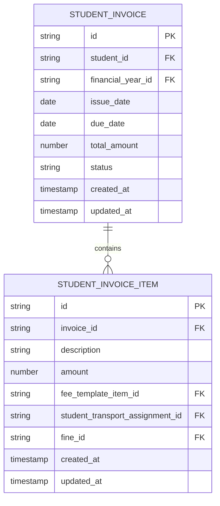
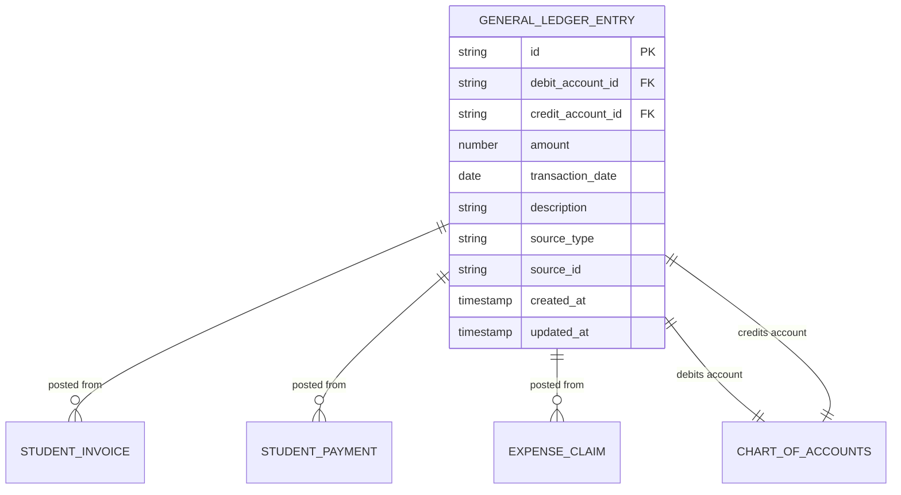
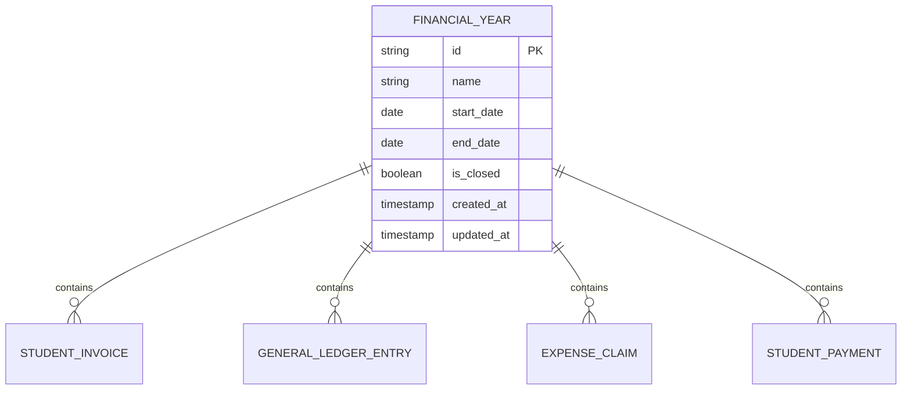
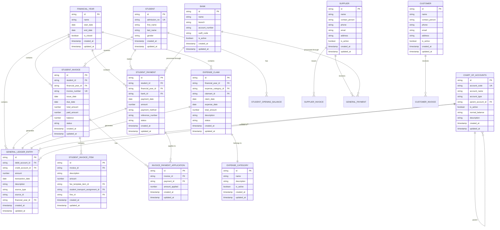
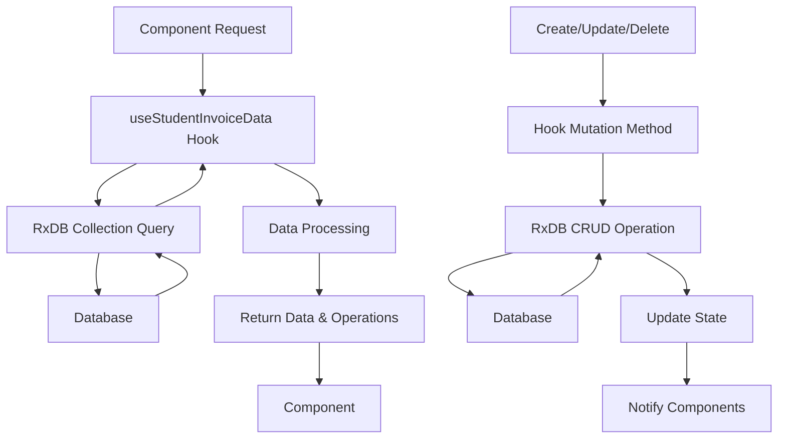
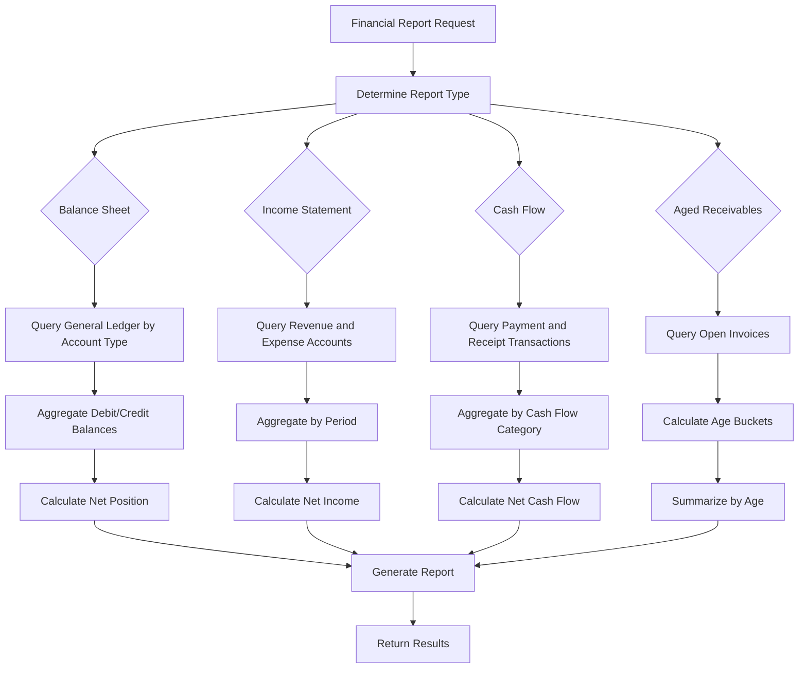

# Financial Data Model

<cite>
**Referenced Files in This Document**   
- [databaseAgnosticSchema.ts](file://src/utils/databaseAgnosticSchema.ts)
- [rxdbService.ts](file://src/services/rxdbService.ts)
- [useStudentInvoiceData.ts](file://src/modules/finance/data/useStudentInvoiceData.ts)
- [useStudentInvoiceItemData.ts](file://src/modules/finance/data/useStudentInvoiceItemData.ts)
- [useGeneralLedgerEntryData.ts](file://src/modules/finance/data/useGeneralLedgerEntryData.ts)
- [collections.ts](file://src/modules/finance/data/collections.ts)
- [schema.ts](file://src/modules/finance/data/schema.ts)
- [types.ts](file://src/modules/finance/data/types.ts)
</cite>

## Table of Contents
1. [Introduction](#introduction)
2. [Core Financial Entities](#core-financial-entities)
3. [Entity Relationships](#entity-relationships)
4. [Field Definitions and Constraints](#field-definitions-and-constraints)
5. [Database Schema Diagram](#database-schema-diagram)
6. [Data Access Patterns](#data-access-patterns)
7. [Business Logic and Validation Rules](#business-logic-and-validation-rules)
8. [Performance Considerations](#performance-considerations)

## Introduction
This document provides comprehensive documentation for the Finance module's core data model within the EduGen school management system. The financial data model is designed to support essential accounting functions including financial year management, chart of accounts, general ledger entries, invoicing, payments, and expense tracking. The system leverages RxDB as the primary database engine with a modular architecture that separates data definitions, access patterns, and business logic. This documentation details the schema definitions, entity relationships, field constraints, and data access patterns that form the foundation of the financial management system.

## Core Financial Entities

The Finance module comprises several core entities that work together to manage financial operations within the educational institution. These entities are defined using a database-agnostic schema approach that allows compatibility with both RxDB and PouchDB storage engines.

### Financial Years
The **Financial Year** entity represents accounting periods used for financial reporting and budgeting. Each financial year has a defined start and end date, and serves as a temporal boundary for financial transactions.

### Chart of Accounts
The **Chart of Accounts** entity defines the accounting categories used to classify financial transactions. This hierarchical structure enables organized tracking of assets, liabilities, equity, revenue, and expenses.

### General Ledger Entries
The **General Ledger Entry** entity records individual accounting transactions that affect the organization's financial position. Each entry follows double-entry accounting principles with debit and credit amounts.

### Invoices
The **Invoice** entity manages billing documents issued to students and customers. The system supports both student-specific invoices and general customer invoices.

### Payments
The **Payment** entity tracks incoming and outgoing financial transactions, including student fee payments, supplier payments, and general receipts.

### Expense Tracking
The **Expense Claim** entity manages organizational expenses, including categorization, approval workflows, and payment processing.

**Section sources**
- [types.ts](file://src/modules/finance/data/types.ts)
- [schema.ts](file://src/modules/finance/data/schema.ts)

## Entity Relationships

The financial data model implements a relational structure with well-defined relationships between entities to ensure data integrity and support complex financial operations.

### Student Invoice and Invoice Item Relationship
The **StudentInvoiceData** entity maintains a one-to-many relationship with **StudentInvoiceItemData**. Each student invoice can contain multiple invoice items, representing individual fee components or charges.



**Diagram sources**
- [useStudentInvoiceData.ts](file://src/modules/finance/data/useStudentInvoiceData.ts)
- [useStudentInvoiceItemData.ts](file://src/modules/finance/data/useStudentInvoiceItemData.ts)

### General Ledger Integration
The **GeneralLedgerEntryData** entity serves as the central accounting record that connects various financial transactions. Invoice payments, expense claims, and other financial activities generate corresponding general ledger entries to maintain accounting accuracy.



**Diagram sources**
- [useGeneralLedgerEntryData.ts](file://src/modules/finance/data/useGeneralLedgerEntryData.ts)
- [useStudentInvoiceData.ts](file://src/modules/finance/data/useStudentInvoiceData.ts)
- [useStudentPaymentData.ts](file://src/modules/finance/data/useStudentPaymentData.ts)

### Financial Year Context
All financial transactions are contextualized within a specific **Financial Year**. This relationship ensures proper period accounting and supports year-end closing procedures.



**Diagram sources**
- [useFinancialYearData.ts](file://src/modules/finance/data/useFinancialYearData.ts)
- [useStudentInvoiceData.ts](file://src/modules/finance/data/useStudentInvoiceData.ts)

## Field Definitions and Constraints

This section details the field definitions, data types, primary/foreign keys, and constraints for the core financial entities.

### Financial Year Schema
The Financial Year entity contains the following fields:

**FinancialYearType**
- **id**: string - Primary key, unique identifier (UUID format)
- **name**: string - Descriptive name of the financial year (e.g., "2023-2024")
- **start_date**: date - Beginning date of the financial year
- **end_date**: date - Ending date of the financial year
- **is_closed**: boolean - Indicates whether the financial year is closed for transactions
- **created_at**: timestamp - Creation timestamp
- **updated_at**: timestamp - Last modification timestamp

**Constraints**: 
- Primary Key: id
- Required Fields: id, name, start_date, end_date, created_at, updated_at
- Date Validation: start_date must be before end_date

### Chart of Accounts Schema
The Chart of Accounts entity contains the following fields:

**ChartOfAccountType**
- **id**: string - Primary key, unique identifier (UUID format)
- **account_code**: string - Unique accounting code for the account
- **account_name**: string - Descriptive name of the account
- **account_type**: enum - Type of account (Asset, Liability, Equity, Revenue, Expense)
- **parent_account_id**: string - Reference to parent account for hierarchical structure
- **is_active**: boolean - Indicates whether the account is active for transactions
- **normal_balance**: enum - Normal balance side (Debit or Credit)
- **description**: string - Detailed description of the account purpose
- **created_at**: timestamp - Creation timestamp
- **updated_at**: timestamp - Last modification timestamp

**Constraints**:
- Primary Key: id
- Unique Constraint: account_code
- Required Fields: id, account_code, account_name, account_type, normal_balance, created_at, updated_at

### General Ledger Entry Schema
The General Ledger Entry entity contains the following fields:

**GeneralLedgerEntryType**
- **id**: string - Primary key, unique identifier (UUID format)
- **debit_account_id**: string - Foreign key to Chart of Accounts (debit side)
- **credit_account_id**: string - Foreign key to Chart of Accounts (credit side)
- **amount**: number - Monetary amount of the transaction
- **transaction_date**: date - Date when the transaction occurred
- **description**: string - Narrative description of the transaction
- **source_type**: string - Type of source document (Invoice, Payment, Expense, etc.)
- **source_id**: string - Reference to the source document ID
- **financial_year_id**: string - Foreign key to Financial Year
- **created_at**: timestamp - Creation timestamp
- **updated_at**: timestamp - Last modification timestamp

**Constraints**:
- Primary Key: id
- Required Fields: id, debit_account_id, credit_account_id, amount, transaction_date, source_type, source_id, financial_year_id, created_at, updated_at
- Business Rule: debit_account_id cannot equal credit_account_id
- Validation: amount must be greater than zero

### Student Invoice Schema
The Student Invoice entity contains the following fields:

**StudentInvoiceType**
- **id**: string - Primary key, unique identifier (UUID format)
- **student_id**: string - Foreign key to Student entity
- **financial_year_id**: string - Foreign key to Financial Year
- **invoice_number**: string - Unique invoice identifier
- **issue_date**: date - Date when the invoice was issued
- **due_date**: date - Payment due date
- **total_amount**: number - Sum of all invoice items
- **paid_amount**: number - Amount already paid
- **balance**: number - Outstanding balance (total_amount - paid_amount)
- **status**: enum - Invoice status (Draft, Issued, Partially Paid, Paid, Overdue, Cancelled)
- **created_at**: timestamp - Creation timestamp
- **updated_at**: timestamp - Last modification timestamp

**Constraints**:
- Primary Key: id
- Unique Constraint: invoice_number
- Required Fields: id, student_id, financial_year_id, issue_date, due_date, total_amount, status, created_at, updated_at
- Business Rule: due_date must be on or after issue_date

### Student Invoice Item Schema
The Student Invoice Item entity contains the following fields:

**StudentInvoiceItemType**
- **id**: string - Primary key, unique identifier (UUID format)
- **invoice_id**: string - Foreign key to Student Invoice
- **description**: string - Description of the fee or charge
- **amount**: number - Monetary amount of the item
- **fee_template_item_id**: string - Reference to fee template item
- **student_transport_assignment_id**: string - Reference to transport assignment (if applicable)
- **fine_id**: string - Reference to fine (if applicable)
- **created_at**: timestamp - Creation timestamp
- **updated_at**: timestamp - Last modification timestamp

**Constraints**:
- Primary Key: id
- Required Fields: id, invoice_id, description, amount, created_at, updated_at
- Business Rule: At least one of fee_template_item_id, student_transport_assignment_id, or fine_id should be populated

**Section sources**
- [types.ts](file://src/modules/finance/data/types.ts)
- [schema.ts](file://src/modules/finance/data/schema.ts)

## Database Schema Diagram

The following entity-relationship diagram illustrates the complete financial data model with all core entities and their relationships:



**Diagram sources**
- [schema.ts](file://src/modules/finance/data/schema.ts)
- [types.ts](file://src/modules/finance/data/types.ts)

## Data Access Patterns

The financial data model implements a consistent data access pattern using React hooks and RxDB collections to provide CRUD operations while maintaining separation of concerns.

### RxDB Collections Configuration
The finance module's collections are defined in the central RxDB service, which imports and merges module-specific collections:

```typescript
// rxdbService.ts - Collections definition
export const collectionsDefinition: Record<string, { schema: RxJsonSchema<any> }> = { 
  // Core collections
  app_settings: { schema: appSettingsSchema },
  // ... other core collections
  
  // Module collections
  ...financeCollections,
};
```

The `financeCollections` object is imported from the finance module's data layer and contains all financial entity schemas converted to RxDB format.

### React Hooks for Data Management
Each financial entity has a corresponding React hook that provides a clean API for data operations:



**Diagram sources**
- [rxdbService.ts](file://src/services/rxdbService.ts)
- [useStudentInvoiceData.ts](file://src/modules/finance/data/useStudentInvoiceData.ts)

### Hook Implementation Pattern
The data hooks follow a consistent implementation pattern that abstracts the underlying database operations:

```typescript
// useStudentInvoiceData.ts
const useStudentInvoiceData = () => {
  const [studentInvoices, setStudentInvoices] = useState<any[]>([]);
  const [isLoading, setIsLoading] = useState<boolean>(true);
  const [error, setError] = useState<string | null>(null);

  useEffect(() => {
    // Data loading logic
  }, []);

  const create = async (newItem: Partial<any>) => {
    // Create operation
  };

  const update = async (id: number, updatedData: Partial<any>) => {
    // Update operation
  };

  const remove = async (id: number) => {
    // Delete operation
  };

  return {
    data: studentInvoices,
    isLoading,
    error,
    create,
    update,
    remove
  };
};
```

This pattern provides a simple interface for components while encapsulating the complexity of database interactions.

**Section sources**
- [rxdbService.ts](file://src/services/rxdbService.ts)
- [useStudentInvoiceData.ts](file://src/modules/finance/data/useStudentInvoiceData.ts)
- [useStudentInvoiceItemData.ts](file://src/modules/finance/data/useStudentInvoiceItemData.ts)
- [useGeneralLedgerEntryData.ts](file://src/modules/finance/data/useGeneralLedgerEntryData.ts)

## Business Logic and Validation Rules

The financial data model enforces several business rules and validation constraints to ensure data integrity and accounting accuracy.

### Referential Integrity Requirements
The system maintains strict referential integrity through foreign key relationships:

- All financial transactions must reference a valid **Financial Year**
- **General Ledger Entries** must reference valid **Chart of Accounts** for both debit and credit accounts
- **Student Invoices** must reference existing **Students**
- **Invoice Items** must reference their parent **Invoice**
- **Payment Applications** must reference both a valid **Invoice** and **Payment**

### Data Validation Rules
The system implements comprehensive validation at both the schema and application levels:

**Schema-Level Validation**
- UUID format validation for all ID fields
- Date format validation for temporal fields
- Numeric range validation for monetary amounts
- Enum validation for status fields
- Required field validation for critical data

**Business Logic Validation**
- **Invoice Balance Calculation**: The balance field is automatically calculated as total_amount minus paid_amount
- **Double-Entry Accounting**: Every **General Ledger Entry** must have equal debit and credit amounts across related entries
- **Financial Year Boundaries**: Transactions cannot be recorded outside the active financial year
- **Payment Application**: The total amount applied to an invoice cannot exceed the invoice balance
- **Account Hierarchy**: Chart of accounts parent-child relationships must not create circular references

### Automatic Field Population
The system automatically populates certain fields to reduce data entry errors:

- **created_at** and **updated_at** timestamps are automatically set on record creation and modification
- **id** fields are automatically generated using UUIDs
- **status** fields are automatically updated based on business rules (e.g., invoice status changes to "Paid" when balance reaches zero)

**Section sources**
- [databaseAgnosticSchema.ts](file://src/utils/databaseAgnosticSchema.ts)
- [schema.ts](file://src/modules/finance/data/schema.ts)
- [useStudentInvoiceData.ts](file://src/modules/finance/data/useStudentInvoiceData.ts)

## Performance Considerations

The financial data model incorporates several performance optimizations to support efficient financial reporting and querying.

### Indexing Strategies
The system implements strategic indexing on frequently queried fields:

- **Financial Years**: Indexed on start_date and end_date for period-based queries
- **Student Invoices**: Indexed on student_id, financial_year_id, and status for student-specific and status-based queries
- **General Ledger Entries**: Indexed on transaction_date, debit_account_id, credit_account_id, and financial_year_id for accounting reports
- **Payments**: Indexed on payment_date and student_id for cash flow analysis

### Financial Reporting Queries
The data model supports efficient financial reporting through optimized query patterns:



**Diagram sources**
- [rxdbService.ts](file://src/services/rxdbService.ts)
- [useGeneralLedgerEntryData.ts](file://src/modules/finance/data/useGeneralLedgerEntryData.ts)

### Data Access Optimization
The system employs several optimization techniques:

- **Batch Operations**: Bulk insert and update operations are used for data imports and migrations
- **Caching Strategy**: Frequently accessed reference data (Chart of Accounts, Financial Years) is cached in memory
- **Lazy Loading**: Large result sets are paginated to improve UI responsiveness
- **Query Optimization**: Complex financial reports use indexed fields and optimized query patterns

These performance considerations ensure that the financial system can handle large volumes of transactions while maintaining responsive user interfaces for financial reporting and analysis.

**Section sources**
- [rxdbService.ts](file://src/services/rxdbService.ts)
- [databaseAgnosticSchema.ts](file://src/utils/databaseAgnosticSchema.ts)