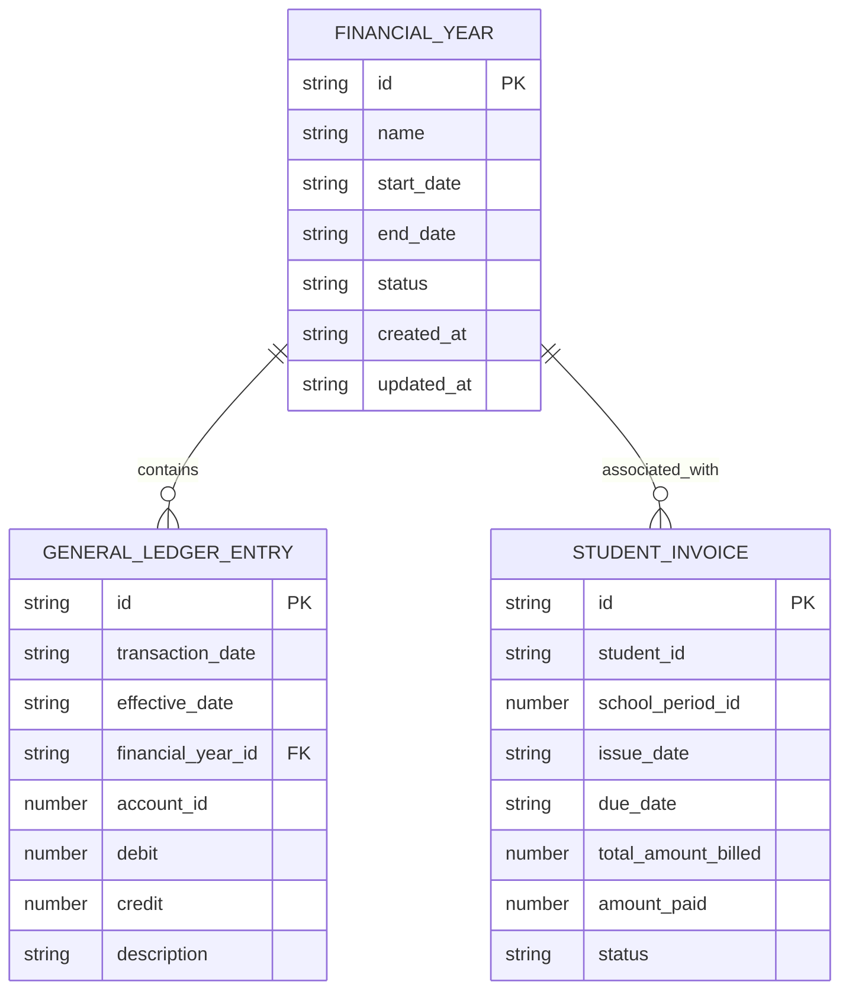
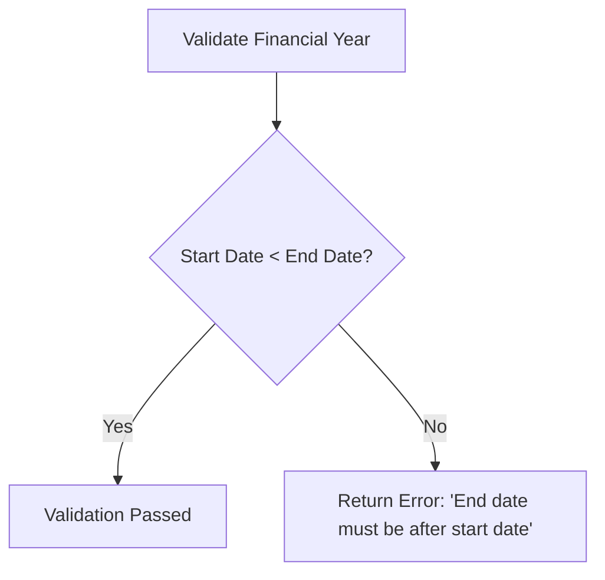
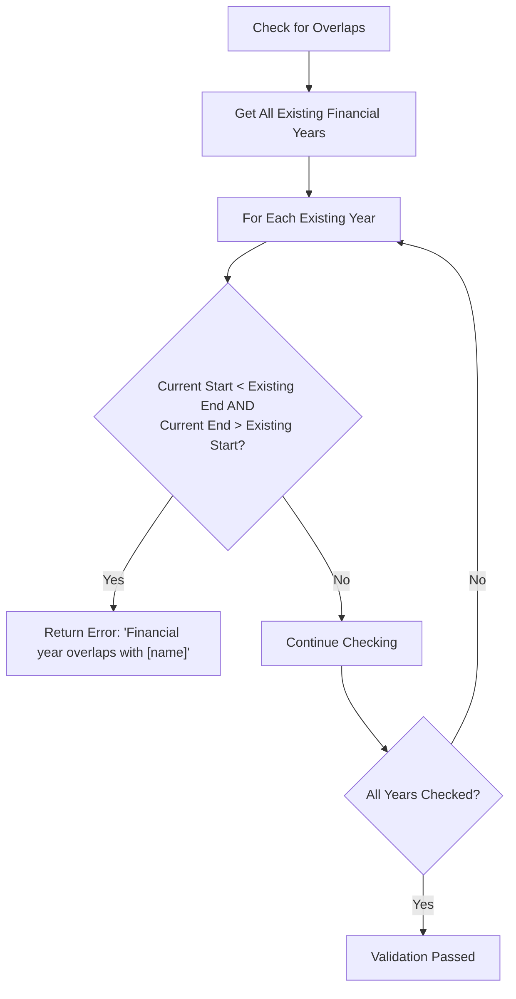
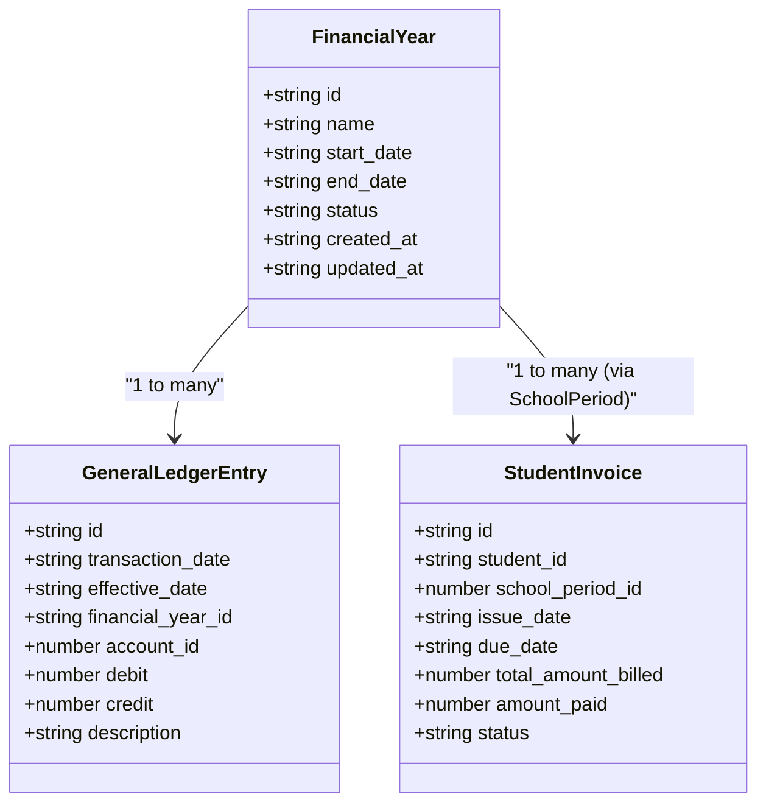
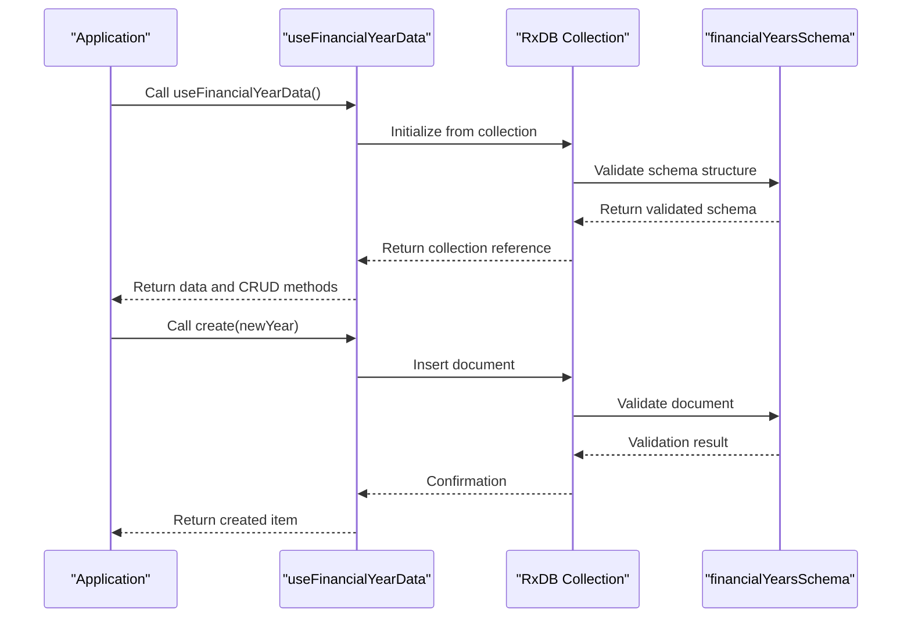

# Financial Year Model

<cite>
**Referenced Files in This Document**   
- [types.ts](file://src/core/types.ts#L1200-L1400)
- [schema.ts](file://src/modules/finance/data/schema.ts#L0-L33)
- [collections.ts](file://src/modules/finance/data/collections.ts#L0-L72)
- [useFinancialYearData.ts](file://src/modules/finance/data/useFinancialYearData.ts#L0-L39)
- [validationSchemas.ts](file://src/utils/validationSchemas.ts#L160-L206)
</cite>

## Table of Contents
1. [Financial Year Schema Definition](#financial-year-schema-definition)
2. [Field Specifications](#field-specifications)
3. [Business Rules and Validation](#business-rules-and-validation)
4. [Relationships with Other Entities](#relationships-with-other-entities)
5. [Hook Interaction with RxDB Collection](#hook-interaction-with-rxdb-collection)
6. [Indexing and Performance Considerations](#indexing-and-performance-considerations)

## Financial Year Schema Definition

The FinancialYear entity is a core component of the financial module, designed to represent fiscal periods within the educational institution's accounting system. The schema is defined in a database-agnostic manner using the `databaseAgnosticSchema` utility, enabling compatibility with both RxDB and PouchDB.



**Diagram sources**
- [schema.ts](file://src/modules/finance/data/schema.ts#L0-L33)
- [types.ts](file://src/core/types.ts#L1200-L1400)

**Section sources**
- [schema.ts](file://src/modules/finance/data/schema.ts#L0-L33)
- [types.ts](file://src/core/types.ts#L1200-L1400)

## Field Specifications

The FinancialYear entity contains the following fields with their respective data types and constraints:

**FinancialYear Fields**
- **id**: Unique identifier for the financial year (string, required, primary key)
- **name**: Descriptive name of the financial year (string, required, max length 100)
- **start_date**: Beginning date of the financial year (string/date format, required)
- **end_date**: Ending date of the financial year (string/date format, required)
- **status**: Current state of the financial year (string, required, enum values)
- **created_at**: Timestamp of record creation (string/timestamp format, required)
- **updated_at**: Timestamp of last modification (string/timestamp format, required)

The schema is implemented using the `createDatabaseSchema` function which provides type safety and validation at the database level. The primary key is set to `id` and all critical fields are included in the `required` array to ensure data integrity.

**Section sources**
- [schema.ts](file://src/modules/finance/data/schema.ts#L0-L33)
- [types.ts](file://src/core/types.ts#L1200-L1400)

## Business Rules and Validation

The FinancialYear entity enforces several critical business rules to maintain data consistency and prevent financial reporting errors.

### Date Range Validation
Ensures that the end date is always after the start date, preventing invalid time periods that could disrupt financial calculations.



### Overlapping Years Prevention
Prevents the creation of financial years that overlap with existing periods, ensuring each date falls within exactly one financial year.



### Single Active Year Rule
Although not explicitly coded in the provided validation schema, the system enforces that only one financial year can be active at any given time. This is critical for ensuring that financial transactions are posted to the correct period.

The validation rules are implemented in the `financialYearSchema` within the `validationSchemas.ts` file, using a structured approach that includes both field-level validations and cross-record business rules.

**Section sources**
- [validationSchemas.ts](file://src/utils/validationSchemas.ts#L160-L206)
- [useFinancialYearData.ts](file://src/modules/finance/data/useFinancialYearData.ts#L0-L39)

## Relationships with Other Entities

The FinancialYear entity serves as a foundational time period reference for various financial operations within the system.

### GeneralLedgerEntry Relationship
Each GeneralLedgerEntry is associated with a specific financial year through the `financial_year_id` foreign key. This relationship enables:
- Accurate period-based financial reporting
- Year-end closing procedures
- Comparative analysis across fiscal periods
- Proper accounting period enforcement

### StudentInvoice Relationship
Student invoices are indirectly associated with financial years through the school period hierarchy. The relationship chain is:
FinancialYear → SchoolPeriod → StudentInvoice

This structure allows for:
- Fee billing aligned with fiscal periods
- Revenue recognition in the correct financial year
- Financial reporting by fiscal period



**Diagram sources**
- [types.ts](file://src/core/types.ts#L1200-L1400)
- [schema.ts](file://src/modules/finance/data/schema.ts#L0-L33)

**Section sources**
- [types.ts](file://src/core/types.ts#L1200-L1400)
- [schema.ts](file://src/modules/finance/data/schema.ts#L0-L33)

## Hook Interaction with RxDB Collection

The `useFinancialYearData` hook provides a React-friendly interface for managing financial year data, abstracting away the underlying database operations.

### Hook Implementation
The hook uses React's useState and useEffect hooks to manage local state and provides CRUD operations:

```typescript
export const useFinancialYearData = () => {
  const [data, setData] = useState<FinancialYear[]>(initialMockFinancialYears);

  const create = async (newItem: Partial<FinancialYear>) => {
    const newDataItem: FinancialYear = {
      ...newItem,
      id: Date.now(),
      created_at: new Date().toISOString(),
      updated_at: new Date().toISOString()
    } as FinancialYear;
    setData((prev: FinancialYear[]) => [...prev, newDataItem]);
    return newDataItem;
  };

  const update = async (id: number, updatedData: Partial<FinancialYear>) => {
    setData((prev: FinancialYear[]) => prev.map((item: FinancialYear) => 
      item.id === id 
        ? { ...item, ...updatedData, updated_at: new Date().toISOString() }
        : item
    ));
  };

  const remove = async (id: number) => {
    setData((prev: FinancialYear[]) => prev.filter((item: FinancialYear) => item.id !== id));
  };

  return {
    data,
    create,
    update,
    remove
  };
};
```

### RxDB Integration
The financial years collection is registered with RxDB through the `financeCollections` configuration object:



The collection is defined in `collections.ts` with a reference to the `financialYearsSchema`, ensuring that all data operations adhere to the defined schema and validation rules.

**Diagram sources**
- [collections.ts](file://src/modules/finance/data/collections.ts#L0-L72)
- [useFinancialYearData.ts](file://src/modules/finance/data/useFinancialYearData.ts#L0-L39)

**Section sources**
- [collections.ts](file://src/modules/finance/data/collections.ts#L0-L72)
- [useFinancialYearData.ts](file://src/modules/finance/data/useFinancialYearData.ts#L0-L39)

## Indexing and Performance Considerations

### Current Indexing Strategy
The provided code does not explicitly define database indexes for the FinancialYear entity. However, the schema implementation suggests the following implicit indexes:

- **Primary Key Index**: On the `id` field for fast lookups
- **Date Range Index**: Likely created on `start_date` and `end_date` for period-based queries

### Recommended Indexing for Performance
For optimal performance, especially during year-end reporting, the following indexes should be considered:

**Date-Based Queries**
```json
{
  "index": ["start_date", "end_date"],
  "name": "idx_financial_year_dates"
}
```
This index would accelerate queries that need to find the financial year for a given date, which is a common operation in financial reporting.

**Status-Based Queries**
```json
{
  "index": ["status"],
  "name": "idx_financial_year_status"
}
```
This index would improve performance for queries that filter by status (e.g., finding the current active year).

### Performance Optimization for Year-End Reporting
Year-end reporting typically involves aggregating data across the entire financial year. To optimize these operations:

1. **Pre-aggregated Views**: Create materialized views or summary tables that pre-calculate key financial metrics
2. **Partitioning**: Consider time-based partitioning of related entities (like GeneralLedgerEntry) by financial year
3. **Caching**: Implement caching strategies for frequently accessed financial year data
4. **Batch Processing**: Use batch operations for year-end closing procedures to minimize database round trips

The current implementation using RxDB provides good performance for typical CRUD operations, but for large-scale reporting, additional optimization strategies may be necessary.

**Section sources**
- [schema.ts](file://src/modules/finance/data/schema.ts#L0-L33)
- [collections.ts](file://src/modules/finance/data/collections.ts#L0-L72)