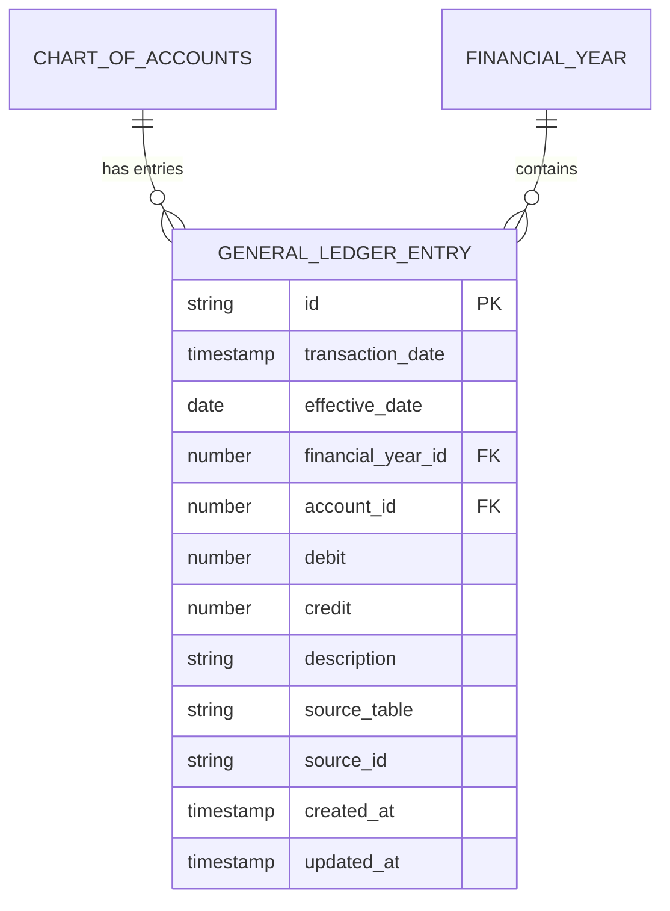
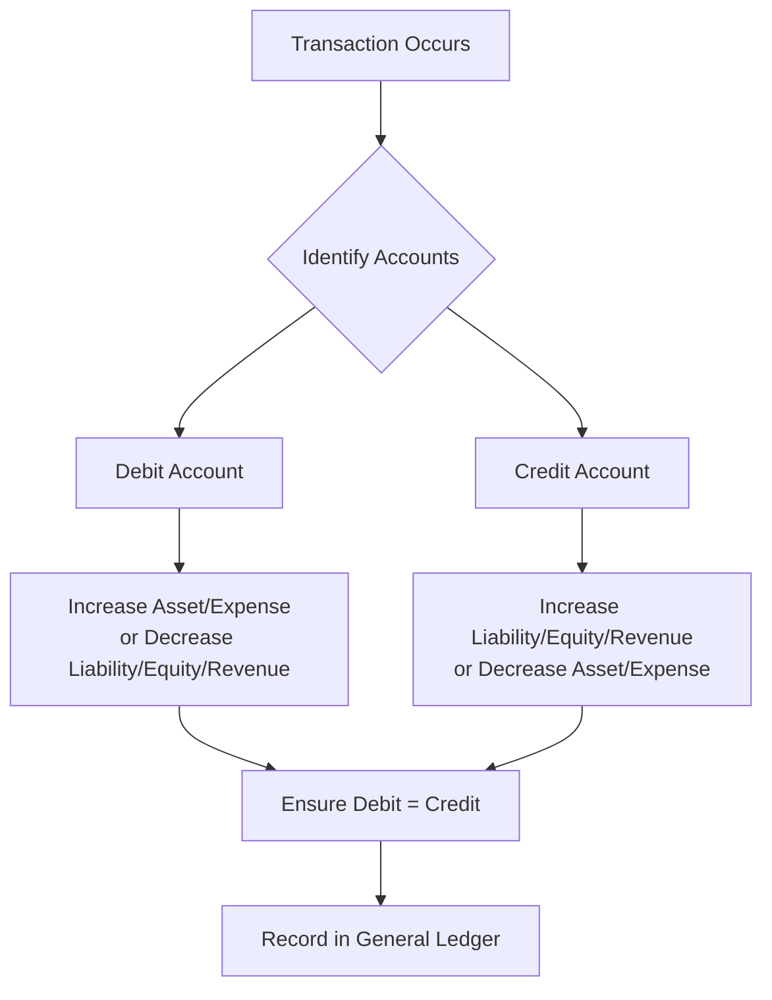
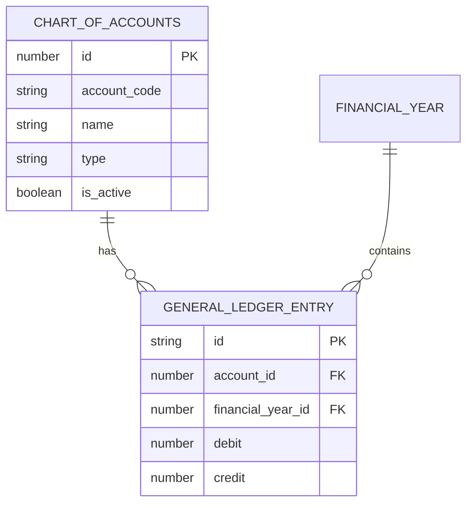
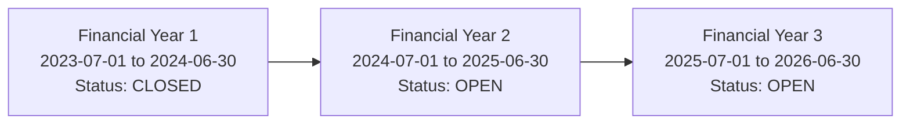
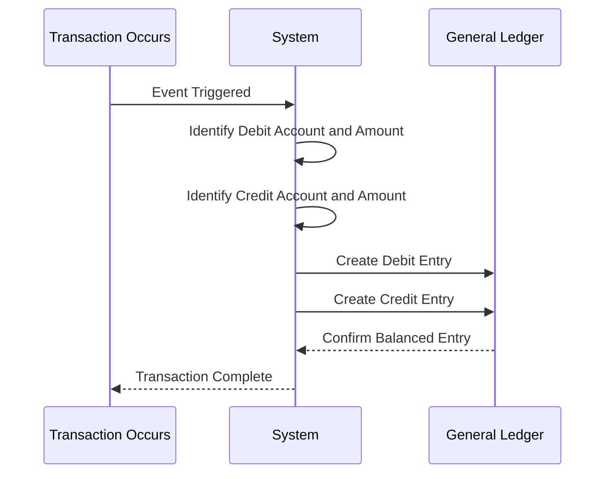
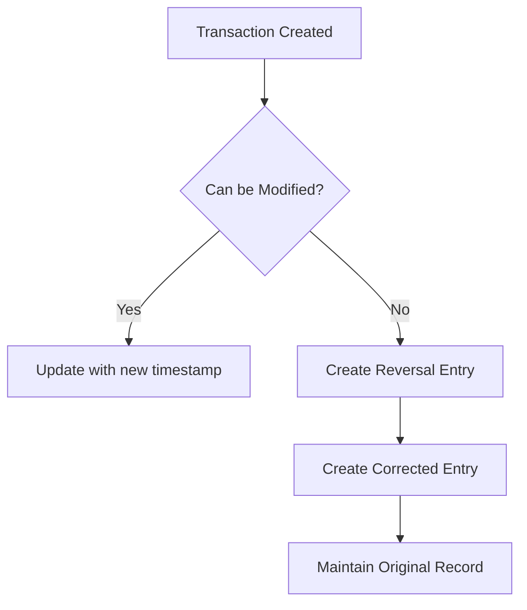

# General Ledger Model

<cite>
**Referenced Files in This Document**   
- [types.ts](file://src/core/types.ts#L844-L857)
- [schema.ts](file://src/modules/finance/data/schema.ts#L352-L382)
- [mockData.ts](file://src/modules/finance/data/mockData.ts#L0-L261)
- [useGeneralLedgerEntryData.ts](file://src/modules/finance/data/useGeneralLedgerEntryData.ts#L0-L56)
- [types.ts](file://src/modules/finance/data/types.ts#L251-L278)
</cite>

## Table of Contents
1. [Introduction](#introduction)
2. [Schema Definition](#schema-definition)
3. [Double-Entry Accounting Principles](#double-entry-accounting-principles)
4. [Referential Integrity with Chart of Accounts](#referential-integrity-with-chart-of-accounts)
5. [Relationship with Financial Periods](#relationship-with-financial-periods)
6. [Journal Entry Patterns](#journal-entry-patterns)
7. [useGeneralLedgerEntryData Hook](#usegeneralledgerentrydata-hook)
8. [Audit Trail and Immutability](#audit-trail-and-immutability)
9. [Indexing and Performance](#indexing-and-performance)
10. [Conclusion](#conclusion)

## Introduction
The General Ledger Entry data model serves as the foundation for financial accounting within the educational institution's financial management system. This document provides a comprehensive analysis of the data structure, its implementation of double-entry accounting principles, and its integration with other financial components. The model ensures accurate financial record-keeping, maintains referential integrity with the Chart of Accounts, and supports robust financial reporting capabilities.

## Schema Definition
The General Ledger Entry schema defines the structure for recording all financial transactions within the system. Each entry captures essential accounting information that enables accurate financial tracking and reporting.

**GeneralLedgerEntry Interface**
```typescript
export interface GeneralLedgerEntry {
    id: string;
    transaction_date: string;
    effective_date: string;
    financial_year_id: number;
    account_id: number;
    debit?: number | null;
    credit?: number | null;
    description: string;
    source_table?: string | null;
    source_id?: string | null;
    created_at: string;
    updated_at: string;
}
```

**Field Descriptions**
- **id**: Unique identifier for the ledger entry
- **transaction_date**: Date when the transaction was recorded in the system
- **effective_date**: Date when the transaction takes financial effect
- **financial_year_id**: Reference to the financial year in which the transaction occurs
- **account_id**: Reference to the Chart of Accounts entry affected by the transaction
- **debit**: Amount recorded as a debit (positive value)
- **credit**: Amount recorded as a credit (positive value)
- **description**: Narrative description of the transaction
- **source_table**: Originating module or table that generated the transaction
- **source_id**: Identifier of the originating record in the source table
- **created_at**: Timestamp when the entry was created
- **updated_at**: Timestamp when the entry was last modified

**Schema Validation Rules**


**Diagram sources**
- [types.ts](file://src/core/types.ts#L844-L857)
- [schema.ts](file://src/modules/finance/data/schema.ts#L352-L382)

**Section sources**
- [types.ts](file://src/core/types.ts#L844-L857)
- [schema.ts](file://src/modules/finance/data/schema.ts#L352-L382)

## Double-Entry Accounting Principles
The General Ledger Entry data model implements fundamental double-entry accounting principles, ensuring that every financial transaction maintains the accounting equation: Assets = Liabilities + Equity.

### Core Implementation
The system enforces double-entry accounting by requiring that every transaction consists of at least two entries: one debit and one credit. The sum of debits must equal the sum of credits for each complete transaction.

### Accounting Equation
The model supports the fundamental accounting equation through proper classification of accounts:
- **Assets**: Accounts that represent economic resources (e.g., bank accounts, accounts receivable)
- **Liabilities**: Accounts that represent obligations (e.g., accounts payable, accrued expenses)
- **Equity**: Accounts that represent ownership interest (e.g., retained earnings, capital reserves)
- **Revenue**: Accounts that represent income (e.g., tuition fees, transport fees)
- **Expenses**: Accounts that represent costs (e.g., salaries, utilities)



**Diagram sources**
- [mockData.ts](file://src/modules/finance/data/mockData.ts#L0-L261)

**Section sources**
- [mockData.ts](file://src/modules/finance/data/mockData.ts#L0-L261)

## Referential Integrity with Chart of Accounts
The General Ledger Entry model maintains strict referential integrity with the Chart of Accounts, ensuring that all transactions reference valid, active accounts.

### Chart of Accounts Structure
The Chart of Accounts is organized into five main categories:
1. **Assets**: Economic resources owned by the institution
2. **Liabilities**: Obligations owed to external parties
3. **Equity**: Ownership interest in the institution
4. **Revenue**: Income generated from operations
5. **Expenses**: Costs incurred in operations

### Account Types and Examples
```typescript
export interface ChartOfAccount {
    id: number;
    account_code: string;
    name: string;
    type: AccountType; // ASSET, LIABILITY, EQUITY, REVENUE, EXPENSE
    template_type: AccountTemplateType;
    is_active: boolean;
}
```

**Sample Chart of Accounts**
| Account ID | Account Code | Name | Type |
|------------|--------------|------|------|
| 101 | 1001 | School Bank Account - KCB | ASSET |
| 104 | 1004 | Accounts Receivable - Students | ASSET |
| 201 | 2001 | Accounts Payable - Suppliers | LIABILITY |
| 301 | 3001 | Retained Earnings | EQUITY |
| 401 | 4001 | Tuition Fees Revenue | REVENUE |
| 501 | 5001 | Salaries & Wages | EXPENSE |

### Referential Integrity Enforcement
The system ensures referential integrity through:
- Foreign key constraints between `account_id` in GeneralLedgerEntry and `id` in ChartOfAccount
- Validation that referenced accounts are active (`is_active: true`)
- Type checking to ensure appropriate account usage (e.g., revenue accounts only used for credits)



**Diagram sources**
- [mockData.ts](file://src/modules/finance/data/mockData.ts#L55-L61)
- [types.ts](file://src/core/types.ts#L844-L857)

**Section sources**
- [mockData.ts](file://src/modules/finance/data/mockData.ts#L55-L61)

## Relationship with Financial Periods
The General Ledger Entry model is closely integrated with financial periods, enabling accurate period-based financial reporting and closing procedures.

### Financial Year Structure
Financial years are defined with specific start and end dates, typically aligned with the academic calendar:

```typescript
export interface FinancialYear {
    id: number;
    name: string;
    start_date: string;
    end_date: string;
    status: FinancialYearStatus; // OPEN, CLOSED
}
```

### Period Management
The system supports multiple financial years simultaneously, with only one year typically open for transactions at any time:



### Period-Based Operations
- **Transaction Posting**: Entries can only be posted to open financial years
- **Period Closing**: At the end of a financial year, the system closes the year and transfers balances to retained earnings
- **Reporting**: Financial statements are generated based on specific financial periods

**Section sources**
- [mockData.ts](file://src/modules/finance/data/mockData.ts#L0-L261)

## Journal Entry Patterns
The system implements standard journal entry patterns that reflect common financial transactions in an educational institution.

### Standard Transaction Patterns
The mock data reveals several common journal entry patterns:

#### 1. Revenue Recognition
```typescript
// Student fees collection
{id: 'GLE003', transaction_date: '2024-07-05', account_id: 101, debit: 250000, description: 'Student fees collection - Term 3'},
{id: 'GLE004', transaction_date: '2024-07-05', account_id: 401, credit: 250000, description: 'Student fees collection - Term 3'}
```

#### 2. Expense Payment
```typescript
// Payment to supplier
{id: 'GLE005', transaction_date: '2024-07-10', account_id: 504, debit: 85000, description: 'Payment to Text Book Centre'},
{id: 'GLE006', transaction_date: '2024-07-10', account_id: 101, credit: 85000, description: 'Payment to Text Book Centre'}
```

#### 3. Payroll Processing
```typescript
// Salary payment
{id: 'GLE007', transaction_date: '2024-07-15', account_id: 501, debit: 180000, description: 'Monthly salaries payment'},
{id: 'GLE008', transaction_date: '2024-07-15', account_id: 103, credit: 180000, description: 'Monthly salaries payment'}
```

#### 4. Opening Balances
```typescript
// Opening balance entry
{id: 'GLE001', transaction_date: '2024-07-01', account_id: 101, debit: 500000, description: 'Opening balance - July 2024'},
{id: 'GLE002', transaction_date: '2024-07-01', account_id: 301, credit: 500000, description: 'Opening balance - July 2024'}
```

### Cross-Module Integration Patterns
The system supports integration with other modules through standardized journal entries:

#### Nutrition Module Integration
```typescript
// Student wallet deposit
{id: 'GLE017', transaction_date: '2024-07-28', account_id: 101, debit: 2000, description: 'Student wallet deposit - Jim Halpert'},
{id: 'GLE018', transaction_date: '2024-07-28', account_id: 203, credit: 2000, description: 'Student wallet deposit - Jim Halpert'}

// Canteen sales
{id: 'GLE019', transaction_date: '2024-07-29', account_id: 203, debit: 500, description: 'Canteen sales - Jim Halpert snacks purchase'},
{id: 'GLE020', transaction_date: '2024-07-29', account_id: 410, credit: 500, description: 'Canteen sales - Jim Halpert snacks purchase'}
```

#### Library Module Integration
```typescript
// Library fine
{id: 'GLE023', transaction_date: '2024-06-25', account_id: 104, debit: 50, description: 'Library fine - Jim Halpert overdue book'},
{id: 'GLE024', transaction_date: '2024-06-25', account_id: 415, credit: 50, description: 'Library fine - Jim Halpert overdue book'}
```



**Diagram sources**
- [mockData.ts](file://src/modules/finance/data/mockData.ts#L170-L235)

**Section sources**
- [mockData.ts](file://src/modules/finance/data/mockData.ts#L170-L235)

## useGeneralLedgerEntryData Hook
The `useGeneralLedgerEntryData` hook provides a React interface for managing General Ledger Entry operations within the application.

### Hook Implementation
```typescript
const useGeneralLedgerEntryData = () => {
  const [generalLedgerEntries, setGeneralLedgerEntries] = useState<any[]>([]);
  const [isLoading, setIsLoading] = useState<boolean>(true);
  const [error, setError] = useState<string | null>(null);

  useEffect(() => {
    try {
      setGeneralLedgerEntries(initialMockUsers);
      setIsLoading(false);
    } catch (e) {
      setError('Failed to fetch general ledger entries');
      setIsLoading(false);
    }
  }, []);

  const create = async (newItem: Partial<any>) => {
    const newDataItem: any = {
      ...newItem,
      id: Date.now(),
      created_at: new Date().toISOString(),
      updated_at: new Date().toISOString()
    };
    setGeneralLedgerEntries((prev: any[]) => [...prev, newDataItem]);
    return newDataItem;
  };

  const update = async (id: number, updatedData: Partial<any>) => {
    setGeneralLedgerEntries((prev: any[]) => prev.map((item: any) =>
      item.id === id
        ? { ...item, ...updatedData, updated_at: new Date().toISOString() }
        : item
    ));
  };

  const remove = async (id: number) => {
    setGeneralLedgerEntries((prev: any[]) => prev.filter((item: any) => item.id !== id));
  };

  return {
    data: generalLedgerEntries,
    isLoading,
    error,
    create,
    update,
    remove
  };
};
```

### Key Features
- **State Management**: Uses React's useState to manage ledger entries
- **CRUD Operations**: Provides create, update, and remove functions
- **Timestamp Management**: Automatically sets `created_at` and `updated_at` timestamps
- **Error Handling**: Implements basic error handling for data operations

### Usage Pattern
```typescript
const { data, isLoading, error, create, update, remove } = useGeneralLedgerEntryData();

// Create a new ledger entry
const newEntry = {
  transaction_date: '2024-07-01',
  effective_date: '2024-07-01',
  financial_year_id: 1,
  account_id: 101,
  debit: 1000,
  description: 'Test transaction'
};

create(newEntry);
```

**Section sources**
- [useGeneralLedgerEntryData.ts](file://src/modules/finance/data/useGeneralLedgerEntryData.ts#L0-L56)

## Audit Trail and Immutability
The General Ledger Entry model incorporates audit trail features and immutability constraints to ensure financial integrity and compliance.

### Audit Trail Implementation
The system maintains a comprehensive audit trail through:
- **Creation Timestamp**: `created_at` field records when an entry is first created
- **Update Timestamp**: `updated_at` field records the last modification time
- **Immutable Core Data**: Once created, the fundamental transaction details cannot be altered

### Immutability Constraints
While the current implementation allows updates to ledger entries, best practices suggest implementing stricter immutability:



### Recommended Audit Enhancements
For improved audit capabilities, consider implementing:
- **User Tracking**: Record which user created or modified each entry
- **Change Logging**: Maintain a history of all modifications
- **Digital Signatures**: Implement electronic signatures for critical entries
- **Access Controls**: Restrict modification rights based on user roles

**Section sources**
- [useGeneralLedgerEntryData.ts](file://src/modules/finance/data/useGeneralLedgerEntryData.ts#L0-L56)
- [types.ts](file://src/core/types.ts#L844-L857)

## Indexing and Performance
The General Ledger Entry model includes indexing strategies to optimize financial reporting performance.

### Current Indexing Strategy
Based on the schema definition, the primary index is on the `id` field:

```typescript
export const generalLedgerEntriesSchema: DatabaseSchema = createDatabaseSchema({
    title: 'general_ledger_entry',
    primaryKey: 'id',
    properties: {
        id: SchemaHelpers.string({ maxLength: 100 }),
        transaction_date: SchemaHelpers.timestamp(),
        effective_date: SchemaHelpers.date(),
        financial_year_id: SchemaHelpers.string({ maxLength: 100 }),
        account_id: SchemaHelpers.string({ maxLength: 100 }),
        // ... other fields
    }
});
```

### Performance Optimization Opportunities
For improved reporting performance, consider implementing additional indexes:

#### Recommended Indexes
1. **Financial Year Index**: Speeds up period-based reporting
2. **Account ID Index**: Accelerates account-specific queries
3. **Effective Date Index**: Optimizes date-range queries
4. **Composite Index**: `(financial_year_id, account_id, effective_date)` for common reporting scenarios

### Reporting Performance
The Account Ledger report demonstrates the need for efficient querying:

```typescript
const handleGenerateReport = useCallback(() => {
    const filteredEntries = (generalLedgerEntries || [])
      .filter(entry => entry.account_id === selectedAccountId)
      .filter(entry => {
        const entryDate = new Date(entry.effective_date);
        return (!startDate || entryDate >= new Date(startDate)) && 
               (!endDate || entryDate <= new Date(endDate));
      })
      .sort((a, b) => new Date(a.effective_date).getTime() - new Date(b.effective_date).getTime());
});
```

This implementation would benefit significantly from proper indexing, especially as the volume of ledger entries grows over time.

**Section sources**
- [schema.ts](file://src/modules/finance/data/schema.ts#L352-L382)
- [AccountLedgerPage.tsx](file://src/modules/reports/pages/AccountLedgerPage.tsx#L26-L57)

## Conclusion
The General Ledger Entry data model provides a robust foundation for financial accounting within the educational institution's management system. By implementing double-entry accounting principles, maintaining referential integrity with the Chart of Accounts, and supporting integration with financial periods, the model ensures accurate and reliable financial record-keeping.

Key strengths of the implementation include:
- Comprehensive schema that captures essential accounting information
- Clear implementation of double-entry accounting through paired debit/credit entries
- Integration with financial periods for accurate period-based reporting
- Support for cross-module financial transactions

Areas for potential enhancement include:
- Strengthening immutability constraints to improve audit integrity
- Implementing additional database indexes for improved reporting performance
- Adding user tracking to the audit trail
- Enhancing validation to prevent unbalanced journal entries

The `useGeneralLedgerEntryData` hook provides a functional interface for managing ledger entries, though it currently operates on mock data. When connected to a persistent data store, this hook will enable seamless ledger operations throughout the application.