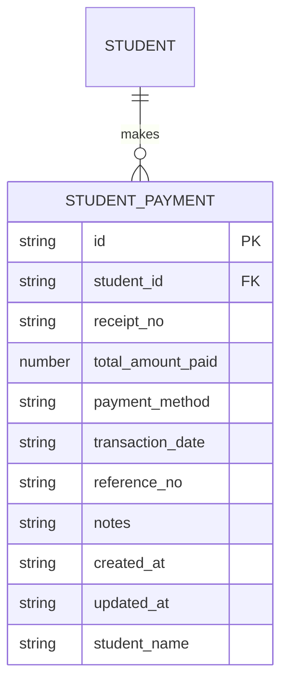
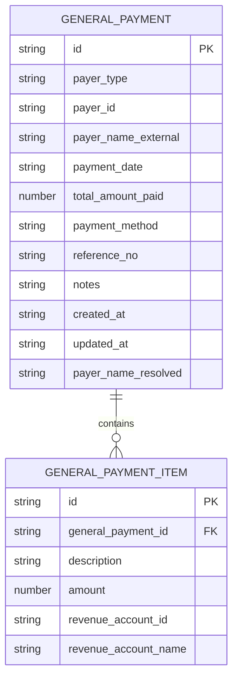
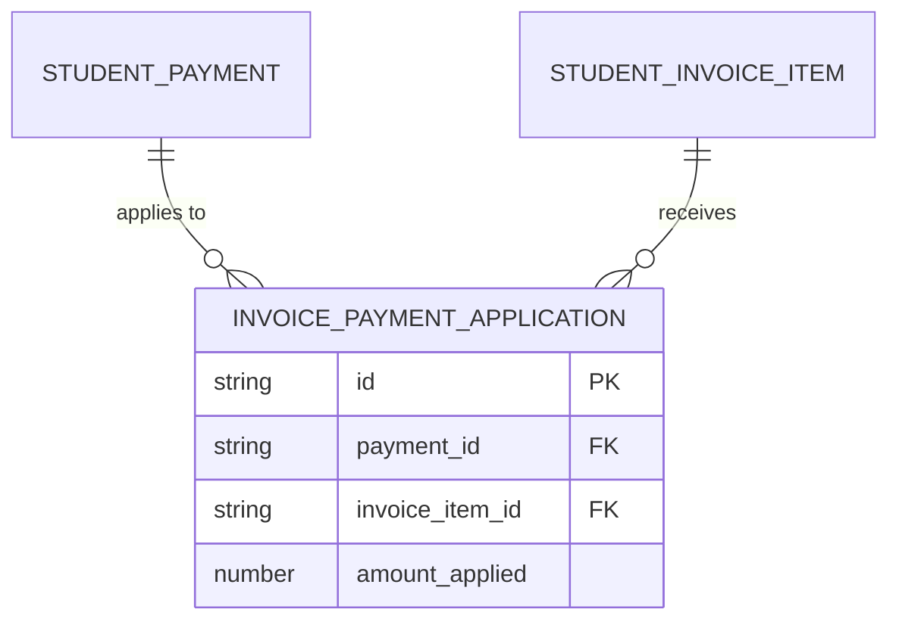
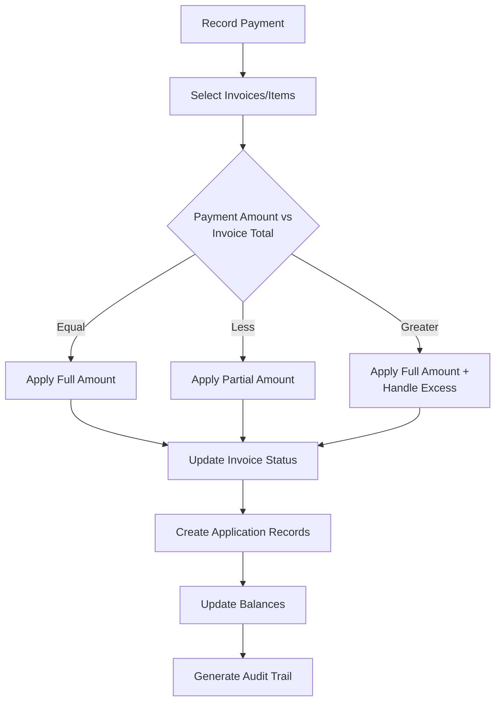
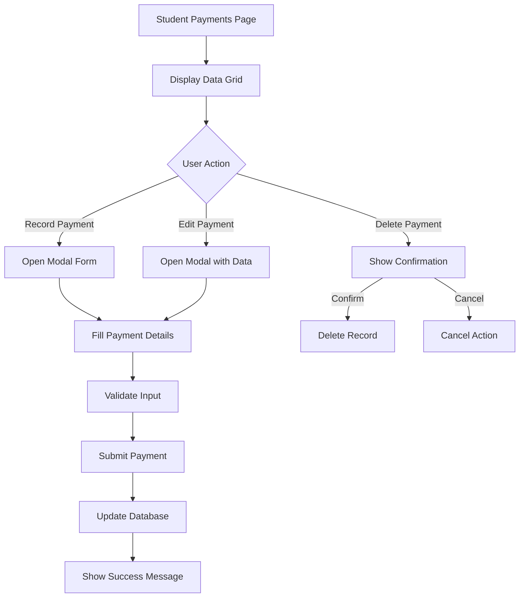
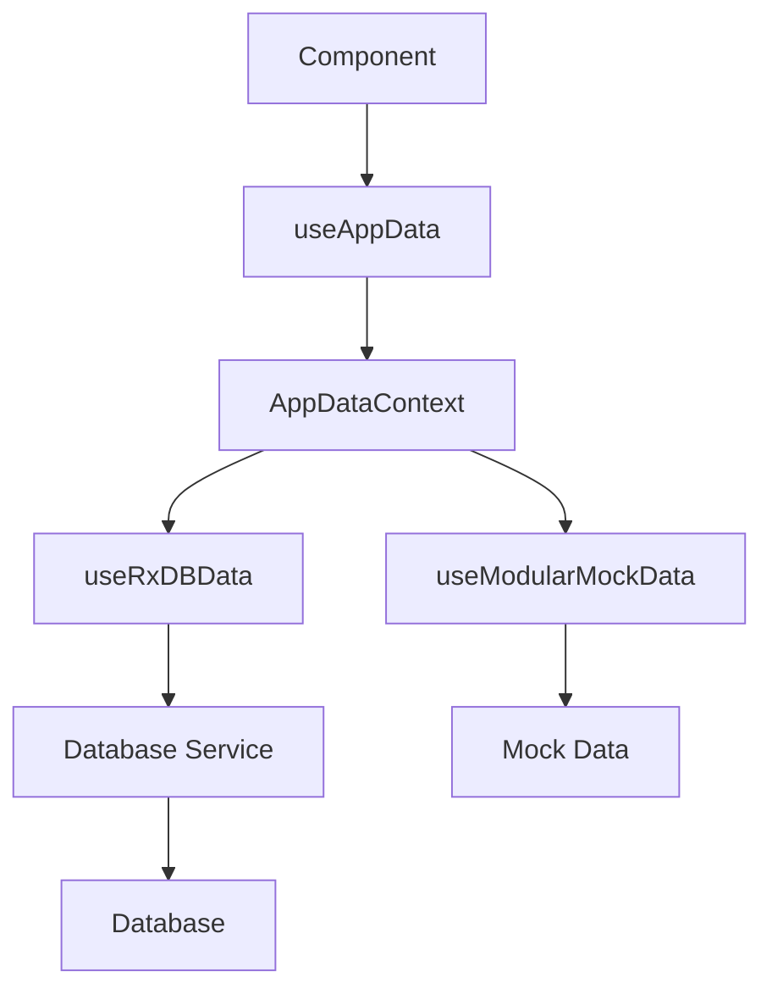

# Payment Model

<cite>
**Referenced Files in This Document**   
- [types.ts](file://src/core/types.ts)
- [schema.ts](file://src/modules/finance/data/schema.ts)
- [types.ts](file://src/modules/finance/data/types.ts)
- [collections.ts](file://src/modules/finance/data/collections.ts)
- [StudentPaymentsPage.tsx](file://src/modules/finance/pages/StudentPaymentsPage.tsx)
- [useAppData.ts](file://src/hooks/useAppData.ts)
- [AppDataContext.tsx](file://src/contexts/AppDataContext.tsx)
- [useRxDBData.ts](file://src/hooks/useRxDBData.ts)
- [useStudentPaymentData.ts](file://src/modules/finance/data/useStudentPaymentData.ts)
</cite>

## Table of Contents
1. [Introduction](#introduction)
2. [Payment Data Model](#payment-data-model)
3. [Invoice Payment Application](#invoice-payment-application)
4. [Payment Workflow and Allocation](#payment-workflow-and-allocation)
5. [User Interface and Interaction](#user-interface-and-interaction)
6. [Data Management and Hooks](#data-management-and-hooks)
7. [Reconciliation and Audit](#reconciliation-and-audit)

## Introduction
The Payment Model in the SchoolPilot system manages financial transactions for both student and general payments. This documentation details the schema, relationships, workflows, and integration points for handling payments, with a focus on how payments are linked to invoices, how partial and overpayments are processed, and how the system ensures data integrity through audit trails and reconciliation processes.

## Payment Data Model

The payment data model is designed to handle both student-specific and general payments, with a clear distinction between payment records and their application to invoices. The model supports various payment methods and provides comprehensive tracking of financial transactions.

### Student Payment Schema
The student payment schema defines the structure for recording payments made by students. Key fields include:

- **id**: Unique identifier for the payment record
- **student_id**: Reference to the student making the payment
- **receipt_no**: Unique receipt number for the transaction
- **total_amount_paid**: Total amount received in the payment
- **payment_method**: Method used for payment (Cash, Bank Transfer, Cheque, Mobile Money, Card, Other)
- **transaction_date**: Timestamp of when the payment was made
- **reference_no**: Reference number for the transaction (e.g., Cheque number, M-Pesa code)
- **notes**: Additional notes about the payment
- **created_at**: Timestamp of record creation
- **updated_at**: Timestamp of last record update
- **student_name**: Denormalized field for student name (for display purposes)



**Diagram sources**
- [schema.ts](file://src/modules/finance/data/schema.ts#L200-L218)
- [types.ts](file://src/modules/finance/data/types.ts#L120-L130)

**Section sources**
- [schema.ts](file://src/modules/finance/data/schema.ts#L200-L218)
- [types.ts](file://src/modules/finance/data/types.ts#L120-L130)

### General Payment Schema
The system also supports general payments for non-student entities. The general payment schema includes:

- **id**: Unique identifier for the payment record
- **payer_type**: Type of payer (Student, Staff, Customer, Partner, Other)
- **payer_id**: Reference to the payer (when applicable)
- **payer_name_external**: Name of external payer
- **payment_date**: Date and time of payment
- **total_amount_paid**: Total amount received
- **payment_method**: Method used for payment
- **reference_no**: Transaction reference number
- **notes**: Additional notes
- **items**: Array of payment items with descriptions, amounts, and revenue accounts
- **payer_name_resolved**: Resolved name of the payer
- **created_at**: Record creation timestamp
- **updated_at**: Last update timestamp



**Diagram sources**
- [schema.ts](file://src/modules/finance/data/schema.ts#L340-L360)
- [types.ts](file://src/modules/finance/data/types.ts#L150-L165)

**Section sources**
- [schema.ts](file://src/modules/finance/data/schema.ts#L340-L360)
- [types.ts](file://src/modules/finance/data/types.ts#L150-L165)

## Invoice Payment Application

The InvoicePaymentApplicationData linking table is critical for connecting payments to specific invoice items, enabling precise allocation of payments across multiple invoices and handling complex payment scenarios.

### Linking Table Structure
The invoice payment application table has the following structure:

- **id**: Unique identifier for the application record
- **payment_id**: Reference to the payment record
- **invoice_item_id**: Reference to the specific invoice item being paid
- **amount_applied**: Amount of the payment applied to this invoice item

This structure allows a single payment to be distributed across multiple invoice items, supporting partial payments and overpayments.



**Diagram sources**
- [schema.ts](file://src/modules/finance/data/schema.ts#L280-L290)
- [types.ts](file://src/modules/finance/data/types.ts#L135-L140)

**Section sources**
- [schema.ts](file://src/modules/finance/data/schema.ts#L280-L290)
- [types.ts](file://src/modules/finance/data/types.ts#L135-L140)

### Handling Partial Payments and Overpayments
The system handles partial payments and overpayments through the invoice payment application mechanism:

1. When a payment is made, it is initially recorded with the total amount paid
2. The payment is then allocated to specific invoice items through application records
3. For partial payments, only a portion of an invoice item's amount is covered
4. For overpayments, the excess amount can be applied to other outstanding invoice items or carried forward as a credit

The StudentInvoice entity tracks the overall payment status with fields like:
- **total_amount_billed**: Total amount of the invoice
- **amount_paid**: Running total of payments applied to the invoice
- **status**: Current status (Due, Partially Paid, Paid, Overdue, Voided)

## Payment Workflow and Allocation

The payment allocation workflow involves several steps to ensure accurate financial tracking and proper application of payments to outstanding balances.

### Payment Allocation Process
1. **Payment Recording**: A payment is recorded with basic details including amount, method, and reference
2. **Invoice Selection**: The system identifies which invoices or invoice items the payment should be applied to
3. **Amount Allocation**: The payment amount is distributed across selected invoice items
4. **Application Recording**: Invoice payment application records are created for each allocation
5. **Balance Update**: The amounts paid on invoices are updated, and statuses are adjusted accordingly

### Complex Payment Scenarios
The data model supports several complex payment scenarios:

#### Multiple Invoice Payments
A single payment can be applied to multiple invoices by creating multiple application records, each linking to a different invoice item.

#### Partial Invoice Payments
When a payment covers only part of an invoice item, the application record reflects the partial amount, leaving the remaining balance outstanding.

#### Overpayment Handling
When a payment exceeds the amount due on selected invoices, the excess can be:
- Applied to other outstanding invoices
- Carried forward as a credit for future payments
- Refunded to the payer

#### Payment Reversal
Payments can be reversed by creating negative application records or voiding the original payment, with appropriate audit trail entries.



**Diagram sources**
- [useStudentPaymentData.ts](file://src/modules/finance/data/useStudentPaymentData.ts#L20-L50)
- [StudentPaymentsPage.tsx](file://src/modules/finance/pages/StudentPaymentsPage.tsx#L50-L150)

**Section sources**
- [useStudentPaymentData.ts](file://src/modules/finance/data/useStudentPaymentData.ts#L20-L50)
- [StudentPaymentsPage.tsx](file://src/modules/finance/pages/StudentPaymentsPage.tsx#L50-L150)

## User Interface and Interaction

The user interface for recording student payments provides a streamlined workflow for financial staff to process payments efficiently.

### Student Payments Page
The StudentPaymentsPage component provides a comprehensive interface for managing student payments with the following features:

- **Data Grid**: Displays existing payments with filtering and sorting capabilities
- **Modal Form**: Allows recording new payments or editing existing ones
- **Validation**: Ensures required fields are completed and amounts are valid
- **Confirmation**: Requires confirmation before deleting payment records

Key UI elements include:
- Student selection dropdown
- Receipt number input
- Amount paid field with currency formatting
- Payment method selection
- Transaction date picker
- Reference number field
- Action buttons for edit and delete



**Diagram sources**
- [StudentPaymentsPage.tsx](file://src/modules/finance/pages/StudentPaymentsPage.tsx#L1-L242)

**Section sources**
- [StudentPaymentsPage.tsx](file://src/modules/finance/pages/StudentPaymentsPage.tsx#L1-L242)

## Data Management and Hooks

The system uses a combination of hooks and data management patterns to handle payment data efficiently.

### Data Hooks Architecture
The payment data management follows a layered approach:

1. **useAppData Hook**: Provides access to the global application data context
2. **Module-specific Hooks**: Handle CRUD operations for specific data types
3. **Database Integration**: Connects to the underlying database through service layers

The useAppData hook serves as the primary interface for components to access payment data and operations:

- **studentPayments**: Array of all student payment records
- **addStudentPayment**: Function to create a new payment
- **updateStudentPayment**: Function to modify an existing payment
- **deleteStudentPayment**: Function to remove a payment record

### Hook Implementation
The useStudentPaymentData hook provides a self-contained implementation for student payment management:

```typescript
const useStudentPaymentData = () => {
  const [studentPayments, setStudentPayments] = useState<StudentPayment[]>([]);
  const [isLoading, setIsLoading] = useState<boolean>(true);
  const [error, setError] = useState<string | null>(null);

  // CRUD operations
  const create = async (newItem: Partial<StudentPayment>) => { /* implementation */ };
  const update = async (id: string, updatedData: Partial<StudentPayment>) => { /* implementation */ };
  const remove = async (id: string) => { /* implementation */ };

  return {
    data: studentPayments,
    isLoading,
    error,
    create,
    update,
    remove
  };
};
```

This hook pattern allows for easy testing and potential replacement of the data source without affecting consuming components.



**Diagram sources**
- [useAppData.ts](file://src/hooks/useAppData.ts#L1-L21)
- [AppDataContext.tsx](file://src/contexts/AppDataContext.tsx#L1-L169)
- [useRxDBData.ts](file://src/hooks/useRxDBData.ts#L1-L306)

**Section sources**
- [useAppData.ts](file://src/hooks/useAppData.ts#L1-L21)
- [AppDataContext.tsx](file://src/contexts/AppDataContext.tsx#L1-L169)
- [useRxDBData.ts](file://src/hooks/useRxDBData.ts#L1-L306)

## Reconciliation and Audit

The payment system includes robust reconciliation and audit capabilities to ensure financial accuracy and compliance.

### Audit Trail
Every payment operation generates audit trail entries that capture:
- Who made the change (user_id)
- What action was taken (INSERT, UPDATE, DELETE)
- Which table was affected
- The primary key of the affected record
- The previous data state (old_data)
- The new data state (new_data)
- When the change occurred (changed_at)
- The IP address and user agent of the request

This comprehensive audit trail enables tracking of all financial modifications for compliance and troubleshooting.

### Reconciliation Requirements
The system supports reconciliation through several mechanisms:

1. **Payment-Application Matching**: Every payment must be fully accounted for through application records
2. **Balance Verification**: Invoice balances are automatically calculated and verified
3. **Reporting**: Financial reports provide summaries of payments by period, method, and status
4. **Export Capabilities**: Data can be exported for external reconciliation

### Integration with Banking Data
The payment model is designed to integrate with external banking systems through:

- **Reference Numbers**: Unique identifiers that can be matched with bank statements
- **Transaction Dates**: Precise timestamps for reconciliation
- **Payment Methods**: Categorization that aligns with banking channels
- **API Endpoints**: Interfaces for automated data exchange with banking partners

These integration points ensure that internal payment records can be reconciled with external bank statements, maintaining financial accuracy across systems.

**Section sources**
- [types.ts](file://src/core/types.ts#L150-L160)
- [useRxDBData.ts](file://src/hooks/useRxDBData.ts#L200-L250)
- [AppDataContext.tsx](file://src/contexts/AppDataContext.tsx#L100-L150)