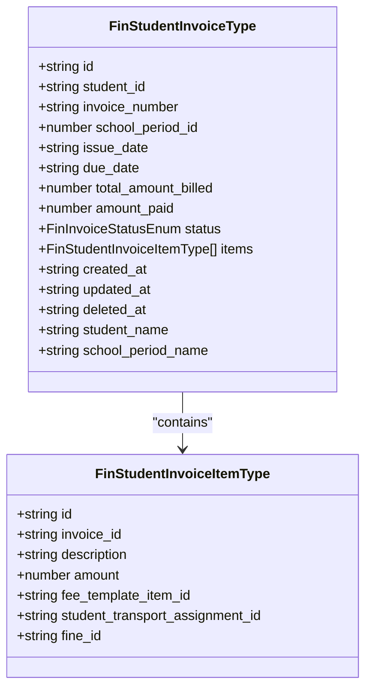
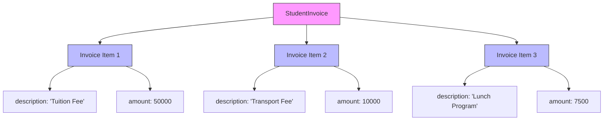
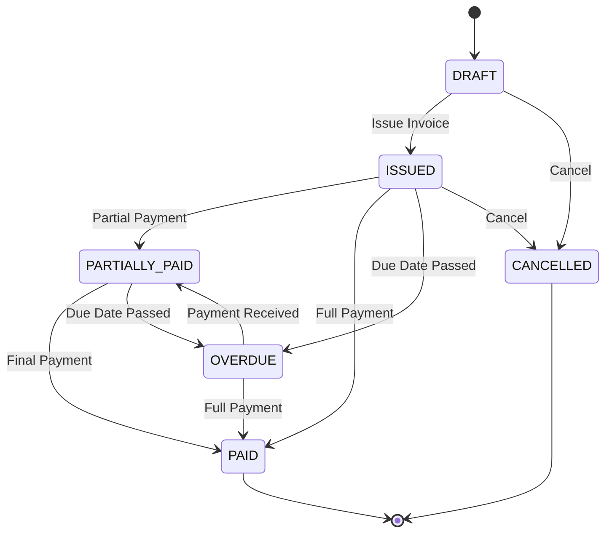
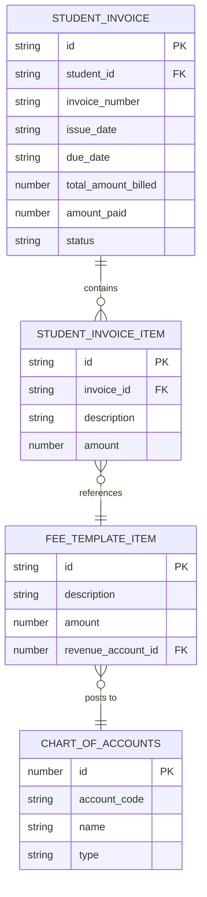
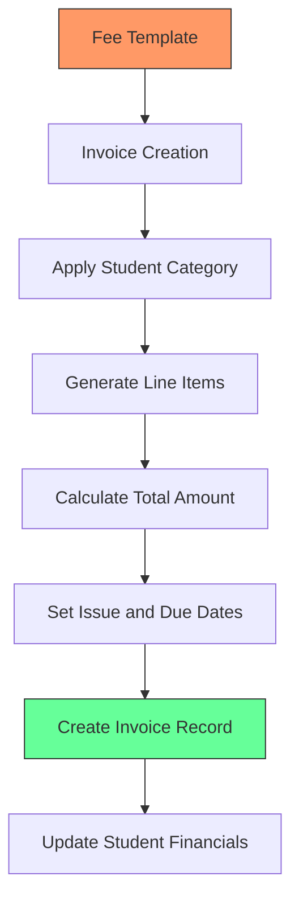
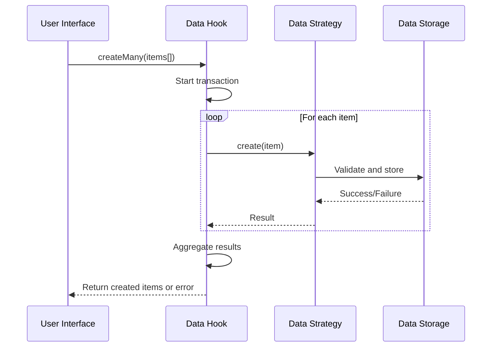
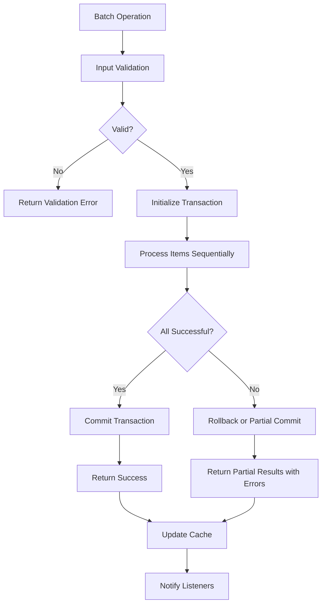

# Student Invoice Model

<cite>
**Referenced Files in This Document**   
- [types.ts](file://src/modules/finance/data/types.ts#L151-L177)
- [mockData.ts](file://src/modules/finance/data/mockData.ts#L200-L261)
- [validationSchemas.ts](file://src/utils/validationSchemas.ts#L190-L389)
- [useDataHookFactory.ts](file://src/hooks/useDataHookFactory.ts#L0-L199)
- [useFeeTemplateData.ts](file://src/modules/finance/data/useFeeTemplateData.ts#L7-L54)
</cite>

## Table of Contents
1. [Introduction](#introduction)
2. [Core Data Structures](#core-data-structures)
3. [Parent-Child Relationship](#parent-child-relationship)
4. [Invoice Lifecycle Management](#invoice-lifecycle-management)
5. [Chart of Accounts Integration](#chart-of-accounts-integration)
6. [Fee Template Integration](#fee-template-integration)
7. [Validation Rules](#validation-rules)
8. [Batch Operations and Data Hooks](#batch-operations-and-data-hooks)
9. [Conclusion](#conclusion)

## Introduction
This document provides comprehensive documentation for the Student Invoice data model and its relationship with invoice items. The system is designed to manage student financial transactions within an educational institution, providing a robust framework for invoice creation, tracking, and payment processing. The model supports complex financial operations while maintaining data integrity through comprehensive validation rules and integration with accounting systems.

**Section sources**
- [types.ts](file://src/modules/finance/data/types.ts#L151-L177)
- [mockData.ts](file://src/modules/finance/data/mockData.ts#L200-L261)

## Core Data Structures

### StudentInvoiceData Structure
The `FinStudentInvoiceType` interface defines the structure of a student invoice with the following key fields:

- **id**: Unique identifier for the invoice
- **student_id**: Reference to the student being billed
- **invoice_number**: Human-readable invoice identifier
- **school_period_id**: Academic period for which the invoice applies
- **issue_date**: Date when the invoice was created
- **due_date**: Payment deadline
- **total_amount_billed**: Total amount owed
- **amount_paid**: Amount already paid
- **status**: Current state of the invoice
- **items**: Collection of invoice line items
- **student_name**: Display name of the student (derived)
- **school_period_name**: Display name of the academic period (derived)

### StudentInvoiceItemData Structure
The `FinStudentInvoiceItemType` interface defines the structure of individual invoice line items:

- **id**: Unique identifier for the invoice item
- **invoice_id**: Reference to the parent invoice
- **description**: Text description of the charge
- **amount**: Monetary value of the item
- **fee_template_item_id**: Reference to the fee template item (optional)
- **student_transport_assignment_id**: Reference to transport assignment (optional)
- **fine_id**: Reference to library or other fines (optional)



**Diagram sources**
- [types.ts](file://src/modules/finance/data/types.ts#L151-L177)

**Section sources**
- [types.ts](file://src/modules/finance/data/types.ts#L151-L177)

## Parent-Child Relationship

### Relationship Overview
The Student Invoice system implements a parent-child relationship between `StudentInvoiceData` (parent) and `StudentInvoiceItemData` (child) entities. This hierarchical structure allows for detailed breakdown of charges while maintaining a consolidated view of the total amount owed.

### Key Relationship Characteristics
- **One-to-Many**: A single invoice can contain multiple line items
- **Referential Integrity**: Each invoice item must reference a valid parent invoice
- **Aggregation**: The parent invoice's `total_amount_billed` is the sum of all child item amounts
- **Lifecycle Synchronization**: Status changes in the parent invoice may affect child items

### Example Implementation
```typescript
// Sample invoice with multiple line items
const studentInvoice: FinStudentInvoiceType = {
  id: 'SINV001',
  student_id: 'S001',
  invoice_number: 'INV/2023/001',
  school_period_id: 1,
  issue_date: '2023-09-01',
  due_date: '2023-09-15',
  total_amount_billed: 60000,
  amount_paid: 60000,
  status: InvoiceStatus.PAID,
  items: [
    {
      id: 'sii_001',
      invoice_id: 'SINV001',
      description: 'Tuition Fee - Term 1',
      amount: 50000
    },
    {
      id: 'sii_002',
      invoice_id: 'SINV001',
      description: 'Transport Fee - Term 1',
      amount: 10000
    }
  ],
  created_at: new Date().toISOString(),
  updated_at: new Date().toISOString(),
  student_name: 'Jim Halpert',
  school_period_name: 'Term 1 - AY 2023/2024'
};
```



**Diagram sources**
- [mockData.ts](file://src/modules/finance/data/mockData.ts#L200-L261)

**Section sources**
- [types.ts](file://src/modules/finance/data/types.ts#L151-L177)
- [mockData.ts](file://src/modules/finance/data/mockData.ts#L200-L261)

## Invoice Lifecycle Management

### Status Transitions
The invoice system supports a comprehensive lifecycle with the following status states:
- **DRAFT**: Invoice created but not yet issued
- **ISSUED**: Invoice has been sent to the student/parent
- **PARTIALLY_PAID**: Some payment has been received but balance remains
- **PAID**: Full payment received
- **OVERDUE**: Payment deadline has passed with outstanding balance
- **CANCELLED**: Invoice has been voided

### Lifecycle Example


**Diagram sources**
- [types.ts](file://src/modules/finance/data/types.ts#L151-L177)

### Payment Processing
The system tracks both the total amount billed and the amount paid, allowing for accurate representation of the payment status. When payments are applied, the system updates the `amount_paid` field and automatically adjusts the invoice status based on the relationship between `amount_paid` and `total_amount_billed`.

**Section sources**
- [types.ts](file://src/modules/finance/data/types.ts#L151-L177)
- [validationSchemas.ts](file://src/utils/validationSchemas.ts#L190-L389)

## Chart of Accounts Integration

### Revenue Tracking
The Student Invoice system integrates with the Chart of Accounts to ensure proper revenue tracking and financial reporting. While the invoice items themselves don't directly reference account codes, the system uses fee templates that are linked to specific revenue accounts.

### Account Mapping
The integration works through the following mechanism:
1. Fee template items are associated with revenue accounts
2. When an invoice is created from a fee template, the revenue account information is inherited
3. Payment applications generate general ledger entries that post to the appropriate accounts

### Example Revenue Accounts
Based on the mock data, common revenue accounts include:
- **4001**: Tuition Fees Revenue
- **4002**: Transport Fees Revenue
- **4003**: Boarding Fees Revenue
- **4009**: Meal Plan Fees Revenue
- **4010**: Canteen Sales Revenue



**Diagram sources**
- [mockData.ts](file://src/modules/finance/data/mockData.ts#L200-L261)
- [types.ts](file://src/modules/finance/data/types.ts#L16-L27)

**Section sources**
- [mockData.ts](file://src/modules/finance/data/mockData.ts#L200-L261)
- [types.ts](file://src/modules/finance/data/types.ts#L16-L27)

## Fee Template Integration

### Template-Based Invoice Creation
The system supports invoice creation through fee templates, which define standard fee structures for different student categories and academic periods.

### Template Structure
The `FeeTemplate` interface includes:
- **id**: Unique identifier
- **name**: Template name
- **school_period_id**: Associated academic period
- **student_category_id**: Target student category
- **items**: Collection of fee template items

### Template Item Structure
The `FeeTemplateItem` interface includes:
- **id**: Unique identifier
- **fee_template_id**: Reference to parent template
- **description**: Charge description
- **amount**: Standard amount
- **revenue_account_id**: GL account for revenue tracking
- **revenue_account_name**: Display name of the revenue account

### Example Template Usage
```typescript
// Creating an invoice from a fee template
const createInvoiceFromTemplate = (templateId: number, studentId: string) => {
  const template = feeTemplates.find(t => t.id === templateId);
  if (!template) throw new Error('Template not found');
  
  const invoiceItems = template.items.map(item => ({
    id: generateId(),
    invoice_id: generateId(),
    description: item.description,
    amount: item.amount
  }));
  
  const totalAmount = invoiceItems.reduce((sum, item) => sum + item.amount, 0);
  
  return {
    id: generateId(),
    student_id: studentId,
    invoice_number: generateInvoiceNumber(),
    school_period_id: template.school_period_id,
    issue_date: new Date().toISOString().split('T')[0],
    due_date: calculateDueDate(),
    total_amount_billed: totalAmount,
    amount_paid: 0,
    status: InvoiceStatus.ISSUED,
    items: invoiceItems,
    created_at: new Date().toISOString(),
    updated_at: new Date().toISOString()
  };
};
```



**Diagram sources**
- [useFeeTemplateData.ts](file://src/modules/finance/data/useFeeTemplateData.ts#L7-L54)

**Section sources**
- [useFeeTemplateData.ts](file://src/modules/finance/data/useFeeTemplateData.ts#L7-L54)
- [mockData.ts](file://src/modules/finance/data/mockData.ts#L200-L261)

## Validation Rules

### Field-Level Validation
The system enforces the following field-level validation rules:
- **id**: Required, string type
- **student_id**: Required, string type
- **invoice_number**: Required, string (1-50 characters)
- **school_period_id**: Required, numeric
- **issue_date**: Required, valid date
- **due_date**: Required, valid date
- **total_amount_billed**: Required, numeric, minimum 0
- **amount_paid**: Required, numeric, minimum 0
- **status**: Required, must be a valid InvoiceStatus enum value

### Business Rule Validation
The system implements the following business rules:

#### Due Date Validation
```mermaid
flowchart TD
A[Validate Invoice] --> B{Issue Date and Due Date Provided?}
B --> |No| C[Skip Validation]
B --> |Yes| D[Convert to Date Objects]
D --> E{Due Date > Issue Date?}
E --> |Yes| F[Validation Passes]
E --> |No| G[Return Error: "Due date must be after issue date"]
```

#### Payment Validation
```mermaid
flowchart TD
A[Validate Invoice] --> B{Amount Paid > Total Billed?}
B --> |No| C[Validation Passes]
B --> |Yes| D[Return Error: "Amount paid cannot exceed amount billed"]
```

#### Unique Invoice Number
```mermaid
flowchart TD
A[Validate Invoice] --> B{Context Available?}
B --> |No| C[Skip Validation]
B --> |Yes| D[Check All Invoices]
D --> E{Duplicate Invoice Number Found?}
E --> |No| F[Validation Passes]
E --> |Yes| G[Return Error: "Invoice number already in use"]
```

### Implementation
```typescript
const studentInvoiceSchema: EntityValidationSchema = {
  entityName: 'studentInvoices',
  fields: {
    id: { required: true, type: 'string' },
    student_id: { required: true, type: 'string' },
    invoice_number: { required: true, type: 'string', minLength: 1, maxLength: 50 },
    school_period_id: { required: true, type: 'number' },
    issue_date: { required: true, type: 'date' },
    due_date: { required: true, type: 'date' },
    total_amount_billed: { 
      required: true, 
      type: 'number',
      min: 0,
      custom: CommonValidations.positiveNumber
    },
    amount_paid: { 
      required: true, 
      type: 'number',
      min: 0,
      custom: CommonValidations.positiveNumber
    },
    status: { required: true, enum: Object.values(InvoiceStatus) }
  },
  relationships: {
    student_id: {
      type: 'many-to-one',
      targetEntity: 'students',
      targetField: 'id',
      required: true
    },
    school_period_id: {
      type: 'many-to-one',
      targetEntity: 'schoolPeriods',
      targetField: 'id',
      required: true
    }
  },
  businessRules: [
    {
      name: 'due_date_after_issue',
      description: 'Due date must be after issue date',
      validate: (invoice) => {
        if (invoice.issue_date && invoice.due_date) {
          if (new Date(invoice.due_date) <= new Date(invoice.issue_date)) {
            return {
              field: 'due_date',
              message: 'Due date must be after issue date',
              code: 'INVALID_DUE_DATE',
              severity: 'error'
            };
          }
        }
        return null;
      }
    },
    {
      name: 'payment_not_exceed_billed',
      description: 'Amount paid cannot exceed amount billed',
      validate: (invoice) => {
        if (invoice.amount_paid > invoice.total_amount_billed) {
          return {
            field: 'amount_paid',
            message: 'Amount paid cannot exceed amount billed',
            code: 'OVERPAYMENT',
            severity: 'error'
          };
        }
        return null;
      }
    },
    {
      name: 'unique_invoice_number',
      description: 'Invoice number must be unique',
      validate: (invoice, context) => {
        if (context && context.allInvoices) {
          const duplicate = context.allInvoices.find((inv: any) => 
            inv.invoice_number === invoice.invoice_number && inv.id !== invoice.id
          );
          if (duplicate) {
            return {
              field: 'invoice_number',
              message: `Invoice number ${invoice.invoice_number} is already in use`,
              code: 'DUPLICATE_INVOICE_NUMBER',
              severity: 'error'
            };
          }
        }
        return null;
      }
    }
  ]
};
```

**Diagram sources**
- [validationSchemas.ts](file://src/utils/validationSchemas.ts#L190-L389)

**Section sources**
- [validationSchemas.ts](file://src/utils/validationSchemas.ts#L190-L389)

## Batch Operations and Data Hooks

### Data Hook Factory
The system uses a standardized data hook factory pattern to provide consistent CRUD operations across all entities, including student invoices.

### Standard Interface
The `DataHookResult<T>` interface provides the following operations:
- **create**: Create a single record
- **update**: Update a single record
- **remove**: Delete a single record
- **createMany**: Create multiple records
- **updateMany**: Update multiple records
- **removeMany**: Delete multiple records
- **refresh**: Refresh data from source
- **syncStatus**: Get synchronization status

### Batch Operation Implementation


### Example Batch Processing
```typescript
// Creating multiple invoices for a class
const createClassInvoices = async (studentIds: string[], templateId: number) => {
  const invoicePromises = studentIds.map(studentId => 
    createInvoiceFromTemplate(templateId, studentId)
  );
  
  const invoices = await Promise.all(invoicePromises);
  
  // Use batch create to efficiently store all invoices
  const createdInvoices = await studentInvoiceHook.createMany(invoices);
  
  return createdInvoices;
};

// Updating multiple invoices
const updateInvoicesStatus = async (invoiceIds: string[], newStatus: InvoiceStatus) => {
  const updates = invoiceIds.map(id => ({
    id,
    data: { status: newStatus, updated_at: new Date().toISOString() }
  }));
  
  return await studentInvoiceHook.updateMany(updates);
};
```

### Performance Considerations
The batch operations are designed to:
- Minimize database round trips
- Provide transactional consistency
- Include performance monitoring
- Support offline operations when enabled
- Handle errors gracefully with partial success reporting



**Diagram sources**
- [useDataHookFactory.ts](file://src/hooks/useDataHookFactory.ts#L0-L199)

**Section sources**
- [useDataHookFactory.ts](file://src/hooks/useDataHookFactory.ts#L0-L199)

## Conclusion
The Student Invoice data model provides a comprehensive solution for managing student financial transactions within an educational institution. The parent-child relationship between `StudentInvoiceData` and `StudentInvoiceItemData` enables detailed charge breakdowns while maintaining a consolidated view of financial obligations. 

Key features of the system include:
- Robust validation rules ensuring data integrity
- Integration with the Chart of Accounts for accurate financial reporting
- Support for fee templates to standardize billing processes
- Comprehensive lifecycle management with multiple status states
- Efficient batch operations through standardized data hooks

The system's design emphasizes data consistency, financial accuracy, and operational efficiency, making it suitable for managing complex tuition and fee structures in educational institutions of various sizes.