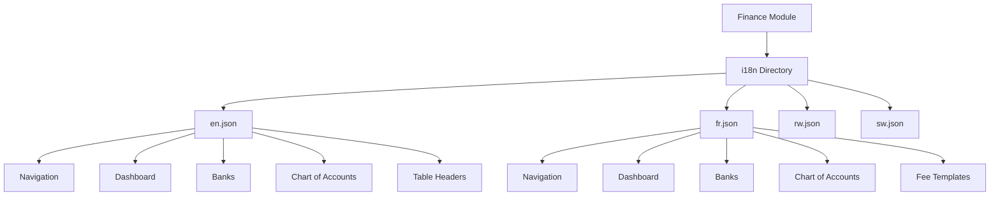
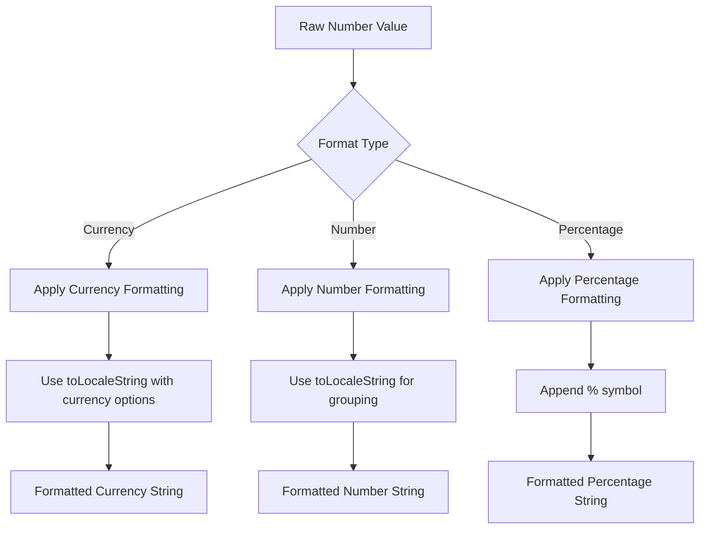
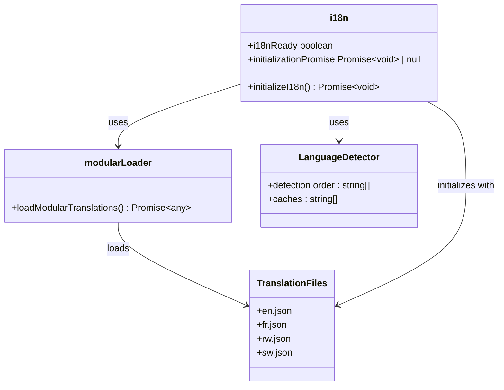

# Internationalization & Localization

<cite>
**Referenced Files in This Document**   
- [en.json](file://src/modules/finance/i18n/en.json)
- [fr.json](file://src/modules/finance/i18n/fr.json)
- [rw.json](file://src/modules/finance/i18n/rw.json)
- [sw.json](file://src/modules/finance/i18n/sw.json)
- [modularLoader.ts](file://src/i18n/modularLoader.ts)
- [i18n.ts](file://src/i18n/i18n.ts)
- [DataCard.tsx](file://src/components/ui/data/DataCard.tsx)
</cite>

## Table of Contents
1. [Introduction](#introduction)
2. [Translation File Structure](#translation-file-structure)
3. [Financial Terminology Localization](#financial-terminology-localization)
4. [Number and Currency Formatting](#number-and-currency-formatting)
5. [Modular i18n System Architecture](#modular-i18n-system-architecture)
6. [Best Practices for Language Support](#best-practices-for-language-support)
7. [Common Localization Issues](#common-localization-issues)
8. [Conclusion](#conclusion)

## Introduction
The Finance module implements a comprehensive internationalization (i18n) and localization system to support multiple languages including English, French, Kinyarwanda, and Swahili. This documentation details how financial terminology, number formatting, and currency symbols are localized across these languages. The system uses a modular approach where each module maintains its own translation files, which are dynamically loaded and integrated into a unified i18n framework based on i18next. This design enables consistent localization of financial text such as invoice labels, account names, and transaction descriptions while addressing locale-specific requirements for number formatting, currency symbol placement, and pluralization rules.

## Translation File Structure
The Finance module maintains separate JSON translation files for each supported language, following a consistent structure that organizes translations by functional areas such as navigation, dashboard, banks, and chart of accounts.



**Diagram sources**
- [en.json](file://src/modules/finance/i18n/en.json)
- [fr.json](file://src/modules/finance/i18n/fr.json)
- [rw.json](file://src/modules/finance/i18n/rw.json)
- [sw.json](file://src/modules/finance/i18n/sw.json)

**Section sources**
- [en.json](file://src/modules/finance/i18n/en.json)
- [fr.json](file://src/modules/finance/i18n/fr.json)
- [rw.json](file://src/modules/finance/i18n/rw.json)
- [sw.json](file://src/modules/finance/i18n/sw.json)

Each translation file follows a hierarchical structure with top-level keys for different functional areas. The structure includes:

- **navigation**: Contains labels for navigation menus and sidebar items
- **dashboard**: Includes text for dashboard components and widgets
- **banks**: Contains labels for bank account management features
- **chartOfAccounts**: Includes terminology for accounting functions
- **tableHeaders**: Standardizes column headers across financial tables
- **feeTemplates**: Contains labels for fee template management

The translation files are stored in the `src/modules/finance/i18n/` directory with standardized filenames (`en.json`, `fr.json`, `rw.json`, `sw.json`) that correspond to the ISO language codes.

## Financial Terminology Localization
The Finance module localizes financial terminology across four languages, ensuring that accounting concepts and financial operations are accurately represented in each locale.

### Navigation and Interface Labels
The navigation system is fully localized, with each language providing appropriate translations for financial module components:

**English (en.json)**
```json
"navigation": {
  "finance": {
    "title": "Finance",
    "dashboard": "Dashboard",
    "banks": "Banks",
    "chartOfAccounts": "Chart of Accounts",
    "invoices": "Invoices",
    "payments": "Payments"
  }
}
```

**French (fr.json)**
```json
"navigation": {
  "finance": {
    "title": "Finance",
    "dashboard": "Tableau de Bord",
    "banks": "Banques",
    "chartOfAccounts": "Plan Comptable",
    "invoices": "Factures",
    "payments": "Paiements"
  }
}
```

**Kinyarwanda (rw.json)**
```json
"navigation": {
  "finance": {
    "title": "Imari",
    "dashboard": "Ikibaho",
    "banks": "Amabanki",
    "chartOfAccounts": "Imbonerahamwe y'amakonti",
    "invoices": "Amafakitiri",
    "payments": "Kwishyura"
  }
}
```

**Swahili (sw.json)**
```json
"navigation": {
  "finance": {
    "title": "Fedha",
    "dashboard": "Dashibodi",
    "banks": "Benki",
    "chartOfAccounts": "Chati ya Akaunti",
    "invoices": "Ankara",
    "payments": "Malipo"
  }
}
```

### Financial Operation Terminology
Specific financial operations and accounting concepts are localized with attention to cultural and linguistic accuracy:

**Dashboard Terminology**
- English: "Total Income", "Total Expenses", "Net Position"
- French: "Revenu Total", "Dépenses Totales", "Position Nette"
- Kinyarwanda: "Amafaranga yose yinjira", "Amafaranga yose akoreshwa", "Imiterere y'amafaranga"
- Swahili: "Jumla ya Mapato", "Jumla ya Gharama", "Msimamo wa Safi"

**Bank Management Labels**
- English: "Add Bank Account", "Bank Name", "Account Number"
- French: "Ajouter Compte Bancaire", "Nom de la Banque", "Numéro de Compte"
- Kinyarwanda: "Ongeraho konti ya banki", "Izina rya banki", "Nomero ya konti"
- Swahili: "Ongeza Akaunti ya Benki", "Jina la Benki", "Nambari ya Akaunti"

**Chart of Accounts Terms**
- English: "Account Code", "Account Name", "Account Type"
- French: "Code Compte", "Nom du Compte", "Type de Compte"
- Kinyarwanda: "Kode ya konti", "Izina rya konti", "Ubwoko bwa konti"
- Swahili: "Msimbo wa Akaunti", "Jina la Akaunti", "Aina ya Akaunti"

**Section sources**
- [en.json](file://src/modules/finance/i18n/en.json)
- [fr.json](file://src/modules/finance/i18n/fr.json)
- [rw.json](file://src/modules/finance/i18n/rw.json)
- [sw.json](file://src/modules/finance/i18n/sw.json)

## Number and Currency Formatting
The system implements locale-specific number formatting for financial displays, though currency formatting follows a consistent pattern across locales.

### Number Formatting Implementation
Financial numbers are formatted using JavaScript's built-in `toLocaleString()` method, which automatically applies locale-specific formatting rules for number grouping and decimal separators.



**Diagram sources**
- [DataCard.tsx](file://src/components/ui/data/DataCard.tsx)

The `DataCard` component implements formatting for different field types:

```typescript
// Format field value based on type
const formatFieldValue = (field: DataCardField): ReactNode => {
  const { value, type } = field;
  
  if (React.isValidElement(value)) {
    return value;
  }
  
  const stringValue = String(value);
  
  switch (type) {
    case 'currency':
      return `$${parseFloat(stringValue).toLocaleString()}`;
    case 'percentage':
      return `${stringValue}%`;
    case 'number':
      return parseFloat(stringValue).toLocaleString();
    case 'date':
      // Date formatting logic
  }
};
```

### Currency Symbol and Placement
The Finance module uses a hybrid approach to currency formatting:

1. **Currency Symbol**: The Kenyan Shilling (KES) is the primary currency, but the interface uses the dollar sign ($) as a generic currency symbol in most displays.

2. **Symbol Placement**: The currency symbol is consistently placed before the amount across all locales, following the English convention rather than locale-specific rules.

3. **Explicit Currency Indication**: In detailed financial reports, the currency is explicitly indicated with "(KES)" suffix, as seen in the Account Ledger page:
   - "Debit (KES)"
   - "Credit (KES)"
   - "Balance (KES)"

4. **Decimal Precision**: Financial amounts are displayed with two decimal places using `toFixed(2)` for consistency in accounting precision.

### Locale-Specific Number Formatting
While the code currently uses a generic formatting approach, the i18n system is designed to support locale-specific number formatting:

- **English**: Uses comma as thousand separator and period as decimal separator (1,234.56)
- **French**: Would use space as thousand separator and comma as decimal separator (1 234,56)
- **Kinyarwanda and Swahili**: Typically follow English conventions in financial contexts

The current implementation primarily uses the `toLocaleString()` method, which would automatically apply the appropriate formatting based on the user's locale if properly configured.

**Section sources**
- [DataCard.tsx](file://src/components/ui/data/DataCard.tsx)
- [AccountLedgerPage.tsx](file://src/modules/reports/pages/AccountLedgerPage.tsx)

## Modular i18n System Architecture
The internationalization system follows a modular architecture that dynamically loads translation resources from individual modules.



**Diagram sources**
- [i18n.ts](file://src/i18n/i18n.ts)
- [modularLoader.ts](file://src/i18n/modularLoader.ts)

### System Components
The modular i18n system consists of several key components:

**i18n.ts**: The main i18next instance configuration that initializes the internationalization system:

```typescript
const initializeI18n = async (): Promise<void> => {
  if (i18nReady) {
    return;
  }
  
  if (initializationPromise) {
    return initializationPromise;
  }
  
  initializationPromise = (async () => {
    try {
      console.log('i18n: Starting initialization...');
      const resources = await loadModularTranslations();
      
      await i18n
        .use(LanguageDetector)
        .use(initReactI18next)
        .init({
          resources,
          fallbackLng: 'en',
          debug: process.env.NODE_ENV === 'development',
          defaultNS: 'common',
          returnNull: false,
          ns: [
            'common',
            'navigation',
            'dashboard',
            'academics',
            'administration',
            'finance',
            'hr',
            'inventory',
            'library',
            'settings',
            'student',
            'teacher'
          ],
          interpolation: {
            escapeValue: false,
          },
          react: {
            useSuspense: true,
            bindI18n: 'languageChanged loaded',
            bindI18nStore: 'added removed',
            nsMode: 'default',
          },
          detection: {
            order: ['localStorage', 'navigator', 'htmlTag'],
            caches: ['localStorage'],
          },
        });
      
      console.log('i18n: Successfully initialized');
      i18nReady = true;
    } catch (error) {
      console.error('i18n: Failed to initialize:', error);
      // Fallback initialization
    } finally {
      initializationPromise = null;
    }
  })();
  
  return initializationPromise;
};
```

**modularLoader.ts**: Dynamically loads translation files from all modules using Vite's import.meta.glob:

```typescript
export const loadModularTranslations = async () => {
  const resources: any = {
    en: { translation: {} },
    fr: { translation: {} },
    sw: { translation: {} },
    rw: { translation: {} }
  };

  const languages = ['en', 'fr', 'sw', 'rw'];

  for (const lang of languages) {
    resources[lang] = {
      navigation: {}
    };

    for (const path in modules) {
      const moduleName = path.split('/')[2];
      if (path.includes(`/${lang}.json`)) {
        const module = await (modules[path] as () => Promise<{ default: any }>)();
        const moduleData = module.default || module;
        
        if (!resources[lang][moduleName]) {
          resources[lang][moduleName] = {};
        }
        resources[lang][moduleName] = moduleData;
        
        if (moduleData.navigation) {
          Object.assign(resources[lang].navigation, moduleData.navigation);
        }
      }
    }
  }

  console.log("i18n: Modular resources constructed:", resources);
  return resources;
};
```

### Loading Process
The translation loading process follows these steps:

1. **Initialization**: The `initializeI18n` function is called to set up the i18next instance
2. **Resource Loading**: `loadModularTranslations` scans for all translation files in the modules directory
3. **Language Detection**: The LanguageDetector identifies the user's preferred language from localStorage, browser settings, or HTML tag
4. **Resource Construction**: Translation files are loaded and organized by language and module
5. **Namespace Merging**: Navigation translations are extracted and merged into a unified navigation namespace
6. **System Initialization**: i18next is initialized with the constructed resources

The system supports a fallback mechanism to English (en) when translations are missing in the user's preferred language.

**Section sources**
- [i18n.ts](file://src/i18n/i18n.ts)
- [modularLoader.ts](file://src/i18n/modularLoader.ts)

## Best Practices for Language Support
Based on the current implementation, the following best practices are recommended for adding new language support and maintaining translation consistency.

### Adding New Languages
To add support for a new language, follow these steps:

1. **Create Translation Files**: Add a new JSON file in the `src/modules/finance/i18n/` directory using the ISO language code (e.g., `es.json` for Spanish).

2. **Mirror Existing Structure**: Use the same hierarchical structure as existing translation files, ensuring all keys are present.

3. **Update Modular Loader**: The `modularLoader.ts` file automatically detects new language files, so no code changes are needed in the loader.

4. **Test Language Detection**: Verify that the LanguageDetector properly identifies and loads the new language.

5. **Add to i18next Configuration**: Ensure the new language is included in the initialization configuration.

### Maintaining Translation Consistency
To ensure consistency across financial reports and interfaces:

1. **Use Standardized Keys**: Follow the existing key naming conventions (lowercase with underscores or camelCase) consistently.

2. **Maintain Hierarchical Structure**: Organize translations by functional area (navigation, dashboard, banks, etc.) to ensure predictable lookup.

3. **Synchronize Updates**: When adding new financial features, update all language files simultaneously to prevent missing translations.

4. **Use Consistent Terminology**: Ensure financial terms are translated consistently across different parts of the interface.

5. **Implement Translation Validation**: Use tools like `translation-completeness-check.js` to verify all required keys are present in each language file.

6. **Regular Audits**: Conduct periodic reviews of translation files to ensure accuracy and consistency, especially for financial terminology.

7. **Contextual Documentation**: Include comments or documentation for ambiguous terms to guide translators on the appropriate financial context.

**Section sources**
- [modularLoader.ts](file://src/i18n/modularLoader.ts)
- [i18n.ts](file://src/i18n/i18n.ts)
- [en.json](file://src/modules/finance/i18n/en.json)

## Common Localization Issues
The Finance module may encounter several common localization issues that require specific attention.

### Number Formatting Inconsistencies
The current implementation shows potential inconsistencies in number formatting:

1. **Mixed Currency Symbols**: The system uses both the dollar sign ($) and explicit "(KES)" notation, which may confuse users.

2. **Lack of Locale-Specific Formatting**: While `toLocaleString()` is used, the full locale-specific formatting (thousand separators, decimal markers) may not be consistently applied across all financial displays.

3. **Fixed Currency Symbol**: The dollar sign is hardcoded in the DataCard component, preventing proper localization of currency symbols for different regions.

### Currency Symbol Placement
The system currently places currency symbols before the amount (e.g., "$1,234.56") across all locales, which may not align with local conventions:

- **English**: $1,234.56 (correct)
- **French**: Should be 1 234,56 € (space separator, comma decimal, symbol after)
- **Kinyarwanda and Swahili**: Typically follow English conventions

### Pluralization Rules
The current implementation does not appear to address pluralization rules for financial terms, which can vary significantly between languages:

- **English**: "1 invoice", "2 invoices"
- **French**: "1 facture", "2 factures" (different plural form)
- **Kinyarwanda**: Uses different noun classes for singular and plural
- **Swahili**: Uses prefixes to indicate number (e.g., "ankara moja", "ankara mbili")

### Financial Term Accuracy
Some financial terms may require specialized translation to ensure accounting accuracy:

1. **Technical Accounting Terms**: Terms like "Chart of Accounts", "General Ledger", and "Accrual Basis" have specific meanings that must be accurately conveyed.

2. **Legal Implications**: Invoice terms and payment conditions may have legal implications that require precise translation.

3. **Cultural Context**: Financial concepts like credit, debt, and payment terms may have different cultural connotations that affect user understanding.

### Recommendations for Improvement
To address these issues:

1. **Implement Proper Currency Formatting**: Use the Intl.NumberFormat API with proper locale configuration instead of hardcoded symbols.

2. **Add Pluralization Support**: Implement i18next's pluralization features to handle different grammatical number rules.

3. **Standardize Currency Display**: Choose a consistent approach (either symbolic or explicit) and apply it throughout the application.

4. **Enhance Number Formatting**: Ensure locale-specific number formatting is applied consistently across all financial displays.

5. **Conduct Linguistic Reviews**: Have financial professionals fluent in each target language review the translations for accuracy.

**Section sources**
- [DataCard.tsx](file://src/components/ui/data/DataCard.tsx)
- [en.json](file://src/modules/finance/i18n/en.json)
- [fr.json](file://src/modules/finance/i18n/fr.json)
- [rw.json](file://src/modules/finance/i18n/rw.json)
- [sw.json](file://src/modules/finance/i18n/sw.json)

## Conclusion
The Finance module's internationalization and localization system provides comprehensive support for English, French, Kinyarwanda, and Swahili languages through a modular architecture that dynamically loads translation files. The system effectively localizes financial terminology across key areas such as navigation, dashboard displays, bank management, and accounting functions. While the current implementation successfully addresses text translation, there are opportunities to improve number and currency formatting to better align with locale-specific conventions. The modular i18n system, built on i18next with dynamic loading via Vite's import.meta.glob, provides a scalable foundation for adding new languages and maintaining translation consistency. By following the recommended best practices and addressing the identified localization issues, the system can provide a more accurate and culturally appropriate financial management experience for users across different language regions.