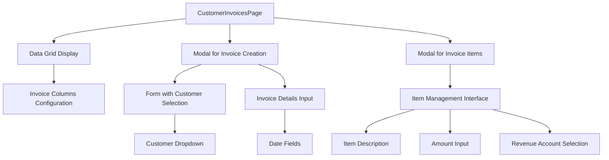
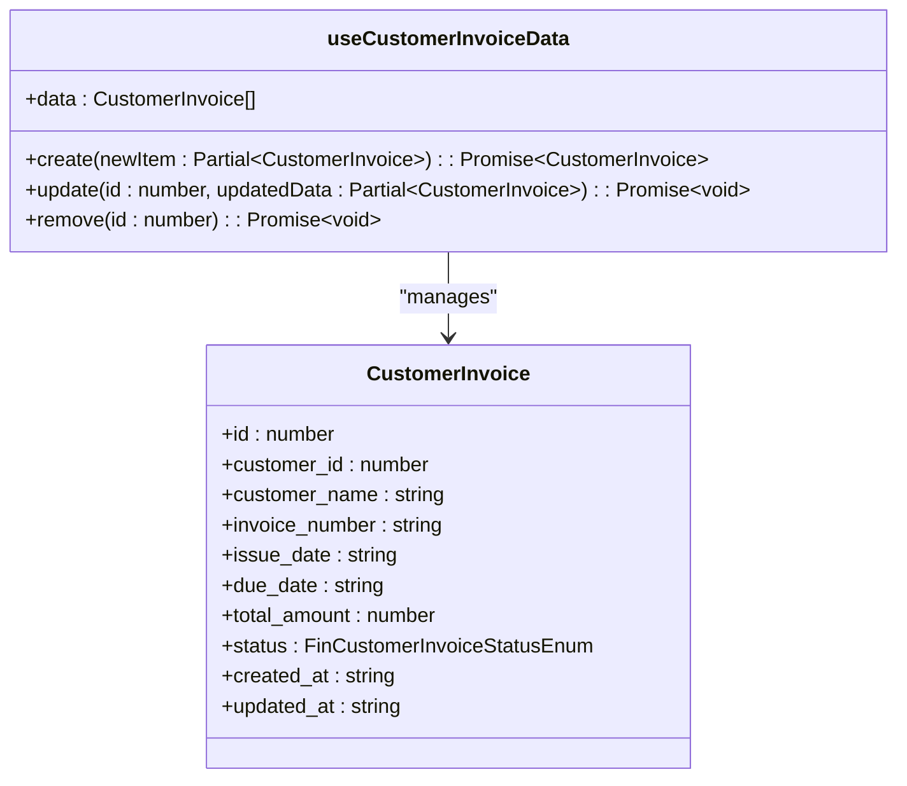
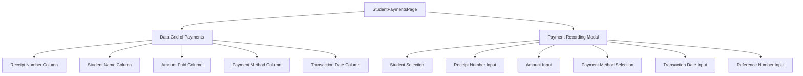
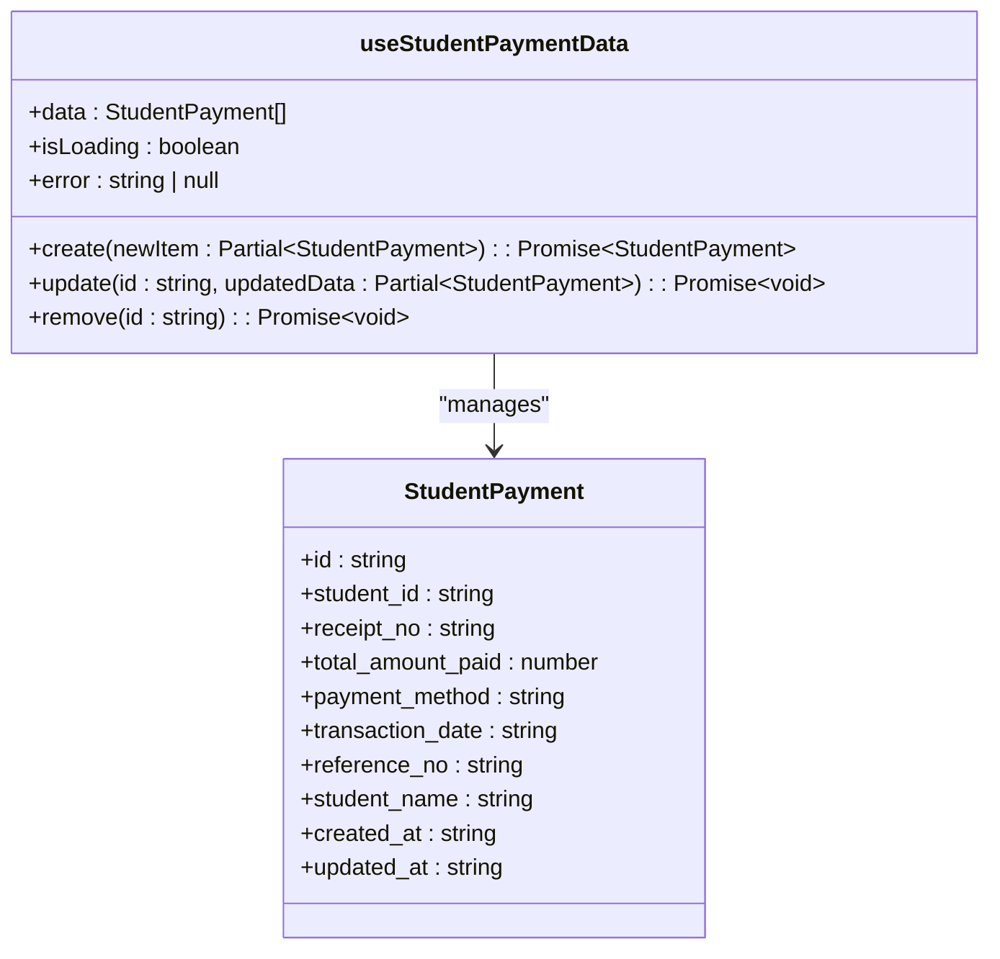
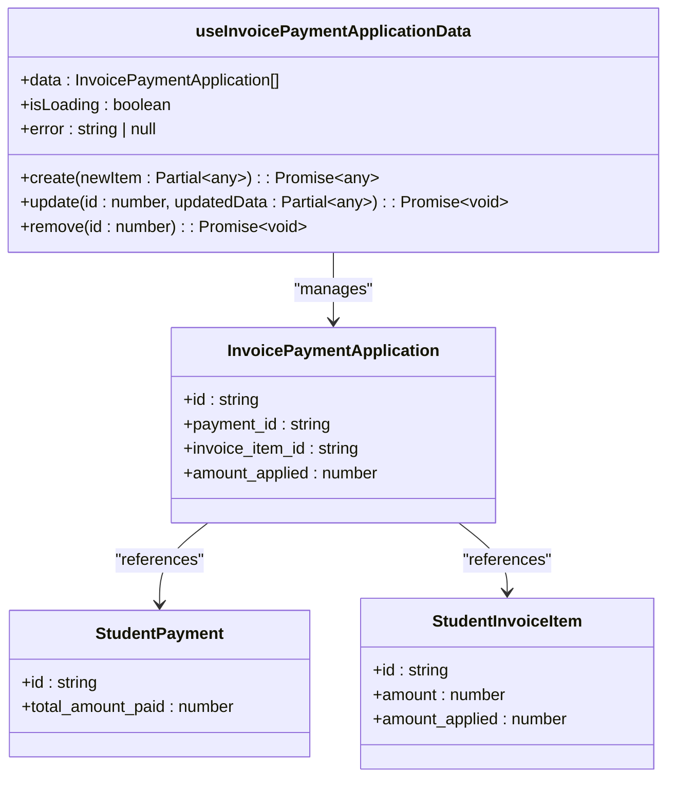
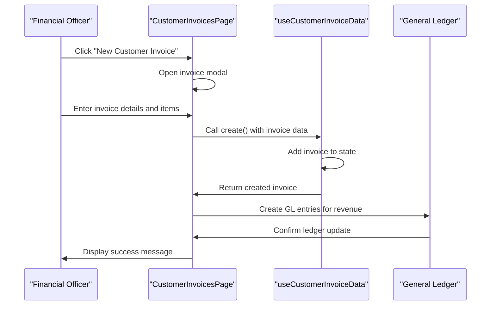

# Invoicing System

<cite>
**Referenced Files in This Document**   
- [CustomerInvoicesPage.tsx](file://src/modules/finance/pages/CustomerInvoicesPage.tsx)
- [StudentPaymentsPage.tsx](file://src/modules/finance/pages/StudentPaymentsPage.tsx)
- [useCustomerInvoiceData.ts](file://src/modules/finance/data/useCustomerInvoiceData.ts)
- [useInvoicePaymentApplicationData.ts](file://src/modules/finance/data/useInvoicePaymentApplicationData.ts)
- [useStudentInvoiceData.ts](file://src/modules/finance/data/useStudentInvoiceData.ts)
- [useStudentPaymentData.ts](file://src/modules/finance/data/useStudentPaymentData.ts)
- [mockData.ts](file://src/modules/finance/data/mockData.ts)
</cite>

## Table of Contents
1. [Introduction](#introduction)
2. [Invoice Lifecycle Management](#invoice-lifecycle-management)
3. [Customer Invoicing Implementation](#customer-invoicing-implementation)
4. [Student Payment Processing](#student-payment-processing)
5. [Data Integration and Ledger Updates](#data-integration-and-ledger-updates)
6. [Invoice Generation Workflows](#invoice-generation-workflows)
7. [Payment Reconciliation Processes](#payment-reconciliation-processes)
8. [Common Issues and Troubleshooting](#common-issues-and-troubleshooting)
9. [Best Practices for Invoicing and Collections](#best-practices-for-invoicing-and-collections)

## Introduction
The Invoicing System in schoolpilot3 provides comprehensive functionality for managing both customer and student financial transactions. The system supports the complete invoice lifecycle from creation to payment application and status tracking. This documentation details the implementation of customer and student invoicing, including the integration between various data hooks and components that ensure accurate ledger updates. The system is designed to handle complex financial operations while maintaining data integrity and providing a user-friendly interface for financial administrators.

## Invoice Lifecycle Management
The invoice lifecycle in schoolpilot3 follows a structured progression from draft to paid status, with support for partial payments and credit notes. The system tracks invoices through multiple states, ensuring accurate financial reporting and status visibility.

The customer invoice status is managed through the `FinCustomerInvoiceStatusEnum`, which defines three primary states:
- **PAID**: The invoice has been fully settled
- **DUE**: The invoice is outstanding but within the payment period
- **OVERDUE**: The invoice has passed its due date without full payment

For student invoices, the status is tracked using the `InvoiceStatus` enum with similar states. The system automatically updates invoice status based on payment applications, ensuring real-time accuracy in financial records.

The lifecycle begins with invoice creation in draft status, followed by issuance with an issue date and due date. When payments are applied, the system calculates the remaining balance and updates the status accordingly. For partial payments, the invoice remains in DUE or OVERDUE status until fully settled.

**Section sources**
- [mockData.ts](file://src/modules/finance/data/mockData.ts#L200-L261)
- [CustomerInvoicesPage.tsx](file://src/modules/finance/pages/CustomerInvoicesPage.tsx#L199-L467)

## Customer Invoicing Implementation
The customer invoicing system is implemented through the `CustomerInvoicesPage.tsx` component, which provides a comprehensive interface for managing invoices for external customers. The implementation follows a modular approach with dedicated data management hooks.

### CustomerInvoicesPage Component
The `CustomerInvoicesPage` component renders a data grid displaying all customer invoices with key information including invoice number, customer name, issue date, due date, total amount, and status. The component uses the `useCustomerInvoiceData` hook to manage invoice data and provides CRUD operations through modal dialogs.

**Diagram sources**
- [CustomerInvoicesPage.tsx](file://src/modules/finance/pages/CustomerInvoicesPage.tsx#L0-L467)

### Data Grid Configuration
The customer invoices data grid is configured with the following columns:

**invoiceColumns**:
- **invoice_number**: Displays the invoice number with monospace font styling
- **customer_name**: Shows the customer name in a prominent font
- **issue_date**: Displays the formatted issue date
- **due_date**: Shows the formatted due date or "-" if not set
- **total_amount**: Displays the amount in Kenyan Shillings (KES) with green text for positive values
- **status**: Renders a colored badge indicating the invoice status (green for PAID, yellow for DUE, red for OVERDUE)
- **actions**: Provides Edit, Items, and Delete buttons for each invoice

**itemColumns**:
- **description**: Shows the item description
- **amount**: Displays the item amount in KES
- **revenue_account_name**: Shows the associated revenue account
- **actions**: Provides Edit and Delete buttons for invoice items

The data grid includes filtering and sorting capabilities, allowing users to easily locate specific invoices. The empty state displays a receipt icon with a prompt to create the first invoice.

**Section sources**
- [CustomerInvoicesPage.tsx](file://src/modules/finance/pages/CustomerInvoicesPage.tsx#L199-L467)

### useCustomerInvoiceData Hook
The `useCustomerInvoiceData` hook provides the data management layer for customer invoices. This self-contained hook implements CRUD operations without depending on the global `AppDataContext`.

**Diagram sources**
- [useCustomerInvoiceData.ts](file://src/modules/finance/data/useCustomerInvoiceData.ts#L0-L40)

The hook uses React's `useState` and `useEffect` hooks to manage the invoice data. Key features include:
- **State Management**: Maintains invoice data in component state
- **Create Operation**: Generates a new invoice with a timestamp and unique ID
- **Update Operation**: Modifies existing invoices and updates the timestamp
- **Delete Operation**: Removes invoices from the data set

The implementation uses mock data initially, with `initialMockCustomerInvoices` providing sample data for demonstration purposes.

**Section sources**
- [useCustomerInvoiceData.ts](file://src/modules/finance/data/useCustomerInvoiceData.ts#L0-L40)
- [mockData.ts](file://src/modules/finance/data/mockData.ts#L200-L261)

## Student Payment Processing
The student payment system is implemented through the `StudentPaymentsPage.tsx` component, which allows financial administrators to record and manage student fee payments.

### StudentPaymentsPage Component
The `StudentPaymentsPage` component provides a streamlined interface for recording student payments. It displays a data grid of existing payments and includes a modal form for adding or editing payment records.

**Diagram sources**
- [StudentPaymentsPage.tsx](file://src/modules/finance/pages/StudentPaymentsPage.tsx#L0-L241)

### Payment Data Model
The student payment system uses the `StudentPayment` type to represent payment records with the following properties:
- **id**: Unique identifier for the payment
- **student_id**: Reference to the student who made the payment
- **receipt_no**: Unique receipt number for the transaction
- **total_amount_paid**: Amount paid in Kenyan Shillings
- **payment_method**: Method of payment (Cash, Bank Transfer, Cheque, Mobile Money, Card, Other)
- **transaction_date**: Date when the payment was made
- **reference_no**: Reference number (e.g., cheque number, M-Pesa code)
- **student_name**: Display name of the student
- **created_at**: Timestamp when the record was created
- **updated_at**: Timestamp when the record was last updated

**Section sources**
- [StudentPaymentsPage.tsx](file://src/modules/finance/pages/StudentPaymentsPage.tsx#L0-L241)

### useStudentPaymentData Hook
The `useStudentPaymentData` hook manages student payment data with full CRUD operations. Unlike the customer invoice hook, this implementation uses string IDs for payments, prefixed with "SPAY".

**Diagram sources**
- [useStudentPaymentData.ts](file://src/modules/finance/data/useStudentPaymentData.ts#L0-L56)

The hook implementation includes:
- **Asynchronous Operations**: All CRUD methods return promises for consistent async handling
- **Error Handling**: Try-catch blocks in the useEffect to handle data fetching errors
- **Loading State**: Tracks loading status during data operations
- **Unique ID Generation**: Creates payment IDs with "SPAY" prefix and timestamp

The initial data is populated from `initialMockStudentPayments` in the mock data file.

**Section sources**
- [useStudentPaymentData.ts](file://src/modules/finance/data/useStudentPaymentData.ts#L0-L56)
- [mockData.ts](file://src/modules/finance/data/mockData.ts#L200-L261)

## Data Integration and Ledger Updates
The invoicing system integrates multiple data sources to ensure accurate financial records and proper ledger updates. The system uses specialized hooks to manage the relationship between invoices and payments.

### Payment Application System
The `useInvoicePaymentApplicationData` hook manages the application of payments to invoice items. This critical component ensures that when a student makes a payment, the funds are properly allocated to specific invoice items.

**Diagram sources**
- [useInvoicePaymentApplicationData.ts](file://src/modules/finance/data/useInvoicePaymentApplicationData.ts#L0-L56)

The payment application process works as follows:
1. When a payment is recorded, the system creates a `StudentPayment` record
2. The payment amount is then allocated to specific invoice items through `InvoicePaymentApplication` records
3. Each application specifies which payment and which invoice item it applies to, along with the amount
4. The system updates the `amount_applied` field on invoice items to track payment progress
5. Invoice status is automatically updated based on the ratio of amount applied to total amount

This approach allows for partial payments, where a single payment can be split across multiple invoice items, or multiple payments can be applied to a single invoice.

**Section sources**
- [useInvoicePaymentApplicationData.ts](file://src/modules/finance/data/useInvoicePaymentApplicationData.ts#L0-L56)
- [mockData.ts](file://src/modules/finance/data/mockData.ts#L200-L261)

### General Ledger Integration
The system maintains a general ledger through the `GeneralLedgerEntry` records, which ensure double-entry accounting principles are followed. Each financial transaction creates corresponding debit and credit entries.

From the mock data, we can see examples of ledger entries for various transactions:
- **Student fees collection**: Debit to Bank Account, Credit to Tuition Fees Revenue
- **Expense payments**: Debit to Expense Account, Credit to Bank Account
- **Opening balances**: Debit to Asset accounts, Credit to Equity accounts

The ledger entries include:
- **transaction_date**: When the transaction occurred
- **effective_date**: When the transaction affects the accounts
- **financial_year_id**: Reference to the financial year
- **account_id**: GL account being affected
- **debit**: Amount debited (if applicable)
- **credit**: Amount credited (if applicable)
- **description**: Transaction description

This integration ensures that all invoicing and payment activities are properly reflected in the school's financial statements.

**Section sources**
- [mockData.ts](file://src/modules/finance/data/mockData.ts#L200-L261)

## Invoice Generation Workflows
The system supports multiple workflows for generating invoices, both for students and external customers.

### Student Invoice Generation
Student invoices are typically generated in bulk based on fee templates. The process involves:

1. **Fee Template Creation**: Administrators create fee templates that define the charges for different student categories and school periods
2. **Template Application**: The system applies the appropriate template to each student based on their category
3. **Invoice Generation**: Individual invoices are created for each student with items from the template
4. **Status Assignment**: Invoices are initially marked as "DUE" with appropriate issue and due dates

The mock data shows an example of a student invoice (SINV001) with two items: tuition fee and transport fee, totaling 60,000 KES. The invoice is linked to a specific school period and student.

### Customer Invoice Generation
Customer invoices for external services follow a different workflow:

1. **Customer Selection**: The user selects a customer from the customer database
2. **Invoice Details**: The user enters invoice number, issue date, and due date
3. **Item Addition**: One or more items are added to the invoice with descriptions and amounts
4. **Revenue Account Assignment**: Each item is assigned to a revenue GL account
5. **Invoice Finalization**: The invoice is saved with a status of "DUE"

The system supports editing existing invoices and adding new items to them. When an invoice is fully paid, its status automatically updates to "PAID".

**Diagram sources**
- [CustomerInvoicesPage.tsx](file://src/modules/finance/pages/CustomerInvoicesPage.tsx#L0-L467)
- [useCustomerInvoiceData.ts](file://src/modules/finance/data/useCustomerInvoiceData.ts#L0-L40)

**Section sources**
- [CustomerInvoicesPage.tsx](file://src/modules/finance/pages/CustomerInvoicesPage.tsx#L0-L467)
- [useCustomerInvoiceData.ts](file://src/modules/finance/data/useCustomerInvoiceData.ts#L0-L40)
- [mockData.ts](file://src/modules/finance/data/mockData.ts#L200-L261)

## Payment Reconciliation Processes
The payment reconciliation process ensures that all payments are properly accounted for and applied to the correct invoices.

### Payment Application Workflow
When a payment is received, the reconciliation process follows these steps:

1. **Payment Recording**: The payment is recorded in the `StudentPayments` table with all relevant details
2. **Application Creation**: One or more `InvoicePaymentApplication` records are created to specify how the payment should be allocated
3. **Invoice Update**: The affected invoice items have their `amount_applied` field updated
4. **Status Recalculation**: The overall invoice status is recalculated based on the payment-to-balance ratio
5. **Ledger Update**: Corresponding GL entries are created to reflect the cash receipt and reduction in accounts receivable

The mock data shows an example where a payment of 60,000 KES (SPAY001) is fully applied to an invoice with two items (sii_001 and sii_002) through two application records (IPA001 and IPA002).

### Reconciliation Verification
The system provides several mechanisms to verify payment reconciliation:

- **Data Grids**: Both the customer invoices and student payments pages display key financial information in tabular format
- **Status Indicators**: Visual cues (colored badges) immediately show the status of invoices
- **Amount Tracking**: The system displays both total amounts and amounts paid, making discrepancies immediately apparent
- **Audit Trail**: All changes are timestamped, allowing administrators to track when payments were applied

The reconciliation process is designed to prevent common errors such as:
- Applying payments to the wrong student
- Double-applying the same payment
- Applying amounts that exceed invoice balances
- Creating payments without corresponding ledger entries

**Section sources**
- [StudentPaymentsPage.tsx](file://src/modules/finance/pages/StudentPaymentsPage.tsx#L0-L241)
- [useInvoicePaymentApplicationData.ts](file://src/modules/finance/data/useInvoicePaymentApplicationData.ts#L0-L56)
- [mockData.ts](file://src/modules/finance/data/mockData.ts#L200-L261)

## Common Issues and Troubleshooting
The invoicing system may encounter several common issues that require specific troubleshooting approaches.

### Duplicate Payments
Duplicate payments can occur when a payment is accidentally recorded twice. The system prevents this through:

- **Receipt Number Validation**: Each receipt number should be unique
- **Transaction Date Verification**: Payments on the same date for the same amount should be investigated
- **Amount Matching**: Large payments should be verified against invoice totals

To resolve duplicate payments:
1. Identify the duplicate payment record
2. Void the incorrect payment rather than deleting it
3. Create a credit note if necessary
4. Update the ledger to reverse the incorrect entries

### Currency Mismatches
The current system appears to use Kenyan Shillings (KES) as the primary currency. Currency mismatches can occur when:
- Invoices are created in different currencies
- Payments are made in foreign currencies
- Exchange rate fluctuations affect balances

To prevent currency issues:
- Standardize on a single currency for all transactions
- Implement currency conversion for international payments
- Display currency codes prominently on all financial documents
- Validate currency consistency during payment application

### Tax Calculation Errors
While the current implementation doesn't explicitly show tax calculations, potential tax issues could include:
- Incorrect tax rates applied to invoice items
- Tax amounts not properly separated from base amounts
- Inconsistent tax treatment across similar items
- Missing tax documentation

Best practices for tax management:
- Define tax rates in a centralized configuration
- Apply taxes at the item level with clear labeling
- Generate tax reports for compliance
- Regularly audit tax calculations against manual computations

**Section sources**
- [CustomerInvoicesPage.tsx](file://src/modules/finance/pages/CustomerInvoicesPage.tsx#L0-L467)
- [StudentPaymentsPage.tsx](file://src/modules/finance/pages/StudentPaymentsPage.tsx#L0-L241)
- [mockData.ts](file://src/modules/finance/data/mockData.ts#L200-L261)

## Best Practices for Invoicing and Collections
To ensure effective financial management, the following best practices should be followed:

### Late Payment Management
For invoices that become overdue:
- **Automated Reminders**: Implement automated email or SMS reminders as due dates approach
- **Grace Periods**: Define clear grace periods before applying late fees
- **Escalation Procedures**: Establish a clear escalation path for persistent late payments
- **Payment Plans**: Offer flexible payment plans for large balances

### Dunning Procedures
A structured dunning process helps maintain cash flow while preserving customer relationships:

1. **First Reminder**: Send a polite reminder 3 days before the due date
2. **Overdue Notice**: Send a formal notice immediately after the due date
3. **Final Notice**: Send a final notice with consequences of non-payment after 14 days
4. **Collection Action**: Escalate to collection procedures after 30 days

### Data Integrity Practices
To maintain accurate financial records:
- **Regular Reconciliation**: Perform daily reconciliation of payments against bank statements
- **Audit Trails**: Maintain complete audit trails for all financial transactions
- **Backup Procedures**: Implement regular backups of financial data
- **Access Controls**: Restrict financial system access based on roles and responsibilities

### Reporting and Analytics
Effective financial management requires robust reporting:
- **Aging Reports**: Track outstanding invoices by age (30, 60, 90+ days)
- **Collection Rates**: Monitor the percentage of invoices collected on time
- **Revenue Trends**: Analyze revenue patterns by customer, service type, or time period
- **Cash Flow Projections**: Use invoice data to forecast future cash flow

By following these best practices, educational institutions can maintain healthy financial operations while providing excellent service to students and external customers.

**Section sources**
- [CustomerInvoicesPage.tsx](file://src/modules/finance/pages/CustomerInvoicesPage.tsx#L0-L467)
- [StudentPaymentsPage.tsx](file://src/modules/finance/pages/StudentPaymentsPage.tsx#L0-L241)
- [mockData.ts](file://src/modules/finance/data/mockData.ts#L200-L261)