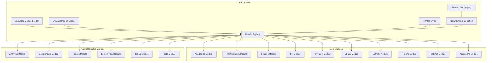
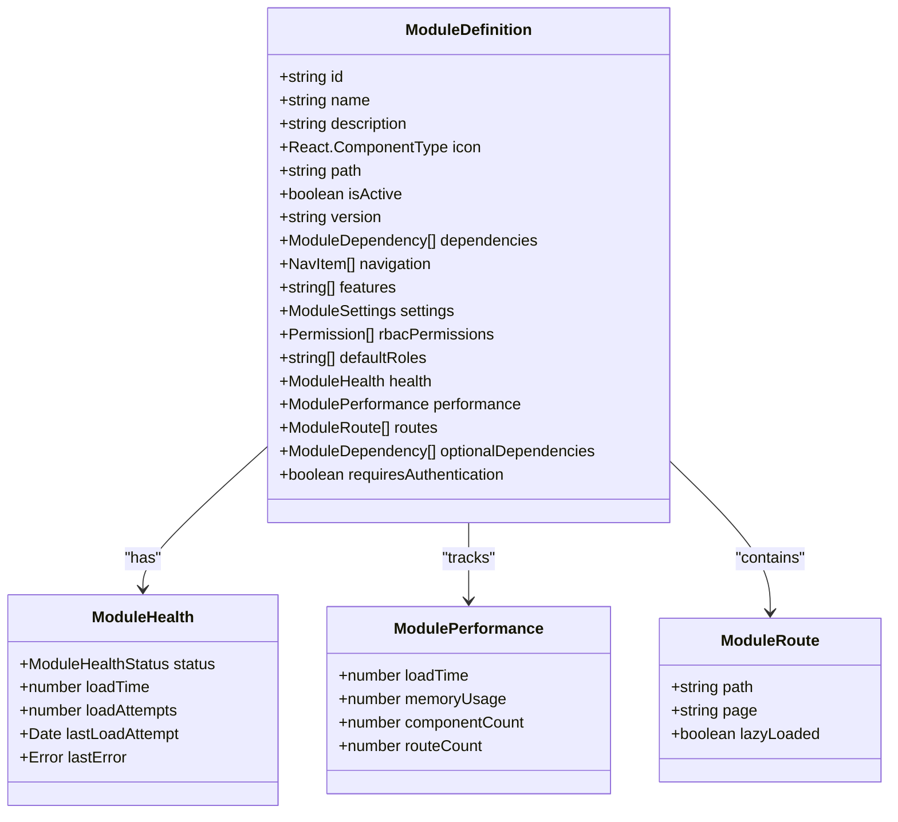
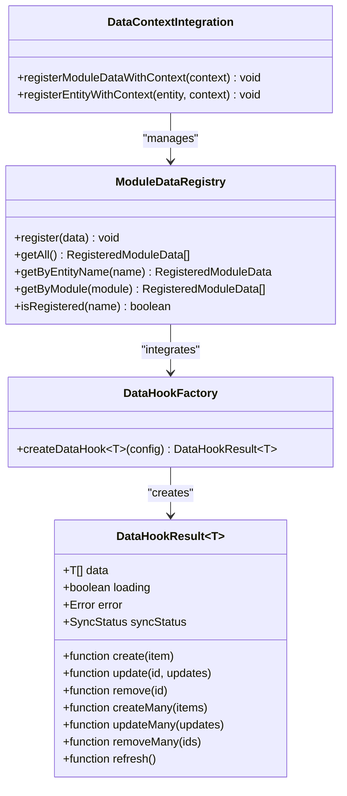
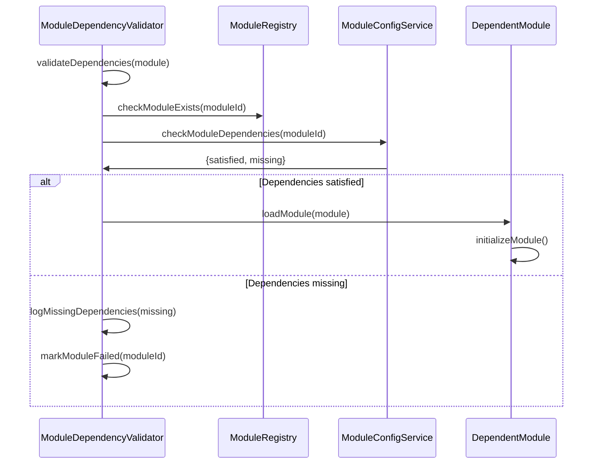
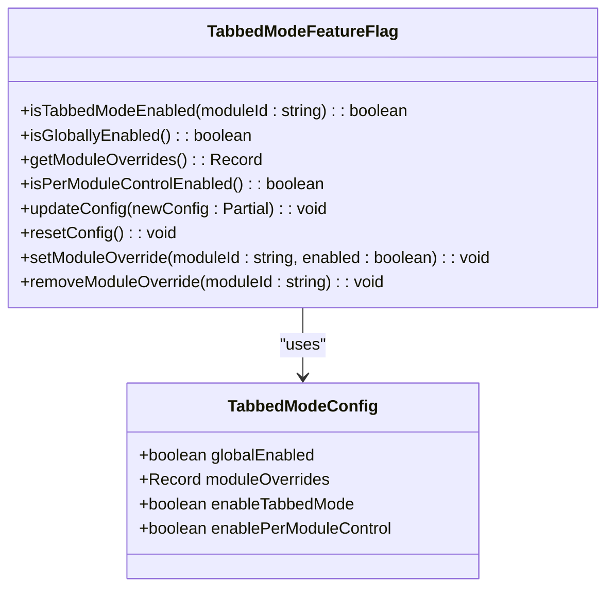
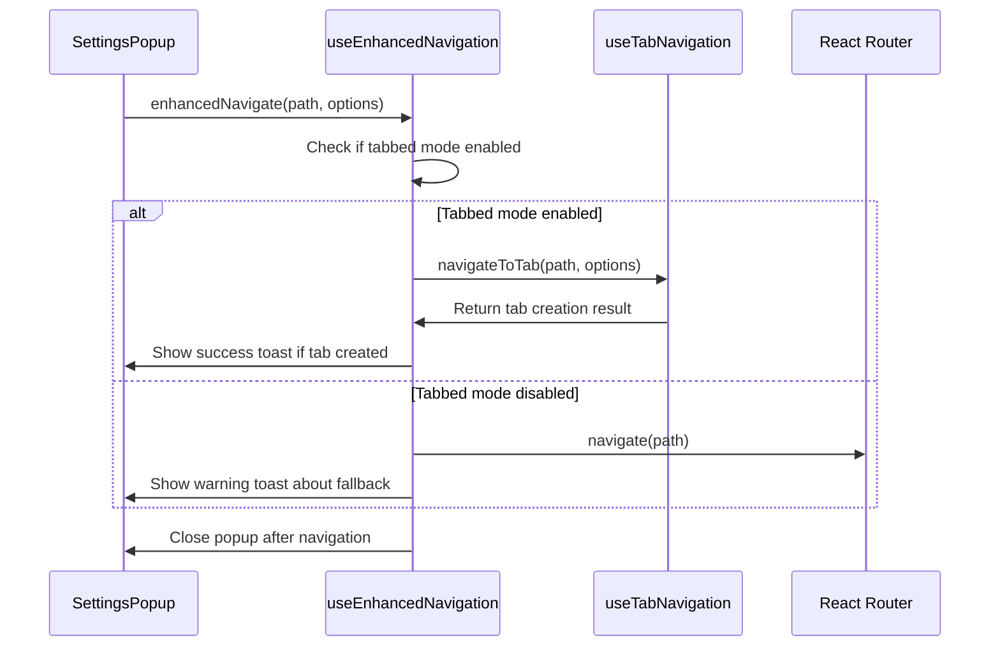

# Functional Modules

<cite>
**Referenced Files in This Document**
- [moduleDefinition.tsx](file://src/modules/academics/moduleDefinition.tsx)
- [rbac.ts](file://src/modules/academics/rbac.ts)
- [moduleDefinition.tsx](file://src/modules/administration/moduleDefinition.tsx)
- [rbac.ts](file://src/modules/administration/rbac.ts)
- [moduleDefinition.tsx](file://src/modules/finance/moduleDefinition.tsx)
- [rbac.ts](file://src/modules/finance/rbac.ts)
- [moduleDefinition.tsx](file://src/modules/hr/moduleDefinition.tsx)
- [rbac.ts](file://src/modules/hr/rbac.ts)
- [moduleDefinition.tsx](file://src/modules/inventory/moduleDefinition.tsx)
- [rbac.ts](file://src/modules/inventory/rbac.ts)
- [moduleDefinition.tsx](file://src/modules/library/moduleDefinition.tsx)
- [rbac.ts](file://src/modules/library/rbac.ts)
- [moduleDefinition.tsx](file://src/modules/nutrition/moduleDefinition.tsx)
- [rbac.ts](file://src/modules/nutrition/rbac.ts)
- [moduleDefinition.tsx](file://src/modules/reports/moduleDefinition.tsx)
- [rbac.ts](file://src/modules/reports/rbac.ts)
- [moduleDefinition.tsx](file://src/modules/settings/moduleDefinition.tsx)
- [rbac.ts](file://src/modules/settings/rbac.ts)
- [moduleDefinition.tsx](file://src/modules/admissions/moduleDefinition.tsx)
- [rbac.ts](file://src/modules/admissions/rbac.ts)
- [AdmissionsDashboardPage.tsx](file://src/modules/admissions/pages/AdmissionsDashboardPage.tsx)
- [useAdmissionsData.ts](file://src/modules/admissions/data/useAdmissionsData.ts)
- [moduleDefinition.tsx](file://src/modules/analytics/moduleDefinition.tsx)
- [rbac.ts](file://src/modules/analytics/rbac.ts)
- [moduleDefinition.tsx](file://src/modules/assignments/moduleDefinition.tsx)
- [rbac.ts](file://src/modules/assignments/rbac.ts)
- [moduleDefinition.tsx](file://src/modules/houses/moduleDefinition.tsx)
- [rbac.ts](file://src/modules/houses/rbac.ts)
- [moduleDefinition.tsx](file://src/modules/lessonplans/moduleDefinition.tsx)
- [rbac.ts](file://src/modules/lessonplans/rbac.ts)
- [moduleDefinition.tsx](file://src/modules/pickup/moduleDefinition.tsx)
- [rbac.ts](file://src/modules/pickup/rbac.ts)
- [moduleDefinition.tsx](file://src/modules/portal/moduleDefinition.tsx)
- [rbac.ts](file://src/modules/portal/rbac.ts)
- [types.ts](file://src/core/types.ts)
- [rbacService.ts](file://src/core/rbacService.ts)
- [dynamicModuleLoader.ts](file://src/services/dynamicModuleLoader.ts)
- [enhancedModuleLoader.ts](file://src/services/enhancedModuleLoader.ts)
- [ModuleDataRegistry.ts](file://src/services/ModuleDataRegistry.ts)
- [DataContextIntegrationService.ts](file://src/services/DataContextIntegrationService.ts)
- [useEnhancedNavigation.ts](file://src/hooks/useEnhancedNavigation.ts)
- [useDataHookFactory.ts](file://src/hooks/useDataHookFactory.ts)
- [SettingsPopup.tsx](file://src/components/SettingsPopup.tsx)
- [tabbedModeFeatureFlag.ts](file://src/services/tabbedModeFeatureFlag.ts)
- [TabbedModeSettingsPanel.tsx](file://src/modules/settings/components/TabbedModeSettingsPanel.tsx)
- [TabbedModeSettingsPage.tsx](file://src/modules/settings/pages/TabbedModeSettingsPage.tsx)
- [moduleRegistry.ts](file://src/core/moduleRegistry.ts)
- [unifiedConfig.ts](file://src/config/unifiedConfig.ts)
</cite>

## Update Summary
**Changes Made**
- Added comprehensive new modules: Analytics, Assignments, Houses, Lesson Plans, Pickup, and Portal
- Each new module includes complete RBAC configurations, internationalization support, and standardized module definitions
- Enhanced module ecosystem with specialized functionality for teacher analytics, assignment management, house system, lesson planning, student pickup, and parent portals
- Expanded dependency relationships and cross-module integrations
- Updated module interaction patterns to support new workflows and data flows

## Table of Contents
1. [Functional Modules](#functional-modules)
2. [Modular Architecture Overview](#modular-architecture-overview)
3. [Module Implementation Patterns](#module-implementation-patterns)
4. [Core Module Definitions](#core-module-definitions)
5. [New Comprehensive Module Ecosystem](#new-comprehensive-module-ecosystem)
6. [Enhanced Module Dashboards](#enhanced-module-dashboards)
7. [Improved Data Hooks and Services](#improved-data-hooks-and-services)
8. [Enhanced Module Dependencies](#enhanced-module-dependencies)
9. [Module Interaction Patterns](#module-interaction-patterns)
10. [Tabbed Mode Configuration](#tabbed-mode-configuration)
11. [Conclusion](#conclusion)

## Modular Architecture Overview

The schoolpilot3 system implements a sophisticated modular architecture that enables independent development, testing, and deployment of functional areas. Each module is a self-contained unit with its own components, data models, services, and configuration. This architecture promotes separation of concerns, reduces coupling between system components, and allows for incremental feature development.

The modular design follows a consistent pattern across all functional areas, with each module containing standardized files for registration, permission management, and internationalization. The recent enhancements include a new centralized data registry, improved dependency management, and enhanced dashboard capabilities.

**Diagram sources**
- [enhancedModuleLoader.ts](file://src/services/enhancedModuleLoader.ts)
- [ModuleDataRegistry.ts](file://src/services/ModuleDataRegistry.ts)
- [DataContextIntegrationService.ts](file://src/services/DataContextIntegrationService.ts)

**Section sources**
- [enhancedModuleLoader.ts:1-51](file://src/services/enhancedModuleLoader.ts#L1-L51)
- [ModuleDataRegistry.ts:1-124](file://src/services/ModuleDataRegistry.ts#L1-L124)

## Module Implementation Patterns

The system follows standardized implementation patterns for module registration and permission management. Each module implements a consistent structure with specific files that define its behavior and integration points with the core system.

### Enhanced Module Definition Pattern

All modules implement a `moduleDefinition.tsx` file that exports a `ModuleDefinition` object conforming to the interface defined in `src/core/types.ts`. The new enhanced pattern includes additional fields for health monitoring, performance metrics, and improved dependency management.

The `ModuleDefinition` interface now includes enhanced properties:
- **health**: Module health status and monitoring
- **performance**: Performance metrics and optimization data
- **dependencies**: Enhanced dependency tracking with health status
- **optionalDependencies**: Support for optional module dependencies
- **routes**: Enhanced routing configuration with lazy loading
- **requiresAuthentication**: New field for authentication requirements

**Diagram sources**
- [types.ts:1720-1786](file://src/core/types.ts#L1720-L1786)
- [enhancedModuleLoader.ts:1-51](file://src/services/enhancedModuleLoader.ts#L1-L51)

**Section sources**
- [types.ts:1720-1786](file://src/core/types.ts#L1720-L1786)
- [enhancedModuleLoader.ts:1-51](file://src/services/enhancedModuleLoader.ts#L1-L51)

### RBAC Implementation Pattern

Each module defines its permissions in a `rbac.ts` file that exports an array of `Permission` objects and an array of default roles. The enhanced RBAC system now includes better categorization and feature-based permissions.

**Section sources**
- [rbacService.ts:679-696](file://src/core/rbacService.ts#L679-L696)
- [rbac.ts](file://src/modules/academics/rbac.ts)

## Core Module Definitions

### Academics Module

The Academics module manages educational content, exam scheduling, and grading systems. It provides comprehensive tools for curriculum management, student assessment, and academic performance tracking.

**Key Components:**
- **Exam Scheduling UI**: Interface for creating and managing exam schedules
- **Grade Calculator Widget**: Tool for calculating and converting grades
- **Result Review Interface**: System for reviewing and approving exam results
- **Scheduling Calendar**: Visual calendar for exam and timetable management

**Business Capabilities:**
- Exam scheduling and management
- Grading scheme configuration
- Student exam result entry and approval
- Timetable integration
- Academic year and period management
- Subject and class allocation

**Dependencies:**
- Administration (required): For student and staff data
- Finance (optional): For financial implications of academic decisions
- Reports (optional): For academic performance analytics

### Administration Module

The Administration module handles student records, staff management, and organizational structure. It serves as the central repository for demographic and organizational data used by other modules.

**Key Components:**
- **Application Management**: System for managing student applications
- **PreNAs Marks Management**: Interface for managing preliminary assessment marks
- **Quick Edit Config Modal**: Tool for rapid configuration of administrative settings

**Business Capabilities:**
- Student registration and profile management
- Staff records and personnel management
- Class and academic structure configuration
- Attendance tracking
- Communication template management
- Message campaign execution
- Academic year and period definitions

**Dependencies:**
- None (core dependency for other modules)

### Finance Module

The Finance module manages fee structures, payment processing, and accounting functions. It integrates with other modules to handle financial transactions related to student services and institutional operations.

**Key Components:**
- **Fee Management**: System for configuring and managing fee structures
- **Payment Processing**: Interface for recording and tracking payments
- **Financial Reporting**: Tools for generating financial statements and analytics

**Business Capabilities:**
- Fee template and structure management
- Student payment processing
- Invoice management (customer and supplier)
- Expense tracking and management
- Bank and supplier management
- Financial year management
- Transport fee assignments

**Dependencies:**
- Administration (required): For student and customer data

### HR Module

The HR module manages payroll, staff compensation, and human resources records. It provides tools for payroll processing and staff financial management.

**Key Components:**
- **Payroll Management**: System for managing payroll cycles and calculations
- **Payslip Generation**: Interface for creating and distributing payslips
- **Salary Settings**: Configuration for staff compensation structures

**Business Capabilities:**
- Payroll item type management
- Payroll period configuration
- Payslip generation and distribution
- Staff salary setting management
- Compensation tracking

**Dependencies:**
- Administration (required): For staff records and organizational structure

### Inventory Module

The Inventory module manages stock levels, procurement, and asset tracking. It provides comprehensive tools for inventory control and supply chain management.

**Key Components:**
- **Reorder Alerts Panel**: Interface for monitoring stock levels and reorder points
- **Procurement System**: Tools for managing purchase orders and requisitions
- **Asset Tracking**: System for tracking fixed assets and equipment

**Business Capabilities:**
- Inventory item management
- Stock level monitoring
- Reorder alert management
- Stock reception and returns
- Requisition and purchase order management
- Stock issuance
- Supplier management
- Fixed asset tracking
- Warehouse management

**Dependencies:**
- Administration (required): For supplier and organizational data

### Library Module

The Library module manages book lending, cataloging, and library operations. It provides tools for tracking library resources and patron borrowing activities.

**Key Components:**
- **Catalog Management**: System for managing library book inventory
- **Lending System**: Interface for processing book loans and returns
- **Patron Management**: Tools for managing library members

**Business Capabilities:**
- Book catalog management
- Book lending and return processing
- Loan period tracking
- Fine calculation and management
- Patron registration and management
- Reservation system
- Inventory tracking

**Dependencies:**
- Administration (required): For student and staff data as library patrons

### Nutrition Module

The Nutrition module manages meal planning, dietary requirements, and food service operations. It provides tools for planning and tracking student nutrition programs.

**Key Components:**
- **Meal Planning**: System for creating and managing meal plans
- **Dietary Management**: Interface for tracking special dietary requirements
- **Nutrition Tracking**: Tools for monitoring nutritional intake

**Business Capabilities:**
- Meal plan creation and scheduling
- Menu management
- Dietary requirement tracking
- Allergy management
- Nutrition analysis
- Food inventory integration
- Meal service tracking

**Dependencies:**
- Administration (required): For student data and dietary requirements
- Inventory (optional): For food stock management

### Reports Module

The Reports module provides analytics, dashboards, and reporting capabilities across all functional areas. It serves as the central system for data visualization and business intelligence.

**Key Components:**
- **Analytics Dashboards**: Pre-built dashboards for key performance indicators
- **Report Library**: Repository of standard and custom reports
- **Data Visualization**: Tools for creating charts and graphs

**Business Capabilities:**
- Academic performance analytics
- Financial reporting
- Student attendance analytics
- HR and payroll reporting
- Inventory and procurement analytics
- Custom report creation
- Data export and sharing
- Dashboard customization

**Dependencies:**
- All other modules (optional): For data integration and cross-module analytics

**Section sources**
- [moduleDefinition.tsx](file://src/modules/academics/moduleDefinition.tsx)
- [rbac.ts](file://src/modules/academics/rbac.ts)
- [moduleDefinition.tsx](file://src/modules/administration/moduleDefinition.tsx)
- [rbac.ts](file://src/modules/administration/rbac.ts)
- [moduleDefinition.tsx](file://src/modules/finance/moduleDefinition.tsx)
- [rbac.ts](file://src/modules/finance/rbac.ts)
- [moduleDefinition.tsx](file://src/modules/hr/moduleDefinition.tsx)
- [rbac.ts](file://src/modules/hr/rbac.ts)
- [moduleDefinition.tsx](file://src/modules/inventory/moduleDefinition.tsx)
- [rbac.ts](file://src/modules/inventory/rbac.ts)
- [moduleDefinition.tsx](file://src/modules/library/moduleDefinition.tsx)
- [rbac.ts](file://src/modules/library/rbac.ts)
- [moduleDefinition.tsx](file://src/modules/nutrition/moduleDefinition.tsx)
- [rbac.ts](file://src/modules/nutrition/rbac.ts)
- [moduleDefinition.tsx](file://src/modules/reports/moduleDefinition.tsx)
- [rbac.ts](file://src/modules/reports/rbac.ts)

## New Comprehensive Module Ecosystem

The schoolpilot3 system now features a comprehensive module ecosystem with six new specialized modules that extend the platform's functionality across multiple operational domains.

### Analytics Module

The Analytics module provides comprehensive teacher and academic analytics capabilities, computing insights from existing data without creating new collections.

**Key Components:**
- **Teacher Dashboard**: Personalized analytics dashboard for educators
- **Subject Analytics**: Detailed performance analysis by subject area
- **Class Analytics**: Aggregate performance metrics for classroom management
- **Report Export**: Multi-format report generation and export capabilities

**Business Capabilities:**
- Teacher performance monitoring and insights
- Subject-level academic analysis
- Class-wide performance tracking
- Comparative performance analysis across periods
- Trend analysis over academic timeframes
- Multi-format report export (PDF, CSV, Excel)

**Dependencies:**
- Academics (required): For academic data and performance metrics
- HR (required): For staff-related analytics and performance data

**Section sources**
- [moduleDefinition.tsx](file://src/modules/analytics/moduleDefinition.tsx)
- [rbac.ts](file://src/modules/analytics/rbac.ts)

### Assignments Module

The Assignments module manages the complete lifecycle of academic assignments, from creation to grading and analytics.

**Key Components:**
- **Assignment Management**: Create, edit, and manage academic assignments
- **Submission Handling**: Student submission tracking and management
- **Grading Interface**: Digital assignment grading and feedback system
- **Analytics Dashboard**: Assignment performance and completion analytics

**Business Capabilities:**
- Assignment creation and distribution
- Student submission tracking and management
- Digital assignment grading and feedback
- Assignment analytics and performance insights
- Template management for recurring assignments
- Rubric-based grading support

**Dependencies:**
- Administration (required): For student and teacher data
- Academics (required): For subject and class context

**Section sources**
- [moduleDefinition.tsx](file://src/modules/assignments/moduleDefinition.tsx)
- [rbac.ts](file://src/modules/assignments/rbac.ts)

### Houses Module

The Houses module implements a comprehensive house system for student recognition, point management, and behavioral tracking.

**Key Components:**
- **House Management**: Create and manage house categories and teams
- **Point Transaction System**: Award, deduct, and track merit/demerit points
- **Leaderboard Management**: Real-time ranking and achievement tracking
- **Category Management**: Define point categories and award criteria

**Business Capabilities:**
- House creation and management
- Point awarding and deduction system
- Merit and demerit tracking
- Leaderboard generation and management
- Point transaction approval workflows
- Category-based point management

**Dependencies:**
- Administration (required): For student data and house membership

**Section sources**
- [moduleDefinition.tsx](file://src/modules/houses/moduleDefinition.tsx)
- [rbac.ts](file://src/modules/houses/rbac.ts)

### Lesson Plans Module

The Lesson Plans module provides comprehensive lesson planning, tracking, and approval capabilities for educational institutions.

**Key Components:**
- **Weekly Planning**: Structured weekly lesson plan creation and management
- **Daily Notes**: Lesson execution tracking and daily reflections
- **Approval Workflow**: Hierarchical approval system for lesson plans
- **Coverage Tracking**: Substitute teacher coverage and plan tracking

**Business Capabilities:**
- Weekly lesson plan creation and management
- Daily lesson notes and reflections
- Hierarchical plan approval workflows
- Coverage reporting and substitute management
- Syllabus coverage tracking and analysis

**Dependencies:**
- Academics (required): For academic context and subject alignment

**Section sources**
- [moduleDefinition.tsx](file://src/modules/lessonplans/moduleDefinition.tsx)
- [rbac.ts](file://src/modules/lessonplans/rbac.ts)

### Pickup Module

The Pickup module manages student dismissal procedures, authorization tracking, and safety verification processes.

**Key Components:**
- **Pickup Authorization**: Manage authorized pickup persons and codes
- **Verification System**: QR code and photo ID verification
- **Pickup Logging**: Comprehensive pickup transaction logging
- **Parent Notifications**: Automated notification system for pickups

**Business Capabilities:**
- Authorized person management and verification
- Digital pickup code generation and validation
- Photo ID verification for safety
- Comprehensive pickup transaction logging
- Parent notification and communication
- Security-focused dismissal procedures

**Dependencies:**
- Administration (required): For student and authorized person data

**Section sources**
- [moduleDefinition.tsx](file://src/modules/pickup/moduleDefinition.tsx)
- [rbac.ts](file://src/modules/pickup/rbac.ts)

### Portal Module

The Portal module provides secure access to institutional information for students, parents, and guardians through a comprehensive web portal.

**Key Components:**
- **Student Dashboard**: Personalized student information and progress
- **Parent Dashboard**: View children's information and institutional updates
- **Attendance Tracking**: Real-time attendance monitoring
- **Academic Results**: Secure access to academic performance data
- **Fee Management**: Payment history and fee statement access
- **Announcements**: Institutional news and communications

**Business Capabilities:**
- Secure student and parent portal access
- Personalized dashboard with relevant information
- Attendance monitoring and reporting
- Academic result viewing and tracking
- Fee statement and payment history access
- Institutional announcement viewing
- Profile management and updates

**Dependencies:**
- Administration (required): For user and student data
- Academics (required): For academic information
- Finance (optional): For fee and payment information

**Section sources**
- [moduleDefinition.tsx](file://src/modules/portal/moduleDefinition.tsx)
- [rbac.ts](file://src/modules/portal/rbac.ts)

## Enhanced Module Dashboards

The system now provides enhanced dashboard capabilities across all functional modules, featuring standardized dashboard shells, real-time data visualization, and integrated analytics.

### Standardized Dashboard Framework

**ModuleDashboardShell Components:**
- **DashboardMetric**: Key performance indicators with icons and trend data
- **DashboardPanel**: Container for charts and data visualizations
- **DashboardNotification**: Priority alerts and workflow reminders
- **DashboardQuickAction**: Direct navigation to critical workflows

**Enhanced Analytics:**
- Real-time data updates and synchronization
- Interactive chart components with filtering capabilities
- Performance monitoring and health indicators
- Cross-module data integration and correlation

**Section sources**
- [AdmissionsDashboardPage.tsx](file://src/modules/admissions/pages/AdmissionsDashboardPage.tsx)

## Improved Data Hooks and Services

The system implements a comprehensive data management framework with standardized hooks, centralized registries, and enhanced performance monitoring.

### Enhanced Data Hook Factory

The new `useDataHookFactory` provides a standardized approach to data management across all modules, ensuring consistency and reliability in data operations.

**Key Features:**
- **Standardized Interfaces**: Consistent CRUD operations across all modules
- **Performance Monitoring**: Built-in performance tracking and optimization
- **Memory Management**: Intelligent caching and memory-aware operations
- **Data Validation**: Automatic validation and consistency checks
- **Offline Support**: Configurable offline-first data operations
- **Sync Management**: Intelligent synchronization with backend systems

**Data Hook Capabilities:**
- Individual entity operations (create, read, update, delete)
- Batch operations for bulk data management
- Real-time synchronization status tracking
- Error handling and recovery mechanisms
- Performance metrics and operation logging

**Diagram sources**
- [useDataHookFactory.ts:1-557](file://src/hooks/useDataHookFactory.ts#L1-L557)
- [ModuleDataRegistry.ts:1-124](file://src/services/ModuleDataRegistry.ts#L1-L124)
- [DataContextIntegrationService.ts:1-99](file://src/services/DataContextIntegrationService.ts#L1-L99)

**Section sources**
- [useDataHookFactory.ts:1-557](file://src/hooks/useDataHookFactory.ts#L1-L557)
- [ModuleDataRegistry.ts:1-124](file://src/services/ModuleDataRegistry.ts#L1-L124)
- [DataContextIntegrationService.ts:1-99](file://src/services/DataContextIntegrationService.ts#L1-L99)

### Centralized Module Data Registry

The `ModuleDataRegistry` service provides centralized management of all module data entities, enabling better coordination and integration across the system.

**Registry Features:**
- **Automatic Discovery**: Automatic registration from global providers
- **Entity Metadata**: Comprehensive metadata tracking for all data entities
- **Cross-Module Access**: Unified access patterns across all modules
- **Performance Optimization**: Priority-based synchronization and caching
- **Dependency Tracking**: Automatic dependency resolution and management

**Section sources**
- [ModuleDataRegistry.ts:1-124](file://src/services/ModuleDataRegistry.ts#L1-L124)

## Enhanced Module Dependencies

The system now implements sophisticated dependency management with health monitoring, validation, and enhanced loading mechanisms.

### Advanced Dependency Management

**Enhanced Dependency Features:**
- **Health Monitoring**: Real-time health status tracking for all dependencies
- **Circular Dependency Detection**: Advanced algorithms to prevent circular dependencies
- **Version Compatibility**: Sophisticated version checking and conflict resolution
- **Lazy Loading**: Intelligent loading of dependencies based on usage patterns
- **Graceful Degradation**: Fallback mechanisms when dependencies fail

**Dependency Validation:**
- Synchronous validation to prevent race conditions
- Comprehensive dependency graph analysis
- Circular dependency detection and reporting
- Optional dependency management with fallbacks

**Diagram sources**
- [ModuleDependencyValidator.ts](file://src/core/services/ModuleDependencyValidator.ts)
- [moduleConfigService.ts](file://src/services/moduleConfigService.ts)

**Section sources**
- [ModuleDependencyValidator.ts:1-179](file://src/core/services/ModuleDependencyValidator.ts#L1-L179)
- [moduleConfigService.ts:297-325](file://src/services/moduleConfigService.ts#L297-L325)

## Module Interaction Patterns

The enhanced modular architecture enables sophisticated cross-module interactions with improved data sharing and workflow coordination.

### Enhanced Cross-Module Integration

**Academic-Financial Integration:**
The Admissions module integrates with the Finance module for automated fee processing and payment integration. When applications are approved, the system automatically creates student records and assigns appropriate fee structures.

**Analytics-Teaching Integration:**
The Analytics module leverages data from the Academics module to provide teacher performance insights and subject-level analysis. The Assignments module feeds into Analytics for assignment completion and performance tracking.

**Student Information Flow:**
The Portal module provides authenticated access to information from Administration, Academics, and Finance modules, creating a unified view for students and parents.

**Security Integration:**
The Pickup module integrates with Administration for student and authorized person data, ensuring secure dismissal procedures.

**Educational Workflow Integration:**
The Lesson Plans module coordinates with Academics for subject context and with HR for staff scheduling, creating a comprehensive educational workflow system.

**Section sources**
- [moduleDefinition.tsx](file://src/modules/admissions/moduleDefinition.tsx)
- [moduleDefinition.tsx](file://src/modules/finance/moduleDefinition.tsx)
- [moduleDefinition.tsx](file://src/modules/analytics/moduleDefinition.tsx)
- [moduleDefinition.tsx](file://src/modules/assignments/moduleDefinition.tsx)
- [moduleDefinition.tsx](file://src/modules/portal/moduleDefinition.tsx)
- [moduleDefinition.tsx](file://src/modules/pickup/moduleDefinition.tsx)
- [moduleDefinition.tsx](file://src/modules/lessonplans/moduleDefinition.tsx)

## Tabbed Mode Configuration

The system now supports configurable tabbed mode navigation, allowing users to open module pages in tabs for improved workflow efficiency. This feature is controlled through a feature flag system that enables granular control over tabbed mode behavior.

### Tabbed Mode Feature Flag System

The tabbed mode functionality is managed by the `tabbedModeFeatureFlag` service, which provides runtime configuration of tabbed mode behavior. The system supports both global and per-module configuration, allowing administrators to enable or disable tabbed mode for specific modules.

**Key Configuration Options:**
- **Global Enable/Disable**: Toggle tabbed mode for the entire application
- **Per-Module Control**: Enable or disable tabbed mode for individual modules
- **Module Overrides**: Set specific tabbed mode behavior for each module
- **Runtime Configuration**: Update settings without requiring application restart

**Section sources**
- [tabbedModeFeatureFlag.ts](file://src/services/tabbedModeFeatureFlag.ts)
- [TabbedModeSettingsPanel.tsx](file://src/modules/settings/components/TabbedModeSettingsPanel.tsx)
- [TabbedModeSettingsPage.tsx](file://src/modules/settings/pages/TabbedModeSettingsPage.tsx)

### Enhanced Navigation System

The navigation system has been updated to support tabbed mode through the `useEnhancedNavigation` hook, which wraps standard navigation with tabbed mode functionality when enabled.

**Key Features:**
- **Conditional Tab Creation**: Creates tabs only when tabbed mode is enabled
- **Fallback to Standard Navigation**: Falls back to standard navigation if tabbed mode fails
- **Navigation Feedback**: Provides user feedback when tabs are created
- **Seamless Integration**: Works with existing navigation patterns

**Section sources**
- [SettingsPopup.tsx](file://src/components/SettingsPopup.tsx)
- [useEnhancedNavigation.ts](file://src/hooks/useEnhancedNavigation.ts)
- [useTabNavigation.ts](file://src/hooks/useTabNavigation.ts)

## Conclusion

The schoolpilot3 system's enhanced modular architecture provides a robust foundation for managing complex educational institution operations. The addition of six new comprehensive modules significantly expands the system's capabilities while maintaining architectural consistency and standards.

**Key Architectural Strengths:**
- **Comprehensive Module Ecosystem**: Complete coverage from admissions through specialized analytics and portal services
- **Standardized Data Management**: Consistent patterns across all modules via enhanced hooks
- **Advanced Dependency Management**: Sophisticated validation and health monitoring
- **Centralized Data Integration**: Unified access patterns through the registry system
- **Enhanced User Experience**: Improved navigation and workflow efficiency
- **Scalable Architecture**: Foundation for future module additions and enhancements
- **Specialized Functionality**: Domain-specific modules for distinct operational needs

**Recent Enhancements:**
- **New Analytics Module**: Comprehensive teacher and academic analytics with comparative analysis
- **Assignments Module**: Complete assignment lifecycle management with digital grading
- **Houses Module**: Behavioral management and recognition system with point tracking
- **Lesson Plans Module**: Structured lesson planning with approval workflows
- **Pickup Module**: Security-focused student dismissal and authorization system
- **Portal Module**: Secure parent and student information access portal
- **Enhanced Data Hooks**: Standardized factory pattern with performance monitoring and validation
- **Centralized Registry**: Unified management of module data entities and dependencies
- **Improved Dependencies**: Health monitoring and advanced validation capabilities
- **Enhanced Dashboards**: Real-time analytics and interactive visualizations
- **Tabbed Mode Integration**: Flexible navigation with granular configuration controls

The new module ecosystem demonstrates the system's maturity and adaptability, providing specialized solutions for modern educational institution needs while maintaining the core architectural principles of modularity, scalability, and maintainability. Each new module follows established patterns and integrates seamlessly with existing functionality, ensuring system cohesion despite the expanded feature set.

This architecture enables the system to evolve continuously, with new modules added and existing modules enhanced independently. The standardized patterns reduce development complexity while the enhanced dependency management ensures system stability and performance. The recent improvements position the system for future growth and adaptation to changing educational institution needs.