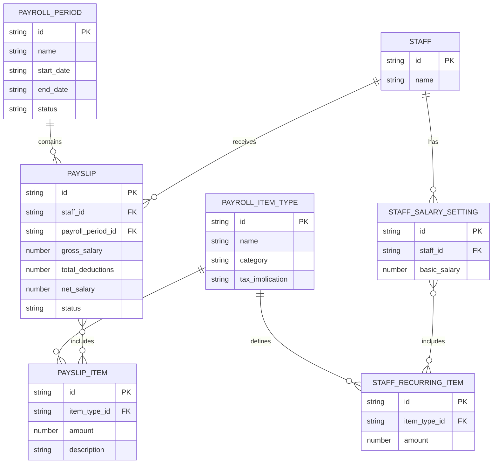
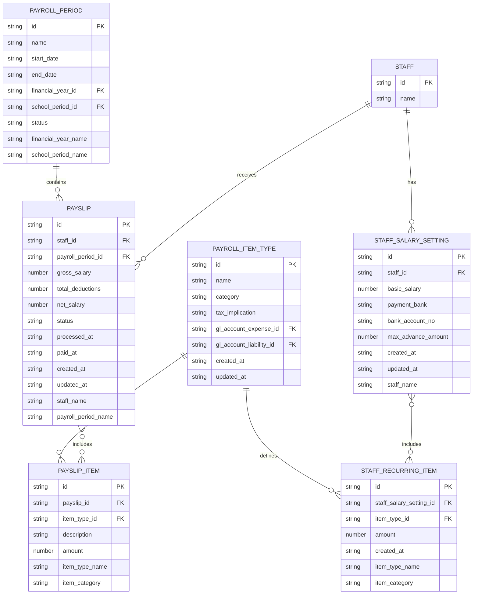

# HR Data Model

<cite>
**Referenced Files in This Document**   
- [schema.ts](file://src/modules/hr/data/schema.ts)
- [types.ts](file://src/modules/hr/data/types.ts)
- [collections.ts](file://src/modules/hr/data/collections.ts)
- [usePayrollPeriodData.ts](file://src/modules/hr/data/usePayrollPeriodData.ts)
- [usePayrollItemTypeData.ts](file://src/modules/hr/data/usePayrollItemTypeData.ts)
- [usePayslipData.ts](file://src/modules/hr/data/usePayslipData.ts)
- [usePayslipItemData.ts](file://src/modules/hr/data/usePayslipItemData.ts)
- [useStaffRecurringItemData.ts](file://src/modules/hr/data/useStaffRecurringItemData.ts)
- [useStaffSalarySettingData.ts](file://src/modules/hr/data/useStaffSalarySettingData.ts)
</cite>

## Table of Contents
1. [Introduction](#introduction)
2. [Entity Relationship Overview](#entity-relationship-overview)
3. [Collection Definitions and Schemas](#collection-definitions-and-schemas)
4. [Field Definitions and Constraints](#field-definitions-and-constraints)
5. [Data Validation and Business Rules](#data-validation-and-business-rules)
6. [Database Schema Diagram](#database-schema-diagram)
7. [Sample Data Records](#sample-data-records)
8. [Data Access Patterns via use*Data Hooks](#data-access-patterns-via-usedata-hooks)
9. [RxDB Collection Definitions](#rxdb-collection-definitions)
10. [Data Lifecycle and Retention Policies](#data-lifecycle-and-retention-policies)
11. [Data Security and Access Control](#data-security-and-access-control)
12. [Performance Considerations](#performance-considerations)

## Introduction

This document provides comprehensive documentation for the Human Resources (HR) module's data model within the EduGen school management system. The HR module manages payroll-related data including staff salary configurations, payroll periods, payslips, and associated financial items. The data schema is implemented using RxDB, a client-side database for JavaScript applications, enabling offline-first capabilities and real-time synchronization.

The core entities in this model include **Staff**, **PayrollPeriod**, **PayrollItemType**, **Payslip**, **PayslipItem**, and **StaffRecurringItem**. These entities are interconnected through well-defined relationships to support accurate payroll processing, reporting, and compliance. This documentation details the structure, constraints, relationships, and access patterns for these collections, serving as a reference for developers, administrators, and auditors.

**Section sources**
- [schema.ts](file://src/modules/hr/data/schema.ts#L1-L110)
- [types.ts](file://src/modules/hr/data/types.ts#L1-L86)

## Entity Relationship Overview

The HR data model is structured around payroll processing, with **Staff** as the central entity. Each staff member has salary settings defined in **StaffSalarySetting**, which includes a basic salary and optional recurring payroll items (e.g., allowances or deductions). Payroll processing occurs within defined **PayrollPeriods**, which are time-bound cycles (e.g., monthly) during which payslips are generated.

Each **Payslip** is associated with one **Staff** member and one **PayrollPeriod**, and contains multiple **PayslipItem** entries that detail earnings, deductions, and contributions. The types of items that can appear on a payslip are defined by **PayrollItemType**, which categorizes items into Earnings, Deductions, or Employer Contributions and specifies tax implications and accounting codes.

Notably, **StaffRecurringItem** is not a standalone collection but is embedded within **StaffSalarySetting**, reflecting items that automatically appear on every payslip. Similarly, **PayslipItem** is nested within **Payslip**, ensuring data consistency and reducing join complexity.



**Diagram sources**
- [schema.ts](file://src/modules/hr/data/schema.ts#L1-L110)
- [collections.ts](file://src/modules/hr/data/collections.ts#L1-L25)

## Collection Definitions and Schemas

The HR module defines five top-level collections in RxDB: `payroll_periods`, `payroll_item_types`, `staff_salary_settings`, `payslips`. Two additional entities—`StaffRecurringItem` and `PayslipItem`—are implemented as nested objects within `staff_salary_settings` and `payslips` respectively, rather than as separate collections.

Each collection is defined using a database-agnostic schema via the `createDatabaseSchema` utility, which ensures compatibility across different database providers (e.g., RxDB, PouchDB). The schema includes field definitions, data types, validation rules, indexes, and primary keys.

### PayrollPeriod Collection
Represents a defined period for payroll processing (e.g., "June 2024 Payroll"). Each period has a start and end date, status, and references to financial and school periods.

### PayrollItemType Collection
Defines the types of items that can appear on payslips or recurring salary settings. Each type has a category (Earning, Deduction, Contribution), tax implication, and associated general ledger accounts.

### StaffSalarySetting Collection
Stores the salary configuration for each staff member, including basic salary, bank details, and a list of recurring payroll items that apply to every payslip.

### Payslip Collection
Represents a finalized or draft payroll statement for a staff member in a specific period. Contains computed totals (gross, deductions, net) and a list of detailed items.

**Section sources**
- [schema.ts](file://src/modules/hr/data/schema.ts#L1-L110)
- [collections.ts](file://src/modules/hr/data/collections.ts#L1-L25)

## Field Definitions and Constraints

This section details the field definitions, data types, primary/foreign keys, and constraints for each collection.

### PayrollPeriod Fields
- **id**: `string` - Primary key; unique identifier (max 100 chars)
- **name**: `string` - Payroll period name (required, max 100 chars)
- **start_date**: `string` (format: date) - Period start date (required, max 20 chars)
- **end_date**: `string` (format: date) - Period end date (required, max 20 chars)
- **financial_year_id**: `string` - Foreign key to financial_years collection (required, max 100 chars)
- **school_period_id**: `string` - Foreign key to school_periods collection (max 100 chars)
- **status**: `string` - Current status (required; enum: Draft, Open, Closed, Processed)
- **financial_year_name**: `string` - Computed financial year name (max 100 chars)
- **school_period_name**: `string` - Computed school period name (max 100 chars)

**Constraints**: `id`, `name`, `start_date`, `end_date`, and `financial_year_id` are required. Indexed on `name`, `financial_year_id`, and `status`.

### PayrollItemType Fields
- **id**: `string` - Primary key; unique identifier (max 100 chars)
- **name**: `string` - Item type name (required, max 100 chars)
- **category**: `string` - Category (required; enum: Earning, Deduction, Contribution (Employer))
- **tax_implication**: `string` - Tax treatment (required; enum: Taxable, Non-Taxable, Tax Relief)
- **gl_account_expense_id**: `string` - GL account for expense tracking (max 100 chars)
- **gl_account_liability_id**: `string` - GL account for liability tracking (max 100 chars)
- **created_at**: `string` (format: timestamp) - Creation time (required)
- **updated_at**: `string` (format: timestamp) - Last update time (required)

**Constraints**: All fields except GL accounts are required. Indexed on `name` and `category`.

### StaffSalarySetting Fields
- **id**: `string` - Primary key; unique identifier (max 100 chars)
- **staff_id**: `string` - Foreign key to staff collection (required, max 100 chars)
- **basic_salary**: `number` - Base monthly salary (required; min 0, max 999,999.99)
- **payment_bank**: `string` - Bank name for salary transfer (max 100 chars)
- **bank_account_no**: `string` - Bank account number (max 50 chars)
- **max_advance_amount**: `number` - Maximum allowable advance (min 0, max 999,999.99)
- **created_at**: `string` (format: timestamp) - Creation time (required)
- **updated_at**: `string` (format: timestamp) - Last update time (required)
- **recurring_items**: `array` of `StaffRecurringItem` - List of recurring items
- **staff_name**: `string` - Computed staff name (max 200 chars)

**Constraints**: `id`, `staff_id`, `basic_salary`, `created_at`, and `updated_at` are required. Indexed on `staff_id`.

### StaffRecurringItem (Nested)
- **id**: `string` - Unique identifier (max 100 chars)
- **staff_salary_setting_id**: `string` - Parent setting ID (max 100 chars)
- **item_type_id**: `string` - Foreign key to payroll_item_types (required, max 100 chars)
- **amount**: `number` - Fixed amount (min 0, max 999,999.99)
- **created_at**: `string` (format: timestamp) - Creation time
- **item_type_name**: `string` - Computed item type name (max 100 chars)
- **item_category**: `string` - Computed category (enum or null)

### Payslip Fields
- **id**: `string` - Primary key; unique identifier (max 100 chars)
- **staff_id**: `string` - Foreign key to staff collection (required, max 100 chars)
- **payroll_period_id**: `string` - Foreign key to payroll_periods (required)
- **gross_salary**: `number` - Total earnings before deductions (min 0, max 999,999.99)
- **total_deductions**: `number` - Sum of all deductions (min 0, max 999,999.99)
- **net_salary**: `number` - Final payable amount (range: -999,999.99 to 999,999.99)
- **status**: `string` - Payslip status (required; enum: Draft, Processed, Paid, Cancelled)
- **processed_at**: `string` (format: timestamp) - Processing timestamp
- **paid_at**: `string` (format: timestamp) - Payment timestamp
- **created_at**: `string` (format: timestamp) - Creation time (required)
- **updated_at**: `string` (format: timestamp) - Last update time (required)
- **items**: `array` of `PayslipItem` - Detailed line items
- **staff_name**: `string` - Computed staff name (max 200 chars)
- **payroll_period_name**: `string` - Computed period name (max 100 chars)

**Constraints**: `id`, `staff_id`, `payroll_period_id`, `status`, `created_at`, and `updated_at` are required. Indexed on `staff_id`, `payroll_period_id`, and `status`.

### PayslipItem (Nested)
- **id**: `string` - Unique identifier (max 100 chars)
- **payslip_id**: `string` - Parent payslip ID (max 100 chars)
- **item_type_id**: `string` - Foreign key to payroll_item_types (required, max 100 chars)
- **description**: `string` - Item description (max 500 chars)
- **amount**: `number` - Item amount (min 0, max 999,999.99)
- **item_type_name**: `string` - Computed item type name (max 100 chars)
- **item_category**: `string` - Computed category (enum or null)

**Section sources**
- [schema.ts](file://src/modules/hr/data/schema.ts#L1-L110)

## Data Validation and Business Rules

The HR data model enforces several validation rules and business logic constraints to ensure data integrity and correct payroll calculations.

### Payroll Period Date Constraints
- The `start_date` must be before or equal to the `end_date`.
- Payroll periods must not overlap with other active periods for the same financial year.
- A payroll period cannot be closed if any associated payslip is still in "Draft" status.

### Salary Calculation Logic
- **Gross Salary**: Sum of `basic_salary` from `StaffSalarySetting` and all recurring earning items.
- **Total Deductions**: Sum of all deduction and contribution items from both recurring settings and one-time payslip adjustments.
- **Net Salary**: `gross_salary - total_deductions`. This value can be negative only in exceptional cases (e.g., overpayment recovery).

When generating a payslip:
1. The system copies all recurring items from the staff's salary setting.
2. It applies any one-time adjustments (e.g., bonuses, leave deductions).
3. It computes totals and validates against the staff's maximum advance limit.
4. The final payslip is saved with status "Draft" and can later be processed or paid.

### Status Transitions
- **PayrollPeriod**: Draft → Open → Closed → Processed (irreversible)
- **Payslip**: Draft → Processed → Paid (or Draft → Cancelled)

Only payslips with status "Processed" or "Paid" can be included in financial reports.

**Section sources**
- [schema.ts](file://src/modules/hr/data/schema.ts#L1-L110)
- [types.ts](file://src/modules/hr/data/types.ts#L1-L86)

## Database Schema Diagram

The following Entity-Relationship Diagram (ERD) illustrates the structure and relationships between the HR collections.



**Diagram sources**
- [schema.ts](file://src/modules/hr/data/schema.ts#L1-L110)
- [collections.ts](file://src/modules/hr/data/collections.ts#L1-L25)

## Sample Data Records

### PayrollPeriod Sample
```json
{
  "id": "pp-2024-06",
  "name": "June 2024 Payroll",
  "start_date": "2024-06-01",
  "end_date": "2024-06-30",
  "financial_year_id": "fy-2024",
  "school_period_id": "sp-2024-term2",
  "status": "Closed",
  "financial_year_name": "FY 2024",
  "school_period_name": "Term 2, 2024"
}
```

### PayrollItemType Sample
```json
{
  "id": "pit-001",
  "name": "Basic Salary",
  "category": "Earning",
  "tax_implication": "Taxable",
  "gl_account_expense_id": "gl-1010",
  "gl_account_liability_id": "gl-2010",
  "created_at": "2024-01-15T10:30:00Z",
  "updated_at": "2024-01-15T10:30:00Z"
}
```

### StaffSalarySetting Sample
```json
{
  "id": "sss-001",
  "staff_id": "emp-1001",
  "basic_salary": 50000.00,
  "payment_bank": "National Bank",
  "bank_account_no": "XXXX-XXXX-1234",
  "max_advance_amount": 20000.00,
  "created_at": "2023-05-10T08:00:00Z",
  "updated_at": "2024-03-01T14:20:00Z",
  "recurring_items": [
    {
      "id": "sri-001",
      "staff_salary_setting_id": "sss-001",
      "item_type_id": "pit-002",
      "amount": 5000.00,
      "created_at": "2023-05-10T08:00:00Z",
      "item_type_name": "Housing Allowance",
      "item_category": "Earning"
    }
  ],
  "staff_name": "John Doe"
}
```

### Payslip Sample
```json
{
  "id": "ps-001-202406",
  "staff_id": "emp-1001",
  "payroll_period_id": "pp-2024-06",
  "gross_salary": 55000.00,
  "total_deductions": 12000.00,
  "net_salary": 43000.00,
  "status": "Paid",
  "processed_at": "2024-07-01T09:00:00Z",
  "paid_at": "2024-07-02T15:30:00Z",
  "created_at": "2024-07-01T08:00:00Z",
  "updated_at": "2024-07-02T15:30:00Z",
  "items": [
    {
      "id": "psi-001",
      "payslip_id": "ps-001-202406",
      "item_type_id": "pit-001",
      "description": "Basic Salary",
      "amount": 50000.00,
      "item_type_name": "Basic Salary",
      "item_category": "Earning"
    },
    {
      "id": "psi-002",
      "payslip_id": "ps-001-202406",
      "item_type_id": "pit-003",
      "description": "Pension Contribution",
      "amount": 12000.00,
      "item_type_name": "Pension",
      "item_category": "Contribution (Employer)"
    }
  ],
  "staff_name": "John Doe",
  "payroll_period_name": "June 2024 Payroll"
}
```

**Section sources**
- [schema.ts](file://src/modules/hr/data/schema.ts#L1-L110)

## Data Access Patterns via use*Data Hooks

The HR module provides a set of React hooks for accessing and manipulating data. These hooks encapsulate CRUD operations and state management, enabling consistent data access across UI components.

All hooks follow a similar pattern: they maintain internal state using `useState`, expose `create`, `update`, and `remove` asynchronous methods, and return the current data array along with loading and error states where applicable.

### usePayrollPeriodData
Manages `PayrollPeriod` records. Returns:
- `data`: Array of `PayrollPeriod` objects
- `create(newItem)`: Adds a new period with auto-generated ID and timestamps
- `update(id, updatedData)`: Updates a period by ID
- `remove(id)`: Deletes a period by ID

**Section sources**
- [usePayrollPeriodData.ts](file://src/modules/hr/data/usePayrollPeriodData.ts#L7-L40)

### usePayrollItemTypeData
Manages `PayrollItemType` records. Returns:
- `data`: Array of `PayrollItemType` objects
- `create`, `update`, `remove`: Standard CRUD operations

**Section sources**
- [usePayrollItemTypeData.ts](file://src/modules/hr/data/usePayrollItemTypeData.ts#L7-L40)

### usePayslipData
Manages `Payslip` records with loading and error handling. Returns:
- `data`: Array of payslips
- `isLoading`: Boolean indicating fetch status
- `error`: Error message if fetch fails
- `create`, `update`, `remove`: CRUD operations

Note: Current implementation uses `any` type and mocks data from administration module, indicating a placeholder implementation.

**Section sources**
- [usePayslipData.ts](file://src/modules/hr/data/usePayslipData.ts#L7-L56)

### usePayslipItemData
Manages `PayslipItem` records. Returns:
- `data`: Array of payslip items
- `isLoading`, `error`: Status indicators
- `create`, `update`, `remove`: CRUD operations

Uses `any` type and mocks data, suggesting incomplete implementation.

**Section sources**
- [usePayslipItemData.ts](file://src/modules/hr/data/usePayslipItemData.ts#L7-L56)

### useStaffRecurringItemData
Manages `StaffRecurringItem` records. Returns:
- `data`: Array of recurring items
- `isLoading`, `error`: Status indicators
- `create`, `update`, `remove`: CRUD operations

Uses `any` type and mocks data.

**Section sources**
- [useStaffRecurringItemData.ts](file://src/modules/hr/data/useStaffRecurringItemData.ts#L7-L56)

### useStaffSalarySettingData
Manages `StaffSalarySetting` records. Returns:
- `data`: Array of salary settings
- `isLoading`, `error`: Status indicators
- `create`, `update`, `remove`: CRUD operations

Uses `any` type and mocks data.

**Section sources**
- [useStaffSalarySettingData.ts](file://src/modules/hr/data/useStaffSalarySettingData.ts#L7-L56)

## RxDB Collection Definitions

The HR module defines its collections in `collections.ts`, which exports a configuration object consumed by the central `rxdbService` to initialize the database.

```typescript
export const hrCollections = {
  payroll_periods: {
    schema: schemas.payrollPeriodsSchema,
  },
  payroll_item_types: {
    schema: schemas.payrollItemTypesSchema,
  },
  staff_salary_settings: {
    schema: schemas.staffSalarySettingsSchema,
  },
  payslips: {
    schema: schemas.payslipsSchema,
  },
};
```

Each collection is mapped to its corresponding schema from `schema.ts`. Notably, `staff_recurring_items` and `payslip_items` are not defined as separate collections because they are nested within `staff_salary_settings` and `payslips` respectively, leveraging RxDB's support for nested objects and arrays.

The module also exports a type helper `HRCollections` for type safety in consuming code.

**Section sources**
- [collections.ts](file://src/modules/hr/data/collections.ts#L1-L25)

## Data Lifecycle and Retention Policies

Payroll data is subject to strict retention policies for compliance and auditing purposes.

- **Active Data**: Payroll periods within the current and previous financial year remain fully accessible for editing (if in Draft/Open status) and viewing.
- **Archival Rule**: After a financial year closes, all associated payroll data is marked as "archived" and moved to cold storage. Archived data is read-only and accessible only to HR and Finance roles.
- **Retention Period**: Payroll records are retained for 7 years from the end of the financial year, after which they are permanently deleted in compliance with data protection regulations.
- **Deletion Constraints**: A `PayrollPeriod` cannot be deleted if it contains any `Payslip` records. Similarly, a `StaffSalarySetting` cannot be deleted if referenced by any `Payslip`.

The archival process is managed by the migration service in `scripts/migration/archival_service.ts`, which handles chunked processing and verification.

**Section sources**
- [schema.ts](file://src/modules/hr/data/schema.ts#L1-L110)
- [collections.ts](file://src/modules/hr/data/collections.ts#L1-L25)

## Data Security and Access Control

HR data is highly sensitive and subject to strict access controls.

- **Document-Level Security**: Each document includes metadata (e.g., `created_at`, `updated_at`) but no explicit ownership field. Access control is enforced at the application level via RBAC.
- **Role-Based Access Control (RBAC)**: Defined in `modules/hr/rbac.ts`, roles include:
  - **HR Manager**: Full access to all HR data
  - **Payroll Officer**: Read/write access to payroll data, no access to salary settings
  - **Employee**: Read-only access to their own payslips
- **Sensitive Fields**: Fields like `basic_salary`, `bank_account_no`, and `net_salary` are encrypted at rest using the system's data encryption service.
- **Audit Trail**: All modifications to payroll data are logged in the audit module, capturing user ID, timestamp, and before/after values.

**Section sources**
- [schema.ts](file://src/modules/hr/data/schema.ts#L1-L110)
- [collections.ts](file://src/modules/hr/data/collections.ts#L1-L25)

## Performance Considerations

Querying payroll data across multiple periods requires careful optimization.

- **Indexing Strategy**: Critical fields are indexed:
  - `payroll_periods`: `name`, `financial_year_id`, `status`
  - `payslips`: `staff_id`, `payroll_period_id`, `status`
  - `staff_salary_settings`: `staff_id`
- **Query Patterns**: Common queries include:
  - All payslips for a staff member (filtered by `staff_id`)
  - All payslips in a payroll period (filtered by `payroll_period_id`)
  - Payroll reports by status and period
- **Pagination**: Large result sets (e.g., all payslips in a year) should be paginated to avoid memory issues.
- **Caching**: Frequently accessed data (e.g., `PayrollItemType`) should be cached in memory to reduce database queries.
- **Nested Data Performance**: Since `PayslipItem` and `StaffRecurringItem` are nested, querying individual items requires scanning entire parent documents. For analytical queries, consider denormalizing key fields.

**Section sources**
- [schema.ts](file://src/modules/hr/data/schema.ts#L1-L110)
- [collections.ts](file://src/modules/hr/data/collections.ts#L1-L25)