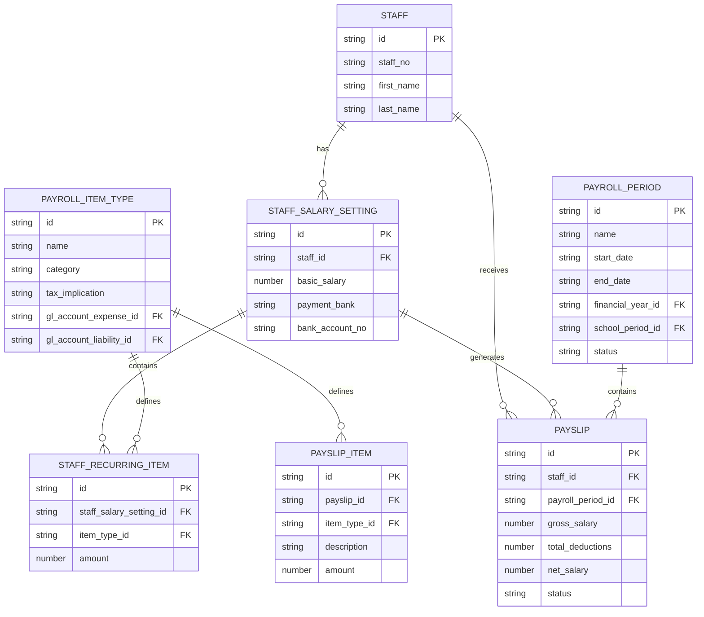
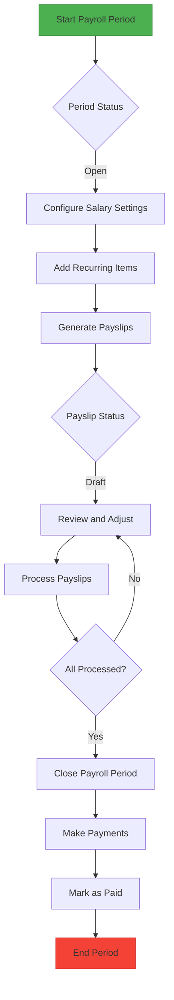

# HR Data Models

<cite>
**Referenced Files in This Document**   
- [types.ts](file://src/modules/hr/data/types.ts)
- [schema.ts](file://src/modules/hr/data/schema.ts)
- [mockData.ts](file://src/modules/hr/data/mockData.ts)
- [usePayrollPeriodData.ts](file://src/modules/hr/data/usePayrollPeriodData.ts)
- [usePayrollItemTypeData.ts](file://src/modules/hr/data/usePayrollItemTypeData.ts)
- [usePayslipData.ts](file://src/modules/hr/data/usePayslipData.ts)
- [useStaffSalarySettingData.ts](file://src/modules/hr/data/useStaffSalarySettingData.ts)
- [core/types.ts](file://src/core/types.ts)
</cite>

## Table of Contents
1. [Introduction](#introduction)
2. [Entity Overview](#entity-overview)
3. [PayrollPeriod](#payrollperiod)
4. [PayrollItemType](#payrollitemtype)
5. [StaffSalarySetting](#staffsalarysetting)
6. [Payslip](#payslip)
7. [Business Rules and Relationships](#business-rules-and-relationships)
8. [Database Schema and Validation](#database-schema-and-validation)
9. [Data Access Patterns](#data-access-patterns)
10. [Mock Data and Testing](#mock-data-and-testing)

## Introduction
This document provides comprehensive documentation for the HR module's data models, focusing on PayrollPeriod, Payslip, StaffSalarySetting, PayrollItemType, and related entities. The documentation covers field definitions, data types, primary keys, relationships, business rules, database schema, validation constraints, and data access patterns. The HR module manages payroll processing for staff members, including salary settings, recurring items, payroll periods, and payslip generation.

**Section sources**
- [types.ts](file://src/modules/hr/data/types.ts)
- [schema.ts](file://src/modules/hr/data/schema.ts)
- [mockData.ts](file://src/modules/hr/data/mockData.ts)

## Entity Overview
The HR data model consists of several interconnected entities that support payroll processing:
- **PayrollPeriod**: Represents a specific payroll cycle with defined start and end dates
- **PayrollItemType**: Defines types of payroll items (earnings, deductions, contributions)
- **StaffSalarySetting**: Stores base salary and recurring items for staff members
- **Payslip**: Generated for each staff member per payroll period, containing calculated earnings and deductions
- **PayslipItem**: Individual line items on a payslip derived from salary settings and payroll calculations

These entities work together to support the payroll processing workflow, from salary configuration to payslip generation and payment.



**Diagram sources**
- [types.ts](file://src/modules/hr/data/types.ts)
- [schema.ts](file://src/modules/hr/data/schema.ts)

## PayrollPeriod
The PayrollPeriod entity represents a defined period for payroll processing, typically aligned with monthly cycles.

### Field Definitions
- **id**: Unique identifier (string, primary key)
- **name**: Payroll period name (string, required, max 100 characters)
- **start_date**: Period start date in YYYY-MM-DD format (string, required, format: date)
- **end_date**: Period end date in YYYY-MM-DD format (string, required, format: date)
- **financial_year_id**: Reference to the financial year (string, required, references financial_years collection)
- **school_period_id**: Reference to the school period (string, optional, references school_periods collection)
- **status**: Current status of the payroll period (string, required, enum: Open, Closed, Processed)
- **financial_year_name**: Computed financial year name (string, optional, max 100 characters)
- **school_period_name**: Computed school period name (string, optional, max 100 characters)

### Primary Key and Indexes
- **Primary Key**: id
- **Indexes**: name, financial_year_id, status

### Sample JSON Payload
```json
{
  "id": "PP001",
  "name": "July 2024 Payroll",
  "start_date": "2024-07-01",
  "end_date": "2024-07-31",
  "financial_year_id": "FY2024",
  "school_period_id": "SP003",
  "status": "Open",
  "financial_year_name": "FY 2024",
  "school_period_name": "Term 3 - AY 2023/2024"
}
```

**Section sources**
- [types.ts](file://src/modules/hr/data/types.ts#L120-L134)
- [schema.ts](file://src/modules/hr/data/schema.ts#L10-L35)

## PayrollItemType
The PayrollItemType entity defines the types of items that can appear on payslips, categorized as earnings, deductions, or employer contributions.

### Field Definitions
- **id**: Unique identifier (string, primary key)
- **name**: Payroll item type name (string, required, max 100 characters)
- **category**: Category of the payroll item (string, required, enum: Earning, Deduction, Contribution (Employer))
- **tax_implication**: Tax treatment of the item (string, required, enum: Taxable, Non-Taxable, Tax Relief)
- **gl_account_expense_id**: Reference to the expense GL account (string, optional, references chart_of_accounts collection)
- **gl_account_liability_id**: Reference to the liability GL account (string, optional, references chart_of_accounts collection)
- **created_at**: Creation timestamp (string, required, ISO 8601 format)
- **updated_at**: Last update timestamp (string, required, ISO 8601 format)

### Primary Key and Indexes
- **Primary Key**: id
- **Indexes**: name, category

### Sample JSON Payload
```json
{
  "id": "PIT001",
  "name": "Basic Salary",
  "category": "Earning",
  "tax_implication": "Taxable",
  "gl_account_expense_id": "COA001",
  "gl_account_liability_id": "COA002",
  "created_at": "2024-01-15T10:30:00Z",
  "updated_at": "2024-01-15T10:30:00Z"
}
```

**Section sources**
- [types.ts](file://src/modules/hr/data/types.ts#L136-L145)
- [schema.ts](file://src/modules/hr/data/schema.ts#L37-L63)

## StaffSalarySetting
The StaffSalarySetting entity stores the base salary and recurring items for a staff member.

### Field Definitions
- **id**: Unique identifier (string, primary key)
- **staff_id**: Reference to the staff member (string, required, references staff collection)
- **basic_salary**: Base salary amount (number, required, minimum 0, maximum 999999.99)
- **payment_bank**: Bank for salary payment (string, optional, max 100 characters)
- **bank_account_no**: Bank account number (string, optional, max 50 characters)
- **max_advance_amount**: Maximum allowable advance amount (number, optional, minimum 0, maximum 999999.99)
- **created_at**: Creation timestamp (string, required, ISO 8601 format)
- **updated_at**: Last update timestamp (string, required, ISO 8601 format)
- **recurring_items**: Array of recurring payroll items (array, optional)
- **staff_name**: Computed staff name (string, optional, max 200 characters)

### Primary Key and Indexes
- **Primary Key**: id
- **Indexes**: staff_id

### Sample JSON Payload
```json
{
  "id": "SSS001",
  "staff_id": "STF001",
  "basic_salary": 150000,
  "payment_bank": "KCB Bank",
  "bank_account_no": "ACC001",
  "max_advance_amount": 50000,
  "created_at": "2024-01-10T09:00:00Z",
  "updated_at": "2024-01-10T09:00:00Z",
  "recurring_items": [
    {
      "id": "SRI001",
      "staff_salary_setting_id": "SSS001",
      "item_type_id": "PIT002",
      "amount": 30000,
      "item_type_name": "House Allowance",
      "item_category": "Earning"
    }
  ],
  "staff_name": "Michael Scott"
}
```

**Section sources**
- [types.ts](file://src/modules/hr/data/types.ts#L147-L160)
- [schema.ts](file://src/modules/hr/data/schema.ts#L65-L109)

## Payslip
The Payslip entity represents the payroll statement generated for a staff member for a specific payroll period.

### Field Definitions
- **id**: Unique identifier (string, primary key)
- **staff_id**: Reference to the staff member (string, required, references staff collection)
- **payroll_period_id**: Reference to the payroll period (string, required, references payroll_periods collection)
- **gross_salary**: Total earnings before deductions (number, optional, minimum 0, maximum 999999.99)
- **total_deductions**: Total amount deducted (number, optional, minimum 0, maximum 999999.99)
- **net_salary**: Final amount to be paid (number, optional, minimum -999999.99, maximum 999999.99)
- **status**: Current status of the payslip (string, required, enum: Draft, Processed, Paid, Cancelled)
- **processed_at**: Timestamp when payslip was processed (string, optional, ISO 8601 format)
- **paid_at**: Timestamp when payment was made (string, optional, ISO 8601 format)
- **created_at**: Creation timestamp (string, required, ISO 8601 format)
- **updated_at**: Last update timestamp (string, required, ISO 8601 format)
- **items**: Array of payslip items (array, optional)
- **staff_name**: Computed staff name (string, optional, max 200 characters)
- **payroll_period_name**: Computed payroll period name (string, optional, max 100 characters)

### Primary Key and Indexes
- **Primary Key**: id
- **Indexes**: staff_id, payroll_period_id, status

### Sample JSON Payload
```json
{
  "id": "PSLP001",
  "staff_id": "STF001",
  "payroll_period_id": "PP003",
  "gross_salary": 185000,
  "total_deductions": 42060,
  "net_salary": 142940,
  "status": "Paid",
  "processed_at": "2024-06-25T10:00:00Z",
  "paid_at": "2024-06-28T14:00:00Z",
  "created_at": "2024-06-25T10:00:00Z",
  "updated_at": "2024-06-28T14:00:00Z",
  "items": [
    {
      "id": "PSLI001",
      "payslip_id": "PSLP001",
      "item_type_id": "PIT001",
      "description": "Basic Salary",
      "amount": 150000,
      "item_type_name": "Basic Salary",
      "item_category": "Earning"
    }
  ],
  "staff_name": "Michael Scott",
  "payroll_period_name": "June 2024 Payroll"
}
```

**Section sources**
- [types.ts](file://src/modules/hr/data/types.ts#L176-L190)
- [schema.ts](file://src/modules/hr/data/schema.ts#L111-L149)

## Business Rules and Relationships
The HR data model implements several business rules and relationships that govern payroll processing.

### Entity Relationships
- **One-to-Many**: A PayrollPeriod contains many Payslips
- **One-to-Many**: A StaffSalarySetting contains many StaffRecurringItems
- **One-to-Many**: A Payslip contains many PayslipItems
- **Many-to-One**: Multiple StaffRecurringItems reference a single PayrollItemType
- **Many-to-One**: Multiple PayslipItems reference a single PayrollItemType

### Salary Setting Inheritance
Staff salary settings inherit from PayrollItemType definitions. When a staff member's salary is configured:
1. The basic salary is set directly on the StaffSalarySetting
2. Recurring items are added by referencing existing PayrollItemType records
3. The item_type_name and item_category are computed from the referenced PayrollItemType
4. Changes to PayrollItemType definitions automatically propagate to related StaffRecurringItems

### Recurring Item Application
Recurring items from StaffSalarySetting are automatically applied when generating payslips:
1. During payslip generation, all active StaffRecurringItems for a staff member are retrieved
2. Each recurring item is converted to a PayslipItem with the same amount
3. The payslip calculation engine computes gross salary, deductions, and net salary
4. The resulting payslip reflects both the basic salary and all recurring items

### Payroll Calculation Logic
The payroll calculation process follows these steps:
1. **Gross Salary Calculation**: basic_salary + sum of all earning-type recurring items
2. **Deduction Calculation**: sum of all deduction-type recurring items
3. **Net Salary Calculation**: gross_salary - total_deductions
4. **Tax Processing**: Taxable items are processed according to their tax_implication
5. **Status Transitions**: Payslips progress from Draft → Processed → Paid

### Lifecycle Management
Entities follow specific lifecycle patterns:
- **PayrollPeriod**: Open → Closed → Processed
- **Payslip**: Draft → Processed → Paid → Cancelled (if needed)
- **StaffSalarySetting**: Created when a staff member is hired, updated when salary changes occur



**Diagram sources**
- [types.ts](file://src/modules/hr/data/types.ts)
- [mockData.ts](file://src/modules/hr/data/mockData.ts)

## Database Schema and Validation
The HR data model implements comprehensive validation rules through RxDB schema definitions.

### Schema Validation Rules
The schema.ts file defines validation rules for each entity:

**PayrollPeriod Validation**
- Required fields: id, name, start_date, end_date, financial_year_id
- String length constraints: name (100), financial_year_id (100), status (50)
- Date format validation for start_date and end_date
- Enum validation for status field

**PayrollItemType Validation**
- Required fields: id, name, category, tax_implication, created_at, updated_at
- String length constraints: name (100), category (50), tax_implication (50)
- Enum validation for category and tax_implication
- Numeric constraints for amount fields

**StaffSalarySetting Validation**
- Required fields: id, staff_id, basic_salary, created_at, updated_at
- String length constraints: staff_id (100), payment_bank (100), bank_account_no (50)
- Numeric constraints: basic_salary and max_advance_amount (0 to 999999.99)
- Array validation for recurring_items

**Payslip Validation**
- Required fields: id, staff_id, payroll_period_id, status, created_at, updated_at
- String length constraints: staff_id (100), payroll_period_id (100), status (50)
- Numeric constraints: gross_salary, total_deductions (0 to 999999.99), net_salary (-999999.99 to 999999.99)
- Array validation for items

### Indexing Strategy
The schema defines indexes to optimize query performance:
- **PayrollPeriod**: name, financial_year_id, status (for filtering by period name, financial year, or status)
- **PayrollItemType**: name, category (for searching by item name or category)
- **StaffSalarySetting**: staff_id (for retrieving salary settings by staff member)
- **Payslip**: staff_id, payroll_period_id, status (for finding payslips by staff, period, or status)

### Data Integrity Constraints
The schema enforces data integrity through:
- Primary key constraints on id fields
- Foreign key references (using SchemaHelpers.ref) for relationships
- Required field constraints to prevent incomplete records
- Enum validation to ensure valid status values
- Numeric range constraints to prevent invalid amounts

**Section sources**
- [schema.ts](file://src/modules/hr/data/schema.ts)
- [types.ts](file://src/modules/hr/data/types.ts)

## Data Access Patterns
The HR module implements data access patterns through custom React hooks that provide CRUD operations.

### usePayrollPeriodData Hook
The usePayrollPeriodData hook provides data management for PayrollPeriod entities:

```typescript
export const usePayrollPeriodData = () => {
  const [data, setData] = useState<PayrollPeriod[]>(initialMockPayrollPeriods);

  const create = async (newItem: Partial<PayrollPeriod>) => {
    const newDataItem: PayrollPeriod = {
      ...newItem,
      id: Date.now(),
      created_at: new Date().toISOString(),
      updated_at: new Date().toISOString()
    } as PayrollPeriod;
    setData((prev: PayrollPeriod[]) => [...prev, newDataItem]);
    return newDataItem;
  };

  const update = async (id: number, updatedData: Partial<PayrollPeriod>) => {
    setData((prev: PayrollPeriod[]) => prev.map((item: PayrollPeriod) => 
      item.id === id 
        ? { ...item, ...updatedData, updated_at: new Date().toISOString() }
        : item
    ));
  };

  const remove = async (id: number) => {
    setData((prev: PayrollPeriod[]) => prev.filter((item: PayrollPeriod) => item.id !== id));
  };

  return {
    data,
    create,
    update,
    remove
  };
};
```

**Key Features:**
- Self-contained state management using useState
- Mock data initialization from mockData.ts
- Automatic timestamp generation on create and update
- Immutable state updates using functional setState

**Section sources**
- [usePayrollPeriodData.ts](file://src/modules/hr/data/usePayrollPeriodData.ts)

### usePayrollItemTypeData Hook
The usePayrollItemTypeData hook provides data management for PayrollItemType entities:

```typescript
export const usePayrollItemTypeData = () => {
  const [data, setData] = useState<PayrollItemType[]>(initialMockPayrollItemTypes);

  const create = async (newItem: Partial<PayrollItemType>) => {
    const newDataItem: PayrollItemType = {
      ...newItem,
      id: Date.now(),
      created_at: new Date().toISOString(),
      updated_at: new Date().toISOString()
    } as PayrollItemType;
    setData((prev: PayrollItemType[]) => [...prev, newDataItem]);
    return newDataItem;
  };

  const update = async (id: number, updatedData: Partial<PayrollItemType>) => {
    setData((prev: PayrollItemType[]) => prev.map((item: PayrollItemType) => 
      item.id === id 
        ? { ...item, ...updatedData, updated_at: new Date().toISOString() }
        : item
    ));
  };

  const remove = async (id: number) => {
    setData((prev: PayrollItemType[]) => prev.filter((item: PayrollItemType) => item.id !== id));
  };

  return {
    data,
    create,
    update,
    remove
  };
};
```

**Key Features:**
- Similar pattern to usePayrollPeriodData
- Uses initialMockPayrollItemTypes for initialization
- Maintains data consistency through immutable updates

**Section sources**
- [usePayrollItemTypeData.ts](file://src/modules/hr/data/usePayrollItemTypeData.ts)

### usePayslipData Hook
The usePayslipData hook provides data management for Payslip entities:

```typescript
const usePayslipData = () => {
  const [payslips, setPayslips] = useState<any[]>([]);
  const [isLoading, setIsLoading] = useState<boolean>(true);
  const [error, setError] = useState<string | null>(null);

  useEffect(() => {
    try {
      // Simulate fetching data from a mock source
      setPayslips(initialMockUsers);
      setIsLoading(false);
    } catch (e) {
      setError('Failed to fetch payslips');
      setIsLoading(false);
    }
  }, []);

  const create = async (newItem: Partial<any>) => {
    const newDataItem: any = {
      ...newItem,
      id: Date.now(),
      created_at: new Date().toISOString(),
      updated_at: new Date().toISOString()
    } as any;
    setPayslips((prev: any[]) => [...prev, newDataItem]);
    return newDataItem;
  };

  const update = async (id: number, updatedData: Partial<any>) => {
    setPayslips((prev: any[]) => prev.map((item: any) =>
      item.id === id
        ? { ...item, ...updatedData, updated_at: new Date().toISOString() }
        : item
    ));
  };

  const remove = async (id: number) => {
    setPayslips((prev: any[]) => prev.filter((item: any) => item.id !== id));
  };

  return {
    data: payslips,
    isLoading,
    error,
    create,
    update,
    remove
  };
};
```

**Note:** This hook appears to have an implementation issue - it uses initialMockUsers from administration module instead of payslip-specific mock data.

**Section sources**
- [usePayslipData.ts](file://src/modules/hr/data/usePayslipData.ts)

### useStaffSalarySettingData Hook
The useStaffSalarySettingData hook provides data management for StaffSalarySetting entities:

```typescript
const useStaffSalarySettingData = () => {
  const [staffSalarySettings, setStaffSalarySettings] = useState<any[]>([]);
  const [isLoading, setIsLoading] = useState<boolean>(true);
  const [error, setError] = useState<string | null>(null);

  useEffect(() => {
    try {
      // Simulate fetching data from a mock source
      setStaffSalarySettings(initialMockUsers);
      setIsLoading(false);
    } catch (e) {
      setError('Failed to fetch staff salary settings');
      setIsLoading(false);
    }
  }, []);

  const create = async (newItem: Partial<any>) => {
    const newDataItem: any = {
      ...newItem,
      id: Date.now(),
      created_at: new Date().toISOString(),
      updated_at: new Date().toISOString()
    } as any;
    setStaffSalarySettings((prev: any[]) => [...prev, newDataItem]);
    return newDataItem;
  };

  const update = async (id: number, updatedData: Partial<any>) => {
    setStaffSalarySettings((prev: any[]) => prev.map((item: any) =>
      item.id === id
        ? { ...item, ...updatedData, updated_at: new Date().toISOString() }
        : item
    ));
  };

  const remove = async (id: number) => {
    setStaffSalarySettings((prev: any[]) => prev.filter((item: any) => item.id !== id));
  };

  return {
    data: staffSalarySettings,
    isLoading,
    error,
    create,
    update,
    remove
  };
};
```

**Note:** This hook also appears to have an implementation issue - it uses initialMockUsers from administration module instead of staff salary setting-specific mock data.

**Section sources**
- [useStaffSalarySettingData.ts](file://src/modules/hr/data/useStaffSalarySettingData.ts)

## Mock Data and Testing
The HR module includes comprehensive mock data to support development and testing.

### Mock Data Structure
The mockData.ts file contains sample data for all HR entities:

```typescript
export const initialMockPayrollPeriods: PayrollPeriod[] = [
  { 
    id: 1, 
    name: 'July 2024 Payroll', 
    start_date: '2024-07-01', 
    end_date: '2024-07-31', 
    financial_year_id: 2, 
    school_period_id: 3, 
    status: PayrollPeriodStatus.OPEN, 
    financial_year_name: 'FY 2024', 
    school_period_name: 'Term 3 - AY 2023/2024' 
  },
  // Additional payroll periods
];

export const initialMockPayrollItemTypes: PayrollItemType[] = [
  { 
    id: 1, 
    name: 'Basic Salary', 
    category: PayrollItemCategory.EARNING, 
    tax_implication: PayrollTaxImplication.TAXABLE, 
    created_at: new Date().toISOString(), 
    updated_at: new Date().toISOString() 
  },
  // Additional payroll item types
];

export const initialMockStaffSalarySettings: StaffSalarySetting[] = [
  { 
    id: 'SSS001', 
    staff_id: 'STF001', 
    basic_salary: 150000, 
    payment_bank: 'KCB Bank', 
    bank_account_no: 'ACC001', 
    created_at: new Date().toISOString(), 
    updated_at: new Date().toISOString(), 
    staff_name: 'Michael Scott' 
  },
  // Additional staff salary settings
];

export const initialMockPayslips: Payslip[] = [
  {
    id: 'PSLP001',
    staff_id: 'STF001',
    payroll_period_id: 3,
    gross_salary: 185000,
    total_deductions: 42060,
    net_salary: 142940,
    status: PayslipStatus.PAID,
    created_at: '2024-06-25T10:00:00Z',
    updated_at: '2024-06-28T14:00:00Z',
    staff_name: 'Michael Scott',
    payroll_period_name: 'June 2024 Payroll',
  },
  // Additional payslips
];

export const initialMockPayslipItems: PayslipItem[] = [
  { 
    id: 'PSLI001', 
    payslip_id: 'PSLP001', 
    item_type_id: 1, 
    description: 'Basic Salary', 
    amount: 150000, 
    item_type_name: 'Basic Salary', 
    item_category: PayrollItemCategory.EARNING 
  },
  // Additional payslip items
];
```

### Testing Support
The mock data supports testing in several ways:
- **Development**: Provides realistic data for UI development and testing
- **Integration Testing**: Enables end-to-end testing of payroll workflows
- **Edge Cases**: Includes various status combinations and edge cases
- **Performance Testing**: Large datasets can be generated from the mock structure

### Data Relationships in Mock Data
The mock data demonstrates proper entity relationships:
- Payslips reference existing PayrollPeriods
- PayslipItems reference existing PayrollItemTypes
- StaffSalarySettings reference existing staff members
- Recurring items are properly linked to salary settings

### Usage in Development
The mock data is used in:
- Hook initialization (usePayrollPeriodData, usePayrollItemTypeData)
- Component development and testing
- Demo mode for showcasing functionality
- Unit tests for business logic validation

**Section sources**
- [mockData.ts](file://src/modules/hr/data/mockData.ts)
- [usePayrollPeriodData.ts](file://src/modules/hr/data/usePayrollPeriodData.ts)
- [usePayrollItemTypeData.ts](file://src/modules/hr/data/usePayrollItemTypeData.ts)