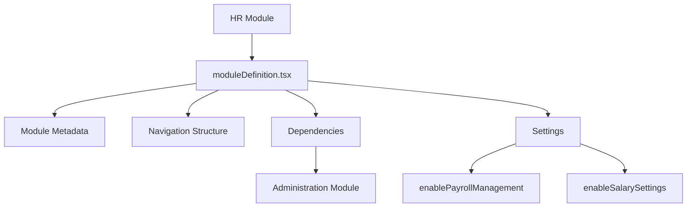
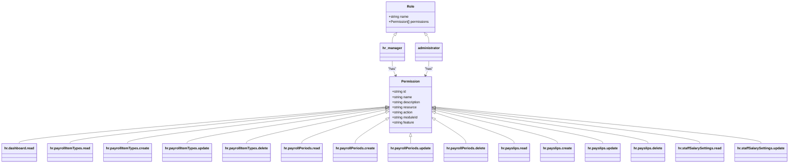
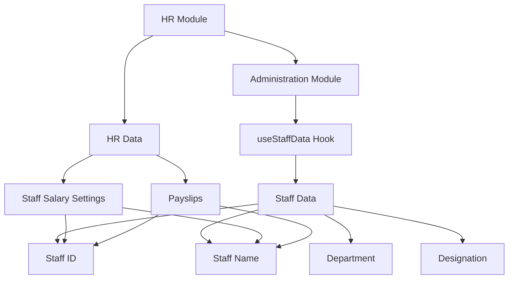
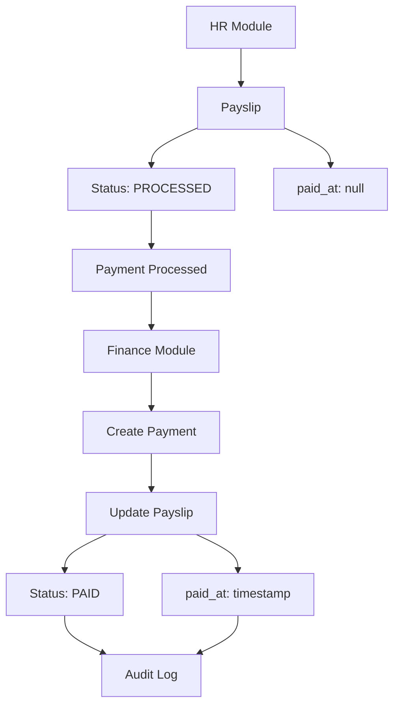
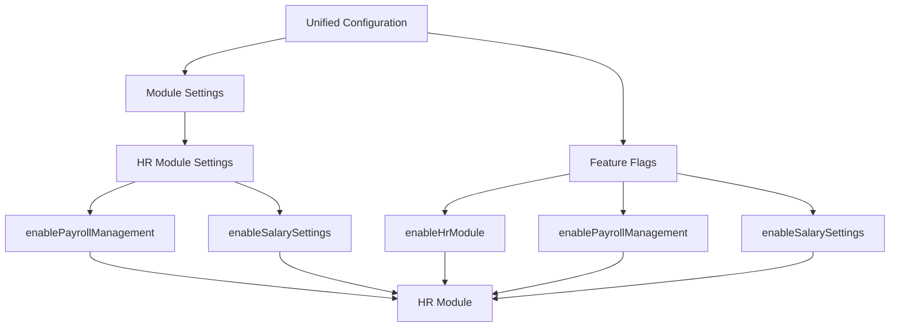
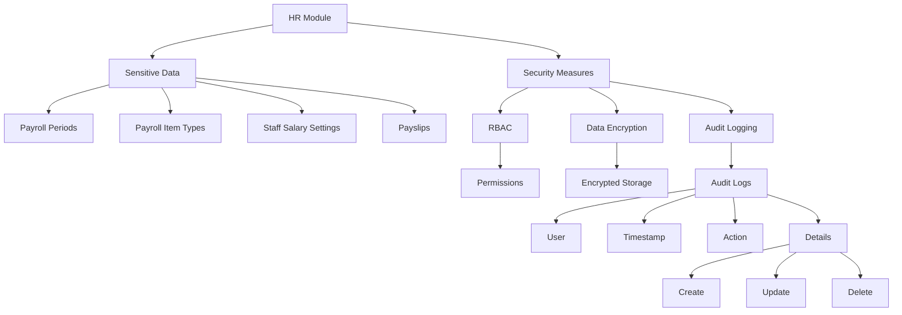
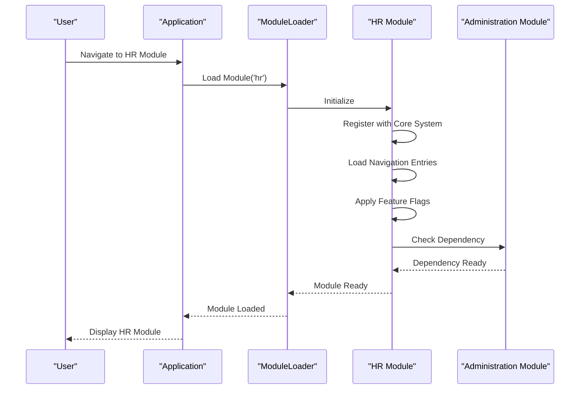
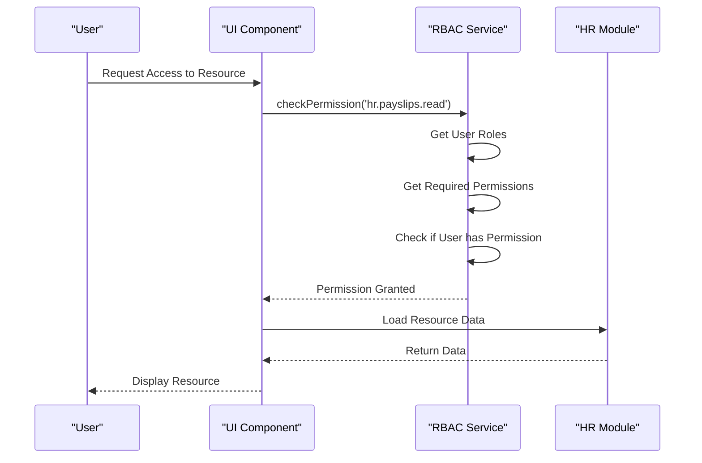
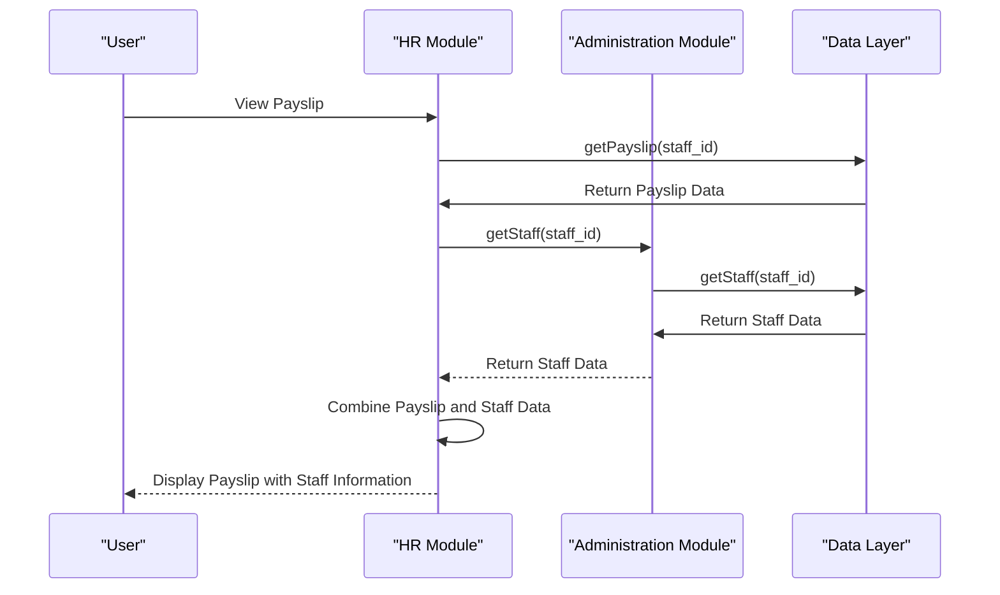

# HR Module Integration

<cite>
**Referenced Files in This Document**   
- [moduleDefinition.tsx](file://src/modules/hr/moduleDefinition.tsx)
- [rbac.ts](file://src/modules/hr/rbac.ts)
- [unifiedConfig.ts](file://src/config/unifiedConfig.ts)
- [schema.ts](file://src/modules/hr/data/schema.ts)
- [types.ts](file://src/modules/hr/data/types.ts)
- [useStaffData.ts](file://src/modules/administration/data/useStaffData.ts)
- [financeModuleDefinition.tsx](file://src/modules/finance/moduleDefinition.tsx)
- [financeRbac.ts](file://src/modules/finance/rbac.ts)
- [core/types.ts](file://src/core/types.ts)
</cite>

## Table of Contents
1. [Introduction](#introduction)
2. [HR Module Registration and Configuration](#hr-module-registration-and-configuration)
3. [Role-Based Access Control (RBAC) Configuration](#role-based-access-control-rbac-configuration)
4. [Integration with Administration Module](#integration-with-administration-module)
5. [Integration with Finance Module](#integration-with-finance-module)
6. [Feature Flags and Configuration Settings](#feature-flags-and-configuration-settings)
7. [Security and Audit Logging](#security-and-audit-logging)
8. [Sequence Diagrams](#sequence-diagrams)

## Introduction
This document provides comprehensive architectural documentation for the HR module integration within the schoolpilot3 ecosystem. It details how the HR module is registered with the core system, its RBAC configuration, integration points with other modules, and security considerations for sensitive payroll data. The documentation is designed to be accessible to both technical and non-technical stakeholders, providing a clear understanding of the module's functionality and interactions within the broader system.

## HR Module Registration and Configuration

The HR module is registered with the core system through the `moduleDefinition.tsx` file, which defines the module's metadata, navigation structure, dependencies, and configuration settings. The module is self-contained and follows a modular architecture pattern, allowing for independent development and deployment.

The module definition specifies the HR module's ID, name, description, icon, path, active status, and version. It also defines the navigation entries that appear in the application's sidebar, each with a name, path, icon, and associated page component. The navigation structure includes entries for the HR dashboard, payroll item types, payroll periods, payslips, and staff salary settings.

The module has a dependency on the Administration module, which is required for staff data synchronization. This dependency ensures that the HR module can access staff information managed by the Administration module. The module also defines settings that can be configured through the application's settings interface, including the ability to enable or disable payroll management and salary settings features.

**Diagram sources**
- [moduleDefinition.tsx](file://src/modules/hr/moduleDefinition.tsx)

**Section sources**
- [moduleDefinition.tsx](file://src/modules/hr/moduleDefinition.tsx)

## Role-Based Access Control (RBAC) Configuration

The HR module's RBAC configuration is defined in the `rbac.ts` file, which specifies the permissions and default roles for the module. The permissions are organized by feature area, including dashboard, payroll item types, payroll periods, payslips, and staff salary settings.

Each permission has a unique ID, name, description, resource, action, module ID, and feature. The permissions follow a consistent naming convention: `hr.<resource>.<action>`. This structure allows for fine-grained access control, enabling administrators to grant users specific permissions based on their roles and responsibilities.

The module defines two default roles: 'hr_manager' and 'administrator'. These roles are granted a comprehensive set of permissions that allow them to perform all actions within the HR module. The 'administrator' role inherits permissions from other modules, providing system-wide administrative capabilities.

The RBAC system is integrated with the core RBAC service, which enforces permissions at runtime. When a user attempts to access a protected resource or perform an action, the system checks their permissions against the required permissions for that action. If the user has the necessary permissions, the action is allowed; otherwise, it is denied.

**Diagram sources**
- [rbac.ts](file://src/modules/hr/rbac.ts)

**Section sources**
- [rbac.ts](file://src/modules/hr/rbac.ts)

## Integration with Administration Module

The HR module integrates with the Administration module for staff data synchronization. This integration is facilitated through the Administration module's `useStaffData` hook, which provides CRUD operations for staff data. The HR module depends on the Administration module, as specified in its module definition.

The integration allows the HR module to access staff information such as names, departments, designations, and contact details. This information is used in various HR processes, including payroll calculation, payslip generation, and staff salary settings. The staff data is synchronized between the modules, ensuring consistency and accuracy across the system.

The HR module's data schema includes references to staff members through the `staff_id` field in various collections, such as `staff_salary_settings` and `payslips`. These references create a relationship between HR data and staff data, enabling the system to link payroll information to specific staff members.

The integration also supports computed fields, such as `staff_name`, which are populated from the Administration module's staff data. This reduces data duplication and ensures that staff information is consistent across the system.

**Diagram sources**
- [moduleDefinition.tsx](file://src/modules/hr/moduleDefinition.tsx)
- [useStaffData.ts](file://src/modules/administration/data/useStaffData.ts)
- [schema.ts](file://src/modules/hr/data/schema.ts)

**Section sources**
- [moduleDefinition.tsx](file://src/modules/hr/moduleDefinition.tsx)
- [useStaffData.ts](file://src/modules/administration/data/useStaffData.ts)
- [schema.ts](file://src/modules/hr/data/schema.ts)

## Integration with Finance Module

The HR module integrates with the Finance module for payment disbursement functionality. This integration is critical for the payroll process, as it enables the system to record payments made to staff members.

The integration is facilitated through the `paid_at` timestamp in the payslip schema, which is set when a payment is processed. This timestamp indicates that the payment has been disbursed through the Finance module. The payslip status is also updated to 'PAID' when the payment is processed.

The Finance module's RBAC configuration includes permissions for payment processing, such as 'finance.payments.create' and 'finance.payments.update'. These permissions are required for users who need to process payments through the Finance module. The HR module does not directly manage these permissions but relies on the Finance module to enforce them.

The integration between the modules ensures that payment information is accurately recorded and synchronized. When a payment is processed in the Finance module, the corresponding payslip in the HR module is updated with the payment timestamp and status. This creates a complete audit trail for payroll payments.

**Diagram sources**
- [schema.ts](file://src/modules/hr/data/schema.ts)
- [financeModuleDefinition.tsx](file://src/modules/finance/moduleDefinition.tsx)
- [financeRbac.ts](file://src/modules/finance/rbac.ts)

**Section sources**
- [schema.ts](file://src/modules/hr/data/schema.ts)
- [financeModuleDefinition.tsx](file://src/modules/finance/moduleDefinition.tsx)
- [financeRbac.ts](file://src/modules/finance/rbac.ts)

## Feature Flags and Configuration Settings

The HR module respects feature flags and configuration settings from the unified configuration system, which is defined in `unifiedConfig.ts`. This system provides a centralized way to manage feature flags and configuration settings across the application.

The HR module's feature flags are defined in the `features` section of the unified configuration. These flags include `enableHrModule`, which controls whether the HR module is enabled, and `enablePayrollManagement`, which controls whether payroll management features are available.

The module also defines its own settings in the `settings` section of its module definition. These settings include `enablePayrollManagement` and `enableSalarySettings`, which can be configured through the application's settings interface. The settings are stored in the unified configuration system and can be accessed by the module at runtime.

The feature flags and settings allow administrators to customize the behavior of the HR module based on the organization's needs. For example, an organization may choose to disable payroll management if it uses an external payroll system. The settings can be changed without modifying the code, providing flexibility and ease of configuration.

**Diagram sources**
- [unifiedConfig.ts](file://src/config/unifiedConfig.ts)
- [moduleDefinition.tsx](file://src/modules/hr/moduleDefinition.tsx)

**Section sources**
- [unifiedConfig.ts](file://src/config/unifiedConfig.ts)
- [moduleDefinition.tsx](file://src/modules/hr/moduleDefinition.tsx)

## Security and Audit Logging

The HR module implements security measures to protect sensitive payroll data, including role-based access control, data encryption, and audit logging. The RBAC system ensures that only authorized users can access payroll data, with permissions defined for each action.

The module's data schema includes fields for tracking creation and update timestamps, such as `created_at` and `updated_at`. These fields provide a record of when data was created or modified, which is useful for auditing and troubleshooting.

The system also implements audit logging for sensitive actions, such as creating, updating, or deleting payroll data. The audit logs include information about the user who performed the action, the timestamp of the action, and the details of the action. This creates a complete audit trail for payroll data, which is essential for compliance and security.

The audit logging system is integrated with the core audit service, which stores audit logs in a secure, tamper-proof manner. The logs can be accessed through the Audit Log page in the Settings module, where administrators can filter and search for specific actions.

**Diagram sources**
- [rbac.ts](file://src/modules/hr/rbac.ts)
- [schema.ts](file://src/modules/hr/data/schema.ts)
- [core/types.ts](file://src/core/types.ts)

**Section sources**
- [rbac.ts](file://src/modules/hr/rbac.ts)
- [schema.ts](file://src/modules/hr/data/schema.ts)
- [core/types.ts](file://src/core/types.ts)

## Sequence Diagrams

### Module Loading Sequence
This sequence diagram shows the process of loading the HR module, including the registration of the module with the core system and the initialization of its dependencies.

**Diagram sources**
- [moduleDefinition.tsx](file://src/modules/hr/moduleDefinition.tsx)
- [useStaffData.ts](file://src/modules/administration/data/useStaffData.ts)

### Permission Checking Sequence
This sequence diagram shows the process of checking permissions when a user attempts to access a protected resource in the HR module.

**Diagram sources**
- [rbac.ts](file://src/modules/hr/rbac.ts)
- [core/rbacService.ts](file://src/core/rbacService.ts)

### Cross-Module Data Access Sequence
This sequence diagram shows the process of accessing staff data from the Administration module when viewing a payslip in the HR module.

**Diagram sources**
- [moduleDefinition.tsx](file://src/modules/hr/moduleDefinition.tsx)
- [useStaffData.ts](file://src/modules/administration/data/useStaffData.ts)
- [schema.ts](file://src/modules/hr/data/schema.ts)