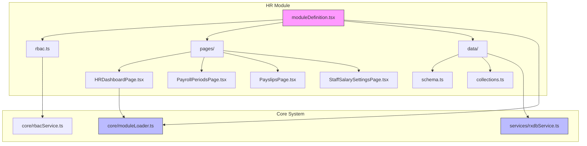
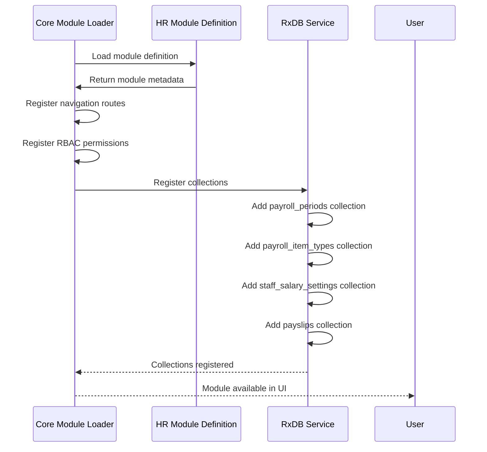
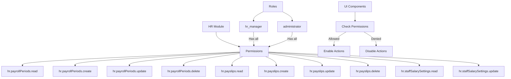
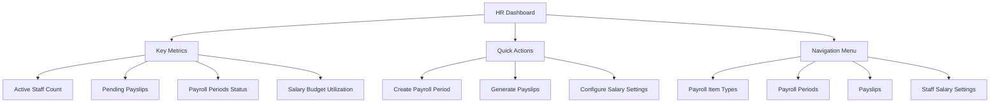
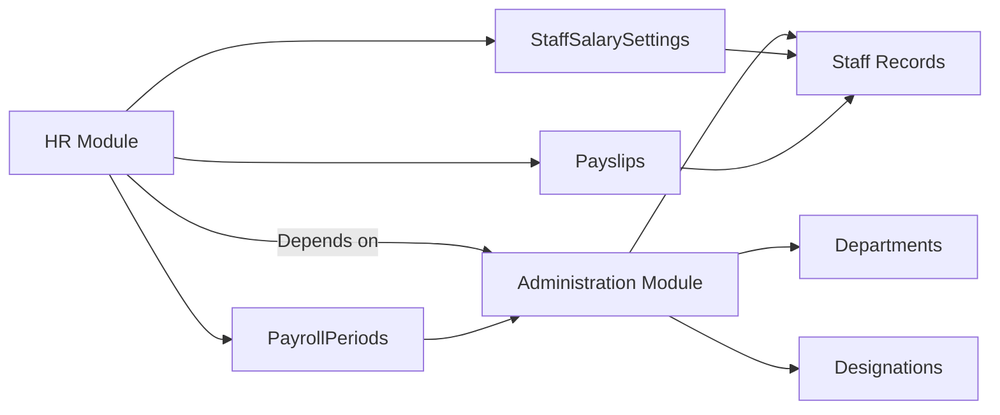
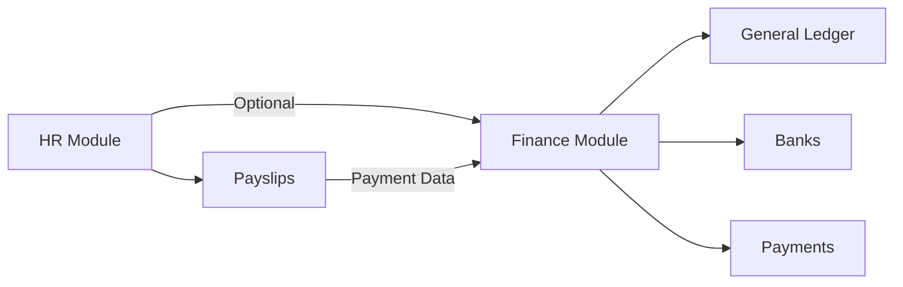
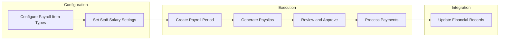
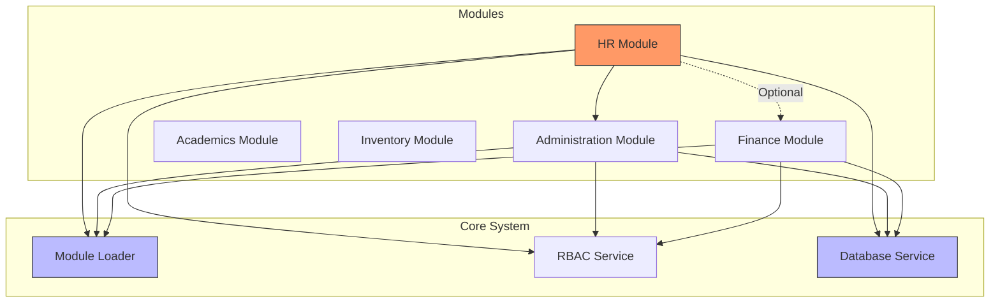

# HR Module Overview

<cite>
**Referenced Files in This Document**   
- [moduleDefinition.tsx](file://src/modules/hr/moduleDefinition.tsx)
- [rbac.ts](file://src/modules/hr/rbac.ts)
- [HRDashboardPage.tsx](file://src/modules/hr/pages/HRDashboardPage.tsx)
- [schema.ts](file://src/modules/hr/data/schema.ts)
- [collections.ts](file://src/modules/hr/data/collections.ts)
- [types.ts](file://src/core/types.ts)
- [rxdbService.ts](file://src/services/rxdbService.ts)
- [finance/moduleDefinition.tsx](file://src/modules/finance/moduleDefinition.tsx)
- [administration/moduleDefinition.tsx](file://src/modules/administration/moduleDefinition.tsx)
</cite>

## Table of Contents
1. [Introduction](#introduction)
2. [Module Architecture](#module-architecture)
3. [Core Data Models](#core-data-models)
4. [Module Registration and Loading](#module-registration-and-loading)
5. [Role-Based Access Control (RBAC)](#role-based-access-control-rbac)
6. [HR Dashboard and User Interface](#hr-dashboard-and-user-interface)
7. [Integration with Other Modules](#integration-with-other-modules)
8. [Data Flow and Payroll Processing](#data-flow-and-payroll-processing)
9. [Feature Configuration and Availability](#feature-configuration-and-availability)
10. [System Architecture Diagram](#system-architecture-diagram)

## Introduction

The HR Module in the schoolpilot3 system serves as a centralized platform for managing all human resources functions within an educational institution. It provides comprehensive tools for staff payroll management, salary configuration, and HR record keeping. The module is designed to integrate seamlessly with other core systems such as Finance and Administration, creating a unified ecosystem for school management. This document provides a detailed overview of the HR module's architecture, functionality, and integration points, focusing on its role in managing PayrollPeriod, Payslip, and StaffSalarySetting entities.

## Module Architecture

The HR module follows a modular architecture pattern, with self-contained components for data management, user interface, and business logic. It leverages the core module loading system to register itself with the application and expose its functionality through a well-defined interface. The module's architecture is organized into distinct layers including data models, services, user interface components, and configuration files.

**Diagram sources**
- [moduleDefinition.tsx](file://src/modules/hr/moduleDefinition.tsx)
- [rbac.ts](file://src/modules/hr/rbac.ts)
- [schema.ts](file://src/modules/hr/data/schema.ts)
- [collections.ts](file://src/modules/hr/data/collections.ts)
- [HRDashboardPage.tsx](file://src/modules/hr/pages/HRDashboardPage.tsx)
- [rxdbService.ts](file://src/services/rxdbService.ts)

**Section sources**
- [moduleDefinition.tsx](file://src/modules/hr/moduleDefinition.tsx)
- [schema.ts](file://src/modules/hr/data/schema.ts)

## Core Data Models

The HR module defines several key data entities that form the foundation of its payroll and compensation management system. These entities are implemented using database-agnostic schemas that can be used with different database providers.

### PayrollPeriod
The PayrollPeriod entity represents a specific time interval for which payroll is processed. It includes start and end dates, financial year references, and status information.

**Section sources**
- [schema.ts](file://src/modules/hr/data/schema.ts#L5-L35)
- [types.ts](file://src/core/types.ts#L950-L961)

### StaffSalarySetting
The StaffSalarySetting entity contains the salary configuration for individual staff members, including basic salary, payment bank details, and recurring payroll items.

**Section sources**
- [schema.ts](file://src/modules/hr/data/schema.ts#L77-L109)
- [types.ts](file://src/core/types.ts#L983-L995)

### Payslip
The Payslip entity represents the payroll statement generated for a staff member for a specific PayrollPeriod. It includes gross salary, deductions, net salary, and detailed breakdown of earnings and deductions.

**Section sources**
- [schema.ts](file://src/modules/hr/data/schema.ts#L111-L142)
- [types.ts](file://src/core/types.ts#L1008-L1022)

## Module Registration and Loading

The HR module registers itself with the core application through the moduleDefinition.tsx file, which provides metadata about the module and its components. This registration process enables the core module loading system to discover and initialize the HR module.

**Diagram sources**
- [moduleDefinition.tsx](file://src/modules/hr/moduleDefinition.tsx)
- [collections.ts](file://src/modules/hr/data/collections.ts)
- [rxdbService.ts](file://src/services/rxdbService.ts)

**Section sources**
- [moduleDefinition.tsx](file://src/modules/hr/moduleDefinition.tsx)
- [collections.ts](file://src/modules/hr/data/collections.ts)

## Role-Based Access Control (RBAC)

The HR module implements a comprehensive role-based access control system through its rbac.ts configuration file. This system defines granular permissions for different HR operations, ensuring that users can only perform actions appropriate to their roles.

**Diagram sources**
- [rbac.ts](file://src/modules/hr/rbac.ts)

**Section sources**
- [rbac.ts](file://src/modules/hr/rbac.ts)

## HR Dashboard and User Interface

The HRDashboardPage.tsx serves as the primary entry point to the HR module, providing an overview of key HR metrics and navigation to specific functionality. The dashboard is designed to give HR managers quick access to essential payroll and staff management tools.

**Diagram sources**
- [HRDashboardPage.tsx](file://src/modules/hr/pages/HRDashboardPage.tsx)

**Section sources**
- [HRDashboardPage.tsx](file://src/modules/hr/pages/HRDashboardPage.tsx)

## Integration with Other Modules

The HR module integrates with other modules in the schoolpilot3 ecosystem to provide a comprehensive management solution. These integrations enable data sharing and coordinated workflows across different functional areas.

### Integration with Administration Module
The HR module has a required dependency on the Administration module, which provides staff records and organizational structure information.

**Diagram sources**
- [moduleDefinition.tsx](file://src/modules/hr/moduleDefinition.tsx)
- [administration/moduleDefinition.tsx](file://src/modules/administration/moduleDefinition.tsx)

### Integration with Finance Module
While not a required dependency, the HR module can integrate with the Finance module for payment disbursements and accounting integration.

**Diagram sources**
- [moduleDefinition.tsx](file://src/modules/hr/moduleDefinition.tsx)
- [finance/moduleDefinition.tsx](file://src/modules/finance/moduleDefinition.tsx)

**Section sources**
- [moduleDefinition.tsx](file://src/modules/hr/moduleDefinition.tsx)
- [finance/moduleDefinition.tsx](file://src/modules/finance/moduleDefinition.tsx)

## Data Flow and Payroll Processing

The HR module implements a structured data flow for payroll processing, starting from configuration and ending with payslip generation. This process ensures accurate and consistent payroll calculations.

**Section sources**
- [schema.ts](file://src/modules/hr/data/schema.ts)
- [types.ts](file://src/core/types.ts)

## Feature Configuration and Availability

The HR module supports feature configuration through settings that control module availability and functionality. These settings can be used to enable or disable specific features based on institutional requirements.

:enablePayrollManagement: boolean setting that controls access to payroll management features
:enableSalarySettings: boolean setting that controls access to staff salary configuration

The module's availability can also be controlled through the isActive flag in the module definition, allowing administrators to completely enable or disable the HR module as needed.

**Section sources**
- [moduleDefinition.tsx](file://src/modules/hr/moduleDefinition.tsx)

## System Architecture Diagram

The following diagram illustrates the position of the HR module within the overall application architecture, showing its relationships with the core system and other modules.

**Diagram sources**
- [moduleDefinition.tsx](file://src/modules/hr/moduleDefinition.tsx)
- [administration/moduleDefinition.tsx](file://src/modules/administration/moduleDefinition.tsx)
- [finance/moduleDefinition.tsx](file://src/modules/finance/moduleDefinition.tsx)
- [rxdbService.ts](file://src/services/rxdbService.ts)