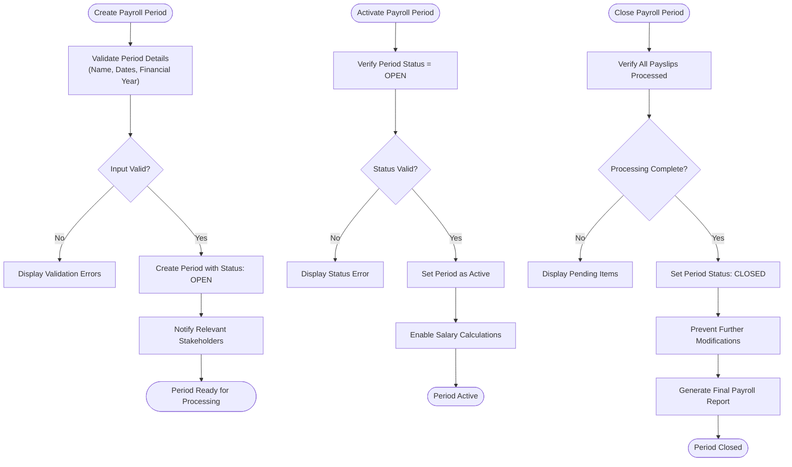
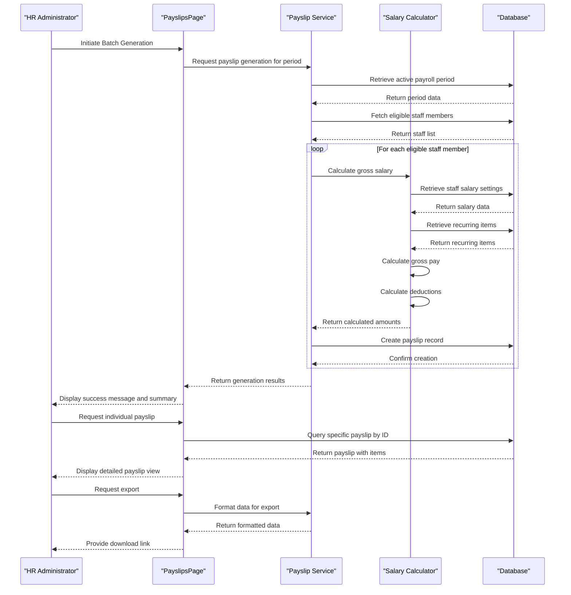
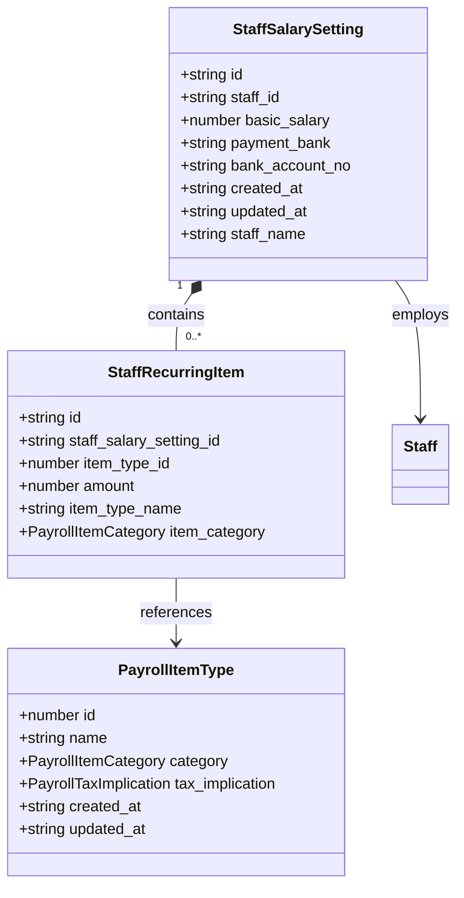
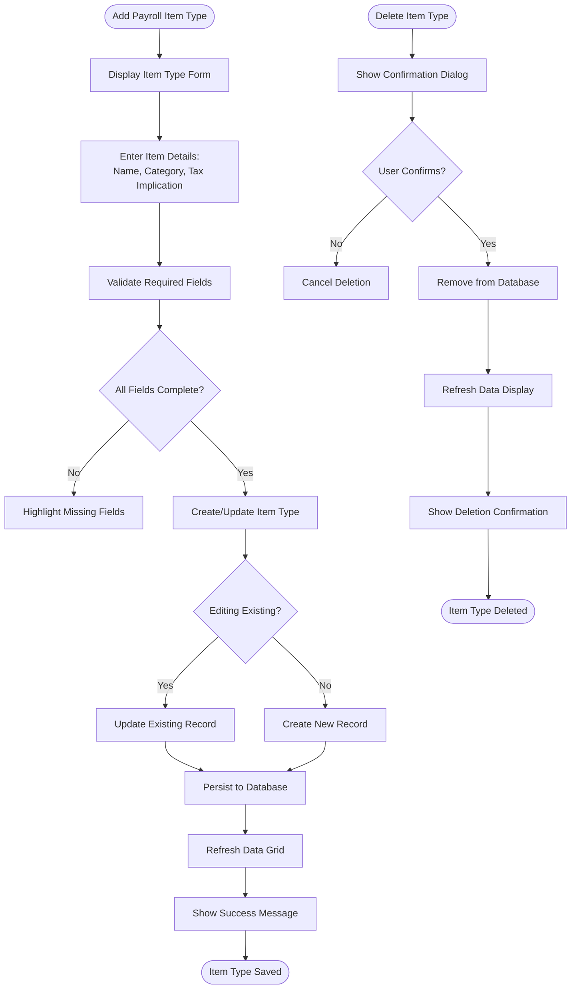
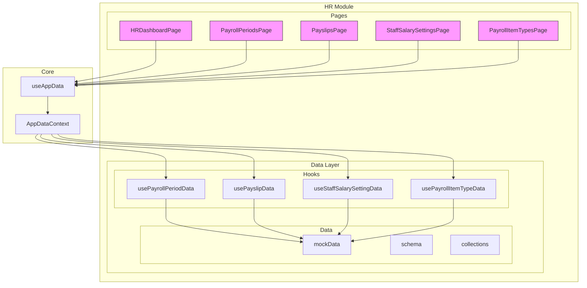

# HR Pages and Features

<cite>
**Referenced Files in This Document**   
- [HRDashboardPage.tsx](file://src/modules/hr/pages/HRDashboardPage.tsx)
- [PayrollPeriodsPage.tsx](file://src/modules/hr/pages/PayrollPeriodsPage.tsx)
- [PayslipsPage.tsx](file://src/modules/hr/pages/PayslipsPage.tsx)
- [StaffSalarySettingsPage.tsx](file://src/modules/hr/pages/StaffSalarySettingsPage.tsx)
- [PayrollItemTypesPage.tsx](file://src/modules/hr/pages/PayrollItemTypesPage.tsx)
- [useAppData.ts](file://src/hooks/useAppData.ts)
- [AppDataContext.tsx](file://src/contexts/AppDataContext.tsx)
- [usePayrollPeriodData.ts](file://src/modules/hr/data/usePayrollPeriodData.ts)
- [usePayslipData.ts](file://src/modules/hr/data/usePayslipData.ts)
- [useStaffSalarySettingData.ts](file://src/modules/hr/data/useStaffSalarySettingData.ts)
- [usePayrollItemTypeData.ts](file://src/modules/hr/data/usePayrollItemTypeData.ts)
- [mockData.ts](file://src/modules/hr/data/mockData.ts)
- [collections.ts](file://src/modules/hr/data/collections.ts)
- [types.ts](file://src/core/types.ts)
</cite>

## Table of Contents
1. [HR Pages and Features](#hr-pages-and-features)
2. [HR Dashboard Page](#hr-dashboard-page)
3. [Payroll Periods Page](#payroll-periods-page)
4. [Payslips Page](#payslips-page)
5. [Staff Salary Settings Page](#staff-salary-settings-page)
6. [Payroll Item Types Page](#payroll-item-types-page)
7. [HR Data Architecture](#hr-data-architecture)
8. [Data Flow and Integration](#data-flow-and-integration)

## HR Dashboard Page

The HRDashboardPage serves as the central hub for the Human Resources module, providing an overview of key HR metrics and quick access to core functionality. It displays summary information about payroll status, pending actions, and navigation shortcuts to other HR features. The dashboard is designed to give HR administrators a comprehensive view of the current state of staff compensation and related activities.

The implementation uses the `useAppData` hook to access HR-related data from the central application context. It renders a clean, card-based interface with visual indicators for different HR metrics. The page includes a welcome message and informational text to guide users, along with a status badge indicating that the dashboard has been enhanced with quick links and employment type charts.

**Section sources**
- [HRDashboardPage.tsx](file://src/modules/hr/pages/HRDashboardPage.tsx)

## Payroll Periods Page

The PayrollPeriodsPage component manages the creation, activation, and closure of payroll periods within the HR system. This page enables HR administrators to define specific time frames for payroll processing, which is essential for accurate salary calculations and financial reporting.

The workflow for payroll periods follows a structured lifecycle:
1. **Creation**: Administrators can create new payroll periods by specifying a name, start date, end date, and associating it with a financial year and school period.
2. **Activation**: Once created, payroll periods can be activated for processing, allowing staff salary calculations and payslip generation.
3. **Closure**: After payroll processing is complete, periods can be closed to prevent further modifications, ensuring data integrity for financial records.

The page would typically include a data grid displaying all payroll periods with their status (OPEN, CLOSED), allowing sorting, filtering, and direct manipulation of period states. Each payroll period entry includes metadata such as the financial year name and school period name for contextual reference.

**Section sources**
- [usePayrollPeriodData.ts](file://src/modules/hr/data/usePayrollPeriodData.ts)
- [mockData.ts](file://src/modules/hr/data/mockData.ts#L4-L22)

**Diagram sources**
- [usePayrollPeriodData.ts](file://src/modules/hr/data/usePayrollPeriodData.ts)
- [mockData.ts](file://src/modules/hr/data/mockData.ts#L4-L22)

## Payslips Page

The PayslipsPage component handles the generation, viewing, and export of employee payslips. This page supports both batch generation for multiple employees and individual payslip management, providing comprehensive payroll processing capabilities.

Key functionalities include:
- **Batch Generation**: The system can generate payslips for all eligible employees within an active payroll period, automatically calculating gross salary, deductions, and net pay based on staff salary settings and recurring items.
- **Individual Viewing**: HR administrators can view detailed payslips for specific employees, examining the breakdown of earnings and deductions.
- **Export Functionality**: Payslips can be exported in various formats (PDF, CSV) for record-keeping, auditing, or distribution to employees.

The implementation uses the `usePayslipData` hook to manage payslip records. Each payslip contains comprehensive information including staff details, payroll period reference, salary components, and payment status. The data structure supports nested payslip items that detail individual earnings and deductions.

**Diagram sources**
- [usePayslipData.ts](file://src/modules/hr/data/usePayslipData.ts)
- [mockData.ts](file://src/modules/hr/data/mockData.ts#L88-L108)

**Section sources**
- [usePayslipData.ts](file://src/modules/hr/data/usePayslipData.ts)
- [mockData.ts](file://src/modules/hr/data/mockData.ts#L88-L108)

## Staff Salary Settings Page

The StaffSalarySettingsPage component manages the configuration of employee compensation, including base salaries, allowances, and deduction management. It also integrates with employment contracts to ensure salary settings align with contractual agreements.

Key features include:
- **Salary Configuration**: Setting basic salary amounts for individual staff members, along with payment details such as bank and account number.
- **Deduction Management**: Configuring recurring deductions and benefits that are automatically applied during payroll processing.
- **Contract Integration**: Linking salary settings to employment contracts to maintain compliance with contractual terms.

The page would typically display a list of staff members with their current salary configurations, allowing HR administrators to edit settings as needed. Each staff salary setting includes references to the employee and detailed compensation information.

**Diagram sources**
- [useStaffSalarySettingData.ts](file://src/modules/hr/data/useStaffSalarySettingData.ts)
- [mockData.ts](file://src/modules/hr/data/mockData.ts#L50-L68)

**Section sources**
- [useStaffSalarySettingData.ts](file://src/modules/hr/data/useStaffSalarySettingData.ts)
- [mockData.ts](file://src/modules/hr/data/mockData.ts#L50-L68)

## Payroll Item Types Page

The PayrollItemTypesPage component enables the definition and categorization of custom payroll items, which are fundamental building blocks for the payroll system. This page allows HR administrators to create and manage different types of earnings, deductions, and contributions.

The implementation provides a comprehensive interface for managing payroll item types with the following features:
- **Custom Definitions**: Creation of new payroll item types with unique names and configurations.
- **Categorization**: Classification of items into earnings, deductions, or contributions.
- **Tax Implications**: Specification of tax treatment (taxable, non-taxable, pre-tax).

The page uses a data grid to display existing payroll item types with filtering and sorting capabilities. Each item type is visually distinguished by category using colored badges (green for earnings, red for deductions, blue for contributions). Tax implications are similarly color-coded (orange for taxable, gray for non-taxable).

**Diagram sources**
- [PayrollItemTypesPage.tsx](file://src/modules/hr/pages/PayrollItemTypesPage.tsx)
- [usePayrollItemTypeData.ts](file://src/modules/hr/data/usePayrollItemTypeData.ts)

**Section sources**
- [PayrollItemTypesPage.tsx](file://src/modules/hr/pages/PayrollItemTypesPage.tsx)
- [usePayrollItemTypeData.ts](file://src/modules/hr/data/usePayrollItemTypeData.ts)

## HR Data Architecture

The HR module follows a modular architecture with well-defined data structures and separation of concerns. The data layer is organized to support both mock data for development and testing, as well as production database integration through RxDB.

Key architectural components include:
- **Data Hooks**: Custom hooks (usePayrollPeriodData, usePayslipData, etc.) that encapsulate data access logic and provide CRUD operations.
- **Central Context**: The AppDataContext that aggregates data from various sources and makes it available throughout the application via the useAppData hook.
- **Data Models**: TypeScript interfaces that define the structure of HR entities with proper typing and relationships.

The architecture supports multiple data modes (demo vs. production) through the unified configuration system, allowing seamless switching between mock data and database-backed implementations.

**Diagram sources**
- [AppDataContext.tsx](file://src/contexts/AppDataContext.tsx)
- [useAppData.ts](file://src/hooks/useAppData.ts)
- [collections.ts](file://src/modules/hr/data/collections.ts)

**Section sources**
- [AppDataContext.tsx](file://src/contexts/AppDataContext.tsx)
- [useAppData.ts](file://src/hooks/useAppData.ts)
- [collections.ts](file://src/modules/hr/data/collections.ts)

## Data Flow and Integration

The HR pages integrate with the data layer through a consistent pattern that ensures maintainability and testability. The primary integration mechanism is the useAppData hook, which provides access to all HR-related data and operations within the AppDataContext.

Data loading sequences follow a standardized pattern:
1. Components import the useAppData hook
2. The hook accesses the AppDataContext via useContext
3. The context provides access to specific HR data sets and CRUD operations
4. Components use this data to render UI elements and handle user interactions

Error handling strategies include:
- Loading states with spinner components during data retrieval
- Validation checks before data mutations
- Confirmation dialogs for destructive operations
- Error boundaries to prevent application crashes

The integration supports both optimistic and pessimistic update strategies, with appropriate feedback to users during data operations. The architecture allows for easy extension and modification of HR features while maintaining data consistency across the application.

**Section sources**
- [useAppData.ts](file://src/hooks/useAppData.ts)
- [AppDataContext.tsx](file://src/contexts/AppDataContext.tsx)
- [PayrollItemTypesPage.tsx](file://src/modules/hr/pages/PayrollItemTypesPage.tsx)