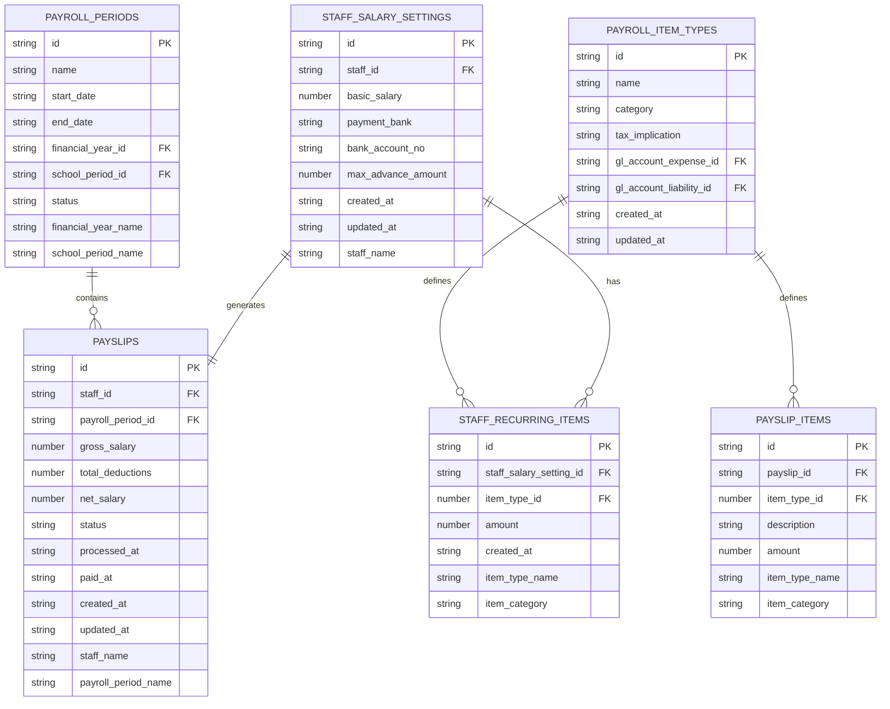
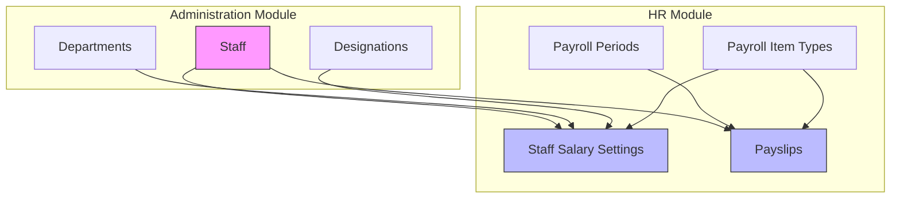

# HR Module

<cite>
**Referenced Files in This Document**   
- [hrModule](file://src/modules/hr/moduleDefinition.tsx)
- [hrCollections](file://src/modules/hr/data/collections.ts)
- [hrSchema](file://src/modules/hr/data/schema.ts)
- [hrTypes](file://src/modules/hr/data/types.ts)
- [PayslipsPage](file://src/modules/hr/pages/PayslipsPage.tsx)
- [StaffSalarySettingsPage](file://src/modules/hr/pages/StaffSalarySettingsPage.tsx)
- [hrRbac](file://src/modules/hr/rbac.ts)
- [hrI18n](file://src/modules/hr/i18n/en.json)
- [administrationModule](file://src/modules/administration/moduleDefinition.tsx)
- [financeModule](file://src/modules/finance/moduleDefinition.tsx)
</cite>

## Table of Contents
1. [Introduction](#introduction)
2. [Module Registration and RBAC Configuration](#module-registration-and-rbac-configuration)
3. [HR Data Model](#hr-data-model)
4. [Key HR Functionalities](#key-hr-functionalities)
5. [Integration with Finance Module](#integration-with-finance-module)
6. [Integration with Administration Module](#integration-with-administration-module)
7. [Implementation Details of Key Components](#implementation-details-of-key-components)
8. [Payroll Tax and Overtime Processing](#payroll-tax-and-overtime-processing)
9. [Compliance and Data Privacy](#compliance-and-data-privacy)
10. [Conclusion](#conclusion)

## Introduction
The HR module in schoolpilot3 is a comprehensive system designed to manage human resources, payroll, and staff compensation. It provides tools for managing staff records, configuring salary settings, processing payroll, and generating payslips. The module is tightly integrated with the Administration and Finance modules to ensure seamless data flow and operational efficiency. This document provides a detailed analysis of the HR module's implementation, covering its architecture, data model, key functionalities, and integration points.

## Module Registration and RBAC Configuration

The HR module is registered within the schoolpilot3 application through the `hrModule` object defined in `moduleDefinition.tsx`. This object contains metadata about the module, including its ID, name, description, icon, path, version, and navigation structure. The module is active and has a version of 1.0.0.

The navigation structure includes links to the HR dashboard, payroll item types, payroll periods, payslips, and staff salary settings. Each navigation item has a name, path, icon, and associated page component. The module also defines features such as payroll management, staff compensation, and HR records, and specifies dependencies on other modules, particularly the Administration module.

Role-Based Access Control (RBAC) is implemented through the `hrPermissions` array, which defines a set of permissions for various HR-related actions. These permissions include viewing, creating, updating, and deleting payroll item types, payroll periods, payslips, and staff salary settings. The permissions are organized by resource and action, with each permission having an ID, name, description, resource, action, module ID, and feature. The module also defines default roles, including 'hr_manager' and 'administrator', which are granted access to the HR module's functionalities.

**Section sources**
- [hrModule](file://src/modules/hr/moduleDefinition.tsx#L14-L56)
- [hrRbac](file://src/modules/hr/rbac.ts#L0-L150)

## HR Data Model

The HR module's data model is defined using database-agnostic schemas in the `schema.ts` file. These schemas are used by both RxDB and PouchDB services to create collections. The data model includes entities for payroll periods, payroll item types, staff salary settings, payslips, and their respective items.

### Payroll Periods
The `payrollPeriodsSchema` defines the structure of a payroll period, including its ID, name, start date, end date, financial year ID, school period ID, status, financial year name, and school period name. The schema specifies that the ID, name, start date, end date, and financial year ID are required fields, and indexes are created on the name, financial year ID, and status fields.

### Payroll Item Types
The `payrollItemTypesSchema` defines the structure of a payroll item type, including its ID, name, category, tax implication, GL account expense ID, GL account liability ID, creation timestamp, and last update timestamp. The schema specifies that the ID, name, category, tax implication, creation timestamp, and last update timestamp are required fields, and indexes are created on the name and category fields.

### Staff Salary Settings
The `staffSalarySettingsSchema` defines the structure of a staff salary setting, including its ID, staff ID, basic salary, payment bank, bank account number, maximum advance amount, creation timestamp, last update timestamp, recurring items, and staff name. The schema specifies that the ID, staff ID, basic salary, creation timestamp, and last update timestamp are required fields, and an index is created on the staff ID field. Recurring items are nested within the staff salary setting and include properties such as ID, staff salary setting ID, item type ID, amount, creation timestamp, item type name, and item category.

### Payslips
The `payslipsSchema` defines the structure of a payslip, including its ID, staff ID, payroll period ID, gross salary, total deductions, net salary, status, processing timestamp, payment timestamp, creation timestamp, last update timestamp, items, staff name, and payroll period name. The schema specifies that the ID, staff ID, payroll period ID, status, creation timestamp, and last update timestamp are required fields, and indexes are created on the staff ID, payroll period ID, and status fields. Payslip items are nested within the payslip and include properties such as ID, payslip ID, item type ID, description, amount, item type name, and item category.

**Diagram sources**
- [hrSchema](file://src/modules/hr/data/schema.ts#L0-L109)
- [hrTypes](file://src/modules/hr/data/types.ts#L0-L85)

## Key HR Functionalities

The HR module provides several key functionalities for managing staff records, payroll, and salary settings. These functionalities are accessible through the HR dashboard and various dedicated pages.

### Staff Records Management
Staff records are managed through the Administration module, which provides pages for adding and managing staff members. The HR module integrates with the Administration module to access staff data, including their department, designation, and employment details. Staff records are used in the HR module to configure salary settings and generate payslips.

### Payroll Processing
Payroll processing is a core functionality of the HR module. It involves creating and managing payroll periods, defining payroll item types, and generating payslips for staff members. The `PayslipsPage` component provides a user interface for selecting a payroll period, generating payslips, and viewing payslip details. The page uses the `useAppData` hook to access data on payslips, payroll periods, and academic years. Users can filter payroll periods by academic year and generate payslips for a selected period. The generated payslips include details such as gross salary, total deductions, net salary, and individual payslip items.

### Salary Configuration
Salary configuration is managed through the `StaffSalarySettingsPage` component. This page allows users to configure salary settings for each staff member, including their basic salary, payment bank, bank account number, and maximum advance amount. Users can also add recurring payroll items, such as allowances or deductions, to a staff member's salary. The page uses the `useAppData` hook to access data on staff members, staff salary settings, and payroll item types. Users can edit existing salary settings or add new ones through a modal interface.

**Section sources**
- [PayslipsPage](file://src/modules/hr/pages/PayslipsPage.tsx#L12-L264)
- [StaffSalarySettingsPage](file://src/modules/hr/pages/StaffSalarySettingsPage.tsx#L16-L347)

## Integration with Finance Module

The HR module integrates with the Finance module to facilitate payment disbursements. Although the provided code does not explicitly show the integration points, the data model suggests that payroll item types are linked to GL (General Ledger) accounts through the `gl_account_expense_id` and `gl_account_liability_id` fields. These fields reference accounts in the Finance module's chart of accounts, ensuring that payroll transactions are properly recorded in the financial system.

When a payslip is processed and marked as paid, the corresponding financial transactions should be created in the Finance module. This integration ensures that the financial records are updated in real-time, maintaining data consistency across the system. The exact mechanism for this integration, such as API calls or event-driven updates, is not detailed in the provided code but is likely implemented through the central data service or a dedicated integration service.

**Section sources**
- [hrSchema](file://src/modules/hr/data/schema.ts#L17-L34)
- [financeModule](file://src/modules/finance/moduleDefinition.tsx)

## Integration with Administration Module

The HR module has a direct dependency on the Administration module, as specified in the `hrModule` definition. This dependency is required for the HR module to function correctly. The Administration module provides essential data on staff members, departments, and designations, which are used in the HR module for salary configuration and payroll processing.

The integration is evident in the data model, where the `staffSalarySettingsSchema` and `payslipsSchema` reference the `staff` collection, which is managed by the Administration module. The `staff` collection includes fields such as `staff_id`, `department_id`, and `designation_id`, which are used to link staff members to their respective departments and designations. This integration ensures that the HR module has access to up-to-date staff information, enabling accurate payroll processing and salary management.

**Diagram sources**
- [hrModule](file://src/modules/hr/moduleDefinition.tsx#L14-L56)
- [hrSchema](file://src/modules/hr/data/schema.ts#L69-L90)
- [administrationModule](file://src/modules/administration/moduleDefinition.tsx)

## Implementation Details of Key Components

### PayslipsPage
The `PayslipsPage` component is responsible for managing payslips. It uses the `useAppData` hook to access data on payslips, payroll periods, and academic years. The component provides a user interface for selecting a payroll period and generating payslips. Users can filter payroll periods by academic year and generate payslips for a selected period. The generated payslips are displayed in a data grid, with columns for payslip ID, staff name, payroll period, gross salary, total deductions, net salary, status, and actions. Users can view the details of a payslip in a modal, which shows the gross salary, total deductions, net salary, and individual payslip items.

The component handles the generation of payslips by calling the `generatePayslipsForPeriod` function, which is provided by the `useAppData` hook. This function likely triggers a backend process to calculate the payslip amounts based on the staff salary settings and payroll item types. The component also handles loading states and displays a spinner while data is being fetched.

### StaffSalarySettingsPage
The `StaffSalarySettingsPage` component is responsible for managing staff salary settings. It uses the `useAppData` hook to access data on staff members, staff salary settings, and payroll item types. The component displays a list of staff members in a data grid, with columns for staff number, name, department, designation, basic salary, and actions. Users can click the "Manage Salary" button to open a modal for configuring the salary settings of a selected staff member.

The modal allows users to set the basic salary, payment bank, bank account number, and maximum advance amount. Users can also add or edit recurring payroll items, such as allowances or deductions, through a secondary modal. The recurring items are linked to payroll item types, which are selected from a dropdown list. The component handles the submission of salary settings by calling the `updateStaffSalarySetting` function, which is provided by the `useAppData` hook. This function likely updates the staff salary settings in the database and recalculates any affected payslips.

**Section sources**
- [PayslipsPage](file://src/modules/hr/pages/PayslipsPage.tsx#L12-L264)
- [StaffSalarySettingsPage](file://src/modules/hr/pages/StaffSalarySettingsPage.tsx#L16-L347)

## Payroll Tax and Overtime Processing

The HR module supports payroll tax calculations through the `tax_implication` field in the `payrollItemTypesSchema`. This field can have values such as "Taxable", "Non-Taxable", or "Tax Relief", which determine how a payroll item is treated for tax purposes. When a payslip is generated, the system likely applies the appropriate tax calculations based on the tax implication of each payroll item. The exact tax calculation logic is not detailed in the provided code but is likely implemented in a backend service or a dedicated payroll engine.

Overtime processing is not explicitly mentioned in the provided code, but it can be handled through the recurring payroll items. Users can define a payroll item type for overtime and add it to a staff member's salary settings with the appropriate amount. The system would then include the overtime amount in the payslip calculation. Alternatively, overtime could be managed as a separate payroll item type that is added to payslips on a per-period basis.

**Section sources**
- [hrSchema](file://src/modules/hr/data/schema.ts#L17-L34)
- [hrTypes](file://src/modules/hr/data/types.ts#L0-L85)

## Compliance and Data Privacy

The HR module handles sensitive employee data, such as salary information, bank account numbers, and personal details. To ensure data privacy and compliance with labor regulations, the module implements role-based access control (RBAC) to restrict access to authorized users. Only users with the 'hr_manager' or 'administrator' roles can access the HR module's functionalities.

The module also follows best practices for data security, such as using secure data storage and transmission. The data model includes fields for creation and update timestamps, which can be used for auditing and tracking changes to sensitive data. Additionally, the module likely integrates with the system's logging and monitoring services to detect and respond to security incidents.

To maintain compliance with labor regulations, the module should support features such as minimum wage calculations, overtime rules, and tax withholding. These features are likely implemented in the backend payroll engine and are not detailed in the provided code. Organizations using the HR module should regularly review and update their payroll policies to ensure compliance with local labor laws and regulations.

**Section sources**
- [hrRbac](file://src/modules/hr/rbac.ts#L0-L150)
- [hrSchema](file://src/modules/hr/data/schema.ts#L0-L109)

## Conclusion
The HR module in schoolpilot3 is a robust and well-structured system for managing human resources, payroll, and staff compensation. It provides a comprehensive set of tools for managing staff records, configuring salary settings, processing payroll, and generating payslips. The module is tightly integrated with the Administration and Finance modules, ensuring seamless data flow and operational efficiency. The implementation follows best practices for data security and compliance, with role-based access control and secure data storage. By leveraging the module's features, organizations can streamline their HR processes and ensure accurate and timely payroll processing.