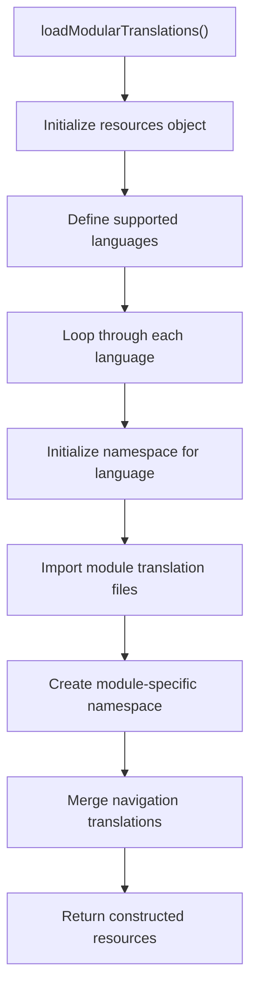
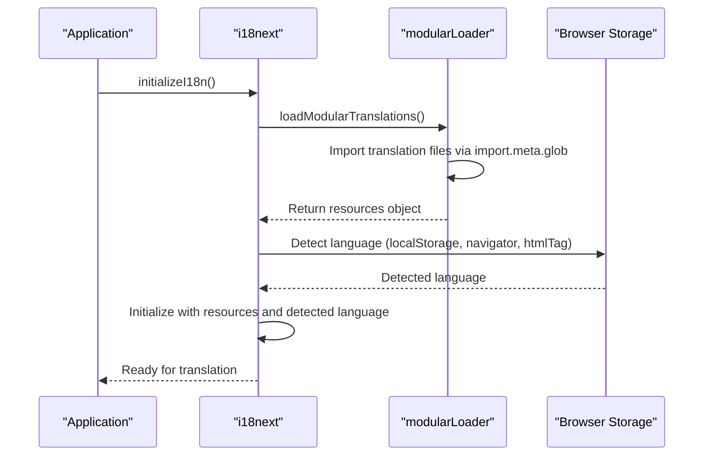
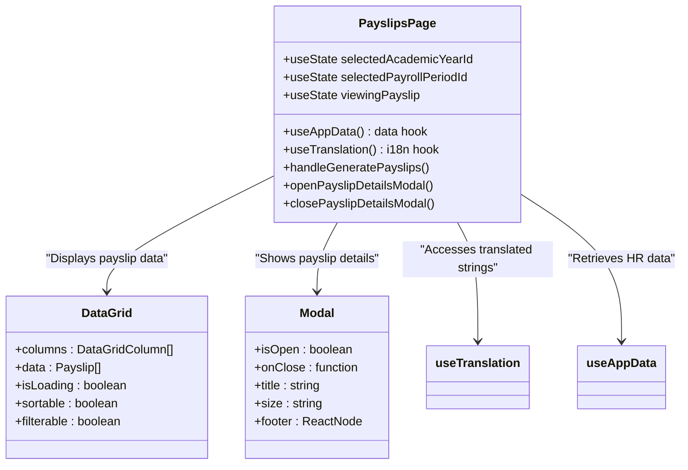
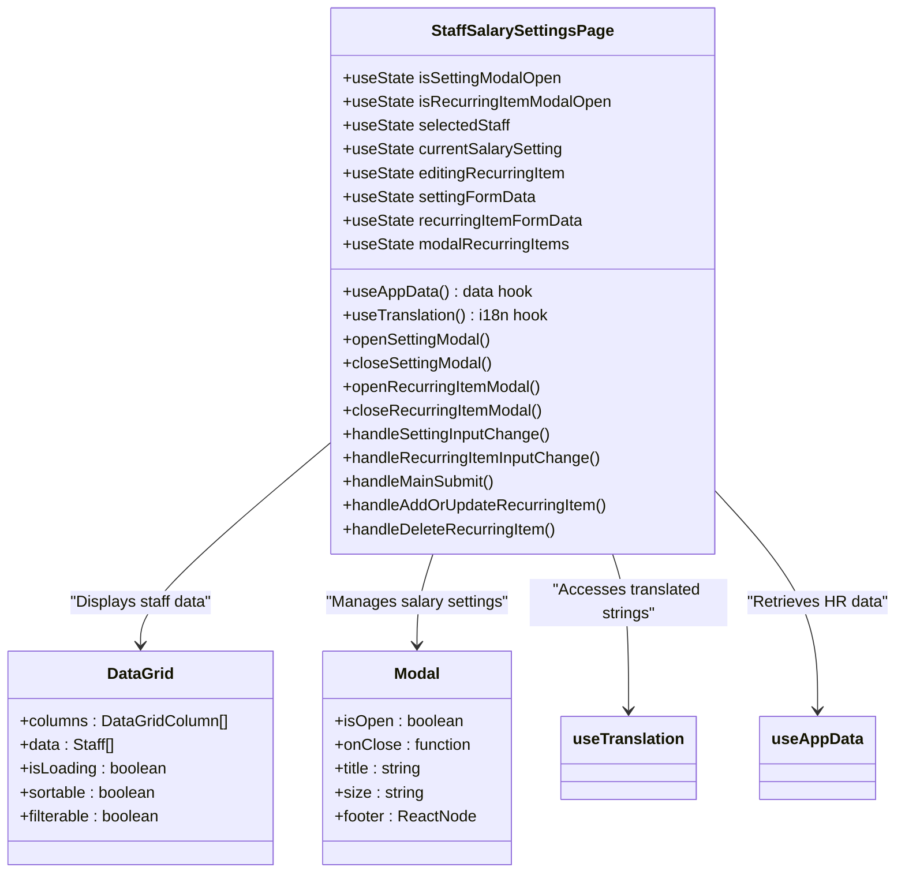

# Internationalization

<cite>
**Referenced Files in This Document**   
- [modularLoader.ts](file://src/i18n/modularLoader.ts)
- [i18n.ts](file://src/i18n/i18n.ts)
- [loader.ts](file://src/i18n/loader.ts)
- [en.json](file://src/modules/hr/i18n/en.json)
- [fr.json](file://src/modules/hr/i18n/fr.json)
- [rw.json](file://src/modules/hr/i18n/rw.json)
- [sw.json](file://src/modules/hr/i18n/sw.json)
- [PayslipsPage.tsx](file://src/modules/hr/pages/PayslipsPage.tsx)
- [StaffSalarySettingsPage.tsx](file://src/modules/hr/pages/StaffSalarySettingsPage.tsx)
- [hrModule.tsx](file://src/modules/hr/moduleDefinition.tsx)
</cite>

## Table of Contents
1. [Introduction](#introduction)
2. [Translation File Structure](#translation-file-structure)
3. [Modular Translation Loading System](#modular-translation-loading-system)
4. [HR-Specific Terminology Implementation](#hr-specific-terminology-implementation)
5. [Component Integration with i18n](#component-integration-with-i18n)
6. [Language Addition and Translation Update Process](#language-addition-and-translation-update-process)
7. [Locale-Specific Formatting Challenges](#locale-specific-formatting-challenges)
8. [Best Practices for Translation Management](#best-practices-for-translation-management)

## Introduction
The Internationalization (i18n) system in the HR module enables multilingual support for payroll, salary components, and employee records across English, French, Kinyarwanda, and Swahili languages. This documentation details the architecture, implementation, and management of the i18n system, focusing on how HR-specific text strings are managed and displayed in the user interface. The system uses a modular approach to organize translations, with dedicated JSON files for each language and a dynamic loading mechanism that integrates with the application's modular architecture.

**Section sources**
- [i18n.ts](file://src/i18n/i18n.ts)
- [modularLoader.ts](file://src/i18n/modularLoader.ts)

## Translation File Structure
The HR module maintains separate JSON files for each supported language, located in the `src/modules/hr/i18n/` directory. Each file contains a hierarchical structure of translation keys organized by functional areas such as dashboard, payroll periods, payroll item types, staff salary settings, and payslips.

The translation files follow a consistent structure with top-level keys that correspond to different sections of the HR module:

```json
{
  "title": "HR",
  "navigation": {
    "hr": {
      "title": "HR",
      "description": "Manage human resources, payroll, and staff compensation",
      "dashboard": "Dashboard",
      "payrollItemTypes": "Payroll Item Types",
      "payrollPeriods": "Payroll Periods",
      "payslips": "Payslips",
      "staffSalarySettings": "Staff Salary Settings"
    }
  }
}
```

Each language file contains the same key structure but with localized values. For example, the French translation file (`fr.json`) includes French translations for all HR terminology, while the Kinyarwanda (`rw.json`) and Swahili (`sw.json`) files provide translations for their respective languages.

The system currently supports four languages:
- English (`en.json`)
- French (`fr.json`)
- Kinyarwanda (`rw.json`)
- Swahili (`sw.json`)

**Section sources**
- [en.json](file://src/modules/hr/i18n/en.json)
- [fr.json](file://src/modules/hr/i18n/fr.json)
- [rw.json](file://src/modules/hr/i18n/rw.json)
- [sw.json](file://src/modules/hr/i18n/sw.json)

## Modular Translation Loading System
The i18n system uses a modular loader to dynamically load translation resources from each module's i18n directory. The `modularLoader.ts` file implements the `loadModularTranslations` function, which uses Vite's import.meta.glob to dynamically import translation files from all modules.



**Diagram sources**
- [modularLoader.ts](file://src/i18n/modularLoader.ts#L0-L66)

The loading process follows these steps:
1. Initialize a resources object with empty translation objects for each supported language (English, French, Swahili, Kinyarwanda)
2. For each language, loop through all module translation files that match the language code
3. Create module-specific namespaces within each language
4. Extract navigation translations and merge them into a unified navigation namespace
5. Return the complete resources object to the i18next instance

The i18next instance is initialized in `i18n.ts`, which creates a singleton instance and configures it with the loaded resources. The initialization includes language detection from localStorage, navigator settings, or HTML tags, with localStorage taking precedence.



**Diagram sources**
- [i18n.ts](file://src/i18n/i18n.ts#L0-L116)
- [modularLoader.ts](file://src/i18n/modularLoader.ts#L0-L66)

**Section sources**
- [i18n.ts](file://src/i18n/i18n.ts#L0-L116)
- [modularLoader.ts](file://src/i18n/modularLoader.ts#L0-L66)

## HR-Specific Terminology Implementation
The HR module implements specific terminology for payroll, salary components, and employee records across all supported languages. The translation keys are organized by functional area, with consistent naming conventions that reflect the HR domain.

Key HR terminology includes:
- **Payroll Periods**: Terms related to defining and managing payroll processing periods
- **Payroll Item Types**: Categories for income, deductions, and contributions
- **Staff Salary Settings**: Configuration for basic salary, bank details, and recurring items
- **Payslips**: Elements of the payroll statement including gross salary, deductions, and net salary

The French translation file (`fr.json`) provides comprehensive translations for HR-specific terms:

```json
{
  "dashboard": {
    "title": "Tableau de Bord RH",
    "totalStaff": "Total Personnel",
    "payrollPeriodsDefined": "Périodes de Paie Définies",
    "payrollItemTypes": "Types d'Éléments de Paie",
    "staffWithSalarySettings": "Personnel avec Param. Salaire"
  },
  "payrollPeriods": {
    "title": "Gestion des Périodes de Paie",
    "description": "Définir les périodes de paie pour le traitement des salaires du personnel",
    "addButton": "Ajouter Période de Paie",
    "nameLabel": "Nom de la Période",
    "startDateLabel": "Date de Début",
    "endDateLabel": "Date de Fin"
  },
  "staffSalarySettings": {
    "title": "Paramètres Salariaux du Personnel",
    "description": "Gérer les configurations salariales pour chaque membre du personnel",
    "basicSalaryLabel": "Salaire de Base (KES)",
    "paymentBankLabel": "Banque de Paiement",
    "bankAccountNoLabel": "N° Compte Bancaire"
  },
  "payslips": {
    "title": "Gestion des Fiches de Paie",
    "grossSalaryLabel": "Salaire Brut :",
    "totalDeductionsLabel": "Total Déductions :",
    "netSalaryLabel": "Salaire Net :"
  }
}
```

The Kinyarwanda and Swahili translations follow the same structure, ensuring consistency across all languages. This modular approach allows for easy maintenance and updates to HR terminology without affecting other parts of the application.

**Section sources**
- [fr.json](file://src/modules/hr/i18n/fr.json#L0-L104)
- [en.json](file://src/modules/hr/i18n/en.json#L0-L13)
- [rw.json](file://src/modules/hr/i18n/rw.json#L0-L13)
- [sw.json](file://src/modules/hr/i18n/sw.json#L0-L13)

## Component Integration with i18n
HR module components integrate with the i18n system using the `useTranslation` hook from react-i18next. Components such as `PayslipsPage` and `StaffSalarySettingsPage` import this hook to access translated strings and enable real-time language switching.

The `PayslipsPage` component demonstrates how translations are used in the user interface:



**Diagram sources**
- [PayslipsPage.tsx](file://src/modules/hr/pages/PayslipsPage.tsx#L0-L267)

The component uses hardcoded English strings in its initial implementation, which should be replaced with translation keys for full i18n support:

```typescript
const payslipColumns: DataGridColumn<Payslip>[] = [
  { 
    key: 'id', 
    header: 'Payslip ID', 
    sortable: true, 
    filterable: true, 
    width: 100
  },
  { 
    key: 'staff_name', 
    header: 'Staff Name', 
    sortable: true, 
    filterable: true, 
    width: 200
  },
  // ... other columns
];
```

Similarly, the `StaffSalarySettingsPage` component integrates with i18n to display translated HR content:



**Diagram sources**
- [StaffSalarySettingsPage.tsx](file://src/modules/hr/pages/StaffSalarySettingsPage.tsx#L0-L350)

The navigation system also uses translation keys, as seen in the HR module definition:

```typescript
export const hrModule: ModuleDefinition = {
  id: 'hr',
  name: 'navigation:hr.title',
  description: 'navigation:hr.description',
  navigation: [
    { name: 'navigation:hr.dashboard', path: '/hr/dashboard', icon: UserGroupIcon, page: 'HRDashboardPage' },
    { name: 'navigation:hr.payrollItemTypes', path: '/hr/payroll-item-types', icon: DocumentTextIcon, page: 'PayrollItemTypesPage' },
    { name: 'navigation:hr.payrollPeriods', path: '/hr/payroll-periods', icon: CalendarDaysIcon, page: 'PayrollPeriodsPage' },
    { name: 'navigation:hr.payslips', path: '/hr/payslips', icon: ClipboardDocumentListIcon, page: 'PayslipsPage' },
    { name: 'navigation:hr.staffSalarySettings', path: '/hr/staff-salary-settings', icon: CurrencyDollarIcon, page: 'StaffSalarySettingsPage' },
  ],
};
```

**Section sources**
- [PayslipsPage.tsx](file://src/modules/hr/pages/PayslipsPage.tsx#L0-L267)
- [StaffSalarySettingsPage.tsx](file://src/modules/hr/pages/StaffSalarySettingsPage.tsx#L0-L350)
- [hrModule.tsx](file://src/modules/hr/moduleDefinition.tsx#L14-L56)

## Language Addition and Translation Update Process
To add a new language to the HR module, follow these steps:

1. Create a new JSON file in the `src/modules/hr/i18n/` directory using the language code (e.g., `de.json` for German)
2. Copy the structure from an existing translation file (e.g., `en.json`)
3. Translate all values while maintaining the same key structure
4. Update the `modularLoader.ts` file to include the new language in the languages array

```typescript
const languages = ['en', 'fr', 'sw', 'rw', 'new_language_code'];
```

To update existing translations:
1. Identify the specific HR terminology that needs updating
2. Update the corresponding values in all language files
3. Ensure consistency in terminology across all languages
4. Validate that the key structure remains identical across all files

The system includes validation mechanisms to ensure consistency across language files. The modular loader constructs the resources object by iterating through all available translation files, which helps identify missing languages or inconsistent key structures. During development, the system can be configured to show warnings for missing translation keys.

For quality assurance, the following validation steps should be performed:
- Verify that all language files have the same set of keys
- Check that HR-specific terminology is accurately translated
- Ensure that currency and date format references are appropriate for each locale
- Test the application with each language to verify proper display of translated content

**Section sources**
- [modularLoader.ts](file://src/i18n/modularLoader.ts#L0-L66)
- [en.json](file://src/modules/hr/i18n/en.json)
- [fr.json](file://src/modules/hr/i18n/fr.json)

## Locale-Specific Formatting Challenges
The HR module faces specific challenges related to locale-specific formatting for payroll periods and salary amounts. These challenges include date format variations and currency formatting requirements.

### Date Format Handling
Payroll periods require date inputs for start and end dates. The current implementation uses the browser's default date input format, which automatically adapts to the user's locale settings:

```typescript
<Input 
  name="start_date" 
  label="Start Date" 
  type="date"
  value={formData.start_date || ''} 
  onChange={handleInputChange} 
  required 
/>
```

For display purposes, the application uses JavaScript's `toLocaleDateString()` method to format dates according to the user's locale:

```typescript
{
  key: 'start_date',
  header: 'Start Date',
  sortable: true,
  width: 120,
  render: (value) => new Date(value).toLocaleDateString()
}
```

This approach ensures that dates are displayed in the appropriate format for each language:
- English: MM/DD/YYYY or DD/MM/YYYY depending on region
- French: DD/MM/YYYY
- Kinyarwanda: DD/MM/YYYY
- Swahili: DD/MM/YYYY

### Currency Formatting
Salary amounts are displayed with the Kenyan Shilling (KES) currency code, as the system is primarily used in Kenya. The current implementation hardcodes the currency format:

```typescript
render: (value, row) => `Ksh ${row.gross_salary?.toFixed(2) || '0.00'}`
```

This approach presents challenges for internationalization, as the currency symbol and formatting should adapt to the user's locale. A more robust solution would use the Intl.NumberFormat API:

```typescript
// Proposed improved implementation
const formatter = new Intl.NumberFormat(i18n.language, {
  style: 'currency',
  currency: 'KES', // Could be configurable based on organization settings
});

render: (value, row) => formatter.format(row.gross_salary || 0)
```

The system should also consider local labor law terminology in different regions, particularly for payroll item categories such as tax implications, deductions, and benefits. These terms may have specific legal meanings that require careful translation by domain experts.

**Section sources**
- [PayslipsPage.tsx](file://src/modules/hr/pages/PayslipsPage.tsx#L99-L143)
- [PayrollPeriodsPage.tsx](file://src/modules/hr/pages/PayrollPeriodsPage.tsx#L100-L156)

## Best Practices for Translation Management
To maintain high-quality translations and ensure compliance with local labor laws, follow these best practices:

### Translation Quality Assurance
1. **Use professional translators** with expertise in HR and payroll terminology
2. **Maintain a glossary** of approved HR terms for consistency across translations
3. **Implement peer review** for all translation updates
4. **Test translations** in the actual application context to ensure proper display

### Technical Best Practices
1. **Use consistent key naming** across all language files
2. **Avoid concatenating translated strings** to prevent grammatical errors
3. **Provide context** for translators through comments or a separate documentation file
4. **Use translation keys** instead of hardcoded strings in components

### Compliance and Legal Considerations
1. **Verify legal terminology** with local HR experts to ensure compliance with labor laws
2. **Maintain version control** for translation files to track changes
3. **Document translation decisions** for audit purposes
4. **Regularly review translations** to ensure they remain current with changing regulations

### Maintenance Workflow
1. **Establish a translation update process** that includes development, review, and deployment stages
2. **Use automated checks** to identify missing or inconsistent translations
3. **Schedule regular translation audits** to maintain quality
4. **Provide feedback mechanisms** for users to report translation issues

By following these best practices, the HR module can maintain high-quality, compliant translations that effectively serve users across different language regions.