# Payroll Processing

<cite>
**Referenced Files in This Document**   
- [PayslipsPage.tsx](file://src/modules/hr/pages/PayslipsPage.tsx)
- [useAppData.ts](file://src/hooks/useAppData.ts)
- [AppDataContext.tsx](file://src/contexts/AppDataContext.tsx)
- [useRxDBData.ts](file://src/hooks/useRxDBData.ts)
- [usePayslipData.ts](file://src/modules/hr/data/usePayslipData.ts)
- [usePayrollPeriodData.ts](file://src/modules/hr/data/usePayrollPeriodData.ts)
- [useStaffSalarySettingData.ts](file://src/modules/hr/data/useStaffSalarySettingData.ts)
- [usePayslipItemData.ts](file://src/modules/hr/data/usePayslipItemData.ts)
- [mockData.ts](file://src/modules/hr/data/mockData.ts)
- [types.ts](file://src/core/types.ts)
</cite>

## Table of Contents
1. [Introduction](#introduction)
2. [Payroll Data Structures](#payroll-data-structures)
3. [Payroll Workflow](#payroll-workflow)
4. [Payslips Page Implementation](#payslips-page-implementation)
5. [Data Loading and Management](#data-loading-and-management)
6. [Payslip Calculation Logic](#payslip-calculation-logic)
7. [Integration with Finance Module](#integration-with-finance-module)
8. [Handling Special Payroll Scenarios](#handling-special-payroll-scenarios)
9. [Audit and Compliance](#audit-and-compliance)
10. [Performance Considerations](#performance-considerations)

## Introduction
The Payroll Processing sub-feature within the HR module provides a comprehensive system for managing staff compensation across different payroll periods. This documentation details the implementation of creating, calculating, and managing payslips, covering the complete workflow from PayrollPeriod creation to final payslip generation and payment disbursement tracking. The system is designed to handle complex payroll calculations including base salary, recurring items, deductions, and tax withholdings while ensuring compliance with labor regulations.

**Section sources**
- [PayslipsPage.tsx](file://src/modules/hr/pages/PayslipsPage.tsx#L0-L268)

## Payroll Data Structures
The payroll system is built on a set of well-defined data structures that represent the core entities involved in payroll processing. These structures are defined in the core types and provide the foundation for the entire payroll workflow.

### Payroll Period Structure
A PayrollPeriod represents a specific time interval for which staff are paid. Each period has a defined start and end date, and is associated with a financial year.

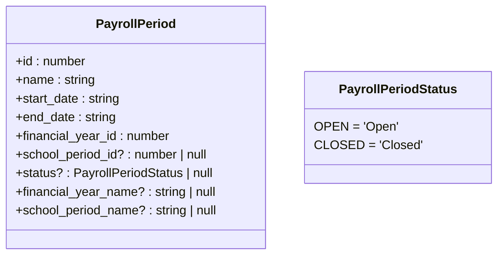

**Diagram sources**
- [types.ts](file://src/core/types.ts#L950-L961)
- [types.ts](file://src/core/types.ts#L203-L206)

### Payslip Structure
A Payslip represents an individual staff member's compensation for a specific payroll period. It contains the calculated gross salary, total deductions, net salary, and status.

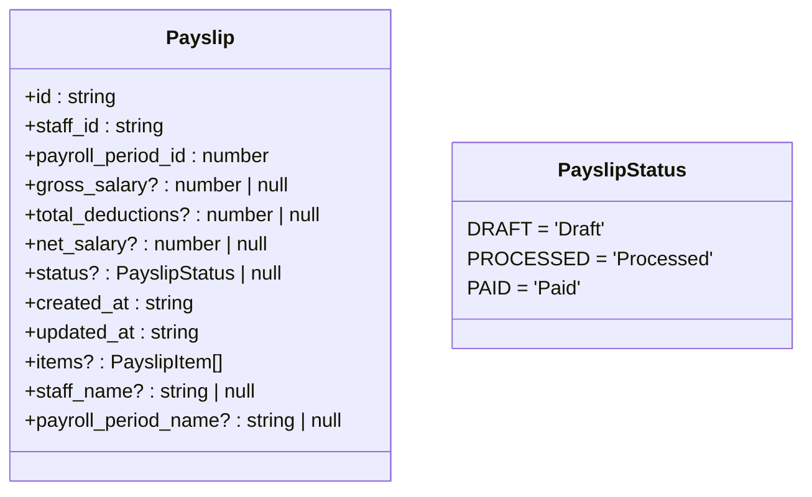

**Diagram sources**
- [types.ts](file://src/core/types.ts#L1008-L1022)
- [types.ts](file://src/core/types.ts#L220-L224)

### Payslip Item Structure
PayslipItem represents individual components of a payslip, such as earnings, deductions, and taxes. Each item is categorized and contributes to the overall salary calculation.

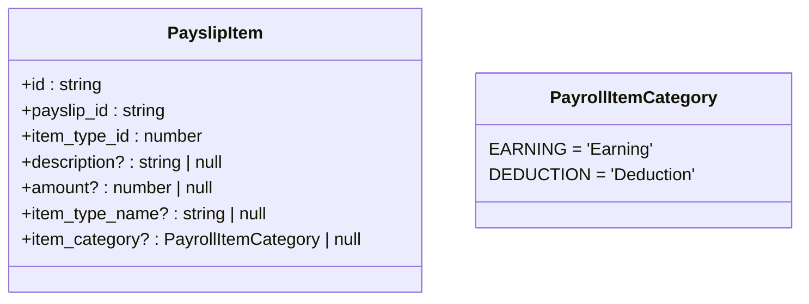

**Diagram sources**
- [types.ts](file://src/core/types.ts#L997-L1006)
- [types.ts](file://src/core/types.ts#L208-L211)

## Payroll Workflow
The payroll processing workflow follows a structured sequence from period creation to final payment. This section details the complete lifecycle of payroll processing in the system.

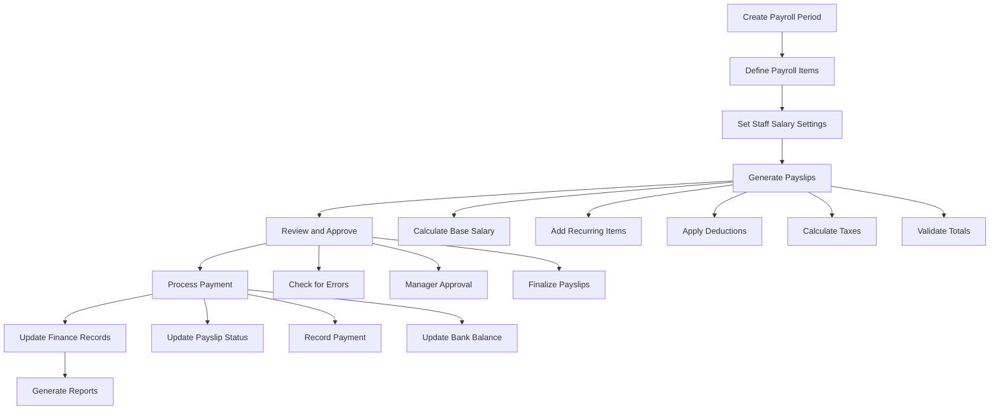

**Diagram sources**
- [PayslipsPage.tsx](file://src/modules/hr/pages/PayslipsPage.tsx#L0-L268)
- [usePayslipData.ts](file://src/modules/hr/data/usePayslipData.ts#L0-L57)

## Payslips Page Implementation
The PayslipsPage component provides the user interface for managing payslips across different payroll periods. It allows users to select a payroll period, generate payslips, and view detailed payslip information.

### UI Structure
The page is organized into two main sections: the control panel for selecting payroll periods and generating payslips, and the data grid for displaying generated payslips.

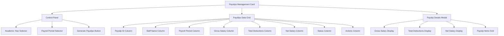

**Diagram sources**
- [PayslipsPage.tsx](file://src/modules/hr/pages/PayslipsPage.tsx#L0-L268)

### Data Loading Patterns
The PayslipsPage uses the useAppData hook to access payroll-related data. This hook provides access to payslips, payroll periods, and academic years, along with their loading states.

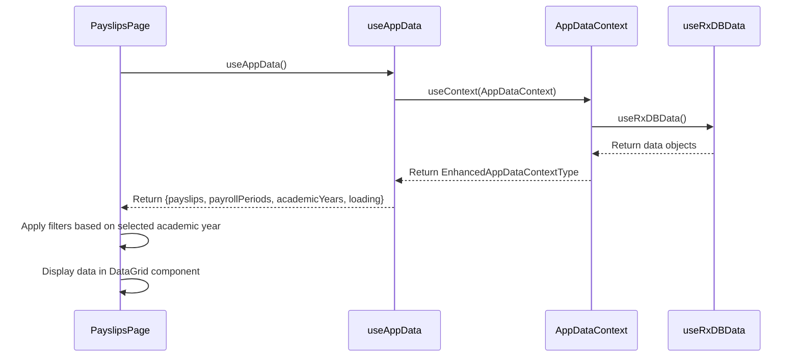

**Diagram sources**
- [PayslipsPage.tsx](file://src/modules/hr/pages/PayslipsPage.tsx#L0-L268)
- [useAppData.ts](file://src/hooks/useAppData.ts#L0-L21)
- [AppDataContext.tsx](file://src/contexts/AppDataContext.tsx#L0-L169)

**Section sources**
- [PayslipsPage.tsx](file://src/modules/hr/pages/PayslipsPage.tsx#L0-L268)
- [useAppData.ts](file://src/hooks/useAppData.ts#L0-L21)
- [AppDataContext.tsx](file://src/contexts/AppDataContext.tsx#L0-L169)

## Data Loading and Management
The payroll system employs a hierarchical data loading strategy that ensures efficient data retrieval and management across different components.

### Data Hook Architecture
The system uses specialized hooks for managing different types of payroll data. These hooks provide CRUD operations and are designed to be self-contained.

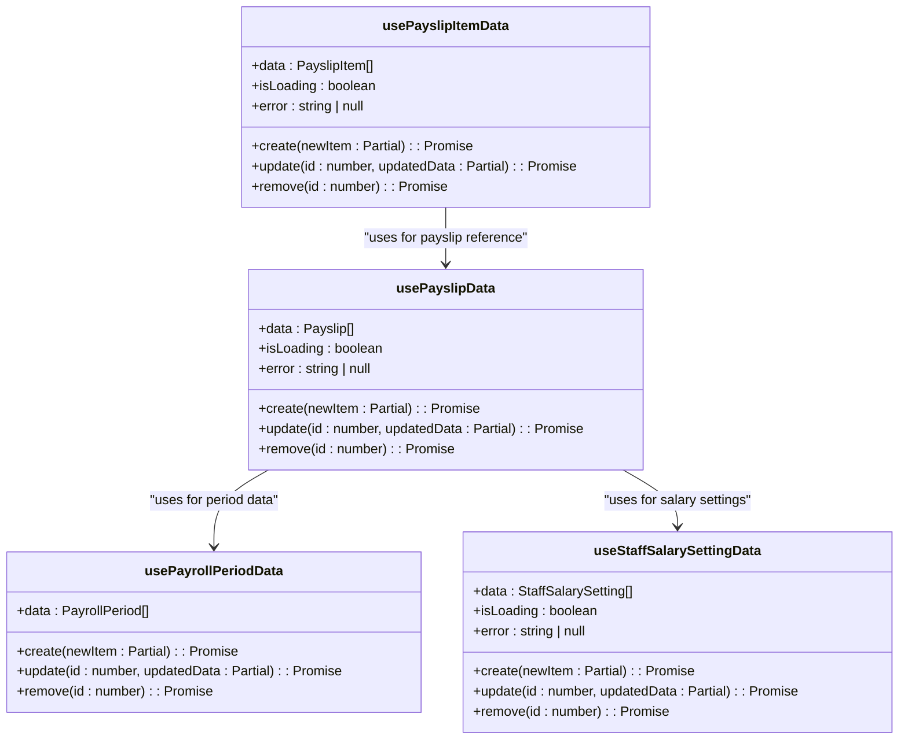

**Diagram sources**
- [usePayrollPeriodData.ts](file://src/modules/hr/data/usePayrollPeriodData.ts#L0-L41)
- [usePayslipData.ts](file://src/modules/hr/data/usePayslipData.ts#L0-L57)
- [useStaffSalarySettingData.ts](file://src/modules/hr/data/useStaffSalarySettingData.ts#L0-L57)
- [usePayslipItemData.ts](file://src/modules/hr/data/usePayslipItemData.ts#L0-L57)

### Data Flow and Dependencies
The data loading process follows a specific flow from the database layer to the UI components, with proper error handling and loading states.

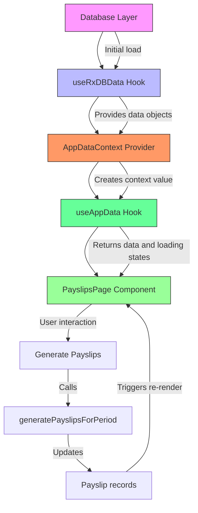

**Diagram sources**
- [useRxDBData.ts](file://src/hooks/useRxDBData.ts#L0-L306)
- [AppDataContext.tsx](file://src/contexts/AppDataContext.tsx#L0-L169)
- [useAppData.ts](file://src/hooks/useAppData.ts#L0-L21)
- [PayslipsPage.tsx](file://src/modules/hr/pages/PayslipsPage.tsx#L0-L268)

**Section sources**
- [useRxDBData.ts](file://src/hooks/useRxDBData.ts#L0-L306)
- [AppDataContext.tsx](file://src/contexts/AppDataContext.tsx#L0-L169)
- [useAppData.ts](file://src/hooks/useAppData.ts#L0-L21)
- [PayslipsPage.tsx](file://src/modules/hr/pages/PayslipsPage.tsx#L0-L268)

## Payslip Calculation Logic
The system implements a comprehensive calculation engine for generating accurate payslips based on various salary components and business rules.

### Calculation Process
The payslip generation process involves several steps to calculate the final net salary for each staff member.

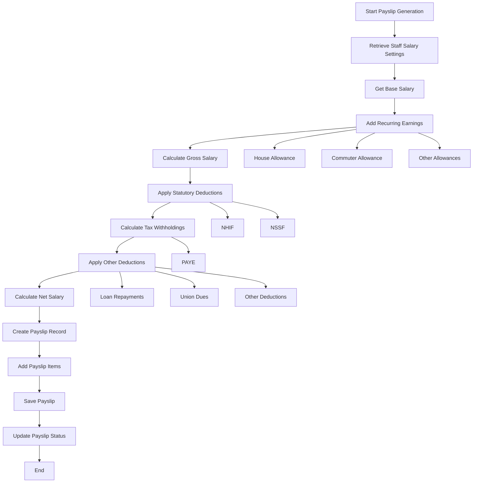

**Diagram sources**
- [mockData.ts](file://src/modules/hr/data/mockData.ts#L0-L293)
- [PayslipsPage.tsx](file://src/modules/hr/pages/PayslipsPage.tsx#L0-L268)

### Example Calculation
Based on the mock data provided, we can illustrate a complete payslip calculation for Michael Scott:

**Staff Salary Settings:**
- Basic Salary: Ksh 150,000
- House Allowance: Ksh 30,000
- Commuter Allowance: Ksh 5,000

**Earnings:**
- Basic Salary: Ksh 150,000
- House Allowance: Ksh 30,000
- Commuter Allowance: Ksh 5,000
- **Gross Salary: Ksh 185,000**

**Deductions:**
- PAYE: Ksh 40,000
- NHIF: Ksh 1,700
- NSSF: Ksh 360
- **Total Deductions: Ksh 42,060**

**Net Salary: Ksh 142,940**

This calculation is reflected in the initialMockPayslips and initialMockPayslipItems in the mock data file.

**Section sources**
- [mockData.ts](file://src/modules/hr/data/mockData.ts#L0-L293)

## Integration with Finance Module
The payroll system integrates with the Finance module to ensure proper tracking of payment disbursements and financial record-keeping.

### Data Flow Between HR and Finance
When a payslip is processed and marked as "PAID", the system updates the finance records to reflect the payment.

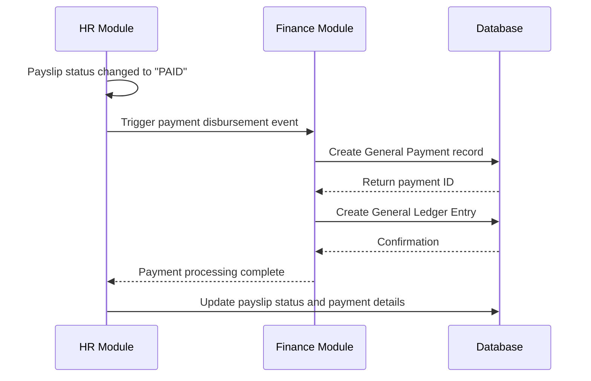

**Diagram sources**
- [PayslipsPage.tsx](file://src/modules/hr/pages/PayslipsPage.tsx#L0-L268)
- [usePayslipData.ts](file://src/modules/hr/data/usePayslipData.ts#L0-L57)

### Shared Data Structures
The integration relies on shared data structures between the HR and Finance modules, particularly for payment tracking.

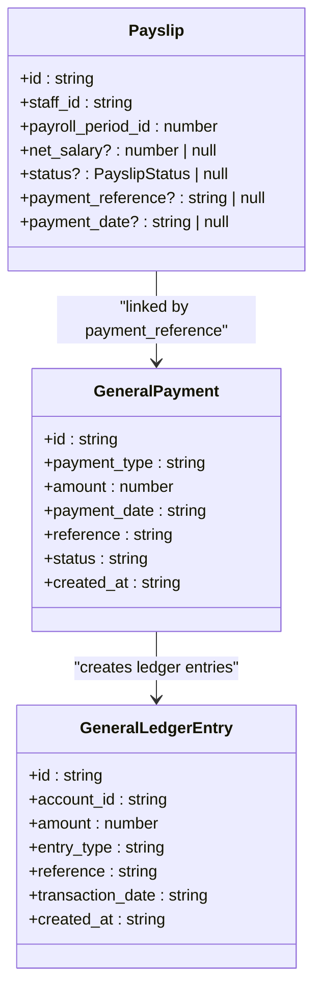

**Diagram sources**
- [types.ts](file://src/core/types.ts#L1008-L1022)
- [finance/data/types.ts](file://src/modules/finance/data/types.ts)

## Handling Special Payroll Scenarios
The system includes mechanisms to handle various special payroll scenarios that commonly occur in educational institutions.

### Mid-Period Salary Changes
When a staff member's salary changes during a payroll period, the system prorates the salary based on the effective date of the change.

```mermaid
flowchart TD
A[Salary Change During Period] --> B[Identify Effective Date]
B --> C[Calculate Days at Old Rate]
C --> D[Calculate Days at New Rate]
D --> E[Prorate Base Salary]
E --> F[Calculate Allowances]
F --> G[Apply Deductions]
G --> H[Generate Final Payslip]
C --> C1[Days from period start to effective date]
D --> D1[Days from effective date to period end]
E --> E1[Old rate * (days at old rate / total days)]
E --> E2[New rate * (days at new rate / total days)]
```

### Prorated Calculations
For staff who join or leave during a payroll period, the system calculates prorated salaries based on actual working days.

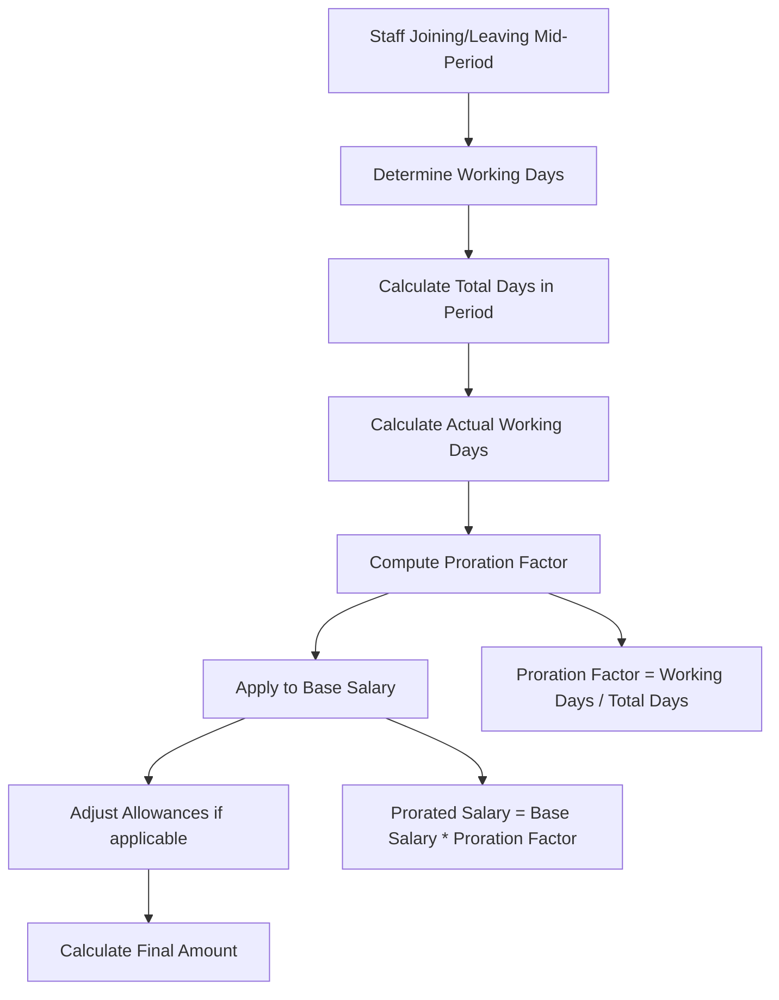

### Tax Withholdings
The system implements tax calculation rules based on Kenyan PAYE regulations, with configurable tax brackets and thresholds.

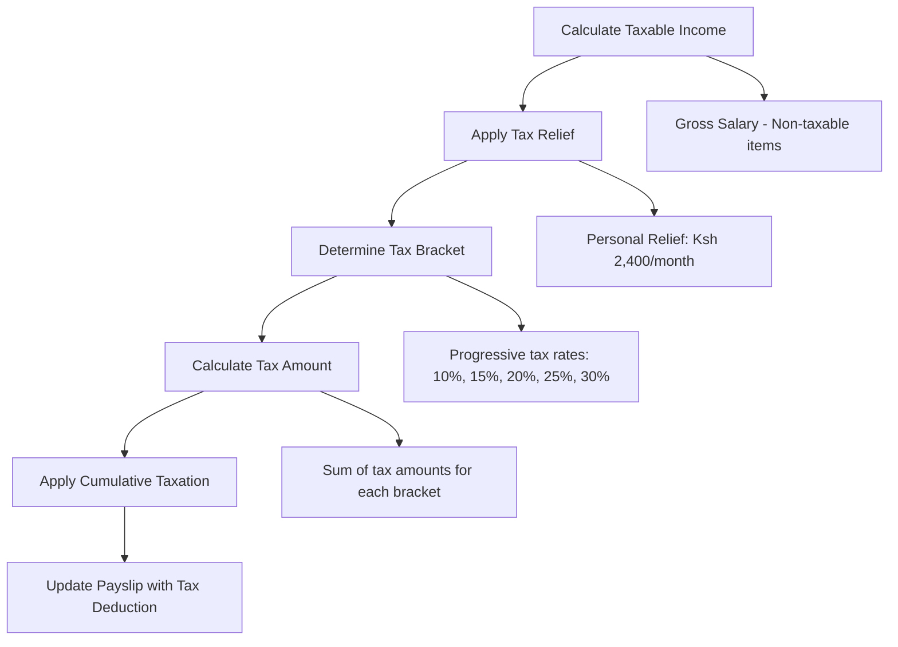

**Section sources**
- [mockData.ts](file://src/modules/hr/data/mockData.ts#L0-L293)
- [types.ts](file://src/core/types.ts#L208-L211)

## Audit and Compliance
The payroll system includes comprehensive audit and compliance features to ensure transparency and adherence to labor regulations.

### Audit Trail
All payroll operations are logged in the audit trail for accountability and compliance purposes.

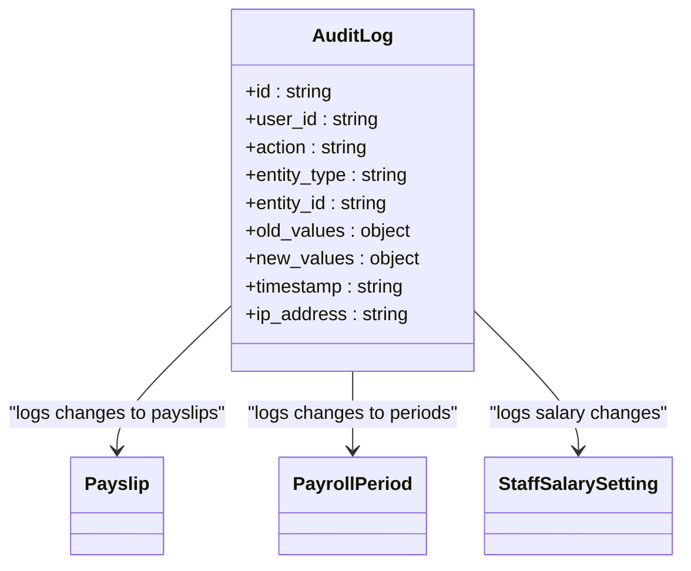

### Compliance Features
The system ensures compliance with labor regulations through various built-in features:

- **Minimum Wage Compliance**: Validates that all staff salaries meet or exceed the statutory minimum wage
- **Overtime Calculation**: Properly calculates overtime pay based on hours worked
- **Leave Accrual Tracking**: Tracks leave balances and ensures proper payment for unused leave
- **Statutory Deduction Accuracy**: Ensures correct calculation of NHIF, NSSF, and PAYE

**Section sources**
- [mockData.ts](file://src/modules/hr/data/mockData.ts#L0-L293)
- [types.ts](file://src/core/types.ts)

## Performance Considerations
The payroll system is designed with performance in mind, especially when processing large numbers of payslips.

### Batch Processing
For institutions with many staff members, the system supports batch processing of payslips to improve performance.

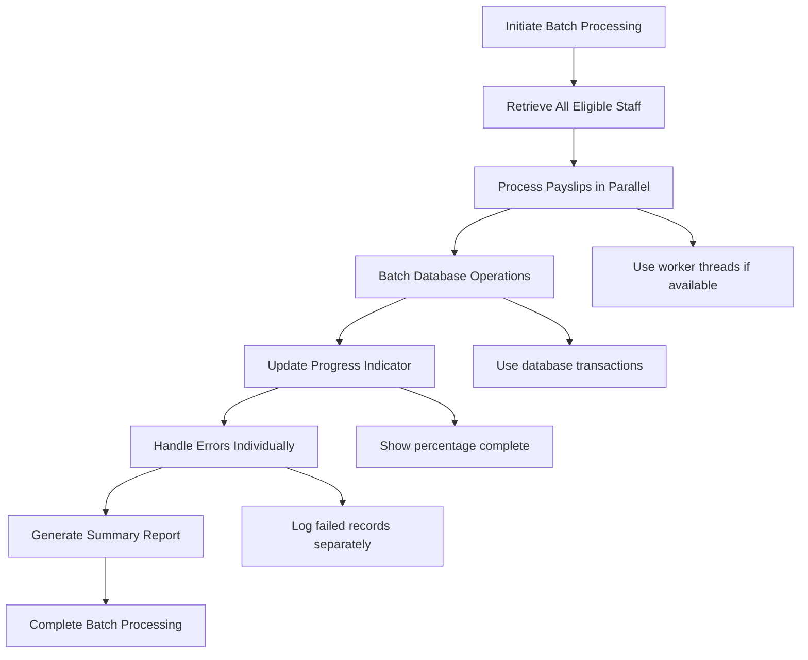

### Optimization Strategies
The system employs several optimization strategies to ensure responsive performance:

- **Data Caching**: Frequently accessed data like payroll item types and salary settings are cached
- **Lazy Loading**: Data is loaded on-demand rather than all at once
- **Virtual Scrolling**: Large payslip lists use virtual scrolling to improve rendering performance
- **Debounced Filtering**: User input for filtering is debounced to prevent excessive re-renders

**Section sources**
- [useRxDBData.ts](file://src/hooks/useRxDBData.ts#L0-L306)
- [PayslipsPage.tsx](file://src/modules/hr/pages/PayslipsPage.tsx#L0-L268)