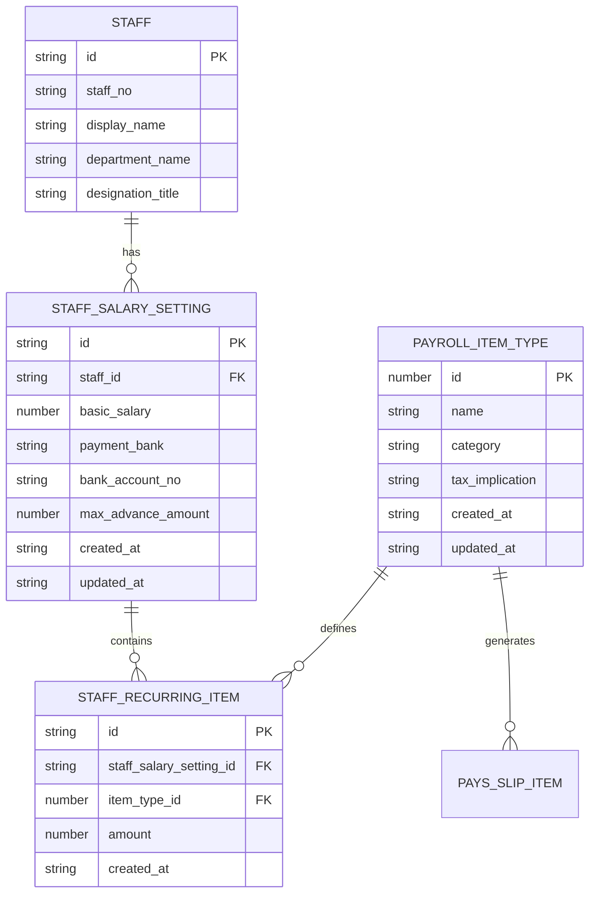
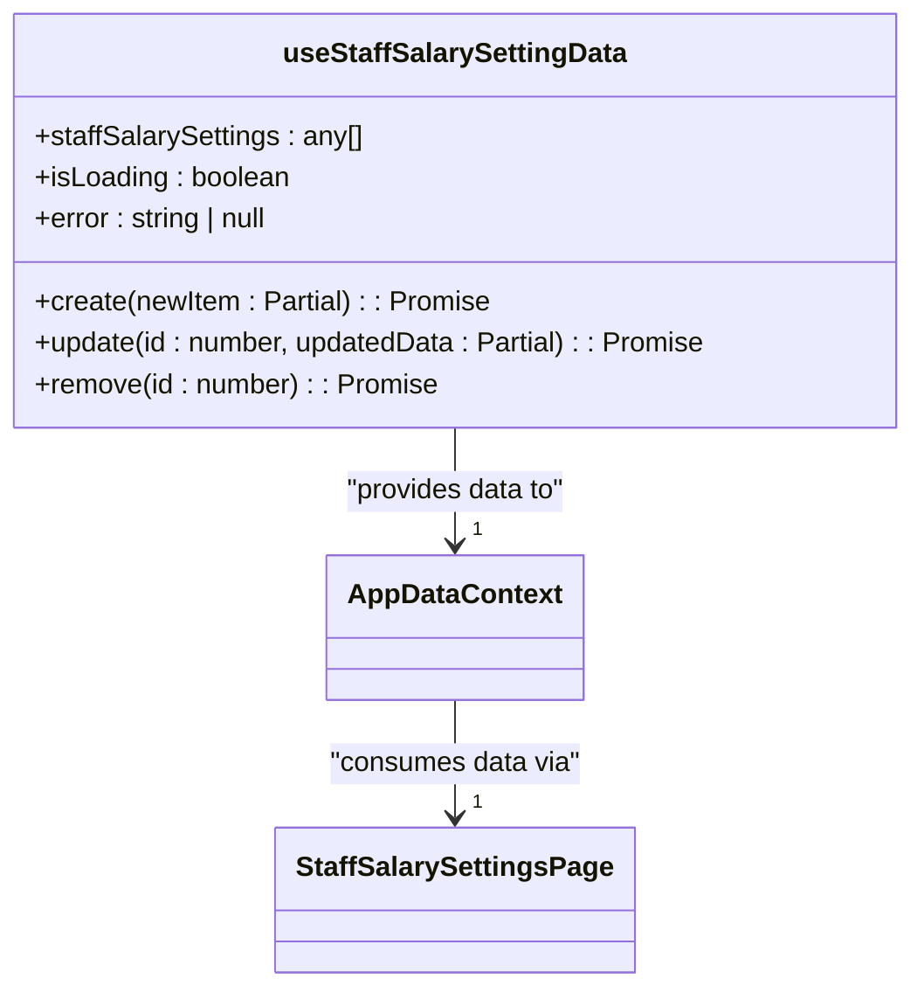
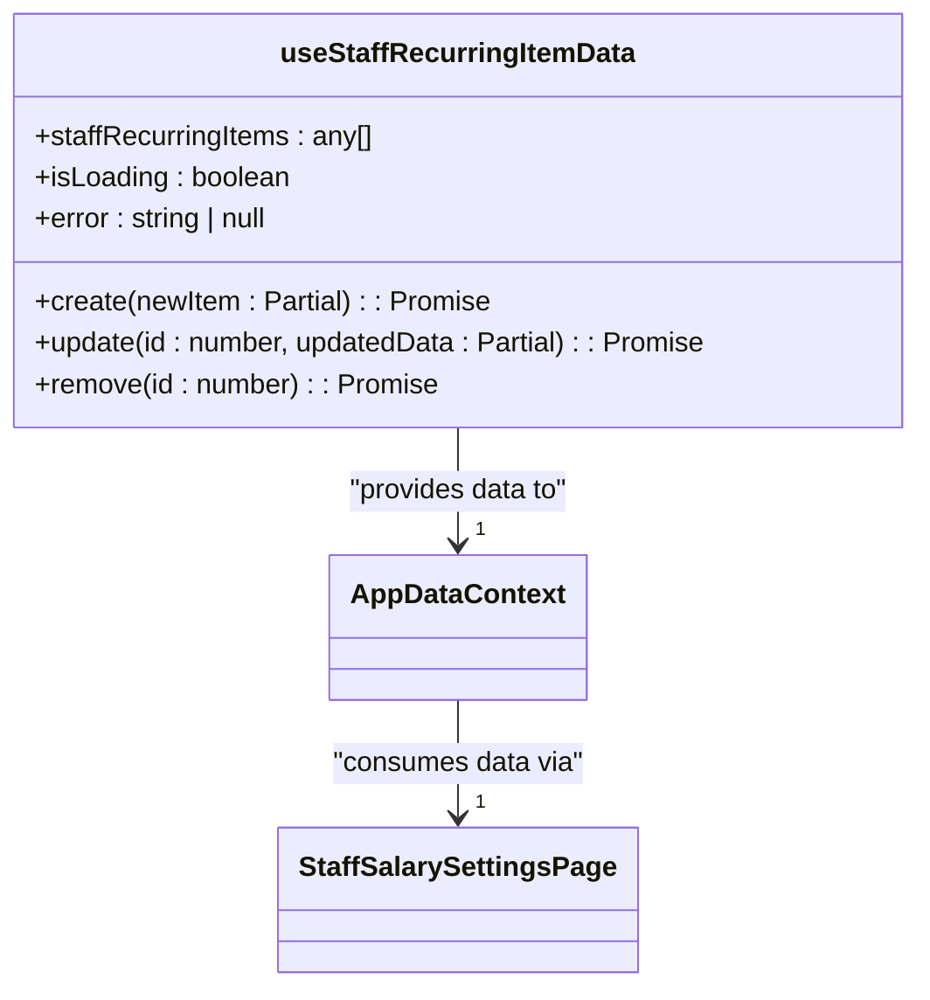
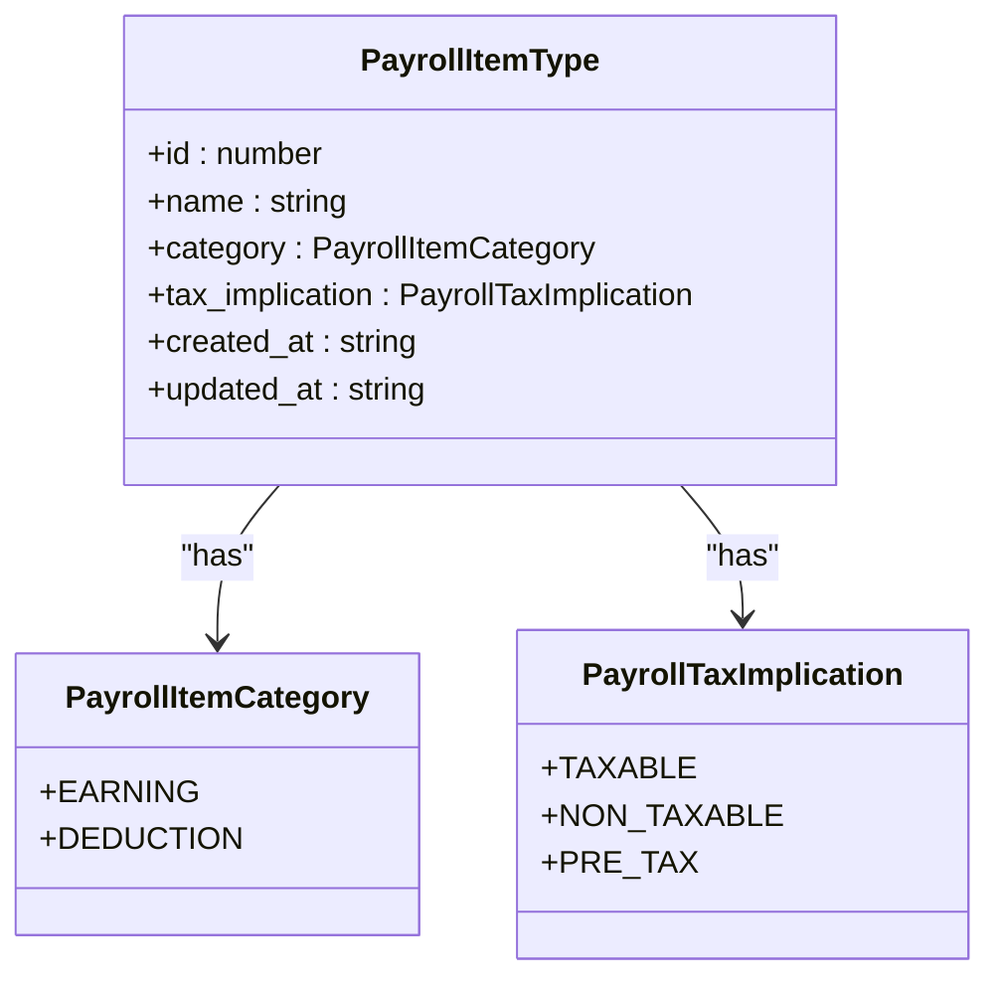
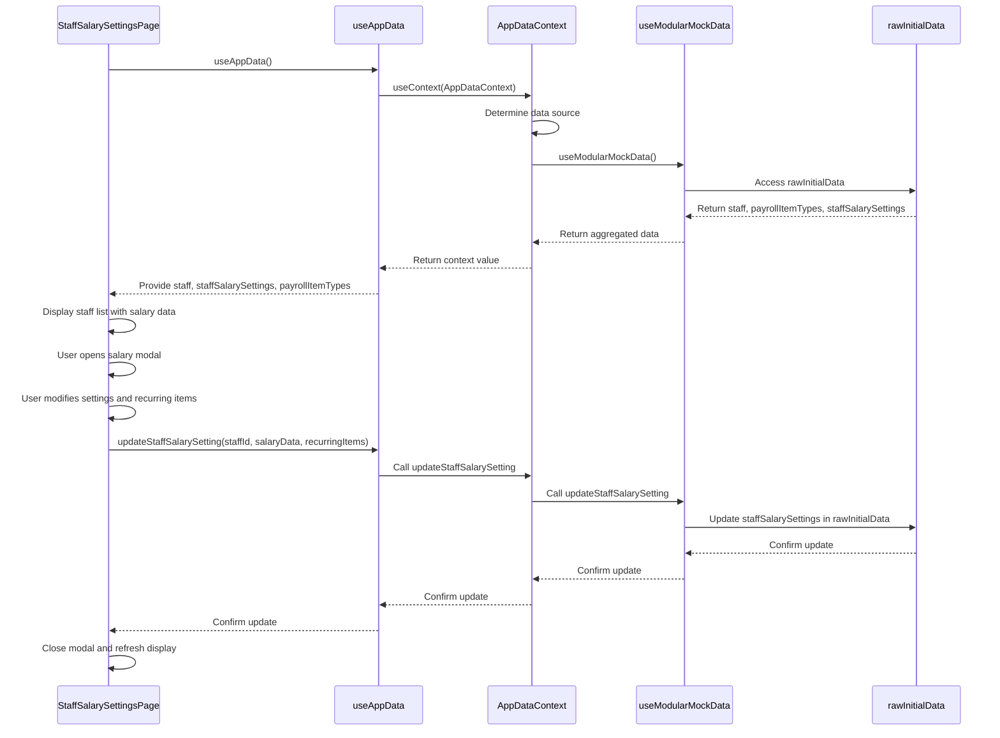
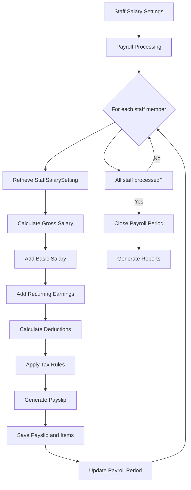

# Salary Configuration

<cite>
**Referenced Files in This Document**   
- [StaffSalarySettingsPage.tsx](file://src/modules/hr/pages/StaffSalarySettingsPage.tsx)
- [useStaffSalarySettingData.ts](file://src/modules/hr/data/useStaffSalarySettingData.ts)
- [useStaffRecurringItemData.ts](file://src/modules/hr/data/useStaffRecurringItemData.ts)
- [types.ts](file://src/core/types.ts)
- [useAppData.ts](file://src/hooks/useAppData.ts)
- [AppDataContext.tsx](file://src/contexts/AppDataContext.tsx)
- [useModularMockData.ts](file://src/hooks/useModularMockData.ts)
- [mockData.ts](file://src/modules/hr/data/mockData.ts)
</cite>

## Table of Contents
1. [Introduction](#introduction)
2. [Core Data Structures](#core-data-structures)
3. [Staff Salary Settings Page](#staff-salary-settings-page)
4. [Data Management Hooks](#data-management-hooks)
5. [Payroll Item Types and Categories](#payroll-item-types-and-categories)
6. [Salary Configuration Workflow](#salary-configuration-workflow)
7. [Integration with Payroll Processing](#integration-with-payroll-processing)
8. [Best Practices and Security](#best-practices-and-security)

## Introduction
The Salary Configuration sub-feature within the HR module enables administrators to define and manage comprehensive salary structures for staff members. This includes configuring base salaries, recurring allowances, and deductions. The system is designed to handle complex payroll scenarios while maintaining data integrity and providing a user-friendly interface. This document details the implementation of the salary configuration system, focusing on the key components, data flow, and integration points that make up this critical HR functionality.

## Core Data Structures

The salary configuration system is built around several key data structures that define the relationships between staff members, their salary settings, and individual payroll components.



**Diagram sources**
- [types.ts](file://src/core/types.ts#L963-L970)
- [types.ts](file://src/core/types.ts#L972-L981)
- [types.ts](file://src/core/types.ts#L983-L995)

**Section sources**
- [types.ts](file://src/core/types.ts#L963-L995)

## Staff Salary Settings Page

The `StaffSalarySettingsPage` component provides the primary user interface for configuring staff salary structures. It displays a list of all staff members with their current salary configurations and allows administrators to manage both base salaries and recurring items.

```mermaid
flowchart TD
A[Staff List DataGrid] --> B{User clicks "Manage Salary"}
B --> C[Open Main Salary Setting Modal]
C --> D[Display Basic Salary Form]
D --> E[Show Recurring Items List]
E --> F{User clicks "Add Item"}
F --> G[Open Recurring Item Modal]
G --> H[Select Payroll Item Type]
H --> I[Enter Amount]
I --> J[Save Item]
J --> E
E --> K{User clicks "Edit" on Item}
K --> G
E --> L{User clicks "Del" on Item}
L --> M[Confirm Deletion]
M --> E
C --> N{User clicks "Save Settings"}
N --> O[Validate Form Data]
O --> P[Call updateStaffSalarySetting]
P --> Q[Close Modal]
Q --> A
```

**Diagram sources**
- [StaffSalarySettingsPage.tsx](file://src/modules/hr/pages/StaffSalarySettingsPage.tsx#L0-L351)

**Section sources**
- [StaffSalarySettingsPage.tsx](file://src/modules/hr/pages/StaffSalarySettingsPage.tsx#L0-L351)

The component uses a two-modal approach for managing salary configurations:
1. **Main Salary Setting Modal**: Handles base salary information and serves as a container for recurring items
2. **Recurring Item Modal**: Dedicated form for adding or editing individual recurring allowances or deductions

The form includes validation logic to ensure required fields are completed:
- Basic salary is required and must be a valid number
- Payroll item type must be selected for recurring items
- Amount must be provided for recurring items

When saving configurations, the system collects both the base salary data and the list of recurring items, then submits them together through the `updateStaffSalarySetting` function.

## Data Management Hooks

The salary configuration system relies on custom React hooks to manage data retrieval and persistence. These hooks abstract the complexity of data operations and provide a clean interface for components.

### useStaffSalarySettingData Hook

The `useStaffSalarySettingData` hook manages the CRUD operations for staff salary settings. It provides functions to create, update, and delete salary configurations.



**Diagram sources**
- [useStaffSalarySettingData.ts](file://src/modules/hr/data/useStaffSalarySettingData.ts#L0-L57)

**Section sources**
- [useStaffSalarySettingData.ts](file://src/modules/hr/data/useStaffSalarySettingData.ts#L0-L57)

### useStaffRecurringItemData Hook

The `useStaffRecurringItemData` hook manages recurring salary items such as allowances and deductions. It follows the same pattern as the salary settings hook but focuses specifically on recurring components.



**Diagram sources**
- [useStaffRecurringItemData.ts](file://src/modules/hr/data/useStaffRecurringItemData.ts#L0-L57)

**Section sources**
- [useStaffRecurringItemData.ts](file://src/modules/hr/data/useStaffRecurringItemData.ts#L0-L57)

## Payroll Item Types and Categories

The `PayrollItemType` interface defines the different components that can be included in a staff member's salary structure. These types are used to categorize and process various earnings and deductions.



**Diagram sources**
- [types.ts](file://src/core/types.ts#L963-L970)

**Section sources**
- [types.ts](file://src/core/types.ts#L963-L970)

The system includes predefined payroll item types as demonstrated in the mock data:
- **Basic Salary**: Base compensation, taxable
- **House Allowance**: Housing benefit, taxable
- **Commuter Allowance**: Transportation benefit, non-taxable
- **PAYE**: Pay As You Earn tax deduction
- **NHIF**: National Hospital Insurance Fund deduction
- **NSSF**: National Social Security Fund deduction

These types are stored in the `payrollItemTypes` array and are available for selection when configuring recurring items for staff members.

## Salary Configuration Workflow

The salary configuration process follows a specific workflow from data retrieval to persistence. This sequence diagram illustrates the flow when a user updates a staff member's salary settings.



**Diagram sources**
- [StaffSalarySettingsPage.tsx](file://src/modules/hr/pages/StaffSalarySettingsPage.tsx#L0-L351)
- [useAppData.ts](file://src/hooks/useAppData.ts#L0-L21)
- [AppDataContext.tsx](file://src/contexts/AppDataContext.tsx#L0-L169)
- [useModularMockData.ts](file://src/hooks/useModularMockData.ts#L0-L260)

**Section sources**
- [StaffSalarySettingsPage.tsx](file://src/modules/hr/pages/StaffSalarySettingsPage.tsx#L0-L351)
- [useAppData.ts](file://src/hooks/useAppData.ts#L0-L21)
- [AppDataContext.tsx](file://src/contexts/AppDataContext.tsx#L0-L169)
- [useModularMockData.ts](file://src/hooks/useModularMockData.ts#L0-L260)

## Integration with Payroll Processing

The salary configuration data directly impacts the payroll processing system. When payroll is processed, the system uses the configured salary settings to generate payslips for each staff member.



**Diagram sources**
- [mockData.ts](file://src/modules/hr/data/mockData.ts#L0-L293)
- [types.ts](file://src/core/types.ts#L997-L1015)

**Section sources**
- [mockData.ts](file://src/modules/hr/data/mockData.ts#L0-L293)
- [types.ts](file://src/core/types.ts#L997-L1015)

The integration works as follows:
1. The payroll processing system retrieves the current salary configuration for each staff member
2. It calculates the gross salary by combining the basic salary with all recurring earnings
3. It applies deductions based on the configured recurring deduction items
4. It generates a payslip with detailed breakdown of all components
5. The resulting payslip is stored and associated with the appropriate payroll period

## Best Practices and Security

When managing salary configurations, several best practices should be followed to ensure data integrity and security:

### Data Consistency
- Always validate input data before saving
- Use transactions when updating related records
- Implement proper error handling and rollback mechanisms
- Maintain audit trails for all salary changes

### Access Controls
- Restrict access to salary configuration features to authorized HR personnel
- Implement role-based access control (RBAC) to limit who can view or modify salary data
- Log all access and modification attempts for sensitive salary information

### Currency and Localization
- Store all monetary values in a consistent currency (e.g., Kenyan Shillings as shown in the code)
- Display currency symbols appropriately in the user interface
- Consider exchange rates for international staff if needed

### Handling Special Cases
- **Salary Revisions**: When updating existing salary configurations, consider whether the change should be retroactive or effective from a future date
- **Retroactive Payments**: Implement separate functionality for processing retroactive payments, which may require special approval workflows
- **Currency Conversions**: For multinational organizations, implement currency conversion logic with appropriate exchange rate sources

The current implementation uses mock data for demonstration purposes, but in a production environment, these configurations would be stored in a persistent database with proper security measures in place.

**Section sources**
- [StaffSalarySettingsPage.tsx](file://src/modules/hr/pages/StaffSalarySettingsPage.tsx#L0-L351)
- [useStaffSalarySettingData.ts](file://src/modules/hr/data/useStaffSalarySettingData.ts#L0-L57)
- [useStaffRecurringItemData.ts](file://src/modules/hr/data/useStaffRecurringItemData.ts#L0-L57)
- [types.ts](file://src/core/types.ts#L963-L995)
- [mockData.ts](file://src/modules/hr/data/mockData.ts#L0-L293)