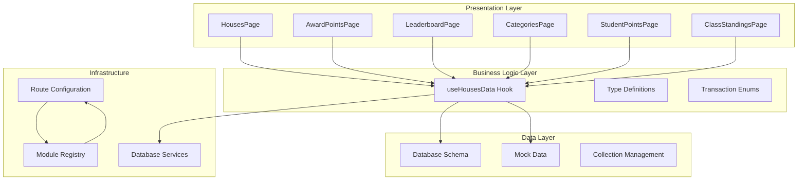
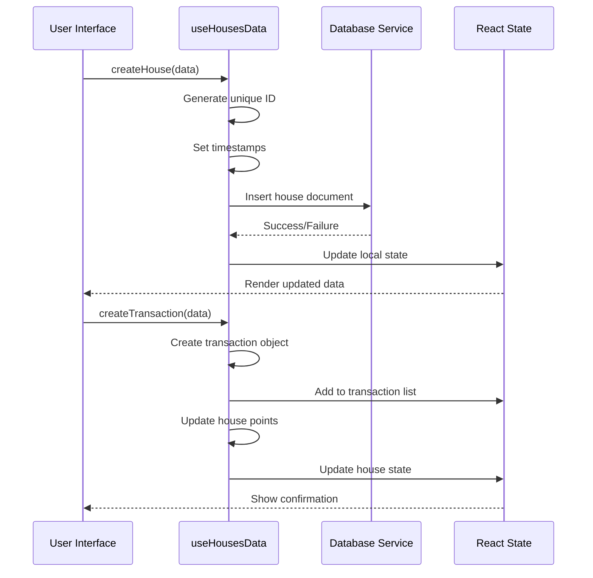
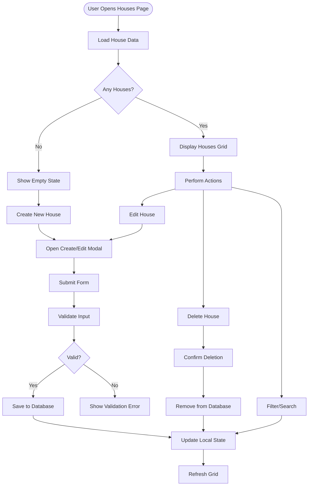
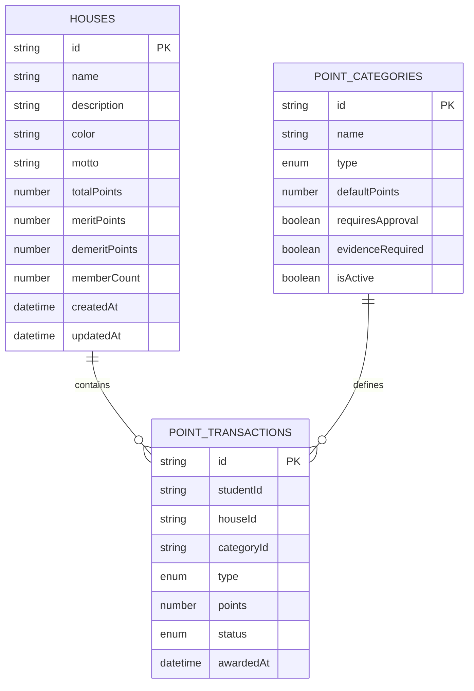
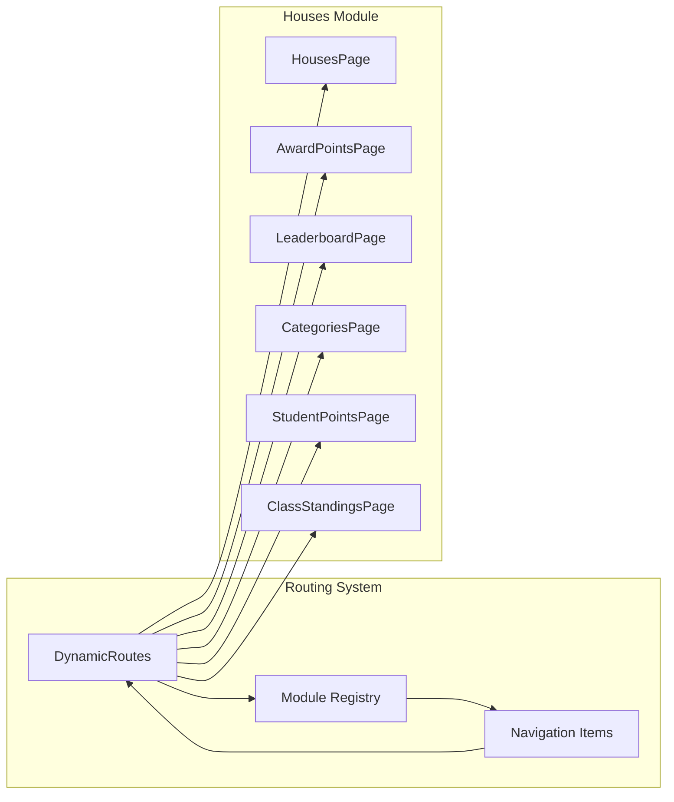

# Houses Module Overview

<cite>
**Referenced Files in This Document**
- [schema.ts](file://src/modules/administration/data/houses/schema.ts)
- [types.ts](file://src/modules/administration/data/houses/types.ts)
- [useHousesData.ts](file://src/modules/administration/data/houses/useHousesData.ts)
- [mockData.ts](file://src/modules/administration/data/houses/mockData.ts)
- [HousesPage.tsx](file://src/modules/administration/pages/houses/HousesPage.tsx)
- [AwardPointsPage.tsx](file://src/modules/administration/pages/houses/AwardPointsPage.tsx)
- [LeaderboardPage.tsx](file://src/modules/administration/pages/houses/LeaderboardPage.tsx)
- [CategoriesPage.tsx](file://src/modules/administration/pages/houses/CategoriesPage.tsx)
- [StudentPointsPage.tsx](file://src/modules/administration/pages/houses/StudentPointsPage.tsx)
- [ClassStandingsPage.tsx](file://src/modules/administration/pages/houses/ClassStandingsPage.tsx)
- [moduleRoutes.tsx](file://src/routing/moduleRoutes.tsx)
- [moduleRegistry.ts](file://src/core/moduleRegistry.ts)
</cite>

## Table of Contents
1. [Introduction](#introduction)
2. [Module Architecture](#module-architecture)
3. [Core Data Model](#core-data-model)
4. [Business Logic Layer](#business-logic-layer)
5. [User Interface Components](#user-interface-components)
6. [Data Management](#data-management)
7. [Integration Points](#integration-points)
8. [Performance Considerations](#performance-considerations)
9. [Future Enhancements](#future-enhancements)
10. [Conclusion](#conclusion)

## Introduction

The Houses module is a comprehensive point-based house system designed for educational institutions to manage student house competitions, point allocations, and rankings. This module provides a complete solution for organizing school spirit activities, behavioral management, and academic recognition through an intuitive web-based interface.

The system supports multiple houses with distinct characteristics, point categories for different types of achievements, and a sophisticated transaction management system that tracks all point awards and deductions. It serves as a central hub for house-related activities within the broader school management ecosystem.

## Module Architecture

The Houses module follows a clean, layered architecture pattern that separates concerns effectively:

**Diagram sources**
- [HousesPage.tsx:1-391](file://src/modules/administration/pages/houses/HousesPage.tsx#L1-L391)
- [useHousesData.ts:1-271](file://src/modules/administration/data/houses/useHousesData.ts#L1-L271)
- [moduleRoutes.tsx:1-294](file://src/routing/moduleRoutes.tsx#L1-L294)

**Section sources**
- [HousesPage.tsx:1-391](file://src/modules/administration/pages/houses/HousesPage.tsx#L1-L391)
- [useHousesData.ts:1-271](file://src/modules/administration/data/houses/useHousesData.ts#L1-L271)
- [moduleRoutes.tsx:1-294](file://src/routing/moduleRoutes.tsx#L1-L294)

## Core Data Model

The Houses module implements a robust three-tier data model consisting of houses, point categories, and point transactions.

### House Entity Structure

Each house entity contains comprehensive information about the house including leadership details, point statistics, and administrative metadata:

| Property | Type | Description | Required |
|----------|------|-------------|----------|
| `id` | string | Unique identifier (HOUS + timestamp) | Yes |
| `name` | string | House name (max 200 chars) | Yes |
| `description` | string | House description | No |
| `color` | string | House color code | Yes |
| `motto` | string | House motto | No |
| `patronTeacherId` | string | House patron teacher ID | No |
| `patronTeacherName` | string | House patron teacher name | No |
| `captainId` | string | House captain ID | No |
| `captainName` | string | House captain name | No |
| `viceCaptainId` | string | House vice-captain ID | No |
| `viceCaptainName` | string | House vice-captain name | No |
| `totalPoints` | number | Total accumulated points | Yes |
| `meritPoints` | number | Total merit points | Yes |
| `demeritPoints` | number | Total demerit points | Yes |
| `memberCount` | number | Number of house members | Yes |
| `createdAt` | string | ISO date-time | Yes |
| `updatedAt` | string | ISO date-time | Yes |

### Point Category System

Point categories define the types of achievements and infractions that can earn or lose points:

| Property | Type | Description | Required |
|----------|------|-------------|----------|
| `id` | string | Category identifier (PCAT + timestamp) | Yes |
| `name` | string | Category name | Yes |
| `type` | enum | Merit or Demerit | Yes |
| `defaultPoints` | number | Default point value | Yes |
| `description` | string | Category description | No |
| `requiresApproval` | boolean | Requires supervisor approval | Yes |
| `approverRole` | string | Required approval role | No |
| `evidenceRequired` | boolean | Evidence attachment needed | Yes |
| `maxDailyAwards` | number | Maximum daily awards | No |
| `isActive` | boolean | Category availability | Yes |

### Point Transaction Management

Point transactions track all point allocations and deductions with comprehensive audit trails:

| Property | Type | Description | Required |
|----------|------|-------------|----------|
| `id` | string | Transaction identifier (PTRX + timestamp) | Yes |
| `studentId` | string | Student receiving points | Yes |
| `studentName` | string | Student name | No |
| `className` | string | Student's class | No |
| `houseId` | string | Target house ID | Yes |
| `houseName` | string | Target house name | No |
| `categoryId` | string | Category identifier | Yes |
| `categoryName` | string | Category name | No |
| `type` | enum | Merit or Demerit | Yes |
| `points` | number | Point value (+/-) | Yes |
| `reason` | string | Reason for transaction | Yes |
| `eventName` | string | Event name (optional) | No |
| `eventId` | string | Event identifier (optional) | No |
| `evidenceUrl` | string | Evidence attachment URL | No |
| `evidenceDescription` | string | Evidence description | No |
| `status` | enum | Pending, Approved, Rejected | Yes |
| `approvedBy` | string | Approving user ID | No |
| `approvedAt` | string | Approval timestamp | No |
| `awardedBy` | string | Awarding user ID | Yes |
| `awardedByName` | string | Awarding user name | No |
| `awardedAt` | string | Transaction timestamp | Yes |

**Section sources**
- [schema.ts:1-86](file://src/modules/administration/data/houses/schema.ts#L1-L86)
- [types.ts:12-95](file://src/modules/administration/data/houses/types.ts#L12-L95)

## Business Logic Layer

The `useHousesData` hook serves as the central business logic coordinator, managing all CRUD operations and data transformations:

### Core Operations

**Diagram sources**
- [useHousesData.ts:46-80](file://src/modules/administration/data/houses/useHousesData.ts#L46-L80)
- [useHousesData.ts:154-177](file://src/modules/administration/data/houses/useHousesData.ts#L154-L177)

### Data Transformation Functions

The module provides several sophisticated data transformation utilities:

1. **Leaderboard Generation**: Creates ranked house standings based on total points
2. **Student Point Summaries**: Aggregates individual student performance metrics
3. **Class Standings**: Organizes student rankings by academic classes
4. **Pending Transaction Tracking**: Monitors approval workflows

**Section sources**
- [useHousesData.ts:192-207](file://src/modules/administration/data/houses/useHousesData.ts#L192-L207)
- [StudentPointsPage.tsx:18-58](file://src/modules/administration/pages/houses/StudentPointsPage.tsx#L18-L58)
- [ClassStandingsPage.tsx:30-86](file://src/modules/administration/pages/houses/ClassStandingsPage.tsx#L30-L86)

## User Interface Components

The Houses module consists of six primary page components, each serving specific functional purposes:

### Houses Management Page

The main houses listing and management interface provides comprehensive CRUD operations for house entities:

**Diagram sources**
- [HousesPage.tsx:42-151](file://src/modules/administration/pages/houses/HousesPage.tsx#L42-L151)

### Point Awarding Interface

The award points page streamlines the point allocation process with intelligent category filtering and approval workflows:

| Feature | Description | Implementation |
|---------|-------------|----------------|
| Category Filtering | Automatically filters categories by selected transaction type | Real-time filtering based on category type |
| Auto-fill Functionality | Pre-populates point values from category defaults | Dynamic field updates on selection |
| Approval Workflow | Manages pending transactions requiring supervisor approval | Status-based visibility controls |
| Evidence Attachment | Optional evidence upload for point transactions | File upload integration |

### Leaderboard Visualization

The leaderboard page presents house rankings through multiple visualization approaches:

1. **Top Houses Cards**: Prominent display of leading houses with progress bars
2. **Statistical Summary**: Key metrics including total points and average per member
3. **Complete Ranking Table**: Full alphabetical ranking with house colors and statistics

### Categories Management

The categories page enables administrators to configure point systems:

| Configuration Option | Purpose | Impact |
|---------------------|---------|--------|
| Merit vs Demerit | Defines point direction | Affects transaction type filtering |
| Default Points | Automatic point assignment | Streamlines point awarding process |
| Approval Requirements | Supervisor oversight | Ensures policy compliance |
| Daily Limits | Prevents point manipulation | Maintains system integrity |
| Evidence Requirements | Documentation needs | Supports audit trails |

### Student Performance Tracking

The student points page aggregates individual performance across multiple dimensions:

- **Overall Rankings**: Student rankings based on net points
- **Recent Activity**: Timeline of recent point transactions
- **Class Distribution**: Performance analysis by academic classes
- **House Comparison**: Individual performance within house context

### Class Standings

The class standings feature provides granular performance analysis:

- **Class-wise Rankings**: Student rankings organized by academic classes
- **House Distribution**: Visual representation of house composition per class
- **Aggregate Statistics**: Class-wide performance metrics
- **Individual Progress**: Track student improvement over time

**Section sources**
- [HousesPage.tsx:1-391](file://src/modules/administration/pages/houses/HousesPage.tsx#L1-L391)
- [AwardPointsPage.tsx:1-475](file://src/modules/administration/pages/houses/AwardPointsPage.tsx#L1-L475)
- [LeaderboardPage.tsx:1-258](file://src/modules/administration/pages/houses/LeaderboardPage.tsx#L1-L258)
- [CategoriesPage.tsx:1-428](file://src/modules/administration/pages/houses/CategoriesPage.tsx#L1-L428)
- [StudentPointsPage.tsx:1-330](file://src/modules/administration/pages/houses/StudentPointsPage.tsx#L1-L330)
- [ClassStandingsPage.tsx:1-351](file://src/modules/administration/pages/houses/ClassStandingsPage.tsx#L1-L351)

## Data Management

The Houses module implements a comprehensive data management strategy combining local state management with database persistence:

### Database Schema Design

The module utilizes a document-based database approach with three primary collections:

**Diagram sources**
- [schema.ts:3-85](file://src/modules/administration/data/houses/schema.ts#L3-L85)

### Mock Data Strategy

The module includes comprehensive mock data for development and testing:

- **Sample Houses**: Four representative houses with realistic attributes
- **Point Categories**: Eight categories covering various achievement types
- **Transaction Examples**: Five sample transactions demonstrating different scenarios

### State Synchronization

The system maintains bidirectional synchronization between local state and database:

1. **Initial Load**: Mock data loads first, followed by database synchronization
2. **Real-time Updates**: Local state updates immediately, with database persistence attempts
3. **Error Recovery**: Automatic fallback to local state on database failures
4. **Conflict Resolution**: Last-write-wins strategy for concurrent modifications

**Section sources**
- [mockData.ts:1-100](file://src/modules/administration/data/houses/mockData.ts#L1-L100)
- [useHousesData.ts:21-43](file://src/modules/administration/data/houses/useHousesData.ts#L21-L43)

## Integration Points

The Houses module integrates seamlessly with the broader school management system through several key integration points:

### Routing Integration

The module participates in the dynamic routing system managed by `moduleRoutes.tsx`:

**Diagram sources**
- [moduleRoutes.tsx:214-246](file://src/routing/moduleRoutes.tsx#L214-L246)
- [moduleRegistry.ts:148-202](file://src/core/moduleRegistry.ts#L148-L202)

### Module Registration

The Houses module is registered through the centralized module registry system:

- **Module Identification**: Unique module ID and display name
- **Navigation Configuration**: Menu items and route definitions
- **Permission Management**: Access control and security policies
- **Dependency Management**: Module interdependencies and loading order

### Security Integration

The module leverages the application's RBAC (Role-Based Access Control) system:

- **Permission Checking**: Automatic permission validation for module access
- **Role-based Features**: Conditional feature availability based on user roles
- **Audit Logging**: Comprehensive tracking of all administrative actions
- **Data Isolation**: Secure separation of sensitive student information

**Section sources**
- [moduleRoutes.tsx:1-294](file://src/routing/moduleRoutes.tsx#L1-L294)
- [moduleRegistry.ts:1-281](file://src/core/moduleRegistry.ts#L1-L281)

## Performance Considerations

The Houses module implements several performance optimization strategies:

### Data Loading Strategies

- **Lazy Loading**: Components load only when accessed
- **Pagination Support**: Large datasets handled efficiently
- **Caching Mechanisms**: Frequently accessed data cached locally
- **Background Synchronization**: Database updates don't block UI interactions

### Memory Management

- **Efficient State Updates**: Minimal re-renders through selective state updates
- **Cleanup Functions**: Proper cleanup of event listeners and subscriptions
- **Resource Pooling**: Reusable components and shared resources
- **Garbage Collection**: Automatic cleanup of unused data structures

### Scalability Features

- **Index Optimization**: Database indexes on frequently queried fields
- **Query Optimization**: Efficient filtering and sorting mechanisms
- **Batch Operations**: Multiple operations combined for better performance
- **Progressive Enhancement**: Graceful degradation for older browsers

## Future Enhancements

The Houses module is designed with extensibility in mind for future enhancements:

### Planned Features

1. **Mobile Application Support**: Native mobile applications for iOS and Android
2. **Real-time Notifications**: Live updates for point transactions and approvals
3. **Advanced Analytics**: Detailed performance analytics and trend reporting
4. **Integration APIs**: Third-party system integrations and data exports
5. **Customizable Themes**: Personalized house branding and visual themes
6. **Automated Workflows**: AI-powered point recommendation systems

### Technical Improvements

- **Microservice Architecture**: Modular decomposition for better maintainability
- **Cloud-native Deployment**: Containerized deployment for scalability
- **Enhanced Security**: Multi-factor authentication and advanced encryption
- **Real-time Collaboration**: Concurrent editing and conflict resolution

## Conclusion

The Houses module represents a comprehensive, scalable solution for managing school house systems. Its robust architecture, intuitive user interface, and flexible data model provide a solid foundation for educational institutions seeking to enhance student engagement and behavioral management.

The module's design emphasizes modularity, maintainability, and extensibility while providing immediate value through its complete feature set. The integration with the broader school management system ensures seamless operation within existing infrastructure.

Key strengths of the module include its comprehensive data model, sophisticated business logic layer, and user-friendly interface components. The implementation demonstrates best practices in React development, state management, and database integration.

Future development efforts will focus on expanding functionality, improving performance, and enhancing the user experience while maintaining the module's core architectural principles and reliability standards.