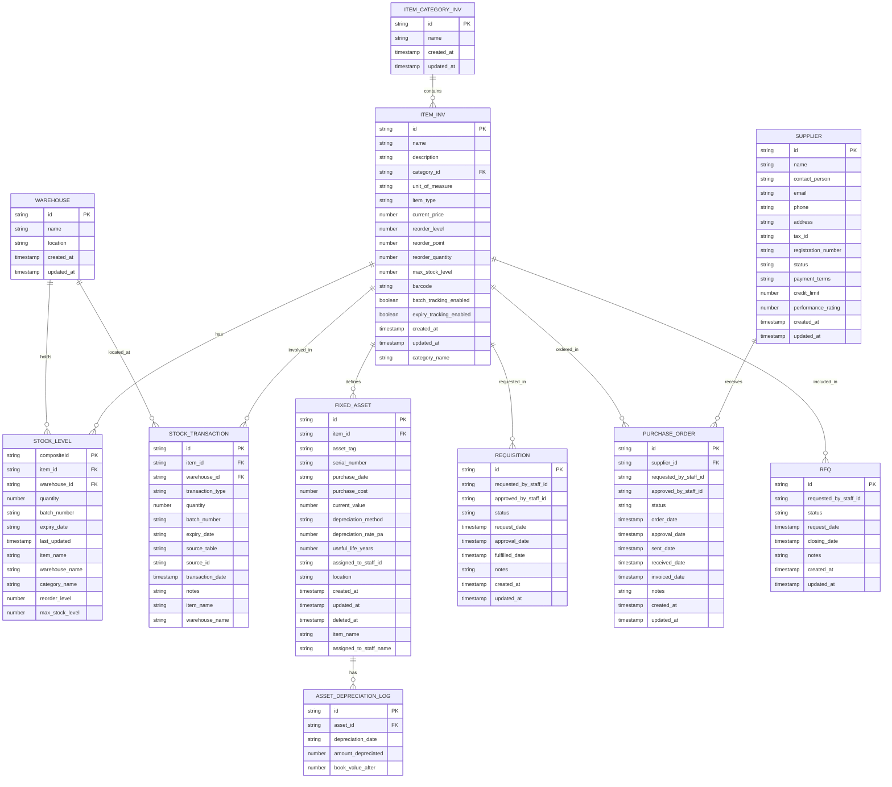

# Data Model & Schema

<cite>
**Referenced Files in This Document**   
- [schema.ts](file://src/modules/inventory/data/schema.ts)
- [collections.ts](file://src/modules/inventory/data/collections.ts)
- [types.ts](file://src/modules/inventory/data/types.ts)
- [mockData.ts](file://src/modules/inventory/data/mockData.ts)
</cite>

## Table of Contents
1. [Introduction](#introduction)
2. [Entity Relationships](#entity-relationships)
3. [Field Definitions and Constraints](#field-definitions-and-constraints)
4. [Primary Keys and Indexes](#primary-keys-and-indexes)
5. [Computed and Denormalized Fields](#computed-and-denormalized-fields)
6. [Stock Transaction Types](#stock-transaction-types)
7. [Inventory Valuation and Asset Depreciation](#inventory-valuation-and-asset-depreciation)
8. [Data Validation and Referential Integrity](#data-validation-and-referential-integrity)
9. [RxDB Collections Configuration](#rxdb-collections-configuration)
10. [Sample Records](#sample-records)

## Introduction
This document provides a comprehensive overview of the Inventory module's data model, detailing the relationships between key entities including Items, ItemCategories, Warehouses, Suppliers, StockLevels, StockTransactions, PurchaseOrders, and Requisitions. The system is designed with an offline-first approach using RxDB for local data storage and synchronization. The data model supports comprehensive inventory management functionality including stock tracking, procurement, and asset management with depreciation. This documentation covers field definitions, data types, primary and foreign keys, constraints, business rules, and configuration details necessary to understand and work with the inventory system.

**Section sources**
- [schema.ts](file://src/modules/inventory/data/schema.ts#L0-L200)

## Entity Relationships

The inventory data model consists of several interconnected entities that work together to manage inventory operations. The core entities include Items, ItemCategories, Warehouses, Suppliers, StockLevels, StockTransactions, PurchaseOrders, Requisitions, and FixedAssets with their depreciation logs.



**Diagram sources**
- [schema.ts](file://src/modules/inventory/data/schema.ts#L0-L200)
- [collections.ts](file://src/modules/inventory/data/collections.ts#L0-L50)

**Section sources**
- [schema.ts](file://src/modules/inventory/data/schema.ts#L0-L200)
- [collections.ts](file://src/modules/inventory/data/collections.ts#L0-L50)

## Field Definitions and Constraints

This section details the field definitions, data types, and constraints for each entity in the inventory data model.

### ItemCategoryInv
The ItemCategoryInv entity represents categories for inventory items.

**Properties:**
- **id**: Unique identifier for the item category (string, required, primary key)
- **name**: Category name (string, max length 100, required)
- **created_at**: Record creation timestamp (timestamp, required)
- **updated_at**: Record last update timestamp (timestamp, required)

**Constraints:**
- Required fields: id, name
- Indexes: name

**Section sources**
- [schema.ts](file://src/modules/inventory/data/schema.ts#L26-L35)

### ItemInv
The ItemInv entity represents inventory items.

**Properties:**
- **id**: Unique identifier for the item (string, required, primary key)
- **name**: Item name (string, max length 200, required)
- **description**: Item description (string, max length 500, nullable)
- **category_id**: Reference to item category (string, max length 100, required)
- **unit_of_measure**: Unit of measure (string, max length 50, required)
- **item_type**: Type of item (string, max length 50, enum: CONSUMABLE, FIXED_ASSET, required)
- **current_price**: Current price (number, min 0, max 999999.99, nullable)
- **reorder_level**: Reorder level (number, min 0, max 999999999, integer, nullable)
- **reorder_point**: Reorder point (number, min 0, max 999999999, integer, nullable)
- **reorder_quantity**: Reorder quantity (number, min 0, max 999999999, integer, nullable)
- **max_stock_level**: Maximum stock level (number, min 0, max 999999999, integer, nullable)
- **barcode**: Item barcode (string, max length 100, nullable)
- **batch_tracking_enabled**: Whether batch tracking is enabled (boolean, nullable, default false)
- **expiry_tracking_enabled**: Whether expiry tracking is enabled (boolean, nullable, default false)
- **created_at**: Record creation timestamp (timestamp, required)
- **updated_at**: Record last update timestamp (timestamp, required)
- **category_name**: Category name (computed) (string, max length 100, nullable)

**Constraints:**
- Required fields: id, name, item_type, created_at, updated_at
- Indexes: name, category_id, item_type, barcode
- Enum constraint on item_type: InvItemTypeEnum (CONSUMABLE, FIXED_ASSET)

**Section sources**
- [schema.ts](file://src/modules/inventory/data/schema.ts#L37-L65)

### Warehouse
The Warehouse entity represents storage locations for inventory.

**Properties:**
- **id**: Unique identifier for the warehouse (string, required, primary key)
- **name**: Warehouse name (string, max length 100, required)
- **location**: Warehouse location (string, max length 200, nullable)
- **created_at**: Record creation timestamp (timestamp, required)
- **updated_at**: Record last update timestamp (timestamp, required)

**Constraints:**
- Required fields: id, name
- Indexes: name

**Section sources**
- [schema.ts](file://src/modules/inventory/data/schema.ts#L10-L25)

### FixedAsset
The FixedAsset entity represents fixed assets that are tracked in the inventory system.

**Properties:**
- **id**: Unique identifier for the fixed asset (string, required, primary key)
- **item_id**: Reference to inventory item (string, max length 100, required)
- **asset_tag**: Asset tag identifier (string, max length 50, required)
- **serial_number**: Serial number (string, max length 100, nullable)
- **purchase_date**: Purchase date (string, format date, nullable)
- **purchase_cost**: Purchase cost (number, min 0, max 999999.99, nullable)
- **current_value**: Current value (number, min 0, max 999999.99, nullable)
- **depreciation_method**: Depreciation method (string, max length 50, nullable, enum: STRAIGHT_LINE, REDUCING_BALANCE)
- **depreciation_rate_pa**: Depreciation rate per annum (number, min 0, max 100, nullable)
- **useful_life_years**: Useful life in years (number, min 1, max 100, integer, nullable)
- **assigned_to_staff_id**: Staff member assigned to (string, max length 100, nullable)
- **location**: Asset location (string, max length 200, nullable)
- **created_at**: Record creation timestamp (timestamp, required)
- **updated_at**: Record last update timestamp (timestamp, required)
- **deleted_at**: Record deletion timestamp (timestamp, nullable)
- **item_name**: Item name (computed) (string, max length 200, nullable)
- **assigned_to_staff_name**: Assigned staff name (computed) (string, max length 200, nullable)

**Constraints:**
- Required fields: id, item_id, asset_tag, created_at, updated_at
- Indexes: asset_tag, item_id, assigned_to_staff_id

**Section sources**
- [schema.ts](file://src/modules/inventory/data/schema.ts#L66-L98)

### AssetDepreciationLog
The AssetDepreciationLog entity tracks the depreciation history of fixed assets.

**Properties:**
- **id**: Unique identifier for the depreciation log entry (string, required, primary key)
- **asset_id**: Reference to fixed asset (string, max length 100, required)
- **depreciation_date**: Date of depreciation (string, format date, required)
- **amount_depreciated**: Amount depreciated (number, min 0, max 999999.99, required)
- **book_value_after**: Book value after depreciation (number, min 0, max 999999.99, required)

**Constraints:**
- Required fields: id, asset_id, depreciation_date, amount_depreciated, book_value_after
- Indexes: asset_id

**Section sources**
- [schema.ts](file://src/modules/inventory/data/schema.ts#L78-L103)

### StockLevel
The StockLevel entity represents the current stock quantity of an item in a specific warehouse.

**Properties:**
- **compositeId**: Composite primary key for stock level (string, required, primary key)
- **item_id**: Reference to inventory item (string, max length 100, required)
- **warehouse_id**: Reference to warehouse (string, max length 100, required)
- **quantity**: Current stock quantity (number, min 0, max 999999999, integer, required)
- **batch_number**: Batch number (string, max length 100, nullable)
- **expiry_date**: Expiry date (string, format date, nullable)
- **last_updated**: Last update timestamp (timestamp, nullable)
- **item_name**: Item name (computed) (string, max length 200, nullable)
- **warehouse_name**: Warehouse name (computed) (string, max length 100, nullable)
- **category_name**: Category name (computed) (string, max length 100, nullable)
- **reorder_level**: Reorder level (computed) (number, min 0, max 999999999, integer, nullable)
- **max_stock_level**: Maximum stock level (computed) (number, min 0, max 999999999, integer, nullable)

**Constraints:**
- Required fields: compositeId, item_id, warehouse_id, quantity
- Indexes: item_id + warehouse_id, expiry_date, batch_number

**Section sources**
- [schema.ts](file://src/modules/inventory/data/schema.ts#L101-L117)

### StockTransaction
The StockTransaction entity records all movements of inventory items.

**Properties:**
- **id**: Unique identifier for the stock transaction (string, required, primary key)
- **item_id**: Reference to inventory item (string, max length 100, required)
- **warehouse_id**: Reference to warehouse (string, max length 100, required)
- **transaction_type**: Type of transaction (string, max length 50, enum: RECEIPT, ISSUE, RETURN_TO_STORE, RETURN_TO_SUPPLIER, STOCK_ADJUSTMENT, required)
- **quantity**: Transaction quantity (number, min -999999999, max 999999999, integer, required)
- **batch_number**: Batch number (string, max length 100, nullable)
- **expiry_date**: Expiry date (string, format date, nullable)
- **source_table**: Source table reference (string, max length 100, nullable)
- **source_id**: Source record ID (string, max length 100, nullable)
- **transaction_date**: Transaction date and time (timestamp, required)
- **notes**: Transaction notes (string, max length 500, nullable)
- **item_name**: Item name (computed) (string, max length 200, nullable)
- **warehouse_name**: Warehouse name (computed) (string, max length 100, nullable)

**Constraints:**
- Required fields: id, item_id, warehouse_id, transaction_type, quantity, transaction_date
- No additional indexes defined

**Section sources**
- [schema.ts](file://src/modules/inventory/data/schema.ts#L118-L135)

## Primary Keys and Indexes

This section details the primary keys and indexes for each entity in the inventory data model, which are critical for data integrity and query performance.

### Primary Keys
Each entity has a designated primary key that uniquely identifies records:

- **ItemCategoryInv**: id (string)
- **ItemInv**: id (string)
- **Warehouse**: id (string)
- **FixedAsset**: id (string)
- **AssetDepreciationLog**: id (string)
- **StockLevel**: compositeId (string) - This is a composite key that combines item_id, warehouse_id, and potentially batch_number
- **StockTransaction**: id (string)
- **Supplier**: id (string)
- **Requisition**: id (string)
- **PurchaseOrder**: id (string)
- **RFQ**: id (string)
- **StockAlert**: id (string)
- **SupplierContract**: id (string)

The composite primary key for StockLevel (compositeId) is particularly important as it ensures that there is only one record for a specific combination of item, warehouse, and batch (if applicable), preventing duplicate stock level entries.

### Indexes
Indexes are defined on fields that are frequently queried to improve performance:

- **ItemCategoryInv**: name - Index on category name for quick lookups
- **ItemInv**: name, category_id, item_type, barcode - Multiple indexes to support various query patterns including searches by name, filtering by category or type, and barcode scanning
- **Warehouse**: name - Index on warehouse name for quick lookups
- **FixedAsset**: asset_tag, item_id, assigned_to_staff_id - Indexes on key search fields including asset tag (for physical asset tracking), item reference, and staff assignment
- **StockLevel**: [item_id, warehouse_id], expiry_date, batch_number - Composite index on item and warehouse for efficient stock level queries, plus indexes on expiry_date and batch_number for inventory management tasks like expiration tracking and batch recalls
- **StockTransaction**: None explicitly defined in the schema, but queries would likely benefit from indexes on item_id, warehouse_id, transaction_date, and transaction_type

These indexing strategies support the common access patterns in inventory management, such as looking up items by name or barcode, finding all assets assigned to a particular staff member, checking stock levels for specific items in specific warehouses, and tracking inventory movements over time.

**Section sources**
- [schema.ts](file://src/modules/inventory/data/schema.ts#L0-L200)

## Computed and Denormalized Fields

The inventory data model includes several computed and denormalized fields that improve query performance and user experience by reducing the need for joins and complex calculations.

### Computed Fields
Computed fields are values that are derived from other fields in the database and are stored to improve performance:

- **StockLevel.item_name**: Stores the item name from the referenced ItemInv record, allowing display of stock levels without joining to the items table
- **StockLevel.warehouse_name**: Stores the warehouse name from the referenced Warehouse record, enabling display of stock levels with warehouse names without joins
- **StockLevel.category_name**: Stores the category name from the item's category, allowing filtering and grouping of stock levels by category without multiple joins
- **StockLevel.reorder_level**: Denormalized from the ItemInv record for quick access in reorder alert calculations
- **StockLevel.max_stock_level**: Denormalized from the ItemInv record for quick access in inventory management
- **StockTransaction.item_name**: Stores the item name from the referenced ItemInv record for transaction history displays
- **StockTransaction.warehouse_name**: Stores the warehouse name from the referenced Warehouse record for transaction history displays
- **FixedAsset.item_name**: Stores the item name from the referenced ItemInv record for asset displays
- **FixedAsset.assigned_to_staff_name**: Stores the staff member's name for quick display without joining to staff records

### Benefits of Denormalization
The denormalization strategy in this data model provides several benefits:

1. **Improved Query Performance**: By storing commonly accessed related data directly in the record, the system can retrieve complete information with a single query rather than multiple joins, which is especially important in an offline-first application where database performance is critical.

2. **Offline Functionality**: In offline mode, the application may not have access to all related records. By denormalizing key information, the system can still display meaningful data even when some related records are not available locally.

3. **Simplified UI Development**: User interfaces can display rich information without complex data fetching logic, making the code simpler and less error-prone.

4. **Reduced Network Traffic**: When synchronizing data, having denormalized fields means that fewer records need to be transferred to present complete information to the user.

The trade-off of this approach is data redundancy and the need to ensure consistency when the source data changes. The system must update these denormalized fields whenever the source data (like an item name) is modified.

**Section sources**
- [schema.ts](file://src/modules/inventory/data/schema.ts#L46-L65)
- [schema.ts](file://src/modules/inventory/data/schema.ts#L101-L117)
- [schema.ts](file://src/modules/inventory/data/schema.ts#L135-L150)

## Stock Transaction Types

The inventory system supports several types of stock transactions, each representing a different kind of inventory movement. These transaction types are defined as an enumeration to ensure data consistency and provide clear semantics for inventory operations.

### Transaction Types
The InvStockTransactionType enum defines the following transaction types:

- **RECEIPT**: Represents the receipt of items into inventory, typically from a purchase order or supplier delivery. This transaction type increases stock levels.
- **ISSUE**: Represents the issuance of items from inventory to a user, department, or for consumption. This transaction type decreases stock levels.
- **RETURN_TO_STORE**: Represents items being returned to the inventory store from a user or department. This transaction type increases stock levels.
- **RETURN_TO_SUPPLIER**: Represents items being returned to a supplier, typically due to defects or over-delivery. This transaction type decreases stock levels.
- **STOCK_ADJUSTMENT**: Represents manual adjustments to stock levels, typically for inventory corrections, write-offs, or reconciliation. This transaction type can either increase or decrease stock levels.

### Business Rules
Each transaction type follows specific business rules:

1. **RECEIPT Transactions**:
   - Must reference a source table (e.g., 'purchase_orders') and source ID
   - Typically have a positive quantity
   - May include batch number and expiry date information
   - Trigger updates to stock levels and potentially create fixed assets for items classified as fixed assets

2. **ISSUE Transactions**:
   - Decrease stock levels (negative quantity)
   - Must specify the destination (captured in notes or through the source reference)
   - For fixed assets, may trigger assignment to staff members
   - Cannot issue more than the available stock quantity

3. **RETURN_TO_STORE Transactions**:
   - Increase stock levels (positive quantity)
   - Often reference a previous ISSUE transaction as the source
   - May include condition assessment in the notes
   - Restore items to available inventory

4. **RETURN_TO_SUPPLIER Transactions**:
   - Decrease stock levels (negative quantity)
   - Must reference the original receipt or purchase order
   - May require approval based on organizational policies
   - Affect supplier performance ratings

5. **STOCK_ADJUSTMENT Transactions**:
   - Can have positive or negative quantities
   - Require detailed notes explaining the reason for adjustment
   - May require approval for significant adjustments
   - Used for inventory reconciliation and correction of discrepancies

The transaction_type field is constrained by an enumeration to ensure data integrity and prevent invalid transaction types. This approach also facilitates reporting and analytics by providing clear categories for inventory movements.

**Section sources**
- [types.ts](file://src/modules/inventory/data/types.ts#L35-L40)
- [schema.ts](file://src/modules/inventory/data/schema.ts#L118-L135)

## Inventory Valuation and Asset Depreciation

The inventory system supports asset tracking with depreciation calculations, providing financial management capabilities for fixed assets.

### Asset Depreciation Methods
The system supports two depreciation methods through the InvDepreciationMethod enum:

- **STRAIGHT_LINE**: This method depreciates the asset evenly over its useful life. The annual depreciation amount is calculated as (purchase_cost - salvage_value) / useful_life_years. This is the simplest and most commonly used method.
- **REDUCING_BALANCE**: This method applies a constant depreciation rate to the declining book value of the asset. It results in higher depreciation expenses in the early years of an asset's life and lower expenses in later years.

### Depreciation Calculation
When a fixed asset is created, the system stores the following depreciation-related information:

- **purchase_cost**: The original cost of the asset
- **current_value**: The current book value of the asset, which is updated periodically
- **depreciation_method**: The chosen depreciation method
- **depreciation_rate_pa**: The annual depreciation rate (for reducing balance method)
- **useful_life_years**: The estimated useful life of the asset in years

### Depreciation Logging
The system maintains a detailed audit trail of asset depreciation through the AssetDepreciationLog entity:

- Each depreciation entry records the date of depreciation, the amount depreciated, and the resulting book value
- This provides a complete history of an asset's value over time
- The logs support financial reporting and auditing requirements
- They enable reconciliation of asset values across different reporting periods

### Business Rules
Key business rules for asset depreciation include:

1. Depreciation calculations are typically performed annually on the anniversary of the purchase date
2. The current_value field in the FixedAsset record is updated to reflect the latest book value
3. Depreciation entries cannot be modified once created, ensuring an immutable audit trail
4. The system prevents depreciation that would reduce an asset's book value below zero
5. When an asset is fully depreciated, no further depreciation entries are created

This depreciation system enables the organization to track the financial value of its fixed assets over time, supporting accurate financial reporting and asset management decisions.

**Section sources**
- [types.ts](file://src/modules/inventory/data/types.ts#L42-L45)
- [schema.ts](file://src/modules/inventory/data/schema.ts#L66-L103)
- [mockData.ts](file://src/modules/inventory/data/mockData.ts#L110-L119)

## Data Validation and Referential Integrity

The inventory data model includes comprehensive validation rules and referential integrity constraints to ensure data quality and consistency.

### Field-Level Validation
Each field has specific validation rules defined in the schema:

- **String fields**: Length constraints (e.g., name fields limited to 100-200 characters)
- **Numeric fields**: Range constraints (e.g., prices between 0 and 999999.99, quantities between -999999999 and 999999999)
- **Date fields**: Format validation (ensuring dates are in YYYY-MM-DD format)
- **Enumeration fields**: Restriction to predefined values (e.g., transaction_type limited to specific types)
- **Required fields**: Designation of mandatory fields that cannot be null

### Referential Integrity
The system enforces referential integrity through foreign key relationships:

- **ItemInv.category_id** references **ItemCategoryInv.id**
- **StockLevel.item_id** references **ItemInv.id**
- **StockLevel.warehouse_id** references **Warehouse.id**
- **StockTransaction.item_id** references **ItemInv.id**
- **StockTransaction.warehouse_id** references **Warehouse.id**
- **FixedAsset.item_id** references **ItemInv.id**
- **AssetDepreciationLog.asset_id** references **FixedAsset.id**
- **PurchaseOrder.supplier_id** references **Supplier.id**

These relationships ensure that records cannot reference non-existent parent records, maintaining data consistency.

### Business Rule Enforcement
Additional business rules are enforced:

- **StockLevel.quantity**: Must be non-negative (minimum 0)
- **ItemInv.item_type**: Must be either 'Consumable' or 'Fixed Asset'
- **StockTransaction.quantity**: Can be negative (for issues/returns) but within defined limits
- **FixedAsset.depreciation_rate_pa**: Must be between 0 and 100
- **FixedAsset.useful_life_years**: Must be between 1 and 100 years

The combination of schema-level constraints and application-level validation ensures that the inventory data remains accurate and consistent, preventing common data entry errors and maintaining the integrity of inventory records.

**Section sources**
- [schema.ts](file://src/modules/inventory/data/schema.ts#L0-L200)
- [types.ts](file://src/modules/inventory/data/types.ts#L0-L45)

## RxDB Collections Configuration

The inventory module is configured for offline-first operation using RxDB, a client-side database that supports synchronization with a backend server.

### Collection Configuration
The inventoryCollections object in collections.ts defines all the RxDB collections for the inventory module:

```typescript
export const inventoryCollections = {
  warehouses: {
    schema: schemas.warehouseSchema,
  },
  item_categories_inv: {
    schema: schemas.itemCategoryInvSchema,
  },
  items_inv: {
    schema: schemas.itemInvSchema,
  },
  fixed_assets: {
    schema: schemas.fixedAssetSchema,
  },
  asset_depreciation_logs: {
    schema: schemas.assetDepreciationLogSchema,
  },
  stock_levels: {
    schema: schemas.stockLevelSchema,
  },
  stock_transactions: {
    schema: schemas.stockTransactionSchema,
  },
  requisitions: {
    schema: schemas.requisitionSchema,
  },
  purchase_orders: {
    schema: schemas.purchaseOrderSchema,
  },
  rfqs: {
    schema: schemas.rfqSchema,
  },
  suppliers: {
    schema: schemas.supplierSchema,
  },
  supplier_contracts: {
    schema: schemas.supplierContractSchema,
  },
  stock_alerts: {
    schema: schemas.stockAlertSchema,
  },
};
```

### Offline-First Synchronization
Key aspects of the RxDB configuration:

1. **Schema Integration**: Each collection uses the database-agnostic schemas defined in schema.ts, ensuring consistency between the data model definition and the actual database structure.

2. **Collection Names**: The collection names follow a consistent pattern, with inventory-specific collections using the "_inv" suffix for clarity.

3. **Nested Data**: Some complex entities like requisitions and purchase orders contain nested items (requisition_items, purchase_order_items) that are stored within the parent document rather than as separate collections, optimizing for offline access patterns.

4. **Synchronization**: The RxDB configuration enables synchronization with a backend server, allowing data to be replicated between client devices and the central server. This supports the offline-first workflow where users can continue working without an internet connection and have their changes synchronized when connectivity is restored.

5. **Conflict Resolution**: RxDB provides built-in conflict resolution mechanisms to handle cases where the same record is modified on multiple devices while offline.

This configuration enables robust offline functionality while ensuring data consistency across devices and with the central server.

**Section sources**
- [collections.ts](file://src/modules/inventory/data/collections.ts#L0-L50)
- [schema.ts](file://src/modules/inventory/data/schema.ts#L0-L200)

## Sample Records

This section provides sample records for key entities in the inventory data model to illustrate the structure and content of the data.

### Sample Item Category
```json
{
  "id": "CAT001",
  "name": "Laboratory Equipment",
  "created_at": "2023-01-15T08:30:00.000Z",
  "updated_at": "2023-01-15T08:30:00.000Z"
}
```

### Sample Item
```json
{
  "id": "INV001",
  "name": "Beaker 250ml",
  "description": "Glass beaker with measurement markings",
  "category_id": "CAT001",
  "unit_of_measure": "Each",
  "item_type": "Consumable",
  "current_price": 15.50,
  "reorder_level": 10,
  "reorder_point": 5,
  "reorder_quantity": 20,
  "max_stock_level": 100,
  "barcode": "INV001-001",
  "batch_tracking_enabled": true,
  "expiry_tracking_enabled": false,
  "created_at": "2023-01-15T08:30:00.000Z",
  "updated_at": "2023-01-15T08:30:00.000Z",
  "category_name": "Laboratory Equipment"
}
```

### Sample Warehouse
```json
{
  "id": "WH001",
  "name": "Main Science Store",
  "location": "Room 101, Science Building",
  "created_at": "2023-01-15T08:30:00.000Z",
  "updated_at": "2023-01-15T08:30:00.000Z"
}
```

### Sample Stock Level
```json
{
  "compositeId": "INV001|WH001",
  "item_id": "INV001",
  "warehouse_id": "WH001",
  "quantity": 45,
  "last_updated": "2023-12-01T10:15:00.000Z",
  "item_name": "Beaker 250ml",
  "warehouse_name": "Main Science Store",
  "category_name": "Laboratory Equipment",
  "reorder_level": 10,
  "max_stock_level": 100
}
```

### Sample Stock Transaction
```json
{
  "id": "STX001",
  "item_id": "INV001",
  "warehouse_id": "WH001",
  "transaction_type": "Receipt",
  "quantity": 50,
  "batch_number": "BATCH202312",
  "source_table": "purchase_orders",
  "source_id": "PO001",
  "transaction_date": "2023-12-01T10:00:00.000Z",
  "notes": "Received from supplier ABC Scientific",
  "item_name": "Beaker 250ml",
  "warehouse_name": "Main Science Store"
}
```

### Sample Fixed Asset
```json
{
  "id": "FA001",
  "item_id": "INV002",
  "asset_tag": "MICRO-001",
  "serial_number": "SN-MICRO-001-2023",
  "purchase_date": "2023-02-15",
  "purchase_cost": 4500,
  "current_value": 4050,
  "depreciation_method": "Straight Line",
  "depreciation_rate_pa": 10,
  "useful_life_years": 10,
  "assigned_to_staff_id": "STAFF001",
  "location": "Biology Lab",
  "created_at": "2023-02-15T09:00:00.000Z",
  "updated_at": "2023-02-15T09:00:00.000Z",
  "item_name": "Microscope",
  "assigned_to_staff_name": "Dr. Jane Smith"
}
```

### Sample Asset Depreciation Log
```json
{
  "id": "ADL001",
  "asset_id": "FA001",
  "depreciation_date": "2023-12-31",
  "amount_depreciated": 450,
  "book_value_after": 4050
}
```

These sample records demonstrate the structure and relationships between entities in the inventory data model, showing how the various fields are populated in practice.

**Section sources**
- [mockData.ts](file://src/modules/inventory/data/mockData.ts#L0-L119)
- [schema.ts](file://src/modules/inventory/data/schema.ts#L0-L200)