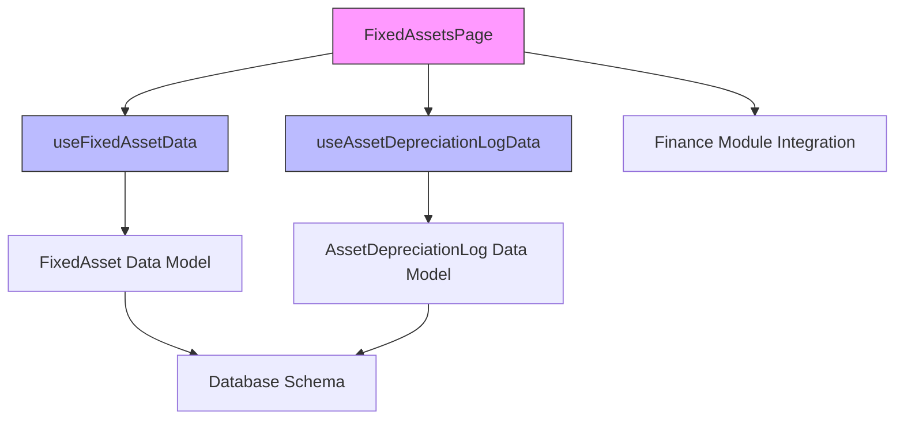
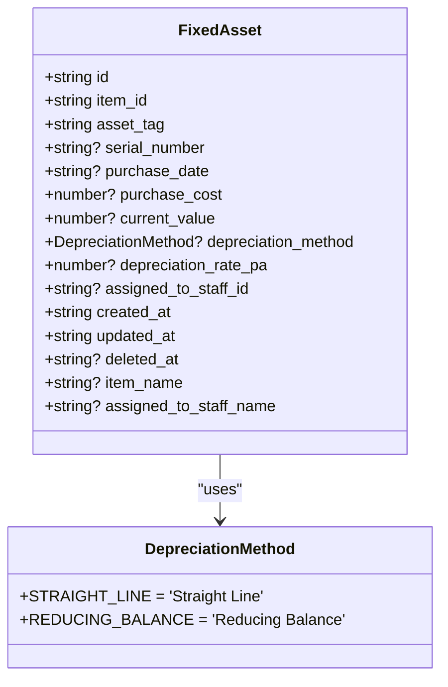
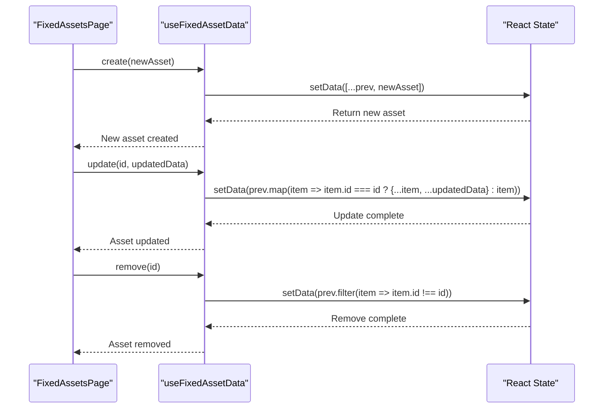
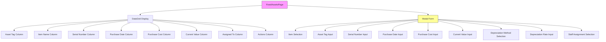
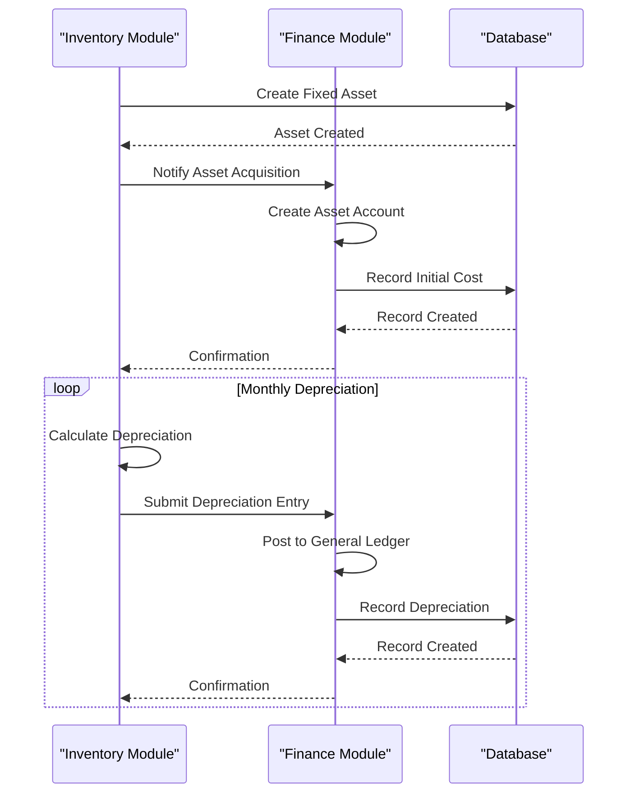
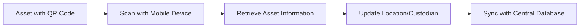

# Fixed Asset Management

<cite>
**Referenced Files in This Document**   
- [FixedAssetsPage.tsx](file://src/modules/inventory/pages/FixedAssetsPage.tsx)
- [useFixedAssetData.ts](file://src/modules/inventory/data/useFixedAssetData.ts)
- [useAssetDepreciationLogData.ts](file://src/modules/inventory/data/useAssetDepreciationLogData.ts)
- [types.ts](file://src/core/types.ts)
- [schema.ts](file://src/modules/inventory/data/schema.ts)
- [mockData.ts](file://src/modules/inventory/data/mockData.ts)
</cite>

## Table of Contents
1. [Introduction](#introduction)
2. [Core Components](#core-components)
3. [Fixed Asset Data Model](#fixed-asset-data-model)
4. [CRUD Operations Implementation](#crud-operations-implementation)
5. [Depreciation Tracking System](#depreciation-tracking-system)
6. [User Interface and Form Design](#user-interface-and-form-design)
7. [Integration with Finance Module](#integration-with-finance-module)
8. [Common Challenges and Recommendations](#common-challenges-and-recommendations)

## Introduction
The Fixed Asset Management system within the Inventory module provides comprehensive tracking and management of high-value school assets such as laboratory equipment, IT hardware, and furniture. This documentation details the implementation of the FixedAssetsPage for managing asset registers, including key fields for acquisition date, cost, location, custodian, and depreciation method. The system leverages specialized hooks for data operations and integrates with financial systems for accounting purposes, ensuring accurate asset lifecycle management from acquisition to disposal.

## Core Components

The fixed asset management functionality is built around several core components that work together to provide a complete asset tracking solution. The primary components include the FixedAssetsPage for user interaction, the useFixedAssetData hook for CRUD operations, and the useAssetDepreciationLogData hook for tracking depreciation schedules. These components are supported by well-defined data models and schema definitions that ensure data consistency and integrity.



**Diagram sources**
- [FixedAssetsPage.tsx](file://src/modules/inventory/pages/FixedAssetsPage.tsx)
- [useFixedAssetData.ts](file://src/modules/inventory/data/useFixedAssetData.ts)
- [useAssetDepreciationLogData.ts](file://src/modules/inventory/data/useAssetDepreciationLogData.ts)

**Section sources**
- [FixedAssetsPage.tsx](file://src/modules/inventory/pages/FixedAssetsPage.tsx#L18-L244)
- [useFixedAssetData.ts](file://src/modules/inventory/data/useFixedAssetData.ts#L7-L39)
- [useAssetDepreciationLogData.ts](file://src/modules/inventory/data/useAssetDepreciationLogData.ts#L7-L54)

## Fixed Asset Data Model

The Fixed Asset data model is designed to capture all essential information about high-value school assets. The model includes both core asset details and denormalized fields for improved query performance and user experience.



**Diagram sources**
- [types.ts](file://src/core/types.ts#L1050-L1067)
- [schema.ts](file://src/modules/inventory/data/schema.ts#L100-L130)

**Section sources**
- [types.ts](file://src/core/types.ts#L1050-L1067)
- [schema.ts](file://src/modules/inventory/data/schema.ts#L100-L130)

### Key Fields and Properties

The FixedAsset interface defines the following properties:

- **id**: Unique identifier for the fixed asset
- **item_id**: Reference to the inventory item (string)
- **asset_tag**: Unique asset tag identifier (string)
- **serial_number**: Optional serial number for the asset
- **purchase_date**: Date when the asset was purchased
- **purchase_cost**: Original purchase cost of the asset
- **current_value**: Current book value of the asset
- **depreciation_method**: Method used for depreciation calculation
- **depreciation_rate_pa**: Annual depreciation rate as a percentage
- **assigned_to_staff_id**: ID of the staff member responsible for the asset
- **created_at**: Timestamp when the record was created
- **updated_at**: Timestamp when the record was last updated
- **deleted_at**: Timestamp when the record was soft-deleted (if applicable)
- **item_name**: Denormalized field containing the item name for display
- **assigned_to_staff_name**: Denormalized field containing the staff member's name

The system supports two depreciation methods through the DepreciationMethod enum:
- **STRAIGHT_LINE**: Equal depreciation amount each year
- **REDUCING_BALANCE**: Depreciation based on a percentage of the remaining book value

## CRUD Operations Implementation

The useFixedAssetData hook provides the core CRUD (Create, Read, Update, Delete) operations for managing fixed assets. This custom hook encapsulates the data management logic, making it reusable across different components.



**Diagram sources**
- [useFixedAssetData.ts](file://src/modules/inventory/data/useFixedAssetData.ts#L7-L39)

**Section sources**
- [useFixedAssetData.ts](file://src/modules/inventory/data/useFixedAssetData.ts#L7-L39)

### Implementation Details

The useFixedAssetData hook implements the following operations:

**Create Operation**: 
- Accepts a partial FixedAsset object as input
- Generates a unique ID using Date.now()
- Sets creation and update timestamps
- Adds the new asset to the state array
- Returns the created asset

**Update Operation**:
- Takes an asset ID and updated data as parameters
- Maps through the existing assets and updates the matching asset
- Preserves the original ID and creation timestamp
- Updates the modification timestamp
- Returns a promise for async compatibility

**Remove Operation**:
- Accepts an asset ID as parameter
- Filters the asset array to exclude the specified asset
- Implements soft deletion through state management
- Returns a promise for async compatibility

The hook uses React's useState hook to manage the asset data in memory, with initial data populated from mock data. In a production environment, this would be connected to a persistent data store.

## Depreciation Tracking System

The asset depreciation tracking system is implemented through the useAssetDepreciationLogData hook and the corresponding data model. This system enables schools to maintain accurate financial records and comply with accounting standards.

```mermaid
classDiagram
class AssetDepreciationLog {
+string id
+string asset_id
+string depreciation_date
+number amount_depreciated
+number book_value_after
}
class AssetDepreciationLogSchema {
+name : 'asset_depreciation_log'
+primaryKey : 'id'
+properties : {id, asset_id, depreciation_date, amount_depreciated, book_value_after}
+required : [id, asset_id, depreciation_date, amount_depreciated, book_value_after]
+indexes : [asset_id]
}
AssetDepreciationLog --> AssetDepreciationLogSchema : "follows"
```

**Diagram sources**
- [useAssetDepreciationLogData.ts](file://src/modules/inventory/data/useAssetDepreciationLogData.ts#L7-L54)
- [schema.ts](file://src/modules/inventory/data/schema.ts#L132-L145)

**Section sources**
- [useAssetDepreciationLogData.ts](file://src/modules/inventory/data/useAssetDepreciationLogData.ts#L7-L54)
- [schema.ts](file://src/modules/inventory/data/schema.ts#L132-L145)

### Depreciation Log Structure

The AssetDepreciationLog interface defines the following properties:

- **id**: Unique identifier for the depreciation log entry
- **asset_id**: Reference to the fixed asset being depreciated
- **depreciation_date**: Date when the depreciation was recorded
- **amount_depreciated**: The amount depreciated in this period
- **book_value_after**: The book value of the asset after this depreciation

The system uses a separate table/collection for depreciation logs to maintain a complete audit trail of all depreciation calculations. This approach allows for historical analysis and financial reporting.

## User Interface and Form Design

The FixedAssetsPage component provides a user-friendly interface for managing fixed assets. The design follows modern UI principles with a clean layout, intuitive controls, and responsive behavior.



**Diagram sources**
- [FixedAssetsPage.tsx](file://src/modules/inventory/pages/FixedAssetsPage.tsx#L18-L244)

**Section sources**
- [FixedAssetsPage.tsx](file://src/modules/inventory/pages/FixedAssetsPage.tsx#L18-L244)

### Form Layout and Validation

The form layout is organized in a responsive grid that adapts to different screen sizes. On desktop, fields are arranged in three columns, while on mobile devices, they stack vertically.

**Required Fields**:
- **Inventory Item**: Dropdown selection from items marked as "Fixed Asset" type
- **Asset Tag**: Unique identifier for the asset (required)

**Optional Fields**:
- **Serial Number**: Manufacturer's serial number
- **Purchase Date**: Date when the asset was acquired
- **Purchase Cost**: Original cost in local currency (KES)
- **Current Value**: Current book value
- **Depreciation Method**: Selection between Straight Line and Reducing Balance
- **Depreciation Rate**: Annual percentage rate for depreciation
- **Assigned To Staff**: Selection from active staff members

The form includes client-side validation to ensure data integrity:
- Asset tag is required
- Item selection is required
- Numeric fields accept only valid numbers
- Date fields use HTML5 date input for validation
- Depreciation rate is constrained between 0 and 100

## Integration with Finance Module

The fixed asset management system is designed to integrate with the Finance module for accounting purposes. While the current implementation uses mock data, the architecture supports seamless integration with financial systems.

### Data Flow Integration



**Diagram sources**
- [FixedAssetsPage.tsx](file://src/modules/inventory/pages/FixedAssetsPage.tsx)
- [finance module files](file://src/modules/finance/)

**Section sources**
- [FixedAssetsPage.tsx](file://src/modules/inventory/pages/FixedAssetsPage.tsx#L18-L244)

The integration points include:
- **Asset Acquisition**: When a new fixed asset is added, the system notifies the Finance module to create corresponding accounting entries
- **Depreciation Posting**: Periodic depreciation calculations are sent to the Finance module for posting to the general ledger
- **Asset Disposal**: When assets are disposed of, the system coordinates with the Finance module to record gains or losses
- **Financial Reporting**: Asset data is available for financial statements and audit reports

## Common Challenges and Recommendations

### Common Challenges

**Asset Misplacement**: High-value assets like laboratory equipment and IT hardware are prone to misplacement or unauthorized movement between departments.

**Incomplete Depreciation Records**: Manual tracking of depreciation can lead to missed entries or calculation errors, affecting financial accuracy.

**Audit Compliance**: Schools must maintain accurate asset records for regulatory and funding compliance, which can be challenging with manual systems.

**Data Synchronization**: Ensuring that asset information is consistent across inventory and finance systems can be difficult.

### Recommendations

**Barcode/QR Code Tracking**: Implement barcode or QR code labels on all fixed assets. This enables quick scanning during physical verification and reduces data entry errors.



**Regular Physical Verification**: Conduct scheduled physical audits of all fixed assets to verify their existence, condition, and location. The system should support audit workflows with checklists and reporting.

**Automated Depreciation Calculations**: Implement automated depreciation calculations based on the selected method (Straight Line or Reducing Balance) to ensure accuracy and consistency.

**Integration with Finance Systems**: Ensure tight integration between the inventory and finance modules to maintain data consistency and reduce manual reconciliation efforts.

**Role-Based Access Control**: Implement granular permissions to ensure that only authorized personnel can modify asset records, particularly financial values and depreciation methods.

**Comprehensive Reporting**: Develop reports for asset utilization, depreciation schedules, and maintenance history to support decision-making and compliance requirements.

**Asset Lifecycle Management**: Extend the system to track the complete lifecycle of assets from acquisition through maintenance, transfers, and eventual disposal.

**Section sources**
- [FixedAssetsPage.tsx](file://src/modules/inventory/pages/FixedAssetsPage.tsx)
- [useFixedAssetData.ts](file://src/modules/inventory/data/useFixedAssetData.ts)
- [useAssetDepreciationLogData.ts](file://src/modules/inventory/data/useAssetDepreciationLogData.ts)
- [types.ts](file://src/core/types.ts)
- [schema.ts](file://src/modules/inventory/data/schema.ts)
- [mockData.ts](file://src/modules/inventory/data/mockData.ts)