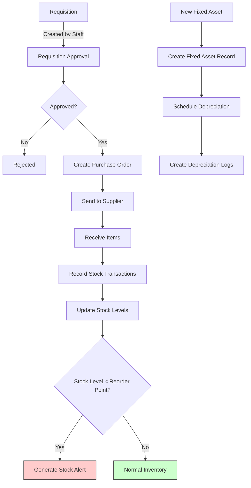
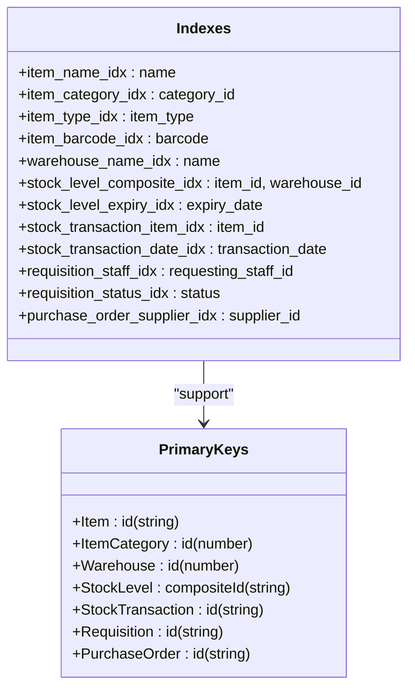
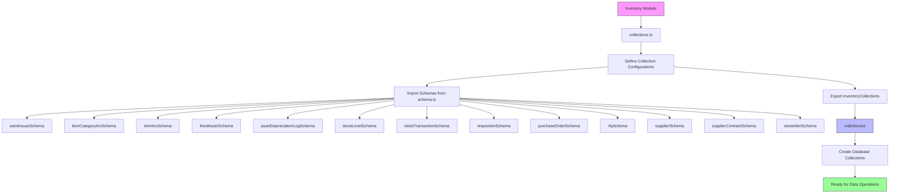
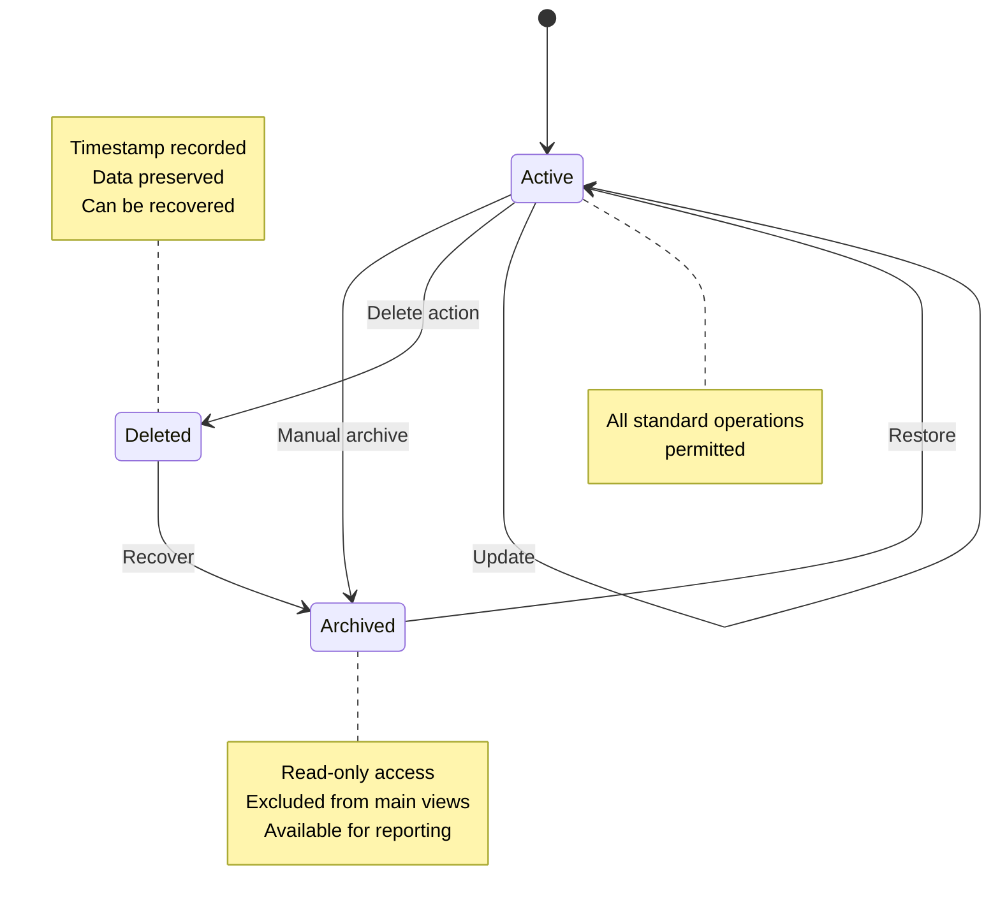

# Inventory Data Models

<cite>
**Referenced Files in This Document**   
- [types.ts](file://src/core/types.ts)
- [types.ts](file://src/modules/inventory/data/types.ts)
- [schema.ts](file://src/modules/inventory/data/schema.ts)
- [collections.ts](file://src/modules/inventory/data/collections.ts)
- [useItemData.ts](file://src/modules/inventory/data/useItemData.ts)
- [useWarehouseData.ts](file://src/modules/inventory/data/useWarehouseData.ts)
- [useStockLevelData.ts](file://src/modules/inventory/data/useStockLevelData.ts)
- [mockData.ts](file://src/modules/inventory/data/mockData.ts)
</cite>

## Table of Contents
1. [Introduction](#introduction)
2. [Core Entities Overview](#core-entities-overview)
3. [Entity Relationships](#entity-relationships)
4. [Field Definitions and Constraints](#field-definitions-and-constraints)
5. [Primary Keys and Indexes](#primary-keys-and-indexes)
6. [Validation Rules and Enums](#validation-rules-and-enums)
7. [Database Collection Registration](#database-collection-registration)
8. [Data Access Patterns](#data-access-patterns)
9. [Sample JSON Payloads](#sample-json-payloads)
10. [Data Lifecycle Management](#data-lifecycle-management)

## Introduction

The Inventory module in schoolpilot3 provides comprehensive management of school resources including consumables, fixed assets, and warehouse operations. This documentation details the data models that form the foundation of the inventory system, covering entity definitions, relationships, constraints, and access patterns. The system is designed to support procurement workflows, stock management, asset tracking, and automated reorder alerts.

**Section sources**
- [types.ts](file://src/core/types.ts#L800-L1599)
- [types.ts](file://src/modules/inventory/data/types.ts#L0-L298)

## Core Entities Overview

The Inventory module consists of ten core entities that work together to manage school resources:

- **Item**: Represents inventory items that can be either consumables or fixed assets
- **ItemCategory**: Categorization of inventory items for organizational purposes
- **Warehouse**: Physical storage locations for inventory items
- **Supplier**: External vendors from whom items are procured
- **SupplierContract**: Formal agreements with suppliers for goods and services
- **Requisition**: Internal requests for items from departments or staff
- **PurchaseOrder**: Official purchase documents sent to suppliers
- **StockTransaction**: Records of all movements of items in and out of warehouses
- **StockLevel**: Current quantities of items in specific warehouses
- **FixedAsset**: High-value items that are tracked individually with depreciation
- **StockAlert**: Automated notifications for stock level issues or expiries

These entities are defined using TypeScript interfaces and database-agnostic schemas to ensure consistency across different storage implementations.

```mermaid
erDiagram
ITEM ||--o{ STOCK_LEVEL : "has"
ITEM ||--o{ STOCK_TRANSACTION : "involved in"
ITEM ||--o{ FIXED_ASSET : "defines"
ITEM }|--|| ITEM_CATEGORY : "belongs to"
WAREHOUSE ||--o{ STOCK_LEVEL : "contains"
WAREHOUSE ||--o{ STOCK_TRANSACTION : "located at"
SUPPLIER ||--o{ SUPPLIER_CONTRACT : "has"
SUPPLIER ||--o{ PURCHASE_ORDER : "receives"
REQUISITION ||--o{ REQUISITION_ITEM : "contains"
PURCHASE_ORDER ||--o{ PURCHASE_ORDER_ITEM : "contains"
ITEM ||--o{ REQUISITION_ITEM : "requested"
ITEM ||--o{ PURCHASE_ORDER_ITEM : "ordered"
REQUISITION ||--|| PURCHASE_ORDER : "fulfilled by"
FIXED_ASSET ||--o{ ASSET_DEPRECIATION_LOG : "generates"
ITEM ||--o{ STOCK_ALERT : "triggers"
WAREHOUSE ||--o{ STOCK_ALERT : "located at"
class ITEM {
id: string
name: string
item_type: ItemTypeEnum
current_price: number
}
class ITEM_CATEGORY {
id: number
name: string
}
class WAREHOUSE {
id: number
name: string
}
class SUPPLIER {
id: number
name: string
status: SupplierStatusEnum
}
class SUPPLIER_CONTRACT {
id: string
contract_number: string
status: ContractStatusEnum
}
class REQUISITION {
id: string
status: RequisitionStatusEnum
}
class PURCHASE_ORDER {
id: string
status: PurchaseOrderStatusEnum
}
class STOCK_TRANSACTION {
id: string
transaction_type: StockTransactionType
}
class STOCK_LEVEL {
compositeId: string
quantity: number
}
class FIXED_ASSET {
id: string
asset_tag: string
depreciation_method: DepreciationMethod
}
class STOCK_ALERT {
id: string
alert_type: "LOW_STOCK|OVERSTOCK|EXPIRY_WARNING|EXPIRED"
}
```

**Diagram sources**
- [types.ts](file://src/core/types.ts#L800-L1599)
- [types.ts](file://src/modules/inventory/data/types.ts#L0-L298)

**Section sources**
- [types.ts](file://src/core/types.ts#L800-L1599)
- [types.ts](file://src/modules/inventory/data/types.ts#L0-L298)

## Entity Relationships

The inventory data model features a comprehensive set of relationships that enable complex inventory management workflows:

### Item and Category Relationship
The **Item** entity has a many-to-one relationship with **ItemCategory**, where multiple items can belong to a single category. This relationship is implemented through the `category_id` field in the Item entity, which references the primary key of the ItemCategory entity.

### Item and Warehouse Relationships
Items have two key relationships with warehouses:
- **StockLevel**: A composite relationship where the quantity of a specific item in a specific warehouse is tracked. The relationship is identified by a composite key of `item_id` and `warehouse_id`.
- **StockTransaction**: All movements of items into or out of warehouses are recorded as transactions, with each transaction linked to both an item and a warehouse.

### Requisition and Purchase Order Workflow
The procurement process follows a hierarchical relationship:
- **Requisition** represents an internal request for items
- **PurchaseOrder** is created to fulfill one or more requisitions
- Both entities contain nested arrays of items (requisition_items and purchase_order_items) that detail the specific items requested or ordered

### Supplier and Contract Management
Suppliers can have multiple contracts, with each **SupplierContract** containing details such as contract value, duration, and renewal terms. The system tracks supplier performance and status, enabling strategic procurement decisions.

### Fixed Asset Lifecycle
Fixed assets are special items that require individual tracking:
- Each **FixedAsset** references an **Item** that defines its type
- Assets can be assigned to staff members and tracked by location
- **AssetDepreciationLog** records track the financial depreciation of assets over time

### Stock Monitoring and Alerts
The system automatically generates **StockAlert** records when inventory levels fall below reorder points or when items are approaching expiration. These alerts are linked to both the item and warehouse, enabling targeted inventory management.



**Diagram sources**
- [schema.ts](file://src/modules/inventory/data/schema.ts#L0-L287)
- [types.ts](file://src/modules/inventory/data/types.ts#L0-L298)

**Section sources**
- [schema.ts](file://src/modules/inventory/data/schema.ts#L0-L287)
- [types.ts](file://src/modules/inventory/data/types.ts#L0-L298)

## Field Definitions and Constraints

### Item Entity
The **Item** entity represents all inventory items in the system, whether consumable or fixed assets.

**Key Fields:**
- `id`: Unique identifier (string)
- `name`: Item name (string, required, max 200 characters)
- `description`: Item description (string, optional, max 500 characters)
- `category_id`: Reference to ItemCategory (number)
- `unit_of_measure`: Unit of measurement (string, required, max 50 characters)
- `item_type`: Item classification (enum: CONSUMABLE, FIXED_ASSET, required)
- `current_price`: Current price (number, optional, min 0, max 999999.99)
- `reorder_level`: Quantity threshold for reorder alerts (number, optional, integer)
- `reorder_point`: Quantity at which reorder is triggered (number, optional, integer)
- `reorder_quantity`: Suggested reorder quantity (number, optional, integer)
- `max_stock_level`: Maximum allowable stock (number, optional, integer)
- `barcode`: Barcode/QR code identifier (string, optional, max 100 characters)
- `batch_tracking_enabled`: Whether batch tracking is enabled (boolean, default false)
- `expiry_tracking_enabled`: Whether expiry tracking is enabled (boolean, default false)

**Section sources**
- [schema.ts](file://src/modules/inventory/data/schema.ts#L50-L100)
- [types.ts](file://src/modules/inventory/data/types.ts#L50-L80)

### Warehouse Entity
The **Warehouse** entity represents physical storage locations.

**Key Fields:**
- `id`: Unique identifier (number)
- `name`: Warehouse name (string, required, max 100 characters)
- `location`: Physical location (string, optional, max 200 characters)

**Section sources**
- [schema.ts](file://src/modules/inventory/data/schema.ts#L10-L20)
- [types.ts](file://src/modules/inventory/data/types.ts#L30-L35)

### StockLevel Entity
The **StockLevel** entity tracks current inventory quantities.

**Key Fields:**
- `compositeId`: Composite primary key (item_id|warehouse_id) (string)
- `item_id`: Reference to Item (string)
- `warehouse_id`: Reference to Warehouse (number)
- `quantity`: Current stock quantity (number, required, non-negative integer)
- `batch_number`: Batch/lot number (string, optional, max 100 characters)
- `expiry_date`: Expiration date (string, format: date)
- `last_updated`: Last update timestamp (string, format: date-time)
- `reorder_level`: Reorder level (denormalized from Item)
- `max_stock_level`: Maximum stock level (denormalized from Item)

**Section sources**
- [schema.ts](file://src/modules/inventory/data/schema.ts#L150-L170)
- [types.ts](file://src/modules/inventory/data/types.ts#L90-L100)

### StockTransaction Entity
The **StockTransaction** entity records all inventory movements.

**Key Fields:**
- `id`: Unique identifier (string)
- `item_id`: Reference to Item (string)
- `warehouse_id`: Reference to Warehouse (number)
- `transaction_type`: Type of transaction (enum: RECEIPT, ISSUE, RETURN_TO_STORE, RETURN_TO_SUPPLIER, STOCK_ADJUSTMENT)
- `quantity`: Transaction quantity (number, can be negative for issues/returns)
- `batch_number`: Batch/lot number (string, optional)
- `expiry_date`: Expiration date (string, format: date)
- `source_table`: Source of transaction (string, optional, e.g., 'purchase_orders', 'requisitions')
- `source_id`: Source record ID (string, optional)
- `transaction_date`: Date and time of transaction (string, format: date-time)
- `notes`: Transaction notes (string, optional, max 500 characters)

**Section sources**
- [schema.ts](file://src/modules/inventory/data/schema.ts#L170-L200)
- [types.ts](file://src/modules/inventory/data/types.ts#L100-L110)

### Requisition Entity
The **Requisition** entity represents internal requests for items.

**Key Fields:**
- `id`: Unique identifier (string)
- `requesting_staff_id`: Staff member making the request (string)
- `request_date`: Date of request (string, format: date)
- `status`: Requisition status (enum: PENDING_APPROVAL, APPROVED, REJECTED, ORDERED, FULFILLED, CANCELLED)
- `notes`: Additional notes (string, optional, max 500 characters)
- `items`: Array of requisition items (nested object)
- `total_requested_value`: Total value of requested items (computed)

**Section sources**
- [schema.ts](file://src/modules/inventory/data/schema.ts#L200-L240)
- [types.ts](file://src/modules/inventory/data/types.ts#L110-L120)

### PurchaseOrder Entity
The **PurchaseOrder** entity represents official purchase documents.

**Key Fields:**
- `id`: Unique identifier (string)
- `supplier_id`: Reference to Supplier (number)
- `order_date`: Date of order (string, format: date)
- `expected_delivery_date`: Expected delivery date (string, format: date)
- `actual_delivery_date`: Actual delivery date (string, format: date)
- `status`: Purchase order status (enum: DRAFT, PENDING_APPROVAL, APPROVED, SENT_TO_SUPPLIER, PARTIALLY_RECEIVED, FULLY_RECEIVED, INVOICED, CANCELLED)
- `total_amount`: Total amount (number)
- `tax_amount`: Tax amount (number)
- `shipping_cost`: Shipping cost (number)
- `discount_amount`: Discount amount (number)
- `notes`: Additional notes (string, optional)
- `requisition_id`: Reference to originating requisition (string, optional)
- `items`: Array of purchase order items (nested object)
- `total_value`: Total value of order (computed)

**Section sources**
- [schema.ts](file://src/modules/inventory/data/schema.ts#L240-L280)
- [types.ts](file://src/modules/inventory/data/types.ts#L120-L130)

## Primary Keys and Indexes

### Primary Keys
Each entity has a designated primary key:

- **Item**: `id` (string)
- **ItemCategory**: `id` (number)
- **Warehouse**: `id` (number)
- **FixedAsset**: `id` (string)
- **StockLevel**: `compositeId` (string, combining item_id and warehouse_id)
- **StockTransaction**: `id` (string)
- **Requisition**: `id` (string)
- **PurchaseOrder**: `id` (string)
- **Supplier**: `id` (number)
- **SupplierContract**: `id` (string)
- **StockAlert**: `id` (string)

The use of composite keys for StockLevel enables efficient querying of item quantities by warehouse, while UUID-style string IDs for transactional entities provide better distribution in distributed database systems.

### Indexes
Strategic indexing is implemented to optimize common query patterns:

**Item Indexes:**
- `name`: For searching items by name
- `category_id`: For filtering items by category
- `item_type`: For filtering by consumable vs. fixed asset
- `barcode`: For barcode/QR code scanning

**Warehouse Indexes:**
- `name`: For searching warehouses by name

**StockLevel Indexes:**
- `[item_id, warehouse_id]`: Composite index for efficient lookups
- `expiry_date`: For identifying expiring items
- `batch_number`: For batch/lot tracking

**StockTransaction Indexes:**
- `item_id`: For tracking all transactions for an item
- `warehouse_id`: For tracking all transactions in a warehouse
- `transaction_date`: For time-based queries
- `batch_number`: For batch-specific transactions

**Requisition Indexes:**
- `requesting_staff_id`: For finding requisitions by staff member
- `status`: For filtering by approval/fulfillment status
- `request_date`: For time-based reporting

**PurchaseOrder Indexes:**
- `supplier_id`: For finding orders by supplier
- `status`: For tracking order fulfillment
- `order_date`: For procurement reporting



**Diagram sources**
- [schema.ts](file://src/modules/inventory/data/schema.ts#L0-L287)

**Section sources**
- [schema.ts](file://src/modules/inventory/data/schema.ts#L0-L287)

## Validation Rules and Enums

### Enumerated Types
The inventory system uses several enumerated types to ensure data consistency:

**ItemTypeEnum:**
- `CONSUMABLE`: Items that are used up and need replenishment
- `FIXED_ASSET`: High-value items that are tracked individually

**RequisitionStatusEnum:**
- `PENDING_APPROVAL`: Awaiting approval
- `APPROVED`: Approved and ready for fulfillment
- `REJECTED`: Rejected by approver
- `ORDERED`: Items have been ordered
- `FULFILLED`: All items have been issued
- `CANCELLED`: Request has been cancelled

**PurchaseOrderStatusEnum:**
- `DRAFT`: Order is being prepared
- `PENDING_APPROVAL`: Awaiting approval
- `APPROVED`: Approved but not yet sent
- `SENT_TO_SUPPLIER`: Order has been sent to supplier
- `PARTIALLY_RECEIVED`: Some items have been received
- `FULLY_RECEIVED`: All items have been received
- `INVOICED`: Supplier has invoiced for the order
- `CANCELLED`: Order has been cancelled

**StockTransactionType:**
- `RECEIPT`: Items received from supplier or other source
- `ISSUE`: Items issued to staff or departments
- `RETURN_TO_STORE`: Items returned to inventory
- `RETURN_TO_SUPPLIER`: Items returned to supplier
- `STOCK_ADJUSTMENT`: Manual adjustment of stock levels

**DepreciationMethod:**
- `STRAIGHT_LINE`: Equal depreciation each period
- `REDUCING_BALANCE`: Higher depreciation in early periods

**SupplierStatusEnum:**
- `ACTIVE`: Supplier is active
- `INACTIVE`: Supplier is temporarily inactive
- `BLACKLISTED`: Supplier is blacklisted
- `PENDING_APPROVAL`: Supplier awaiting approval

**ContractStatusEnum:**
- `ACTIVE`: Contract is active
- `EXPIRED`: Contract has expired
- `PENDING_RENEWAL`: Contract renewal is pending
- `TERMINATED`: Contract has been terminated

### Validation Constraints
The system enforces several data validation rules:

- **Positive Quantities**: Stock levels and transaction quantities (except issues) must be non-negative
- **Price Constraints**: Prices must be non-negative and within reasonable limits (max 999,999.99)
- **Date Validation**: All dates must be in valid ISO format
- **Required Fields**: Critical fields like name, item_type, and status are required
- **Length Limits**: String fields have appropriate length limits to prevent database issues
- **Enum Validation**: Status fields must match defined enum values

**Section sources**
- [types.ts](file://src/modules/inventory/data/types.ts#L0-L298)
- [schema.ts](file://src/modules/inventory/data/schema.ts#L0-L287)

## Database Collection Registration

The inventory collections are registered with the database system through the `collections.ts` file, which defines the configuration for each collection in the RxDB database.

```typescript
export const inventoryCollections = {
  warehouses: {
    schema: schemas.warehouseSchema,
  },
  item_categories_inv: {
    schema: schemas.itemCategoryInvSchema,
  },
  items_inv: {
    schema: schemas.itemInvSchema,
  },
  fixed_assets: {
    schema: schemas.fixedAssetSchema,
  },
  asset_depreciation_logs: {
    schema: schemas.assetDepreciationLogSchema,
  },
  stock_levels: {
    schema: schemas.stockLevelSchema,
  },
  stock_transactions: {
    schema: schemas.stockTransactionSchema,
  },
  requisitions: {
    schema: schemas.requisitionSchema,
  },
  purchase_orders: {
    schema: schemas.purchaseOrderSchema,
  },
  rfqs: {
    schema: schemas.rfqSchema,
  },
  suppliers: {
    schema: schemas.supplierSchema,
  },
  supplier_contracts: {
    schema: schemas.supplierContractSchema,
  },
  stock_alerts: {
    schema: schemas.stockAlertSchema,
  },
};
```

Each collection is configured with its corresponding schema from the `schema.ts` file. The collection names follow a consistent naming convention, with plural forms and descriptive suffixes where needed (e.g., `item_categories_inv` to distinguish from other modules).

The registration process enables the database service to create and manage these collections, providing a consistent interface for data access across the application.



**Diagram sources**
- [collections.ts](file://src/modules/inventory/data/collections.ts#L0-L51)
- [schema.ts](file://src/modules/inventory/data/schema.ts#L0-L287)

**Section sources**
- [collections.ts](file://src/modules/inventory/data/collections.ts#L0-L51)

## Data Access Patterns

The inventory module provides several data access patterns through custom React hooks that encapsulate CRUD operations.

### useItemData Hook
The `useItemData` hook provides data management for inventory items:

```typescript
export const useItemData = () => {
  const [data, setData] = useState<ItemInv[]>(initialMockItemsInv);

  const create = async (newItem: Partial<ItemInv>) => {
    const newDataItem: ItemInv = {
      ...newItem,
      id: Date.now().toString(),
      created_at: new Date().toISOString(),
      updated_at: new Date().toISOString()
    } as ItemInv;
    setData((prev: ItemInv[]) => [...prev, newDataItem]);
    return newDataItem;
  };

  const update = async (id: string, updatedData: Partial<ItemInv>) => {
    setData((prev: ItemInv[]) => prev.map((item: ItemInv) => 
      item.id === id 
        ? { ...item, ...updatedData, updated_at: new Date().toISOString() }
        : item
    ));
  };

  const remove = async (id: string) => {
    setData((prev: ItemInv[]) => prev.filter((item: ItemInv) => item.id !== id));
  };

  return {
    data,
    create,
    update,
    remove
  };
};
```

This hook follows a self-contained pattern, managing its own state without depending on the global AppDataContext. It automatically handles timestamp updates on create and update operations.

### useWarehouseData Hook
The `useWarehouseData` hook manages warehouse data:

```typescript
const useWarehouseData = () => {
  const [warehouses, setWarehouses] = useState<any[]>([]);
  const [isLoading, setIsLoading] = useState<boolean>(true);
  const [error, setError] = useState<string | null>(null);

  useEffect(() => {
    try {
      setWarehouses(initialMockUsers);
      setIsLoading(false);
    } catch (e) {
      setError('Failed to fetch warehouses');
      setIsLoading(false);
    }
  }, []);

  const create = async (newItem: Partial<any>) => {
    const newDataItem: any = {
      ...newItem,
      id: Date.now(),
      created_at: new Date().toISOString(),
      updated_at: new Date().toISOString()
    } as any;
    setWarehouses((prev: any[]) => [...prev, newDataItem]);
    return newDataItem;
  };

  // update and remove methods similar to useItemData
};
```

Note: There appears to be an implementation issue where the hook uses `any` types and references `initialMockUsers` instead of warehouse-specific mock data. This should be corrected to use proper typing and inventory-specific mock data.

### useStockLevelData Hook
The `useStockLevelData` hook follows a similar pattern to manage stock level data:

```typescript
const useStockLevelData = () => {
  const [stockLevels, setStockLevels] = useState<any[]>([]);
  const [isLoading, setIsLoading] = useState<boolean>(true);
  const [error, setError] = useState<string | null>(null);

  useEffect(() => {
    try {
      setStockLevels(initialMockUsers);
      setIsLoading(false);
    } catch (e) {
      setError('Failed to fetch stock levels');
      setIsLoading(false);
    }
  }, []);

  const create = async (newItem: Partial<any>) => {
    const newDataItem: any = {
      ...newItem,
      id: Date.now(),
      created_at: new Date().toISOString(),
      updated_at: new Date().toISOString()
    } as any;
    setStockLevels((prev: any[]) => [...prev, newDataItem]);
    return newDataItem;
  };

  // update and remove methods
};
```

Like the warehouse hook, this implementation has typing issues and uses inappropriate mock data that should be addressed.

### Data Access Best Practices
The hooks demonstrate several best practices:
- **Self-containment**: Each hook manages its own data without global context dependencies
- **Timestamp management**: Automatic creation and update timestamps
- **Error handling**: Loading states and error reporting
- **Type safety**: Use of TypeScript interfaces for data structures
- **Consistent API**: Standardized create, update, remove methods across hooks

**Section sources**
- [useItemData.ts](file://src/modules/inventory/data/useItemData.ts#L0-L40)
- [useWarehouseData.ts](file://src/modules/inventory/data/useWarehouseData.ts#L0-L56)
- [useStockLevelData.ts](file://src/modules/inventory/data/useStockLevelData.ts#L0-L56)

## Sample JSON Payloads

### Create Purchase Order
```json
{
  "id": "PO005",
  "supplier_id": 3,
  "order_date": "2024-07-15",
  "expected_delivery_date": "2024-07-22",
  "status": "DRAFT",
  "notes": "Quarterly stationery restock",
  "items": [
    {
      "id": "POI016",
      "purchase_order_id": "PO005",
      "item_id": "INV001",
      "quantity_ordered": 25,
      "unit_price": 475,
      "warehouse_id": 1
    },
    {
      "id": "POI017",
      "purchase_order_id": "PO005",
      "item_id": "INV002",
      "quantity_ordered": 15,
      "unit_price": 575,
      "warehouse_id": 1
    },
    {
      "id": "POI018",
      "purchase_order_id": "PO005",
      "item_id": "INV006",
      "quantity_ordered": 10,
      "unit_price": 775,
      "warehouse_id": 1
    }
  ],
  "created_at": "2024-07-15T10:30:00Z",
  "updated_at": "2024-07-15T10:30:00Z"
}
```

### Update Stock Levels
```json
{
  "compositeId": "INV001-1",
  "item_id": "INV001",
  "warehouse_id": 1,
  "quantity": 75,
  "last_updated": "2024-07-15T14:22:00Z",
  "updated_at": "2024-07-15T14:22:00Z"
}
```

### Create Stock Transaction (Receipt)
```json
{
  "id": "STK-T019",
  "item_id": "INV001",
  "warehouse_id": 1,
  "transaction_type": "RECEIPT",
  "quantity": 50,
  "source_table": "purchase_orders",
  "source_id": "PO005",
  "transaction_date": "2024-07-15T14:20:00Z",
  "notes": "Received from Text Book Centre PO005",
  "created_at": "2024-07-15T14:20:00Z",
  "updated_at": "2024-07-15T14:20:00Z"
}
```

### Create Requisition
```json
{
  "id": "REQ005",
  "requesting_staff_id": "STF004",
  "request_date": "2024-07-15",
  "status": "PENDING_APPROVAL",
  "notes": "Additional stationery for new staff",
  "items": [
    {
      "id": "RI014",
      "requisition_id": "REQ005",
      "item_id": "INV001",
      "quantity_requested": 5,
      "unit_price": 500
    },
    {
      "id": "RI015",
      "requisition_id": "REQ005",
      "item_id": "INV002",
      "quantity_requested": 3,
      "unit_price": 600
    }
  ],
  "created_at": "2024-07-15T09:15:00Z",
  "updated_at": "2024-07-15T09:15:00Z"
}
```

**Section sources**
- [mockData.ts](file://src/modules/inventory/data/mockData.ts#L0-L259)
- [useItemData.ts](file://src/modules/inventory/data/useItemData.ts#L0-L40)

## Data Lifecycle Management

### Soft-Delete Pattern
The inventory system implements a soft-delete pattern for certain entities to preserve data integrity and enable recovery:

- **FixedAsset**: Uses a `deleted_at` timestamp field to mark assets as deleted without removing the record
- **Item**: No explicit soft-delete field, but items can be archived by updating their status or removing from active categories
- **Supplier**: No soft-delete field, but status can be set to INACTIVE or BLACKLISTED

When a fixed asset is "deleted," the system sets the `deleted_at` field to the current timestamp while preserving all historical data. This allows for:
- Audit trail preservation
- Financial reporting accuracy
- Asset history tracking
- Recovery of mistakenly deleted assets

### Archival Considerations
The system handles archival through several mechanisms:

**Data Retention:**
- All transaction records (StockTransaction) are retained permanently
- Historical stock levels are preserved through transaction history
- Requisition and purchase order records are kept for financial auditing
- Asset depreciation logs are maintained for the asset's entire lifecycle

**Performance Optimization:**
- Frequently accessed data (current StockLevels) is optimized with appropriate indexing
- Historical data queries can be optimized with time-based partitioning
- Denormalized fields (item_name, warehouse_name) reduce join operations

**Data Migration:**
- The system supports data migration through the migration scripts in the scripts/migration directory
- Archival processes can be implemented as part of data migration workflows
- Historical data can be moved to cold storage while maintaining referential integrity

### Lifecycle Events
Key lifecycle events trigger specific actions:

**Item Creation:**
- Generate unique ID
- Set creation timestamp
- Validate required fields
- Create initial stock level records if applicable

**Purchase Order Fulfillment:**
- Create StockTransaction records for received items
- Update StockLevel quantities
- Generate StockAlerts if levels exceed thresholds
- Update PurchaseOrder status based on receipt completeness

**Asset Depreciation:**
- Calculate periodic depreciation amount
- Create AssetDepreciationLog record
- Update FixedAsset current_value
- Adjust financial records accordingly

**Stock Level Monitoring:**
- Regularly check StockLevel against reorder points
- Generate StockAlert records when thresholds are crossed
- Send notifications to inventory managers



**Diagram sources**
- [types.ts](file://src/core/types.ts#L800-L1599)
- [schema.ts](file://src/modules/inventory/data/schema.ts#L0-L287)

**Section sources**
- [types.ts](file://src/core/types.ts#L800-L1599)
- [schema.ts](file://src/modules/inventory/data/schema.ts#L0-L287)