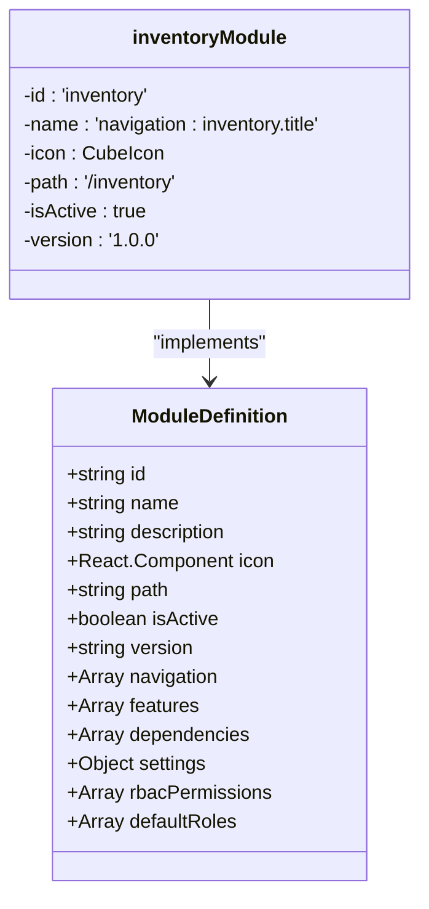
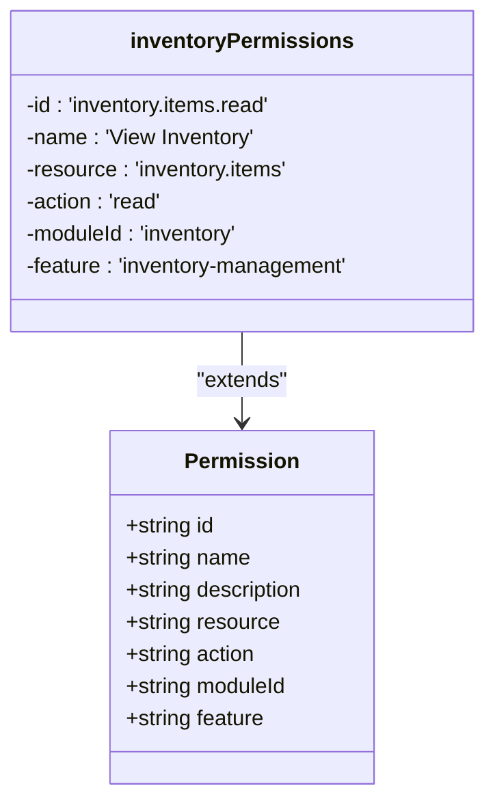
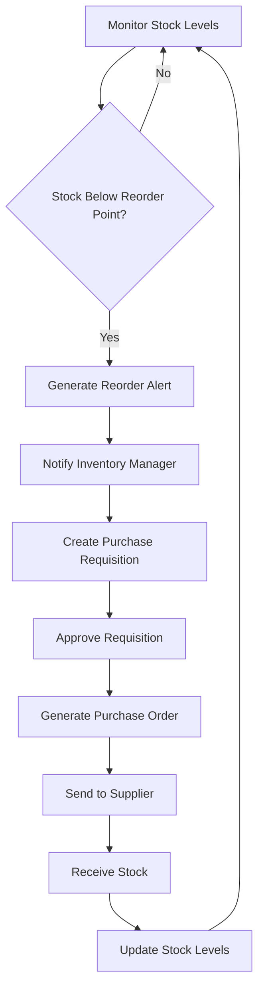
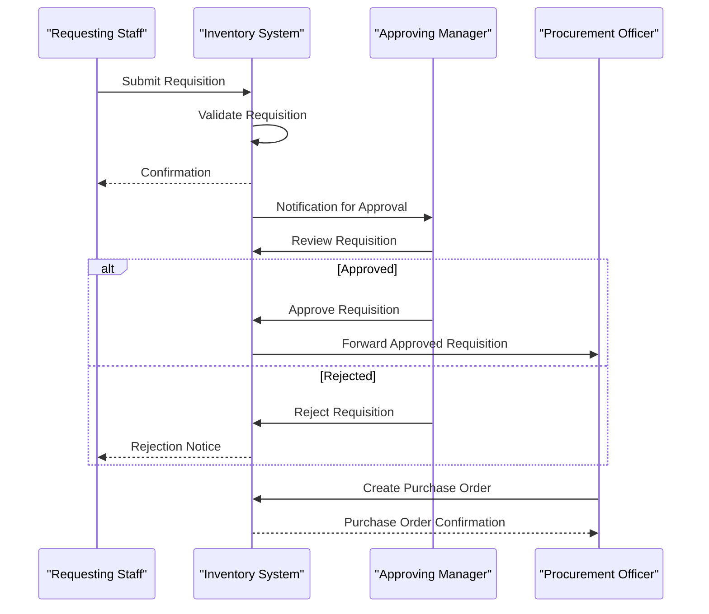
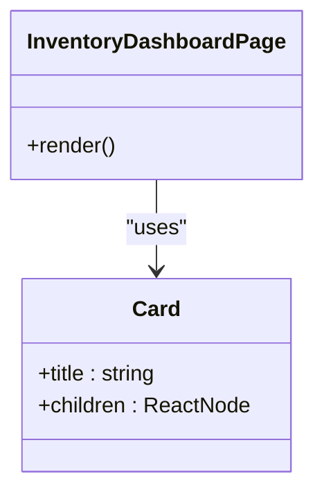
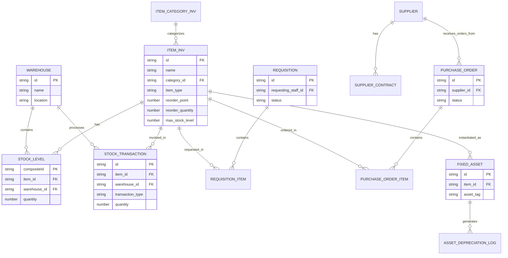
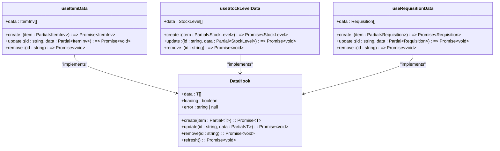

# Inventory Module Overview

<cite>
**Referenced Files in This Document**   
- [moduleDefinition.tsx](file://src/modules/inventory/moduleDefinition.tsx)
- [rbac.ts](file://src/modules/inventory/rbac.ts)
- [InventoryDashboardPage.tsx](file://src/modules/inventory/pages/InventoryDashboardPage.tsx)
- [schema.ts](file://src/modules/inventory/data/schema.ts)
- [types.ts](file://src/modules/inventory/data/types.ts)
- [useRequisitionData.ts](file://src/modules/inventory/data/useRequisitionData.ts)
- [usePurchaseOrderData.ts](file://src/modules/inventory/data/usePurchaseOrderData.ts)
- [useStockLevelData.ts](file://src/modules/inventory/data/useStockLevelData.ts)
- [useItemData.ts](file://src/modules/inventory/data/useItemData.ts)
- [useWarehouseData.ts](file://src/modules/inventory/data/useWarehouseData.ts)
- [useSupplierData.ts](file://src/modules/inventory/data/useSupplierData.ts)
- [useStockTransactionData.ts](file://src/modules/inventory/data/useStockTransactionData.ts)
- [useRequisitionItemData.ts](file://src/modules/inventory/data/useRequisitionItemData.ts)
- [usePurchaseOrderItemData.ts](file://src/modules/inventory/data/usePurchaseOrderItemData.ts)
- [useSupplierContractData.ts](file://src/modules/inventory/data/useSupplierContractData.ts)
- [useStockAlertData.ts](file://src/modules/inventory/data/useStockAlertData.ts)
- [mockData.ts](file://src/modules/inventory/data/mockData.ts)
</cite>

## Table of Contents
1. [Inventory Module Overview](#inventory-module-overview)
2. [Module Purpose and Scope](#module-purpose-and-scope)
3. [Integration with School Management System](#integration-with-school-management-system)
4. [Module Registration and Configuration](#module-registration-and-configuration)
5. [Role-Based Access Control (RBAC)](#role-based-access-control-rbac)
6. [Key Features](#key-features)
7. [User Journey: From Requisition to Stock Reception](#user-journey-from-requisition-to-stock-reception)
8. [Inventory Dashboard and Data Visualization](#inventory-dashboard-and-data-visualization)
9. [Data Model and Schema](#data-model-and-schema)
10. [Data Management and Hooks](#data-management-and-hooks)

## Module Purpose and Scope

The Inventory module in schoolpilot3 is designed to provide comprehensive management of school procurement, stock levels, and asset tracking. This module serves as a centralized system for managing all physical resources within an educational institution, ensuring efficient resource allocation, accurate inventory tracking, and streamlined procurement processes.

The module enables schools to manage various inventory aspects including consumable supplies, fixed assets, and specialized equipment. It supports multi-warehouse operations, allowing different storage locations such as main stores, science labs, and kitchen facilities to be managed independently while maintaining a unified inventory view. The system facilitates the complete procurement lifecycle from requisition creation through purchase order management to stock reception and distribution.

**Section sources**
- [moduleDefinition.tsx](file://src/modules/inventory/moduleDefinition.tsx#L1-L80)
- [types.ts](file://src/modules/inventory/data/types.ts#L0-L299)

## Integration with School Management System

The Inventory module is tightly integrated with other components of the school management system, particularly the Finance and Administration modules. As specified in the module definition, it has a required dependency on the Administration module, ensuring that staff and departmental information is synchronized across systems.

Integration with the Finance module allows for seamless financial tracking of inventory transactions, including purchase order processing, supplier invoicing, and cost accounting for inventory items. This integration ensures that all procurement activities are properly accounted for in the school's financial records.

The module also shares data with the Administration module for staff information, which is essential for tracking requisition requests, asset assignments, and approval workflows. This interconnected architecture enables a holistic approach to school resource management, where inventory decisions can be made with full visibility into financial constraints and administrative requirements.

**Section sources**
- [moduleDefinition.tsx](file://src/modules/inventory/moduleDefinition.tsx#L60-L65)

## Module Registration and Configuration

The Inventory module is registered within the schoolpilot3 system through the `moduleDefinition.tsx` file, which defines all essential properties and configurations for the module. This self-contained definition follows the ModuleDefinition interface and provides the framework for the module's integration into the larger application.

**Diagram sources**
- [moduleDefinition.tsx](file://src/modules/inventory/moduleDefinition.tsx#L1-L80)

The module definition includes key properties such as:
- **id**: A unique identifier ('inventory') used for internal referencing
- **name**: Localized display name using the i18n system ('navigation:inventory.title')
- **icon**: Visual representation using the CubeIcon component
- **path**: Base URL route ('/inventory') for the module
- **navigation**: Array of navigation items that define the module's menu structure
- **features**: List of enabled capabilities including inventory-management, procurement, asset-tracking, and stock-control
- **dependencies**: Specifies required dependencies, currently requiring the Administration module
- **settings**: Configurable options for enabling or disabling specific inventory functionalities
- **rbacPermissions** and **defaultRoles**: Security configuration for access control

The navigation configuration defines 15 distinct pages within the inventory module, providing comprehensive functionality for inventory management, from dashboard views to specific operational pages for items, stock levels, requisitions, purchase orders, and asset tracking.

**Section sources**
- [moduleDefinition.tsx](file://src/modules/inventory/moduleDefinition.tsx#L1-L80)

## Role-Based Access Control (RBAC)

Access to inventory operations is controlled through a robust Role-Based Access Control (RBAC) system defined in the `rbac.ts` file. This security model ensures that users can only perform actions appropriate to their roles and responsibilities within the school.

**Diagram sources**
- [rbac.ts](file://src/modules/inventory/rbac.ts#L1-L42)

The RBAC system defines four specific permissions for inventory item management:
- **inventory.items.read**: Allows viewing inventory items
- **inventory.items.create**: Enables creation of new inventory items
- **inventory.items.update**: Permits updating existing inventory items
- **inventory.items.delete**: Grants permission to delete inventory items

Each permission includes detailed metadata such as a human-readable name, description, resource identifier, action type, module association, and feature categorization. This granular approach to permissions allows for precise control over inventory operations.

The module also defines default roles with access to inventory functionality:
- **inventory_manager**: Primary role for inventory management
- **administrator**: System-wide administrative role with inventory access

This RBAC implementation integrates with the core rbacService to enforce security policies throughout the application, ensuring that only authorized personnel can perform sensitive inventory operations.

**Section sources**
- [rbac.ts](file://src/modules/inventory/rbac.ts#L1-L42)

## Key Features

### Multi-Warehouse Support

The Inventory module supports multiple warehouse locations within a school, allowing for specialized storage and management of different inventory types. The warehouse schema defines essential properties including:
- **id**: Unique identifier for each warehouse
- **name**: Descriptive name of the warehouse
- **location**: Physical location details

The mock data includes three warehouse locations: Main Store, Science Lab Store, and Kitchen Store, demonstrating the module's capability to manage inventory across different departments and storage requirements.

### Supplier Contracts Management

The module provides comprehensive supplier contract management through the `useSupplierContractData` hook and associated data structures. Key features include:
- Contract lifecycle management (active, expired, pending renewal)
- Supplier performance tracking
- Payment terms and credit limit management
- Contract value tracking and reporting
- Expiration alerts and renewal notifications

The system supports contract validation, overlap checking, and statistical reporting to ensure effective supplier relationship management.

### Reorder Automation

The inventory system includes automated reorder functionality through several interconnected features:
- **Reorder Level**: Minimum stock threshold that triggers alerts
- **Reorder Point**: Specific quantity level at which reordering should occur
- **Reorder Quantity**: Suggested quantity for replenishment orders
- **Max Stock Level**: Upper limit to prevent overstocking

These parameters are defined in the item schema and used by the reorder monitoring system to generate alerts when stock levels fall below predefined thresholds.

**Diagram sources**
- [schema.ts](file://src/modules/inventory/data/schema.ts#L50-L100)
- [types.ts](file://src/modules/inventory/data/types.ts#L50-L100)

**Section sources**
- [schema.ts](file://src/modules/inventory/data/schema.ts#L50-L100)
- [types.ts](file://src/modules/inventory/data/types.ts#L50-L100)

## User Journey: From Requisition to Stock Reception

The Inventory module supports a complete user journey for procurement, beginning with a requisition request and ending with stock reception. This workflow ensures proper authorization, tracking, and documentation of all inventory movements.

### Requisition Process

The process begins when a staff member creates a requisition through the Requisitions page. The `useRequisitionData` hook manages requisition records with the following workflow:

**Diagram sources**
- [useRequisitionData.ts](file://src/modules/inventory/data/useRequisitionData.ts#L1-L41)
- [types.ts](file://src/modules/inventory/data/types.ts#L50-L100)

The requisition workflow includes the following status transitions:
- **PENDING_APPROVAL**: Initial state when submitted
- **APPROVED**: After manager approval
- **REJECTED**: If not approved
- **ORDERED**: When purchase order is created
- **FULFILLED**: When stock is received
- **CANCELLED**: If the requisition is cancelled

### Purchase Order and Stock Reception

Once a requisition is approved, the procurement team creates a purchase order using the Purchase Orders page. The `usePurchaseOrderData` hook manages purchase order records, tracking the order status through various stages:

- **DRAFT**: Initial state
- **PENDING_APPROVAL**: Awaiting approval
- **APPROVED**: Approved but not yet sent
- **SENT_TO_SUPPLIER**: Order transmitted to supplier
- **PARTIALLY_RECEIVED**: Some items received
- **FULLY_RECEIVED**: All items received
- **INVOICED**: Supplier invoice received
- **CANCELLED**: Order cancelled

Upon delivery, the stock reception process is managed through the Stock Reception page, where received items are verified against the purchase order and recorded in the inventory system. The `useStockTransactionData` hook records these transactions, updating stock levels accordingly.

**Section sources**
- [useRequisitionData.ts](file://src/modules/inventory/data/useRequisitionData.ts#L1-L41)
- [usePurchaseOrderData.ts](file://src/modules/inventory/data/usePurchaseOrderData.ts#L1-L57)
- [useStockTransactionData.ts](file://src/modules/inventory/data/useStockTransactionData.ts#L1-L57)

## Inventory Dashboard and Data Visualization

The Inventory Dashboard provides a comprehensive overview of inventory health and key performance indicators. The `InventoryDashboardPage.tsx` component serves as the central hub for monitoring inventory status and accessing various inventory functions.

**Diagram sources**
- [InventoryDashboardPage.tsx](file://src/modules/inventory/pages/InventoryDashboardPage.tsx#L1-L28)

The dashboard displays key information including:
- Overall inventory status and summary metrics
- Quick access to all inventory management functions
- Visual indicators of inventory health
- Notifications for critical inventory issues

While the current implementation shows a placeholder with basic information, the design indicates that key inventory metrics and summaries will be displayed, providing administrators with immediate visibility into stock levels, pending requisitions, and other critical inventory data.

The dashboard serves as the primary entry point to the inventory system, offering navigation to all specialized inventory functions including item management, stock level monitoring, requisition processing, and supplier management.

**Section sources**
- [InventoryDashboardPage.tsx](file://src/modules/inventory/pages/InventoryDashboardPage.tsx#L1-L28)

## Data Model and Schema

The Inventory module employs a comprehensive data model designed to capture all aspects of school inventory management. The schema is defined in `schema.ts` using a database-agnostic approach that can be implemented across different storage systems.

### Core Entity Schemas

The module defines several key entity schemas:

**Diagram sources**
- [schema.ts](file://src/modules/inventory/data/schema.ts#L1-L199)
- [types.ts](file://src/modules/inventory/data/types.ts#L1-L299)

Key entities include:
- **Warehouse**: Storage locations within the school
- **ItemInv**: Inventory items with type, category, and pricing information
- **ItemCategoryInv**: Categories for organizing inventory items
- **StockLevel**: Current quantities of items in specific warehouses
- **StockTransaction**: Record of all stock movements (receipts, issues, adjustments)
- **Requisition**: Requests for inventory items from staff members
- **PurchaseOrder**: Orders placed with suppliers
- **FixedAsset**: High-value items requiring depreciation tracking
- **AssetDepreciationLog**: Record of depreciation for fixed assets
- **Supplier**: Vendor information for procurement
- **SupplierContract**: Agreements with suppliers

The schema design incorporates computed fields (denoted with "computed" in descriptions) to improve query performance and reduce the need for complex joins, such as including item_name and warehouse_name directly in stock level records.

**Section sources**
- [schema.ts](file://src/modules/inventory/data/schema.ts#L1-L199)
- [types.ts](file://src/modules/inventory/data/types.ts#L1-L299)

## Data Management and Hooks

The Inventory module implements a data management system using custom React hooks that provide CRUD operations for each entity type. These hooks abstract the data access layer, providing a consistent interface for components to interact with inventory data.

### Data Hook Architecture

**Diagram sources**
- [useItemData.ts](file://src/modules/inventory/data/useItemData.ts#L1-L41)
- [useStockLevelData.ts](file://src/modules/inventory/data/useStockLevelData.ts#L1-L57)
- [useRequisitionData.ts](file://src/modules/inventory/data/useRequisitionData.ts#L1-L41)

### Hook Implementation Details

The module implements several data hooks for managing specific entity types:

- **useItemData**: Manages inventory items with CRUD operations
- **useWarehouseData**: Handles warehouse information
- **useStockLevelData**: Tracks current stock quantities
- **useStockTransactionData**: Records all stock movements
- **useRequisitionData**: Manages staff requisition requests
- **usePurchaseOrderData**: Handles purchase orders to suppliers
- **useSupplierData**: Manages supplier information
- **useSupplierContractData**: Tracks supplier contracts
- **useStockAlertData**: Monitors and manages inventory alerts

Each hook follows a consistent pattern, providing state management (data, loading, error), CRUD operations, and specialized query methods where appropriate. The hooks are designed to work with both mock data (in development/demo mode) and actual backend data, ensuring a smooth transition between development and production environments.

The data hooks use the initial mock data defined in `mockData.ts` to populate the system with realistic inventory data for demonstration and testing purposes. This includes sample items across various categories (stationery, textbooks, lab equipment, furniture, cleaning supplies, and foodstuff), multiple warehouse locations, and realistic stock levels and transactions.

**Section sources**
- [useItemData.ts](file://src/modules/inventory/data/useItemData.ts#L1-L41)
- [useWarehouseData.ts](file://src/modules/inventory/data/useWarehouseData.ts#L1-L57)
- [useStockLevelData.ts](file://src/modules/inventory/data/useStockLevelData.ts#L1-L57)
- [useStockTransactionData.ts](file://src/modules/inventory/data/useStockTransactionData.ts#L1-L57)
- [useRequisitionData.ts](file://src/modules/inventory/data/useRequisitionData.ts#L1-L41)
- [usePurchaseOrderData.ts](file://src/modules/inventory/data/usePurchaseOrderData.ts#L1-L57)
- [useSupplierData.ts](file://src/modules/inventory/data/useSupplierData.ts#L1-L67)
- [useSupplierContractData.ts](file://src/modules/inventory/data/useSupplierContractData.ts#L1-L176)
- [useStockAlertData.ts](file://src/modules/inventory/data/useStockAlertData.ts#L1-L153)
- [mockData.ts](file://src/modules/inventory/data/mockData.ts#L1-L199)