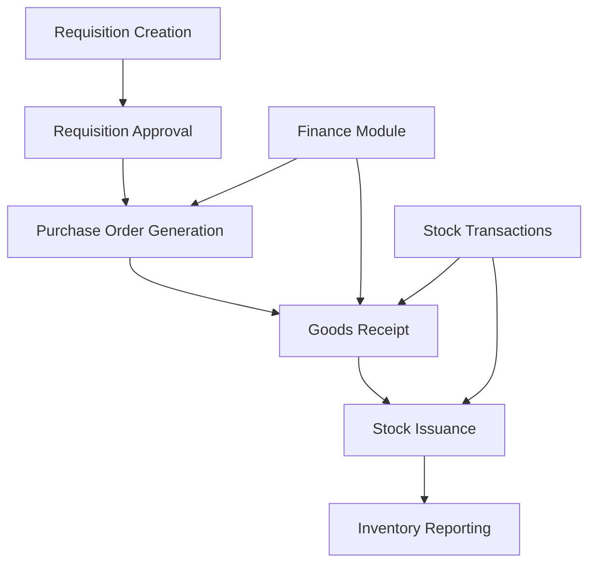
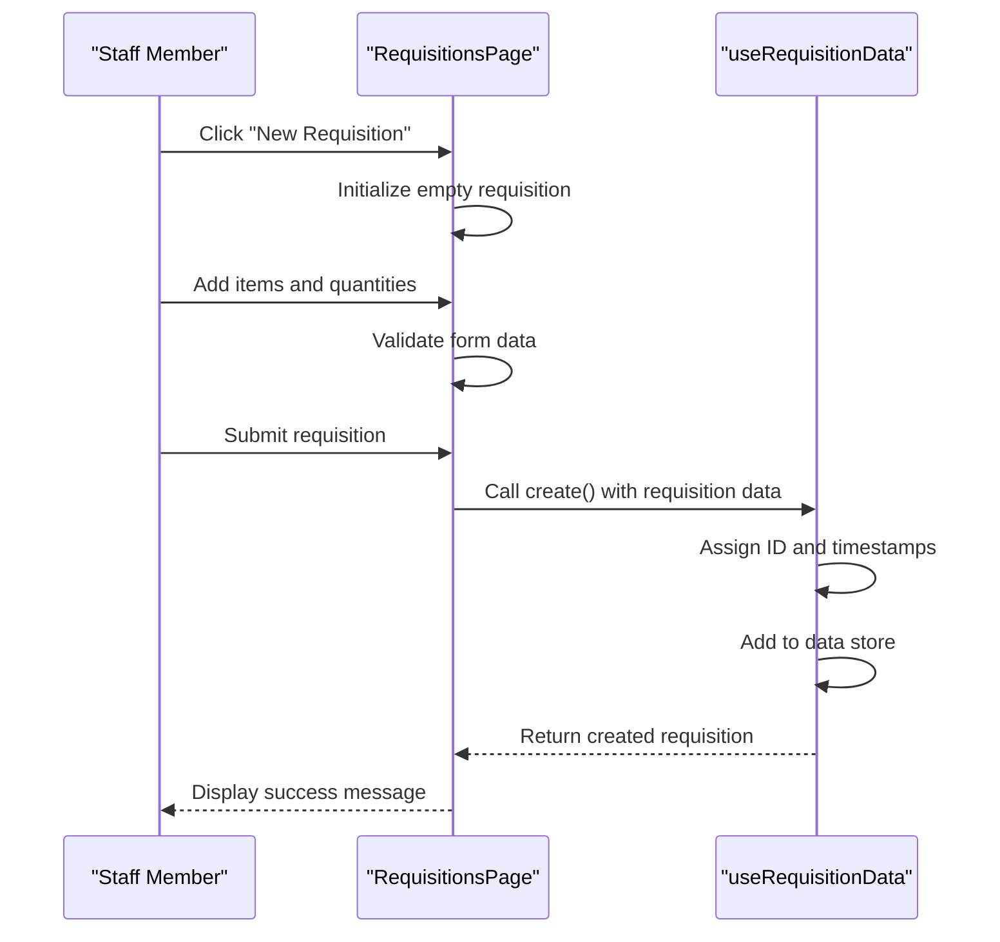
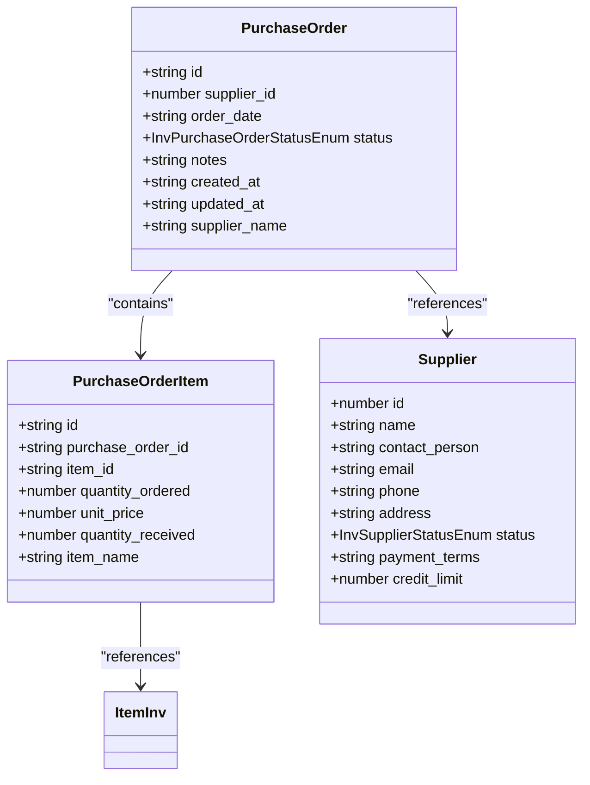
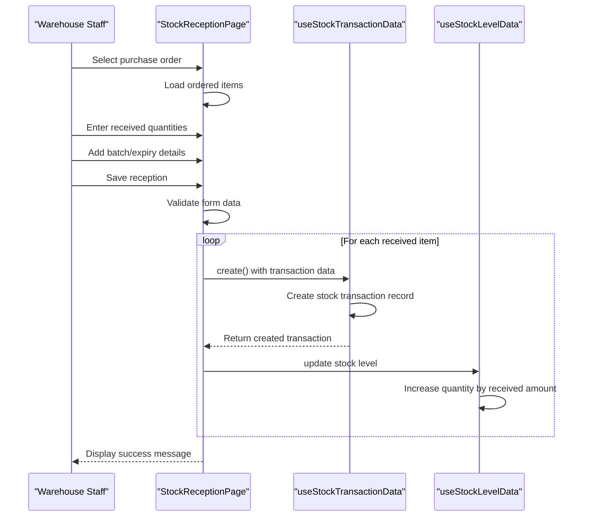
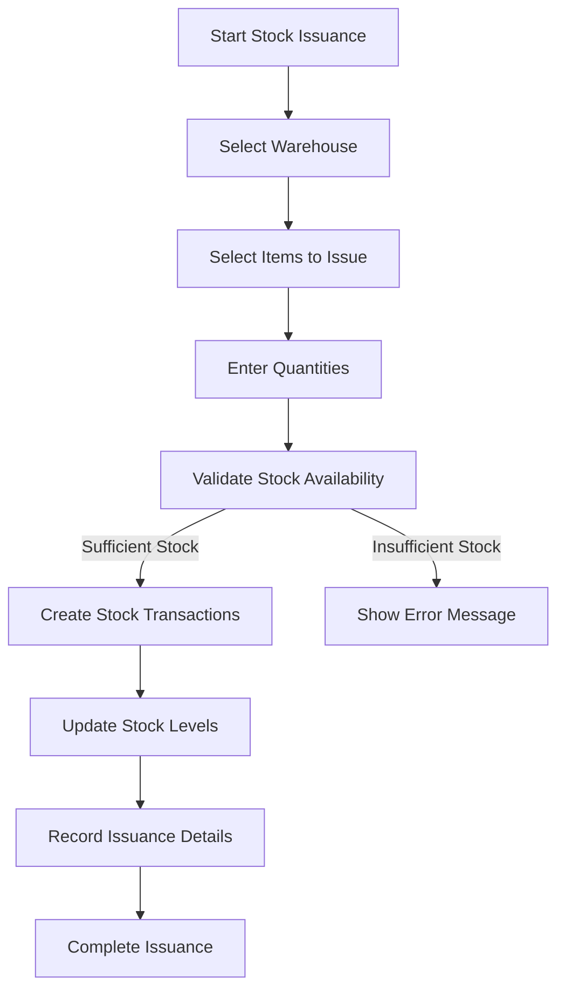
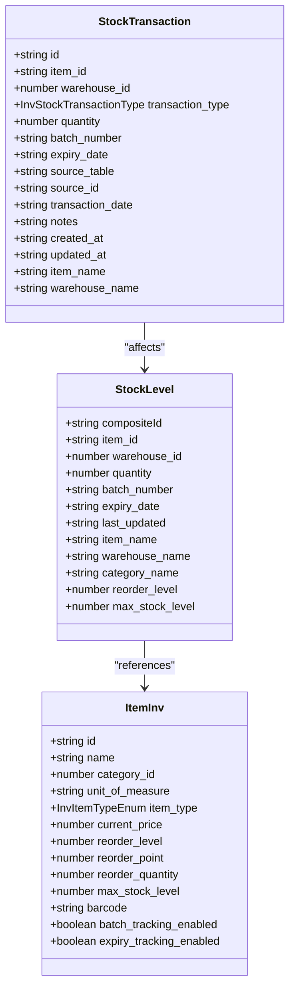
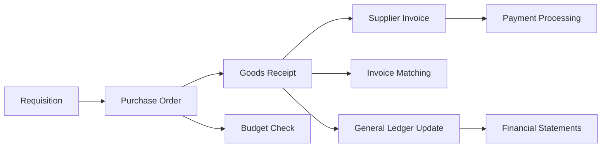
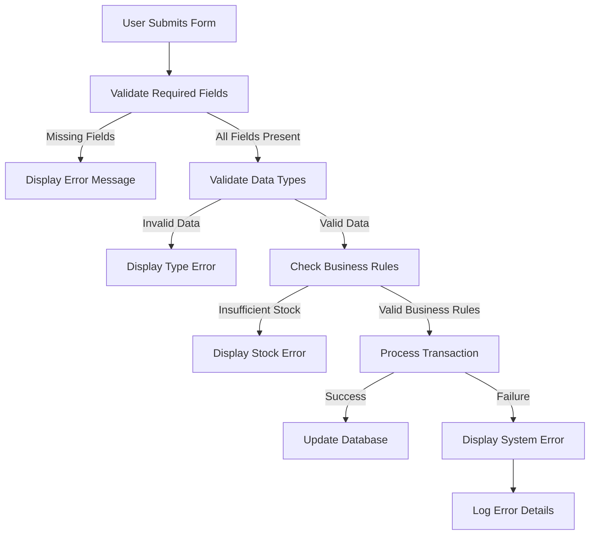
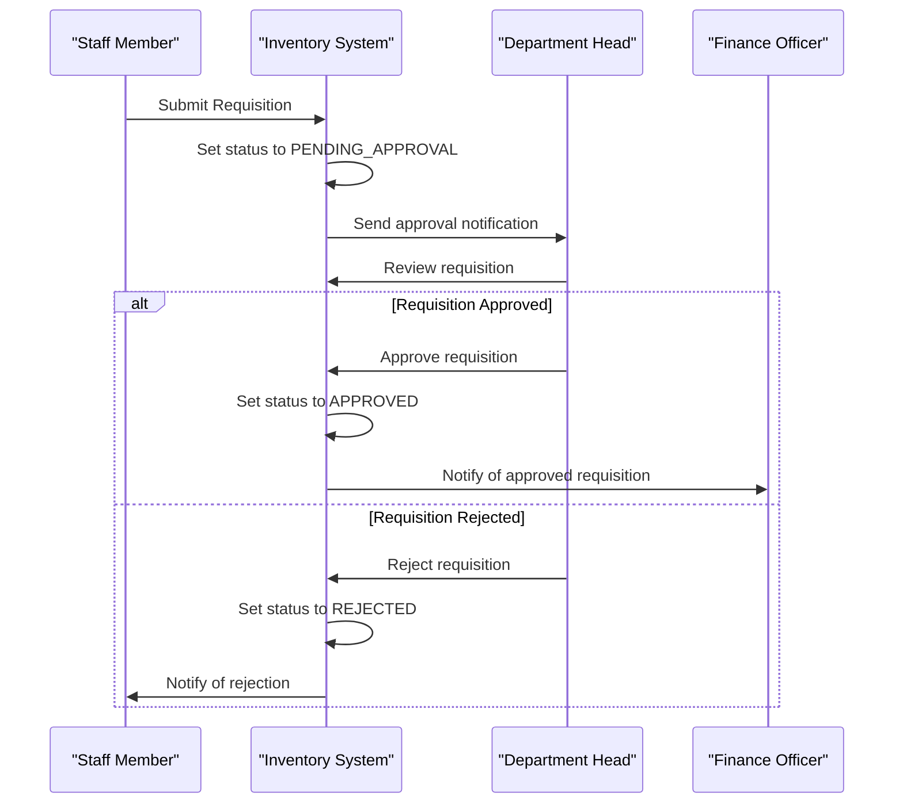
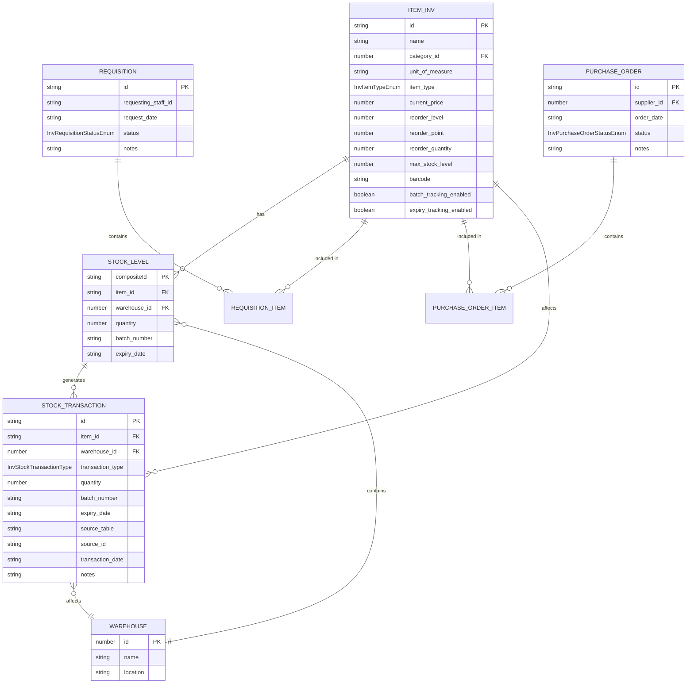

# Inventory Operational Workflows

<cite>
**Referenced Files in This Document**   
- [RequisitionsPage.tsx](file://src/modules/inventory/pages/RequisitionsPage.tsx)
- [PurchaseOrdersPage.tsx](file://src/modules/inventory/pages/PurchaseOrdersPage.tsx)
- [StockReceptionPage.tsx](file://src/modules/inventory/pages/StockReceptionPage.tsx)
- [StockIssuancePage.tsx](file://src/modules/inventory/pages/StockIssuancePage.tsx)
- [types.ts](file://src/modules/inventory/data/types.ts)
- [useRequisitionData.ts](file://src/modules/inventory/data/useRequisitionData.ts)
- [usePurchaseOrderData.ts](file://src/modules/inventory/data/usePurchaseOrderData.ts)
- [useStockTransactionData.ts](file://src/modules/inventory/data/useStockTransactionData.ts)
- [useStockLevelData.ts](file://src/modules/inventory/data/useStockLevelData.ts)
- [mockData.ts](file://src/modules/inventory/data/mockData.ts)
- [schema.ts](file://src/modules/inventory/data/schema.ts)
</cite>

## Table of Contents
1. [Introduction](#introduction)
2. [Core Inventory Workflows Overview](#core-inventory-workflows-overview)
3. [Requisition Management](#requisition-management)
4. [Purchase Order Processing](#purchase-order-processing)
5. [Goods Receipt and Stock Reception](#goods-receipt-and-stock-reception)
6. [Stock Issuance and Distribution](#stock-issuance-and-distribution)
7. [Stock Transaction Lifecycle](#stock-transaction-lifecycle)
8. [Integration with Finance Module](#integration-with-finance-module)
9. [Error Handling and Validation](#error-handling-and-validation)
10. [Workflow Automation and Approval Chains](#workflow-automation-and-approval-chains)
11. [Data Models and Schemas](#data-models-and-schemas)

## Introduction
This document provides a comprehensive overview of the inventory operational workflows in schoolpilot3, focusing on the end-to-end procurement process from requisition creation to stock issuance. The system is designed to manage school inventory efficiently, tracking items across multiple warehouses and ensuring proper authorization and financial controls. The workflows are implemented through a series of interconnected pages and data services that maintain data integrity and provide a user-friendly interface for staff managing inventory operations.

## Core Inventory Workflows Overview
The inventory management system in schoolpilot3 follows a structured procurement workflow that begins with requisition creation and ends with stock issuance. The process involves multiple stages: requisition, purchase order generation, goods receipt, and stock issuance. Each stage is managed through dedicated UI components that guide users through the necessary steps while enforcing validation rules and business logic. The system maintains a complete audit trail of all inventory movements through stock transaction records, which capture every change to inventory levels.

**Diagram sources**
- [RequisitionsPage.tsx](file://src/modules/inventory/pages/RequisitionsPage.tsx)
- [PurchaseOrdersPage.tsx](file://src/modules/inventory/pages/PurchaseOrdersPage.tsx)
- [StockReceptionPage.tsx](file://src/modules/inventory/pages/StockReceptionPage.tsx)
- [StockIssuancePage.tsx](file://src/modules/inventory/pages/StockIssuancePage.tsx)

## Requisition Management
The requisition management workflow begins with the creation of a new requisition through the RequisitionsPage interface. Users can create requisitions for inventory items needed by their department, specifying the items, quantities, and purpose. The system supports multiple requisition statuses including PENDING_APPROVAL, APPROVED, REJECTED, ORDERED, FULFILLED, and CANCELLED.

The RequisitionsPage provides a form interface where users can add multiple items to a single requisition. Each requisition item includes fields for item selection, quantity requested, and optional notes. The form validates that all required fields are completed before submission. When a requisition is submitted, it enters a PENDING_APPROVAL state, requiring authorization from a designated approver before it can proceed to the purchase order stage.

**Diagram sources**
- [RequisitionsPage.tsx](file://src/modules/inventory/pages/RequisitionsPage.tsx)
- [useRequisitionData.ts](file://src/modules/inventory/data/useRequisitionData.ts)

**Section sources**
- [RequisitionsPage.tsx](file://src/modules/inventory/pages/RequisitionsPage.tsx)
- [useRequisitionData.ts](file://src/modules/inventory/data/useRequisitionData.ts)
- [types.ts](file://src/modules/inventory/data/types.ts)

## Purchase Order Processing
The purchase order processing workflow begins when an approved requisition is converted into a purchase order. The PurchaseOrdersPage interface allows authorized users to create purchase orders based on approved requisitions or directly for urgent needs. Purchase orders contain information about the supplier, ordered items, quantities, unit prices, and delivery details.

The system supports multiple purchase order statuses including DRAFT, PENDING_APPROVAL, APPROVED, SENT_TO_SUPPLIER, PARTIALLY_RECEIVED, FULLY_RECEIVED, INVOICED, and CANCELLED. When creating a purchase order, users can select a supplier from the supplier database and add items with their corresponding quantities and prices. The interface calculates the total order value and displays it to the user for verification.

Purchase orders serve as the official document sent to suppliers and are linked to the finance module for budget checking and invoice matching. When a purchase order is approved, it can be sent to the supplier, initiating the procurement process. The system tracks the status of each purchase order and updates it as goods are received.

**Diagram sources**
- [types.ts](file://src/modules/inventory/data/types.ts)
- [schema.ts](file://src/modules/inventory/data/schema.ts)

**Section sources**
- [PurchaseOrdersPage.tsx](file://src/modules/inventory/pages/PurchaseOrdersPage.tsx)
- [usePurchaseOrderData.ts](file://src/modules/inventory/data/usePurchaseOrderData.ts)
- [types.ts](file://src/modules/inventory/data/types.ts)

## Goods Receipt and Stock Reception
The goods receipt process is managed through the StockReceptionPage interface, which allows users to record the receipt of goods against purchase orders. When goods arrive from a supplier, warehouse staff use this page to verify the delivered items against the purchase order and update inventory levels accordingly.

The StockReceptionPage provides a form where users can select a purchase order and view the items that were ordered. For each item, the user enters the actual quantity received, batch number (if applicable), expiry date (for perishable items), and warehouse location. The system validates that all required fields are completed and that quantities are positive values.

When processing goods receipt, the system creates stock transaction records for each received item, with a transaction type of RECEIPT. These transactions increase the stock levels in the designated warehouse. The system also updates the quantity_received field in the purchase order items to reflect the received quantities, allowing for partial receipts when not all ordered items are delivered at once.

**Diagram sources**
- [StockReceptionPage.tsx](file://src/modules/inventory/pages/StockReceptionPage.tsx)
- [useStockTransactionData.ts](file://src/modules/inventory/data/useStockTransactionData.ts)
- [useStockLevelData.ts](file://src/modules/inventory/data/useStockLevelData.ts)

**Section sources**
- [StockReceptionPage.tsx](file://src/modules/inventory/pages/StockReceptionPage.tsx)
- [useStockTransactionData.ts](file://src/modules/inventory/data/useStockTransactionData.ts)
- [useStockLevelData.ts](file://src/modules/inventory/data/useStockLevelData.ts)

## Stock Issuance and Distribution
The stock issuance workflow allows authorized users to issue inventory items from warehouses to departments or individuals. The StockIssuancePage interface provides a form for recording stock issues, specifying the items, quantities, destination, and purpose of the issuance.

When issuing stock, users select the warehouse from which items are being issued and choose the items to be distributed. For each item, they specify the quantity being issued and can add notes about the issuance. The system validates that sufficient stock is available before allowing the issuance to proceed.

The stock issuance process creates stock transaction records with a transaction type of ISSUE. These transactions decrease the stock levels in the source warehouse. The system maintains a complete record of all stock movements, which can be used for auditing and inventory reconciliation. The interface also supports batch and expiry date tracking for items that require such management.

**Diagram sources**
- [StockIssuancePage.tsx](file://src/modules/inventory/pages/StockIssuancePage.tsx)
- [useStockTransactionData.ts](file://src/modules/inventory/data/useStockTransactionData.ts)

**Section sources**
- [StockIssuancePage.tsx](file://src/modules/inventory/pages/StockIssuancePage.tsx)
- [useStockTransactionData.ts](file://src/modules/inventory/data/useStockTransactionData.ts)

## Stock Transaction Lifecycle
The stock transaction lifecycle is central to inventory management in schoolpilot3, providing a complete audit trail of all inventory movements. Stock transactions are created for every change to inventory levels, including receipts, issues, returns, and adjustments. Each transaction is recorded in the stock_transaction collection with detailed information about the movement.

The stockTransactionSchema defines the structure of stock transaction records, including fields for item_id, warehouse_id, transaction_type, quantity, batch_number, expiry_date, source_table, source_id, transaction_date, and notes. The transaction_type field uses the InvStockTransactionType enum, which includes values such as RECEIPT, ISSUE, RETURN_TO_STORE, RETURN_TO_SUPPLIER, and STOCK_ADJUSTMENT.

When a stock transaction is created, it automatically updates the corresponding stock level record. For receipt transactions, the quantity is added to the stock level; for issue transactions, the quantity is subtracted. The system maintains denormalized data in stock level records, including item_name, warehouse_name, and category_name, to optimize query performance and reduce the need for joins.

Stock transactions serve as the foundation for inventory reporting and reconciliation. The system can generate reports showing all transactions for a specific item, warehouse, or time period. These reports help identify trends, detect anomalies, and ensure inventory accuracy.

**Diagram sources**
- [schema.ts](file://src/modules/inventory/data/schema.ts)
- [types.ts](file://src/modules/inventory/data/types.ts)

**Section sources**
- [useStockTransactionData.ts](file://src/modules/inventory/data/useStockTransactionData.ts)
- [schema.ts](file://src/modules/inventory/data/schema.ts)
- [mockData.ts](file://src/modules/inventory/data/mockData.ts)

## Integration with Finance Module
The inventory system integrates closely with the finance module to ensure proper financial controls and accounting for all procurement activities. This integration occurs at multiple points in the procurement workflow, including budget checking during purchase order creation and invoice matching during goods receipt.

When creating a purchase order, the system can check against the school's budget to ensure that sufficient funds are available for the requested items. This budget checking functionality is implemented through integration with the finance module's chart of accounts and budget tracking features. The purchase order includes unit prices and total values that are used for financial reporting and cost analysis.

During goods receipt, the system supports invoice matching, where the received quantities and prices are compared against the supplier's invoice. This three-way matching process (purchase order, goods receipt, and supplier invoice) helps prevent overpayment and ensures that the school only pays for items actually received. The integration allows financial staff to reconcile inventory transactions with financial records, maintaining accurate accounting for inventory assets.

The finance module also handles the accounting for inventory items, tracking their value and depreciation (for fixed assets). When stock transactions occur, the system can update the general ledger with the corresponding financial entries, ensuring that inventory movements are reflected in the school's financial statements.

**Diagram sources**
- [PurchaseOrdersPage.tsx](file://src/modules/inventory/pages/PurchaseOrdersPage.tsx)
- [StockReceptionPage.tsx](file://src/modules/inventory/pages/StockReceptionPage.tsx)

**Section sources**
- [PurchaseOrdersPage.tsx](file://src/modules/inventory/pages/PurchaseOrdersPage.tsx)
- [StockReceptionPage.tsx](file://src/modules/inventory/pages/StockReceptionPage.tsx)

## Error Handling and Validation
The inventory system implements comprehensive error handling and validation to ensure data integrity and prevent common mistakes. Validation occurs at multiple levels, including form validation, business rule validation, and data consistency checks.

In the StockReceptionPage, form validation ensures that all required fields are completed before saving a reception record. The validation checks include verifying that items have valid item_id and warehouse_id values, that quantities are positive numbers, and that all items in the reception have been properly specified. If validation fails, the system displays an appropriate error message to guide the user in correcting the issues.

The system also handles quantity mismatches during goods reception, which occur when the quantity received differs from the quantity ordered. In such cases, the system allows partial receipts and updates the purchase order accordingly. The remaining quantity stays in a pending state until the rest of the order is received. This flexibility accommodates real-world scenarios where suppliers may deliver orders in multiple shipments.

For critical errors, such as database connectivity issues or data corruption, the system provides appropriate error messages and recovery options. The use of React error boundaries and proper exception handling ensures that the application remains stable even when unexpected errors occur.

**Diagram sources**
- [StockReceptionPage.tsx](file://src/modules/inventory/pages/StockReceptionPage.tsx)
- [useStockTransactionData.ts](file://src/modules/inventory/data/useStockTransactionData.ts)

**Section sources**
- [StockReceptionPage.tsx](file://src/modules/inventory/pages/StockReceptionPage.tsx)
- [useStockTransactionData.ts](file://src/modules/inventory/data/useStockTransactionData.ts)

## Workflow Automation and Approval Chains
The inventory system implements workflow automation and approval chains to ensure proper authorization and streamline procurement processes. These workflows are configured through the module settings and can be customized based on the school's policies and organizational structure.

Requisition approvals follow a defined chain where requisitions are routed to appropriate approvers based on the value of the request or the department making the request. The system tracks the approval status and notifies relevant staff when action is required. This automated workflow reduces delays and ensures that all purchases are properly authorized.

Purchase order approvals follow a similar pattern, with different approval thresholds based on the total order value. High-value orders may require multiple levels of approval, while low-value orders might be automatically approved based on predefined rules. The system maintains a complete audit trail of all approval actions, including who approved the request and when.

The system also supports automated reorder alerts based on inventory levels. When stock falls below the reorder_point for an item, the system can automatically generate a requisition or notify the inventory manager. This proactive approach helps prevent stockouts and ensures that essential items are always available.

**Diagram sources**
- [RequisitionsPage.tsx](file://src/modules/inventory/pages/RequisitionsPage.tsx)
- [moduleDefinition.tsx](file://src/modules/inventory/moduleDefinition.tsx)

**Section sources**
- [RequisitionsPage.tsx](file://src/modules/inventory/pages/RequisitionsPage.tsx)
- [moduleDefinition.tsx](file://src/modules/inventory/moduleDefinition.tsx)

## Data Models and Schemas
The inventory system is built on a well-defined data model that captures all aspects of inventory management. The core entities include items, warehouses, requisitions, purchase orders, stock levels, and stock transactions. These entities are defined in the inventory module's schema.ts file using a database-agnostic schema definition.

The ItemInv entity represents inventory items and includes properties such as name, category_id, unit_of_measure, item_type, current_price, and reorder levels. The item_type can be either CONSUMABLE or FIXED_ASSET, allowing the system to manage both consumable supplies and durable equipment.

Warehouses are represented by the warehouseSchema, which includes fields for name and location. Each warehouse can store multiple items, and stock levels are tracked separately for each item-warehouse combination.

The stock_transaction schema is central to the inventory system, capturing every movement of inventory. It includes fields for the source of the transaction (source_table and source_id), allowing the system to trace each stock movement back to its origin (requisition, purchase order, etc.).

The data model also supports advanced inventory features such as batch tracking, expiry date management, and barcode integration. These features are implemented through optional fields in the item and stock level schemas, allowing schools to use them when needed without complicating the interface for simpler use cases.

**Diagram sources**
- [schema.ts](file://src/modules/inventory/data/schema.ts)
- [types.ts](file://src/modules/inventory/data/types.ts)

**Section sources**
- [schema.ts](file://src/modules/inventory/data/schema.ts)
- [types.ts](file://src/modules/inventory/data/types.ts)
- [mockData.ts](file://src/modules/inventory/data/mockData.ts)