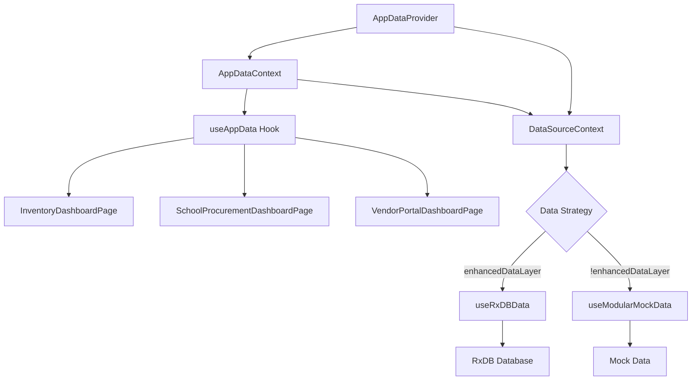
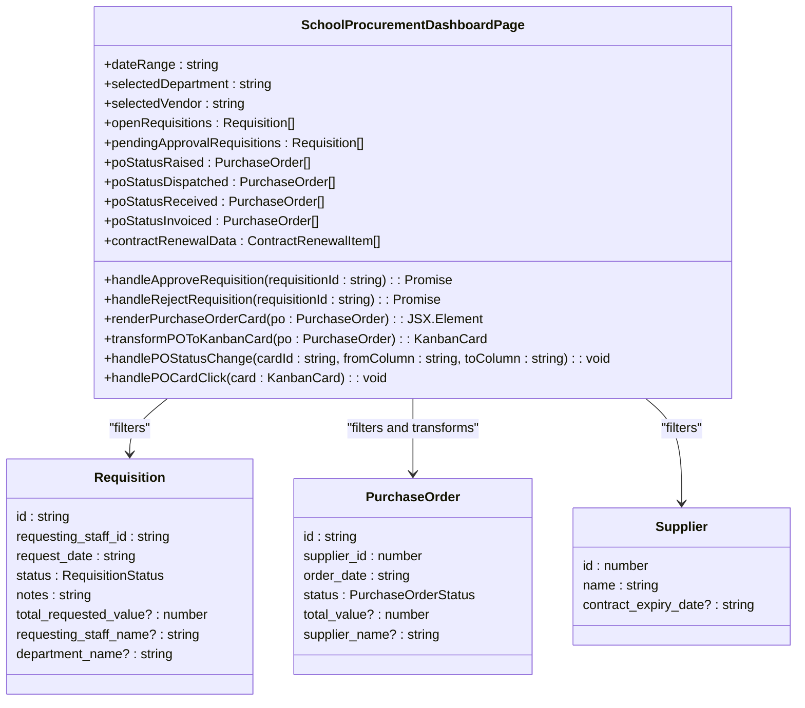
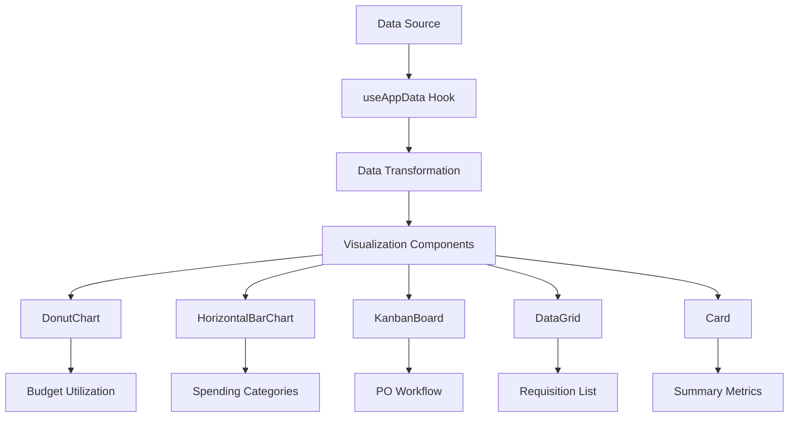

# Inventory UI Components

<cite>
**Referenced Files in This Document**   
- [InventoryDashboardPage.tsx](file://src/modules/inventory/pages/InventoryDashboardPage.tsx)
- [SchoolProcurementDashboardPage.tsx](file://src/modules/inventory/pages/SchoolProcurementDashboardPage.tsx)
- [VendorPortalDashboardPage.tsx](file://src/modules/inventory/pages/VendorPortalDashboardPage.tsx)
- [types.ts](file://src/modules/inventory/data/types.ts)
- [useAppData.ts](file://src/hooks/useAppData.ts)
- [AppDataContext.tsx](file://src/contexts/AppDataContext.tsx)
- [useRxDBData.ts](file://src/hooks/useRxDBData.ts)
- [useModularMockData.ts](file://src/hooks/useModularMockData.ts)
- [mockData.ts](file://src/modules/inventory/data/mockData.ts)
</cite>

## Table of Contents
1. [Introduction](#introduction)
2. [Data Architecture and State Management](#data-architecture-and-state-management)
3. [InventoryDashboardPage: Operational View](#inventorydashboardpage-operational-view)
4. [SchoolProcurementDashboardPage: Strategic View](#schoolprocurementdashboardpage-strategic-view)
5. [VendorPortalDashboardPage: External Supplier View](#vendorportaldashboardpage-external-supplier-view)
6. [Data Visualization and UI Components](#data-visualization-and-ui-components)
7. [Responsive Design and Accessibility](#responsive-design-and-accessibility)

## Introduction
The Inventory module in schoolpilot3 provides a comprehensive suite of dashboard components designed for different user roles within the school's inventory and procurement ecosystem. These dashboards offer real-time insights into inventory levels, procurement workflows, and supplier interactions. The system is built with a modular architecture that supports both real database (RxDB) and mock data modes, ensuring flexibility for development, testing, and production environments. This document details the three primary dashboard components: the operational Inventory Dashboard, the strategic School Procurement Dashboard, and the external-facing Vendor Portal Dashboard.

## Data Architecture and State Management

The inventory dashboards rely on a sophisticated data architecture that abstracts data sources through a context-based system. The primary mechanism for data access is the `useAppData` hook, which provides a unified interface to inventory data regardless of the underlying source.



**Diagram sources**
- [AppDataContext.tsx](file://src/contexts/AppDataContext.tsx#L1-L169)
- [useAppData.ts](file://src/hooks/useAppData.ts#L1-L21)

**Section sources**
- [AppDataContext.tsx](file://src/contexts/AppDataContext.tsx#L1-L169)
- [useAppData.ts](file://src/hooks/useAppData.ts#L1-L21)
- [useRxDBData.ts](file://src/hooks/useRxDBData.ts#L1-L306)
- [useModularMockData.ts](file://src/hooks/useModularMockData.ts#L1-L260)

### Data Flow and Context System
The application uses React's Context API to provide a global data state. The `AppDataProvider` wraps the application and determines the data source based on the `enhancedDataLayer` feature flag in the unified configuration. When enabled, it uses RxDB for real-time database access; otherwise, it falls back to modular mock data.

The `useAppData` hook is the primary interface for components to access inventory data. It returns an object containing all inventory-related data collections such as requisitions, purchase orders, suppliers, and stock levels, along with loading states and CRUD operations.

### Data Models
The inventory module defines comprehensive TypeScript interfaces for all entities. Key data models include:

- **Requisition**: Represents a request for items, with status tracking through `InvRequisitionStatusEnum`
- **PurchaseOrder**: Tracks procurement orders with detailed status through `InvPurchaseOrderStatusEnum`
- **Supplier**: Contains supplier information and performance metrics
- **StockLevel**: Tracks inventory quantities across multiple warehouses
- **Item**: Defines inventory items with pricing, categorization, and tracking parameters

These models are defined in `types.ts` and are used consistently across both the real database and mock data implementations.

## InventoryDashboardPage: Operational View

The `InventoryDashboardPage` serves as the primary operational view for inventory managers and storekeepers. It provides a high-level overview of the current inventory status and key performance indicators.

```tsx
const InventoryDashboardPage: React.FC = () => {
  return (
    <div className="space-y-6">
      <Card title="Inventory & Procurement Dashboard">
        <div className="text-center py-12">
          <ArchiveIcon className="w-16 h-16 text-blue-500 mx-auto mb-4" />
          <h2 className="text-2xl font-semibold text-gray-700 mb-2">Stores & Supplies Overview</h2>
          <p className="text-gray-500">
            Track school inventory, manage stock levels, handle requisitions, and streamline procurement processes.
          </p>
           <div className="mt-6">
            <span className="inline-block bg-sky-200 text-sky-800 text-sm font-semibold px-3 py-1 rounded-full">
              Key inventory metrics and summaries will appear here.
            </span>
          </div>
        </div>
      </Card>
    </div>
  );
};
```

Currently, this component displays a placeholder interface with a central message indicating where key inventory metrics will be displayed. The design suggests it will eventually show KPIs such as:

- **Stock Turnover Rate**: The rate at which inventory is consumed and replenished
- **Inventory Value**: Total monetary value of current stock
- **Pending Requisitions**: Number of requisition requests awaiting approval or fulfillment
- **Low Stock Alerts**: Items below their reorder threshold
- **Recent Stock Movements**: Summary of recent receipts and issues

The component uses the `Card` UI component to contain its content and includes an archive icon to visually represent inventory management. The placeholder text indicates that this dashboard will serve as a central hub for monitoring and managing all inventory and procurement activities.

**Section sources**
- [InventoryDashboardPage.tsx](file://src/modules/inventory/pages/InventoryDashboardPage.tsx#L1-L28)

## SchoolProcurementDashboardPage: Strategic View

The `SchoolProcurementDashboardPage` provides a strategic view for procurement managers and administrators, focusing on spending trends, supplier performance, and procurement workflow management.



**Diagram sources**
- [SchoolProcurementDashboardPage.tsx](file://src/modules/inventory/pages/SchoolProcurementDashboardPage.tsx#L1-L439)

**Section sources**
- [SchoolProcurementDashboardPage.tsx](file://src/modules/inventory/pages/SchoolProcurementDashboardPage.tsx#L1-L439)

### Key Features and Functionality
The procurement dashboard offers several key features for strategic oversight:

**1. Requisition Management**
The dashboard displays requisitions in a data grid with columns for requester, department, amount, and date. Procurement managers can approve or reject requisitions directly from the dashboard through confirmation dialogs that prevent accidental actions.

**2. Purchase Order Workflow Visualization**
A Kanban board visualizes the procurement workflow with columns representing different stages:
- **Raised**: Purchase orders in draft or pending approval
- **Dispatched**: Orders sent to suppliers
- **Received**: Orders partially or fully received
- **Invoiced**: Orders that have been invoiced

Each purchase order appears as a card that can be dragged between columns to update its status, providing an intuitive interface for tracking procurement progress.

**3. Financial Oversight**
The dashboard includes financial visualizations such as:
- A donut chart showing budget utilization (actual spend vs. remaining budget)
- A horizontal bar chart displaying top spending categories
- A metric showing savings achieved through procurement optimization

**4. Supplier Management**
A dedicated section highlights contracts due for renewal within the next 90 days, allowing proactive contract management. This helps prevent service interruptions and enables negotiation of better terms.

### Data Consumption and Filtering
The component consumes data from multiple sources through the `useAppData` hook:
- Requisitions for approval workflow management
- Purchase orders for tracking procurement status
- Suppliers for contract management

It implements client-side filtering based on date range, department, and vendor, allowing users to focus on specific subsets of data. The component also handles loading states, displaying a spinner when data is being fetched.

## VendorPortalDashboardPage: External Supplier View

The `VendorPortalDashboardPage` provides an external-facing interface for suppliers to manage their interactions with the school. This dashboard enables suppliers to track order status, manage deliveries, and communicate with the procurement team.

While the specific implementation details of this component are not available in the provided context, its purpose can be inferred from the naming convention and the overall system architecture. Based on standard procurement system patterns, this dashboard likely includes:

- **Order Status Tracking**: A list of purchase orders from the school, showing their current status (pending, dispatched, received, invoiced)
- **Delivery Scheduling**: Tools for suppliers to schedule deliveries and provide tracking information
- **Invoice Management**: Interface for submitting invoices and tracking payment status
- **Communication Portal**: Messaging system for clarifying order details or reporting issues
- **Performance Metrics**: Supplier performance ratings and feedback from the school

The component would consume data filtered specifically for the authenticated supplier, showing only their purchase orders and related information. It would likely use the same underlying data models as the internal dashboards but present a simplified, supplier-focused interface.

**Section sources**
- [VendorPortalDashboardPage.tsx](file://src/modules/inventory/pages/VendorPortalDashboardPage.tsx)

## Data Visualization and UI Components

The inventory dashboards leverage a rich set of UI components to present data effectively and enable user interaction.



**Diagram sources**
- [SchoolProcurementDashboardPage.tsx](file://src/modules/inventory/pages/SchoolProcurementDashboardPage.tsx#L1-L439)

**Section sources**
- [SchoolProcurementDashboardPage.tsx](file://src/modules/inventory/pages/SchoolProcurementDashboardPage.tsx#L1-L439)

### Key Visualization Components
The dashboards employ several specialized components for data presentation:

**1. DonutChart**
Used to display proportional data such as budget utilization. The chart shows the relationship between actual spending and the remaining budget, providing an immediate visual indication of financial status.

**2. HorizontalBarChart**
Displays comparative data across categories, such as top spending categories. This visualization allows quick identification of major expenditure areas.

**3. KanbanBoard**
Implements a workflow management system for purchase orders. The board uses drag-and-drop functionality to update order status, providing an intuitive interface that mirrors physical kanban systems.

**4. DataGrid**
Presents tabular data with advanced features including sorting, filtering, and custom rendering. The requisition approval grid includes action buttons for approving or rejecting requests.

**5. Card Components**
Used for presenting summary information and individual purchase order details. Cards provide a consistent visual container for related information.

### Data Transformation
The dashboards implement data transformation logic to convert raw data into visualization-ready formats. For example, the `transformPOToKanbanCard` function converts a `PurchaseOrder` object into a `KanbanCard` interface, extracting relevant fields and adding metadata like priority based on order value.

## Responsive Design and Accessibility

The inventory dashboards are designed with responsive layouts and accessibility features to ensure usability across devices and for all users.

### Responsive Layout
The `SchoolProcurementDashboardPage` implements a responsive header that adapts to screen size:
- On larger screens: Date range, department, and vendor filters appear horizontally
- On smaller screens: Filters wrap to multiple lines with appropriate spacing

The layout uses Tailwind CSS classes like `sm:flex-row` and `sm:items-center` to control the responsive behavior, ensuring the interface remains usable on mobile devices.

### Accessibility Features
The components incorporate several accessibility features:

**1. Semantic HTML**
The use of proper heading hierarchy (`h1` for page title) and semantic elements ensures screen readers can navigate the content effectively.

**2. ARIA Labels and Roles**
UI components like buttons and interactive elements include appropriate ARIA attributes to convey their purpose to assistive technologies.

**3. Keyboard Navigation**
Interactive elements such as buttons in the requisition grid are focusable and operable via keyboard, supporting users who cannot use a mouse.

**4. Color Contrast**
The design uses high-contrast colors (e.g., green for approve buttons, red for reject buttons) that meet WCAG guidelines for color contrast.

**5. Loading States**
The dashboard handles loading states gracefully, displaying a spinner during data fetch operations to inform users that content is being loaded.

**6. Confirmation Dialogs**
Destructive actions like rejecting requisitions require user confirmation, preventing accidental data changes.

These accessibility features ensure that the inventory dashboards can be used effectively by all staff members, regardless of their abilities or the devices they use.

**Section sources**
- [SchoolProcurementDashboardPage.tsx](file://src/modules/inventory/pages/SchoolProcurementDashboardPage.tsx#L1-L439)
- [InventoryDashboardPage.tsx](file://src/modules/inventory/pages/InventoryDashboardPage.tsx#L1-L28)