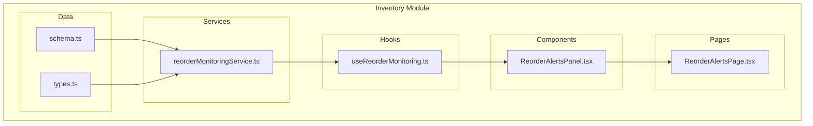
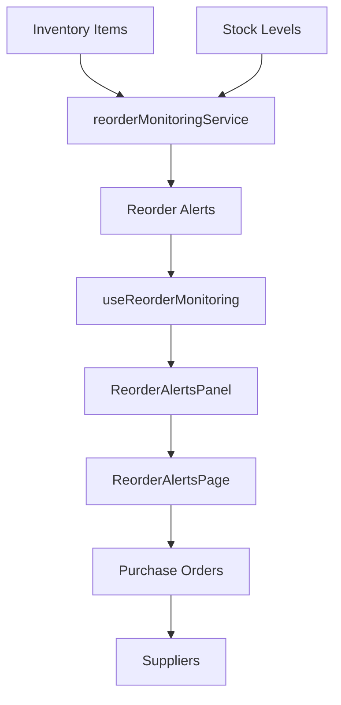
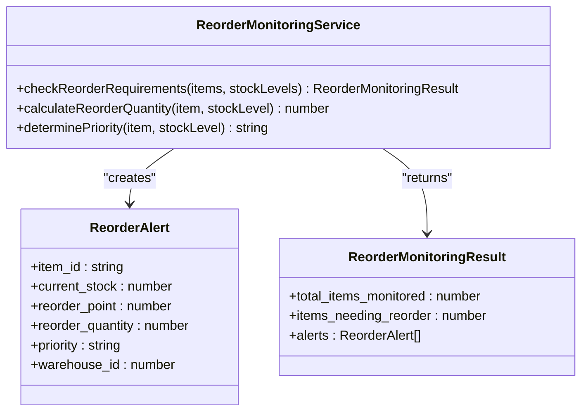
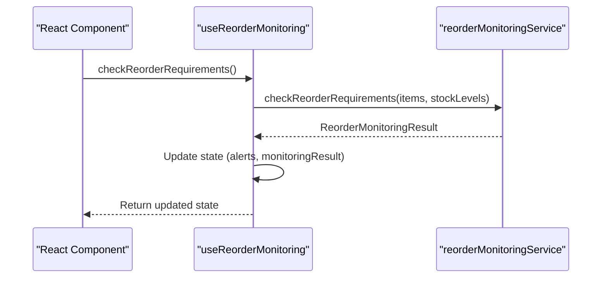
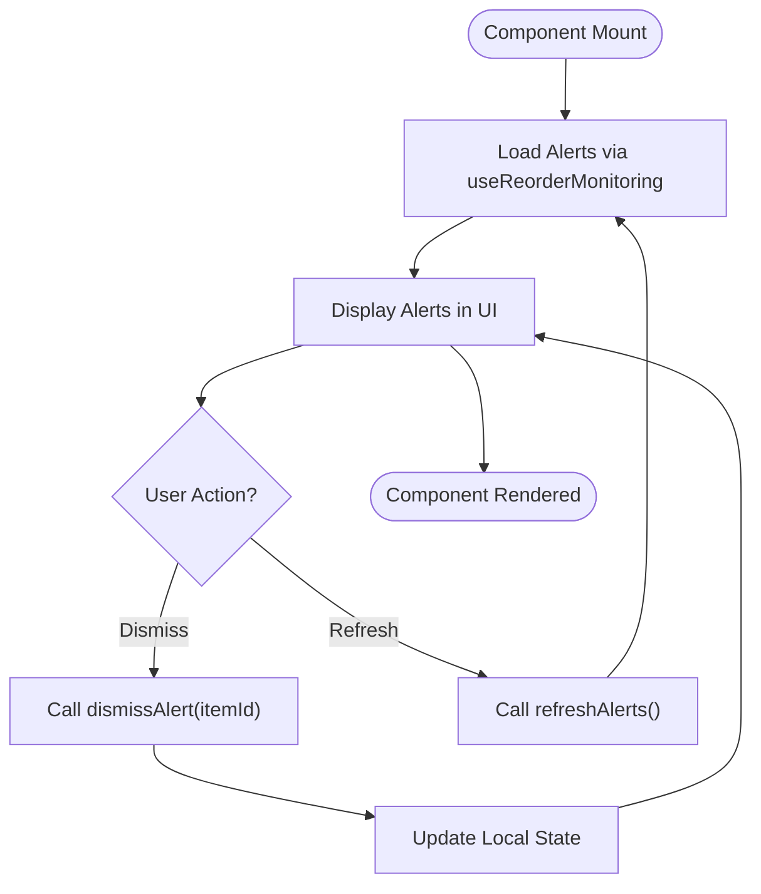
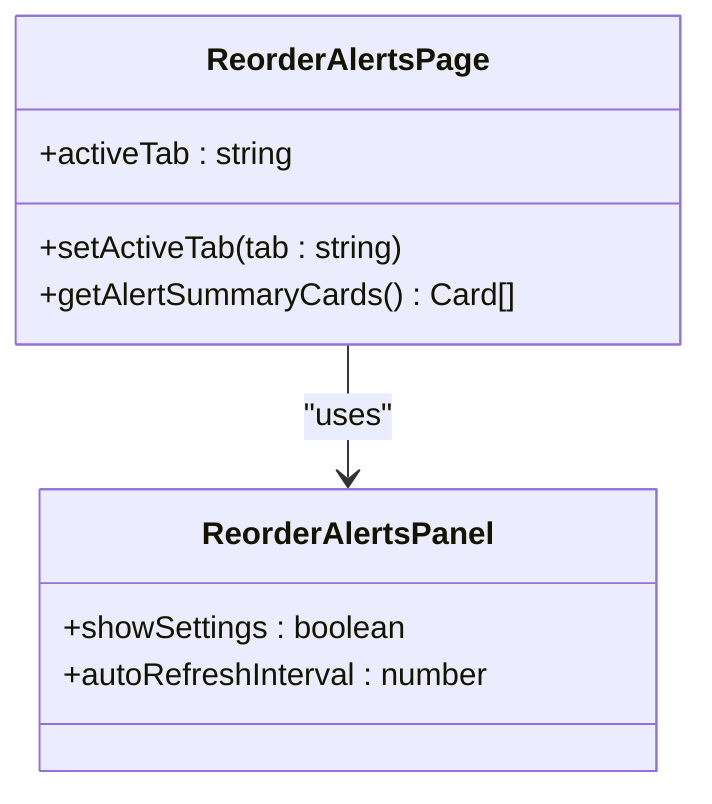
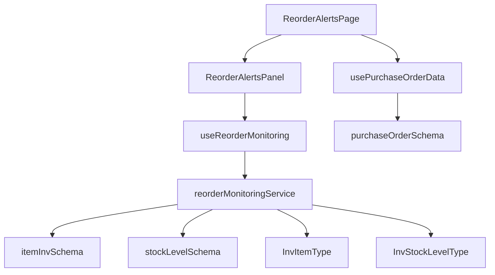

# Reorder Automation System

<cite>
**Referenced Files in This Document**   
- [reorderMonitoringService.ts](file://src/modules/inventory/services/reorderMonitoringService.ts)
- [useReorderMonitoring.ts](file://src/modules/inventory/hooks/useReorderMonitoring.ts)
- [ReorderAlertsPanel.tsx](file://src/modules/inventory/components/ReorderAlertsPanel.tsx)
- [ReorderAlertsPage.tsx](file://src/modules/inventory/pages/ReorderAlertsPage.tsx)
- [schema.ts](file://src/modules/inventory/data/schema.ts)
- [types.ts](file://src/modules/inventory/data/types.ts)
- [usePurchaseOrderData.ts](file://src/modules/inventory/data/usePurchaseOrderData.ts)
</cite>

## Table of Contents
1. [Introduction](#introduction)
2. [Project Structure](#project-structure)
3. [Core Components](#core-components)
4. [Architecture Overview](#architecture-overview)
5. [Detailed Component Analysis](#detailed-component-analysis)
6. [Dependency Analysis](#dependency-analysis)
7. [Performance Considerations](#performance-considerations)
8. [Troubleshooting Guide](#troubleshooting-guide)
9. [Conclusion](#conclusion)

## Introduction
The Reorder Automation System in schoolpilot3's Inventory module is designed to monitor inventory levels and automatically generate reorder recommendations based on predefined thresholds, consumption patterns, and lead times. This system helps prevent stockouts and overstocking by providing real-time alerts and facilitating bulk processing of reorder actions. The system integrates with purchase order creation to automate procurement initiation, ensuring timely replenishment of inventory items.

## Project Structure
The project structure for the reorder automation system is organized within the inventory module of the schoolpilot3 application. Key components are located in specific directories:
- **Services**: Contains the `reorderMonitoringService.ts` file, which implements the core logic for calculating reorder needs.
- **Hooks**: Includes the `useReorderMonitoring.ts` file, which provides real-time reorder status to React components.
- **Components**: Houses the `ReorderAlertsPanel.tsx` component for displaying pending reorder recommendations.
- **Pages**: Features the `ReorderAlertsPage.tsx` page for bulk processing of reorder alerts.
- **Data**: Stores schema definitions in `schema.ts` and type definitions in `types.ts`.

**Diagram sources**
- [reorderMonitoringService.ts](file://src/modules/inventory/services/reorderMonitoringService.ts)
- [useReorderMonitoring.ts](file://src/modules/inventory/hooks/useReorderMonitoring.ts)
- [ReorderAlertsPanel.tsx](file://src/modules/inventory/components/ReorderAlertsPanel.tsx)
- [ReorderAlertsPage.tsx](file://src/modules/inventory/pages/ReorderAlertsPage.tsx)
- [schema.ts](file://src/modules/inventory/data/schema.ts)
- [types.ts](file://src/modules/inventory/data/types.ts)

**Section sources**
- [reorderMonitoringService.ts](file://src/modules/inventory/services/reorderMonitoringService.ts)
- [useReorderMonitoring.ts](file://src/modules/inventory/hooks/useReorderMonitoring.ts)
- [ReorderAlertsPanel.tsx](file://src/modules/inventory/components/ReorderAlertsPanel.tsx)
- [ReorderAlertsPage.tsx](file://src/modules/inventory/pages/ReorderAlertsPage.tsx)
- [schema.ts](file://src/modules/inventory/data/schema.ts)
- [types.ts](file://src/modules/inventory/data/types.ts)

## Core Components
The core components of the Reorder Automation System include the `reorderMonitoringService.ts`, `useReorderMonitoring.ts`, `ReorderAlertsPanel.tsx`, and `ReorderAlertsPage.tsx` files. These components work together to monitor inventory levels, calculate reorder needs, and provide a user interface for managing reorder alerts.

**Section sources**
- [reorderMonitoringService.ts](file://src/modules/inventory/services/reorderMonitoringService.ts)
- [useReorderMonitoring.ts](file://src/modules/inventory/hooks/useReorderMonitoring.ts)
- [ReorderAlertsPanel.tsx](file://src/modules/inventory/components/ReorderAlertsPanel.tsx)
- [ReorderAlertsPage.tsx](file://src/modules/inventory/pages/ReorderAlertsPage.tsx)

## Architecture Overview
The architecture of the Reorder Automation System is designed to be modular and scalable. The system uses a service layer to encapsulate the business logic for reorder calculations, a hook layer to provide real-time data to React components, and a component layer to render the user interface. The system also integrates with the purchase order creation process to automate procurement initiation.

**Diagram sources**
- [reorderMonitoringService.ts](file://src/modules/inventory/services/reorderMonitoringService.ts)
- [useReorderMonitoring.ts](file://src/modules/inventory/hooks/useReorderMonitoring.ts)
- [ReorderAlertsPanel.tsx](file://src/modules/inventory/components/ReorderAlertsPanel.tsx)
- [ReorderAlertsPage.tsx](file://src/modules/inventory/pages/ReorderAlertsPage.tsx)
- [usePurchaseOrderData.ts](file://src/modules/inventory/data/usePurchaseOrderData.ts)

## Detailed Component Analysis

### Reorder Monitoring Service Analysis
The `reorderMonitoringService.ts` file contains the core logic for calculating reorder needs. It uses inventory item data and stock levels to determine when items need to be reordered based on predefined thresholds.

#### For Object-Oriented Components:

**Diagram sources**
- [reorderMonitoringService.ts](file://src/modules/inventory/services/reorderMonitoringService.ts)

**Section sources**
- [reorderMonitoringService.ts](file://src/modules/inventory/services/reorderMonitoringService.ts)

### Use Reorder Monitoring Hook Analysis
The `useReorderMonitoring.ts` file provides a React hook that manages the state and actions for reorder monitoring. It uses the `reorderMonitoringService` to check reorder requirements and provides real-time status to components.

#### For API/Service Components:

**Diagram sources**
- [useReorderMonitoring.ts](file://src/modules/inventory/hooks/useReorderMonitoring.ts)
- [reorderMonitoringService.ts](file://src/modules/inventory/services/reorderMonitoringService.ts)

**Section sources**
- [useReorderMonitoring.ts](file://src/modules/inventory/hooks/useReorderMonitoring.ts)

### Reorder Alerts Panel Analysis
The `ReorderAlertsPanel.tsx` component displays pending reorder recommendations. It uses the `useReorderMonitoring` hook to get the current alerts and provides a user interface for managing them.

#### For Complex Logic Components:

**Diagram sources**
- [ReorderAlertsPanel.tsx](file://src/modules/inventory/components/ReorderAlertsPanel.tsx)
- [useReorderMonitoring.ts](file://src/modules/inventory/hooks/useReorderMonitoring.ts)

**Section sources**
- [ReorderAlertsPanel.tsx](file://src/modules/inventory/components/ReorderAlertsPanel.tsx)

### Reorder Alerts Page Analysis
The `ReorderAlertsPage.tsx` page allows bulk processing of reorder alerts. It provides a tabbed interface for viewing alerts, analytics, and settings.

#### For Object-Oriented Components:

**Diagram sources**
- [ReorderAlertsPage.tsx](file://src/modules/inventory/pages/ReorderAlertsPage.tsx)
- [ReorderAlertsPanel.tsx](file://src/modules/inventory/components/ReorderAlertsPanel.tsx)

**Section sources**
- [ReorderAlertsPage.tsx](file://src/modules/inventory/pages/ReorderAlertsPage.tsx)

## Dependency Analysis
The Reorder Automation System has several dependencies that are crucial for its operation. The system relies on the inventory data schema and types to understand the structure of inventory items and stock levels. It also depends on the purchase order creation process to automate procurement initiation.

**Diagram sources**
- [reorderMonitoringService.ts](file://src/modules/inventory/services/reorderMonitoringService.ts)
- [schema.ts](file://src/modules/inventory/data/schema.ts)
- [types.ts](file://src/modules/inventory/data/types.ts)
- [useReorderMonitoring.ts](file://src/modules/inventory/hooks/useReorderMonitoring.ts)
- [ReorderAlertsPanel.tsx](file://src/modules/inventory/components/ReorderAlertsPanel.tsx)
- [ReorderAlertsPage.tsx](file://src/modules/inventory/pages/ReorderAlertsPage.tsx)
- [usePurchaseOrderData.ts](file://src/modules/inventory/data/usePurchaseOrderData.ts)

**Section sources**
- [reorderMonitoringService.ts](file://src/modules/inventory/services/reorderMonitoringService.ts)
- [schema.ts](file://src/modules/inventory/data/schema.ts)
- [types.ts](file://src/modules/inventory/data/types.ts)
- [useReorderMonitoring.ts](file://src/modules/inventory/hooks/useReorderMonitoring.ts)
- [ReorderAlertsPanel.tsx](file://src/modules/inventory/components/ReorderAlertsPanel.tsx)
- [ReorderAlertsPage.tsx](file://src/modules/inventory/pages/ReorderAlertsPage.tsx)
- [usePurchaseOrderData.ts](file://src/modules/inventory/data/usePurchaseOrderData.ts)

## Performance Considerations
The Reorder Automation System is designed to handle large inventory datasets efficiently. The system uses optimized queries to retrieve inventory items and stock levels, and it caches results to minimize database access. The `usePeriodicReorderMonitoring` hook allows for automatic checks at specified intervals, reducing the need for manual intervention.

**Section sources**
- [reorderMonitoringService.ts](file://src/modules/inventory/services/reorderMonitoringService.ts)
- [useReorderMonitoring.ts](file://src/modules/inventory/hooks/useReorderMonitoring.ts)

## Troubleshooting Guide
Common issues with the Reorder Automation System include incorrect reorder calculations, missing alerts, and integration failures with purchase order creation. To troubleshoot these issues, verify the inventory item data and stock levels, check the reorder thresholds and notification rules, and ensure that the purchase order creation process is properly configured.

**Section sources**
- [reorderMonitoringService.ts](file://src/modules/inventory/services/reorderMonitoringService.ts)
- [useReorderMonitoring.ts](file://src/modules/inventory/hooks/useReorderMonitoring.ts)
- [usePurchaseOrderData.ts](file://src/modules/inventory/data/usePurchaseOrderData.ts)

## Conclusion
The Reorder Automation System in schoolpilot3's Inventory module provides a comprehensive solution for monitoring inventory levels and generating reorder recommendations. By leveraging predefined thresholds, consumption patterns, and lead times, the system ensures timely replenishment of inventory items and prevents stockouts and overstocking. The system's modular architecture and integration with purchase order creation make it a robust and scalable solution for inventory management.