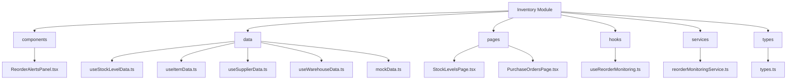
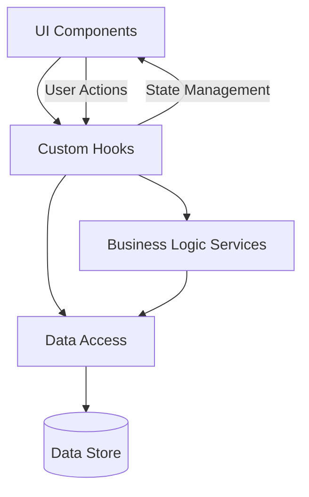
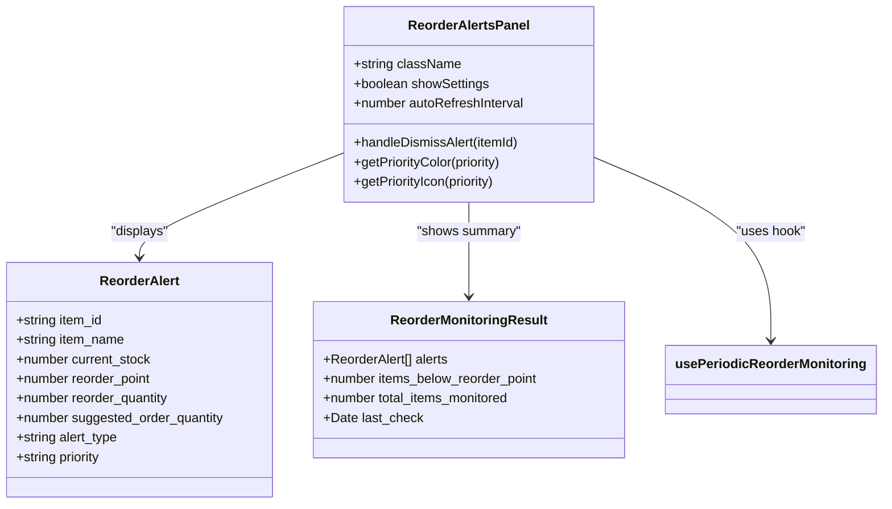
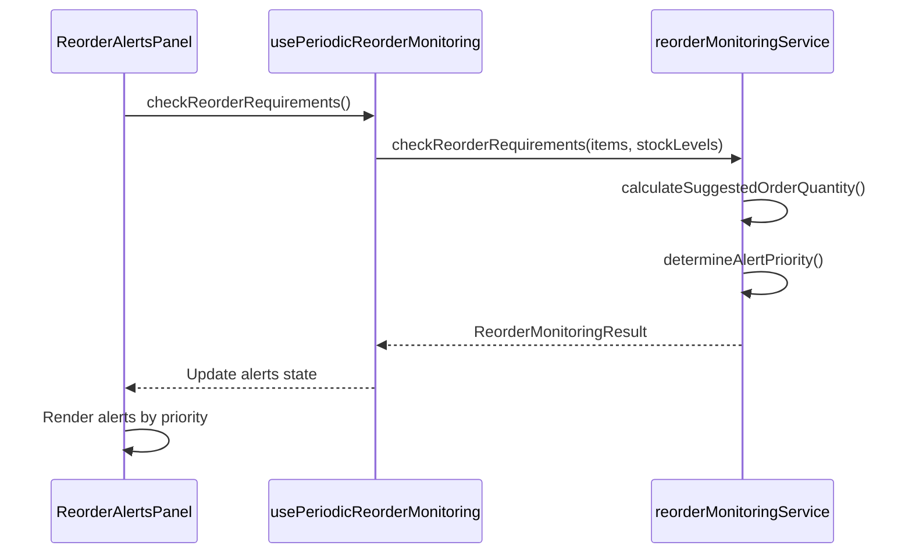
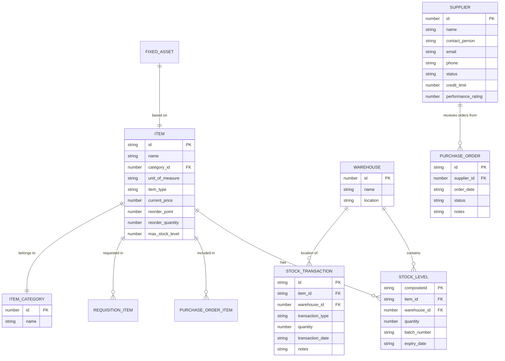
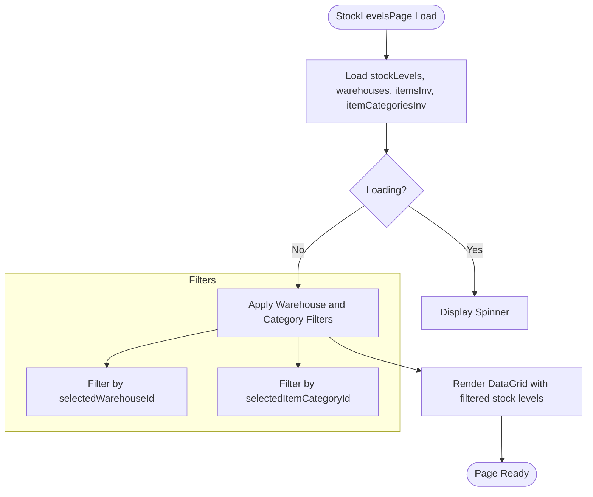
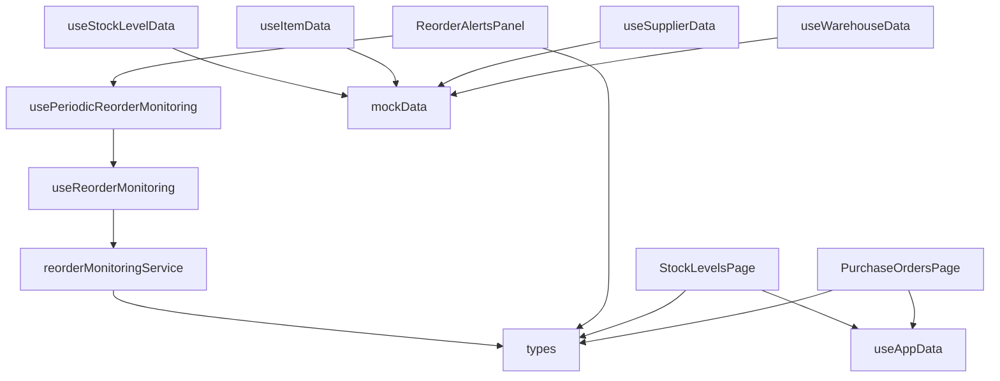

# Inventory Module

<cite>
**Referenced Files in This Document**   
- [ReorderAlertsPanel.tsx](file://src/modules/inventory/components/ReorderAlertsPanel.tsx)
- [useReorderMonitoring.ts](file://src/modules/inventory/hooks/useReorderMonitoring.ts)
- [reorderMonitoringService.ts](file://src/modules/inventory/services/reorderMonitoringService.ts)
- [useStockLevelData.ts](file://src/modules/inventory/data/useStockLevelData.ts)
- [useItemData.ts](file://src/modules/inventory/data/useItemData.ts)
- [usePurchaseOrderData.ts](file://src/modules/inventory/data/usePurchaseOrderData.ts)
- [useSupplierData.ts](file://src/modules/inventory/data/useSupplierData.ts)
- [useWarehouseData.ts](file://src/modules/inventory/data/useWarehouseData.ts)
- [mockData.ts](file://src/modules/inventory/data/mockData.ts)
- [types.ts](file://src/modules/inventory/data/types.ts)
- [StockLevelsPage.tsx](file://src/modules/inventory/pages/StockLevelsPage.tsx)
- [PurchaseOrdersPage.tsx](file://src/modules/inventory/pages/PurchaseOrdersPage.tsx)
</cite>

## Table of Contents
1. [Introduction](#introduction)
2. [Project Structure](#project-structure)
3. [Core Components](#core-components)
4. [Architecture Overview](#architecture-overview)
5. [Detailed Component Analysis](#detailed-component-analysis)
6. [Dependency Analysis](#dependency-analysis)
7. [Performance Considerations](#performance-considerations)
8. [Troubleshooting Guide](#troubleshooting-guide)
9. [Conclusion](#conclusion)

## Introduction
The Inventory Module in schoolpilot3 is a comprehensive system designed to manage school resources efficiently. It handles core inventory operations including stock management, purchase orders, and reorder monitoring. The module integrates with other systems such as Finance for purchase approvals and uses proactive alerting through the ReorderAlertsPanel for inventory optimization. This document provides a detailed analysis of the implementation, covering data models, core functionality, and best practices for inventory management.

## Project Structure
The Inventory module follows a feature-based organization within the src/modules/inventory directory. It contains separate folders for components, data management, hooks, pages, services, and types. The structure promotes separation of concerns with dedicated areas for UI components, business logic, data access, and type definitions. This organization enables maintainability and scalability of the inventory functionality.

**Diagram sources**
- [ReorderAlertsPanel.tsx](file://src/modules/inventory/components/ReorderAlertsPanel.tsx)
- [useStockLevelData.ts](file://src/modules/inventory/data/useStockLevelData.ts)
- [useItemData.ts](file://src/modules/inventory/data/useItemData.ts)
- [useSupplierData.ts](file://src/modules/inventory/data/useSupplierData.ts)
- [useWarehouseData.ts](file://src/modules/inventory/data/useWarehouseData.ts)
- [mockData.ts](file://src/modules/inventory/data/mockData.ts)
- [StockLevelsPage.tsx](file://src/modules/inventory/pages/StockLevelsPage.tsx)
- [PurchaseOrdersPage.tsx](file://src/modules/inventory/pages/PurchaseOrdersPage.tsx)
- [useReorderMonitoring.ts](file://src/modules/inventory/hooks/useReorderMonitoring.ts)
- [reorderMonitoringService.ts](file://src/modules/inventory/services/reorderMonitoringService.ts)
- [types.ts](file://src/modules/inventory/data/types.ts)

## Core Components
The Inventory module consists of several core components that work together to provide comprehensive inventory management capabilities. These include the ReorderAlertsPanel for proactive monitoring, StockLevelsPage for stock visibility, and PurchaseOrdersPage for procurement management. The module uses specialized hooks for data management and services for business logic implementation.

**Section sources**
- [ReorderAlertsPanel.tsx](file://src/modules/inventory/components/ReorderAlertsPanel.tsx)
- [StockLevelsPage.tsx](file://src/modules/inventory/pages/StockLevelsPage.tsx)
- [PurchaseOrdersPage.tsx](file://src/modules/inventory/pages/PurchaseOrdersPage.tsx)

## Architecture Overview
The Inventory module follows a layered architecture with clear separation between presentation, business logic, and data access layers. The UI components render data and handle user interactions, while custom hooks manage state and data retrieval. Services contain the core business logic, and type definitions ensure data consistency across the application.

**Diagram sources**
- [ReorderAlertsPanel.tsx](file://src/modules/inventory/components/ReorderAlertsPanel.tsx)
- [useReorderMonitoring.ts](file://src/modules/inventory/hooks/useReorderMonitoring.ts)
- [reorderMonitoringService.ts](file://src/modules/inventory/services/reorderMonitoringService.ts)
- [useStockLevelData.ts](file://src/modules/inventory/data/useStockLevelData.ts)

## Detailed Component Analysis

### Reorder Alert System Analysis
The ReorderAlertsPanel component provides a comprehensive interface for monitoring inventory levels and managing reorder requirements. It displays alerts based on stock levels compared to reorder points, with priority levels indicating urgency.

**Diagram sources**
- [ReorderAlertsPanel.tsx](file://src/modules/inventory/components/ReorderAlertsPanel.tsx)
- [reorderMonitoringService.ts](file://src/modules/inventory/services/reorderMonitoringService.ts)

**Section sources**
- [ReorderAlertsPanel.tsx](file://src/modules/inventory/components/ReorderAlertsPanel.tsx#L1-L471)

### Reorder Monitoring Logic
The reorder monitoring system consists of a service that calculates reorder requirements and a hook that manages the monitoring state. The system evaluates inventory levels against reorder points and generates appropriate alerts.

**Diagram sources**
- [useReorderMonitoring.ts](file://src/modules/inventory/hooks/useReorderMonitoring.ts#L1-L183)
- [reorderMonitoringService.ts](file://src/modules/inventory/services/reorderMonitoringService.ts#L1-L138)

**Section sources**
- [useReorderMonitoring.ts](file://src/modules/inventory/hooks/useReorderMonitoring.ts#L1-L183)
- [reorderMonitoringService.ts](file://src/modules/inventory/services/reorderMonitoringService.ts#L1-L138)

### Data Model Analysis
The inventory data model defines comprehensive types for all inventory entities, including items, warehouses, suppliers, and transactions. The model supports both consumable items and fixed assets with appropriate tracking capabilities.

**Diagram sources**
- [types.ts](file://src/modules/inventory/data/types.ts#L1-L298)

**Section sources**
- [types.ts](file://src/modules/inventory/data/types.ts#L1-L298)

### Stock Management Analysis
The StockLevelsPage component provides a user interface for viewing current stock levels across warehouses. It includes filtering capabilities by warehouse and item category, allowing users to focus on specific inventory segments.

**Diagram sources**
- [StockLevelsPage.tsx](file://src/modules/inventory/pages/StockLevelsPage.tsx#L1-L106)

**Section sources**
- [StockLevelsPage.tsx](file://src/modules/inventory/pages/StockLevelsPage.tsx#L1-L106)

## Dependency Analysis
The Inventory module has well-defined dependencies between its components. The UI components depend on hooks for data, which in turn depend on services for business logic. The data model is shared across all components, ensuring consistency.

**Diagram sources**
- [ReorderAlertsPanel.tsx](file://src/modules/inventory/components/ReorderAlertsPanel.tsx)
- [StockLevelsPage.tsx](file://src/modules/inventory/pages/StockLevelsPage.tsx)
- [PurchaseOrdersPage.tsx](file://src/modules/inventory/pages/PurchaseOrdersPage.tsx)
- [useReorderMonitoring.ts](file://src/modules/inventory/hooks/useReorderMonitoring.ts)
- [reorderMonitoringService.ts](file://src/modules/inventory/services/reorderMonitoringService.ts)
- [useStockLevelData.ts](file://src/modules/inventory/data/useStockLevelData.ts)
- [useItemData.ts](file://src/modules/inventory/data/useItemData.ts)
- [useSupplierData.ts](file://src/modules/inventory/data/useSupplierData.ts)
- [useWarehouseData.ts](file://src/modules/inventory/data/useWarehouseData.ts)
- [mockData.ts](file://src/modules/inventory/data/mockData.ts)
- [types.ts](file://src/modules/inventory/data/types.ts)

**Section sources**
- [ReorderAlertsPanel.tsx](file://src/modules/inventory/components/ReorderAlertsPanel.tsx)
- [StockLevelsPage.tsx](file://src/modules/inventory/pages/StockLevelsPage.tsx)
- [PurchaseOrdersPage.tsx](file://src/modules/inventory/pages/PurchaseOrdersPage.tsx)
- [useReorderMonitoring.ts](file://src/modules/inventory/hooks/useReorderMonitoring.ts)
- [reorderMonitoringService.ts](file://src/modules/inventory/services/reorderMonitoringService.ts)
- [useStockLevelData.ts](file://src/modules/inventory/data/useStockLevelData.ts)
- [useItemData.ts](file://src/modules/inventory/data/useItemData.ts)
- [useSupplierData.ts](file://src/modules/inventory/data/useSupplierData.ts)
- [useWarehouseData.ts](file://src/modules/inventory/data/useWarehouseData.ts)
- [mockData.ts](file://src/modules/inventory/data/mockData.ts)
- [types.ts](file://src/modules/inventory/data/types.ts)

## Performance Considerations
The Inventory module uses React's useMemo hook to optimize filtering operations in the StockLevelsPage, preventing unnecessary recalculations. The usePeriodicReorderMonitoring hook implements automatic refresh at configurable intervals, balancing real-time data with performance. The component structure follows React best practices with proper state management and efficient rendering patterns.

## Troubleshooting Guide
Common issues in the Inventory module include stock discrepancies and supplier lead time variations. For stock discrepancies, verify that all stock transactions are properly recorded and investigate any unexplained adjustments. For supplier lead time variations, maintain updated supplier performance ratings and consider diversifying suppliers for critical items. Ensure that reorder points and quantities are regularly reviewed based on actual consumption patterns to optimize inventory turnover and minimize waste.

**Section sources**
- [reorderMonitoringService.ts](file://src/modules/inventory/services/reorderMonitoringService.ts#L1-L138)
- [useReorderMonitoring.ts](file://src/modules/inventory/hooks/useReorderMonitoring.ts#L1-L183)
- [mockData.ts](file://src/modules/inventory/data/mockData.ts#L1-L259)

## Conclusion
The Inventory module in schoolpilot3 provides a robust solution for school inventory management. Its comprehensive data model supports both consumable items and fixed assets, while the reorder monitoring system enables proactive inventory management. The module's integration with Finance for purchase approvals creates a complete procurement workflow. By following best practices for setting reorder points and monitoring supplier performance, schools can optimize inventory turnover and minimize waste.