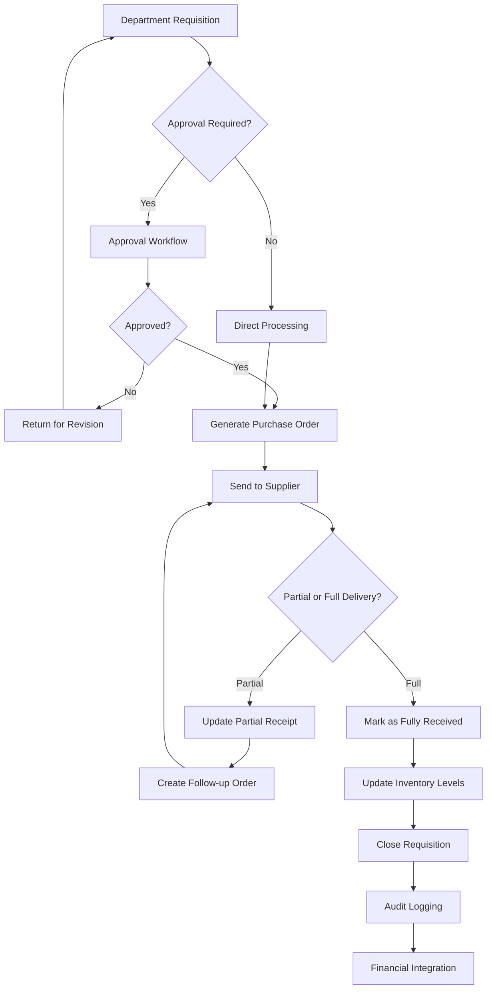
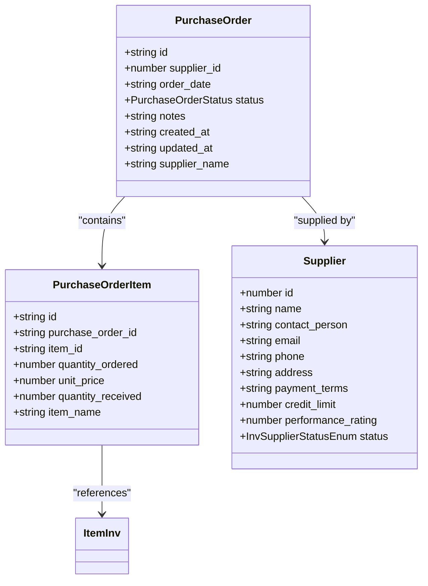
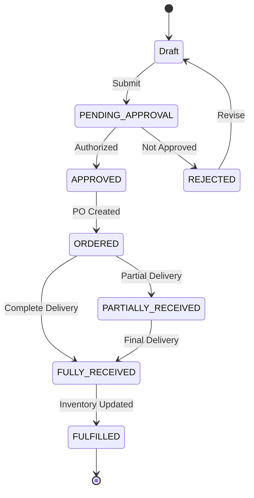

# Procurement & Requisition System

<cite>
**Referenced Files in This Document**   
- [RequisitionsPage.tsx](file://src/modules/inventory/pages/RequisitionsPage.tsx)
- [PurchaseOrdersPage.tsx](file://src/modules/inventory/pages/PurchaseOrdersPage.tsx)
- [useRequisitionData.ts](file://src/modules/inventory/data/useRequisitionData.ts)
- [usePurchaseOrderData.ts](file://src/modules/inventory/data/usePurchaseOrderData.ts)
- [mockData.ts](file://src/modules/inventory/data/mockData.ts)
- [types.ts](file://src/core/types.ts)
</cite>

## Table of Contents
1. [Introduction](#introduction)
2. [Procurement Workflow Overview](#procurement-workflow-overview)
3. [Requisition Management](#requisition-management)
4. [Purchase Order Processing](#purchase-order-processing)
5. [Data Integration and State Management](#data-integration-and-state-management)
6. [Status Transitions and Approval Workflows](#status-transitions-and-approval-workflows)
7. [Supplier and Contract Management](#supplier-and-contract-management)
8. [Common Challenges and Recommendations](#common-challenges-and-recommendations)
9. [Conclusion](#conclusion)

## Introduction
The Procurement & Requisition System within the Inventory module provides a comprehensive solution for managing the end-to-end procurement process in educational institutions. This system enables departments to submit requisitions for inventory items, which are then processed through approval workflows before being converted into purchase orders for suppliers. The system tracks items from initial request through fulfillment, providing visibility into stock levels, purchase history, and supplier performance. This documentation details the implementation of the requisition and purchase order workflows, including the integration between data hooks, status management, and user interface components that facilitate efficient procurement operations.

## Procurement Workflow Overview
The procurement system follows a structured workflow that begins with departmental requisitions and culminates in supplier deliveries. The process starts when a staff member creates a requisition for needed inventory items through the RequisitionsPage interface. These requisitions enter a pending approval status and are reviewed by authorized personnel, potentially involving integration with the Finance module for budget validation. Approved requisitions can then be converted into purchase orders that are sent to suppliers. The system tracks purchase order status from creation through partial or full receipt of goods, updating inventory levels accordingly. Throughout this process, audit logs capture all changes and notifications keep relevant stakeholders informed of status updates. The workflow ensures proper authorization, budget compliance, and timely fulfillment of inventory needs while maintaining comprehensive records for financial reporting and audit purposes.

**Diagram sources**
- [RequisitionsPage.tsx](file://src/modules/inventory/pages/RequisitionsPage.tsx)
- [PurchaseOrdersPage.tsx](file://src/modules/inventory/pages/PurchaseOrdersPage.tsx)

## Requisition Management
The Requisition Management system is implemented through the RequisitionsPage component, which provides a comprehensive interface for creating, editing, and tracking requisitions. Users can initiate new requisitions by specifying the requesting staff member, request date, status, and any relevant notes or justifications. Each requisition can contain multiple items from the inventory catalog, with quantities and unit prices captured for accurate cost estimation. The interface uses a two-modal approach: one for managing the requisition header information and another for managing the line items within a specific requisition. This separation of concerns allows users to focus on either the overall requisition details or the specific items being requested.

The system supports various status transitions for requisitions, including PENDING_APPROVAL, APPROVED, REJECTED, ORDERED, and FULFILLED. These statuses are visually represented with color-coded badges to provide immediate status awareness. The DataGrid component displays all requisitions with sortable and filterable columns, enabling users to quickly find specific requests based on staff member, department, date, or status. When viewing items within a requisition, users can see the requested quantity, unit price, line total, and quantity issued, providing transparency into the fulfillment process. The system also includes validation to ensure that essential fields are completed before submission and confirmation dialogs to prevent accidental deletions.

**Section sources**
- [RequisitionsPage.tsx](file://src/modules/inventory/pages/RequisitionsPage.tsx#L0-L489)

## Purchase Order Processing
The Purchase Order Processing system manages the conversion of approved requisitions into formal purchase orders sent to suppliers. While the specific implementation of PurchaseOrdersPage is not fully visible in the provided context, the system follows standard procurement practices where approved requisitions trigger the creation of purchase orders with supplier information, delivery terms, and pricing details. Purchase orders contain line items that reference inventory items with ordered quantities, unit prices, and received quantities to track fulfillment status. The system supports multiple status levels including PENDING, APPROVED, PARTIALLY_RECEIVED, and FULLY_RECEIVED, allowing for accurate tracking of order fulfillment.

Purchase orders are linked to suppliers who have established contracts with the institution, including agreed-upon payment terms, credit limits, and performance metrics. When goods are received, the system updates the purchase order with received quantities and automatically triggers inventory level updates through stock transactions. This integration between purchasing and inventory management ensures that stock levels are accurately maintained and provides a complete audit trail from requisition to inventory update. The system also supports partial receipts, allowing for multiple delivery shipments against a single purchase order, which is common for large orders or items with extended lead times.

**Diagram sources**
- [mockData.ts](file://src/modules/inventory/data/mockData.ts#L200-L259)
- [types.ts](file://src/core/types.ts)

## Data Integration and State Management
The procurement system utilizes a robust data integration architecture that connects requisition and purchase order workflows through shared data hooks and state management. The useAppData hook serves as the central data provider, aggregating information from various inventory entities including requisitions, staff, and inventory items. This hook enables the RequisitionsPage to access all necessary data for rendering the interface and processing user actions. When a user creates or updates a requisition, the addRequisition and updateRequisition functions from useAppData handle the persistence logic, maintaining data consistency across the application.

The integration between requisitions and purchase orders is facilitated through shared data structures and type definitions. Both systems use consistent item references, allowing for seamless conversion of approved requisition items into purchase order line items. The mock data demonstrates this relationship, with requisition items containing item_id references that correspond to inventory items, and purchase order items using the same referencing system. This consistent data model enables the system to track items from initial request through procurement and inventory receipt. The use of TypeScript interfaces ensures type safety throughout the data flow, reducing errors and improving code maintainability.

**Section sources**
- [RequisitionsPage.tsx](file://src/modules/inventory/pages/RequisitionsPage.tsx#L0-L489)
- [useAppData.ts](file://src/hooks/useAppData.ts)

## Status Transitions and Approval Workflows
The procurement system implements a comprehensive status management system that tracks the lifecycle of requisitions and purchase orders through various stages. For requisitions, the status transitions follow a defined workflow: PENDING_APPROVAL → (APPROVED/REJECTED) → ORDERED → FULFILLED. This progression ensures proper authorization and accountability at each stage of the procurement process. The RequisitionsPage interface visually represents these statuses with color-coded badges, providing immediate visual feedback on the processing stage of each requisition.

Approval workflows may involve multiple stakeholders and potentially integrate with the Finance module for budget validation. The system supports hierarchical approval processes where requisitions above certain monetary thresholds require approval from higher-level authorities. This is reflected in the status options available in the requisition form, which include PENDING_APPROVAL and APPROVED states that represent different stages of the approval process. Once approved, requisitions can be marked as ORDERED, indicating that a purchase order has been generated, and ultimately FULFILLED when all items have been received and inventory updated. The system maintains an audit trail of status changes, capturing timestamps and user information to support accountability and compliance requirements.

**Diagram sources**
- [RequisitionsPage.tsx](file://src/modules/inventory/pages/RequisitionsPage.tsx#L200-L250)
- [mockData.ts](file://src/modules/inventory/data/mockData.ts#L150-L170)

## Supplier and Contract Management
The procurement system incorporates supplier management functionality that tracks vendor information, contract terms, and performance metrics. Suppliers are represented in the system with details including contact information, payment terms, credit limits, and performance ratings. The initialMockSuppliers data structure demonstrates these attributes, showing how suppliers are mapped from global data to inventory-specific supplier types. This information is critical for purchase order generation, as it ensures that orders are directed to approved vendors with established contractual agreements.

Contract terms such as payment terms (e.g., "Net 30") and credit limits are stored at the supplier level and applied automatically to purchase orders, ensuring compliance with negotiated agreements. The system also tracks supplier performance through a rating system, which can inform future procurement decisions and vendor selection. Lead time tracking is implicitly supported through the order_date and delivery status fields, allowing procurement staff to monitor supplier reliability and adjust ordering patterns accordingly. Integration with the Finance module enables validation of purchase orders against supplier credit limits and contract terms, preventing unauthorized expenditures and ensuring financial compliance.

**Section sources**
- [mockData.ts](file://src/modules/inventory/data/mockData.ts#L10-L60)

## Common Challenges and Recommendations
The procurement system addresses several common challenges in institutional purchasing through its design and workflow implementation. Unauthorized purchases are prevented through the mandatory approval workflow, where all requisitions must progress through PENDING_APPROVAL and APPROVED states before procurement can proceed. Contract compliance is ensured by linking purchase orders to suppliers with predefined terms and integrating with the Finance module for budget validation. Delivery delays can be monitored through the purchase order status tracking, which distinguishes between PARTIALLY_RECEIVED and FULLY_RECEIVED states, allowing procurement staff to follow up on outstanding deliveries.

To further enhance the system, several recommendations can be implemented. First, establishing approval hierarchies based on requisition value would ensure appropriate oversight for high-value purchases while streamlining approval for routine, low-value requests. Second, implementing vendor performance monitoring through automated metrics such as on-time delivery rate and quality defect rate would provide data-driven insights for supplier management. Third, integrating lead time analytics would enable more accurate procurement planning and reduce stockouts. Finally, enhancing the notification system to alert relevant stakeholders at key workflow transitions would improve process efficiency and accountability.

## Conclusion
The Procurement & Requisition System provides a comprehensive solution for managing inventory acquisition in educational institutions. By integrating requisition management, approval workflows, purchase order processing, and supplier management, the system ensures that procurement activities are conducted efficiently, transparently, and in compliance with institutional policies. The implementation leverages modern React patterns with hooks for data management and modular components for user interface elements, creating a maintainable and scalable architecture. The system's design supports audit requirements through comprehensive logging and status tracking while providing user-friendly interfaces that streamline the procurement process for staff members. Future enhancements could focus on advanced analytics, predictive ordering based on consumption patterns, and deeper integration with financial systems to further optimize procurement operations.