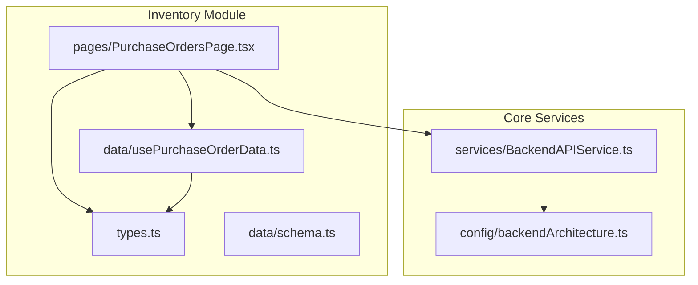
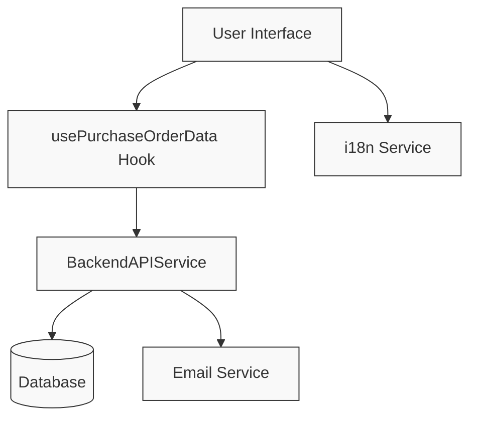
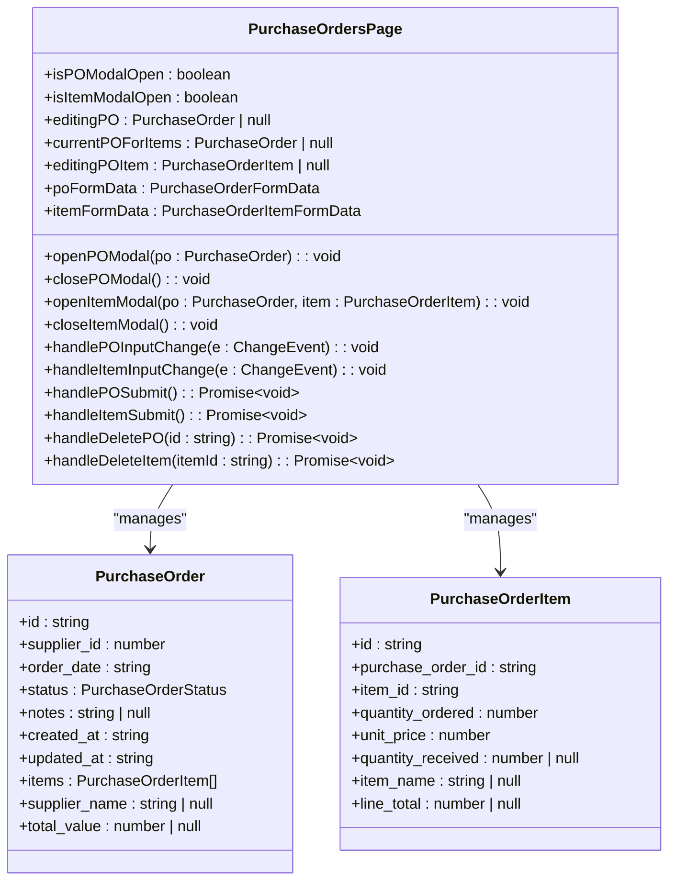
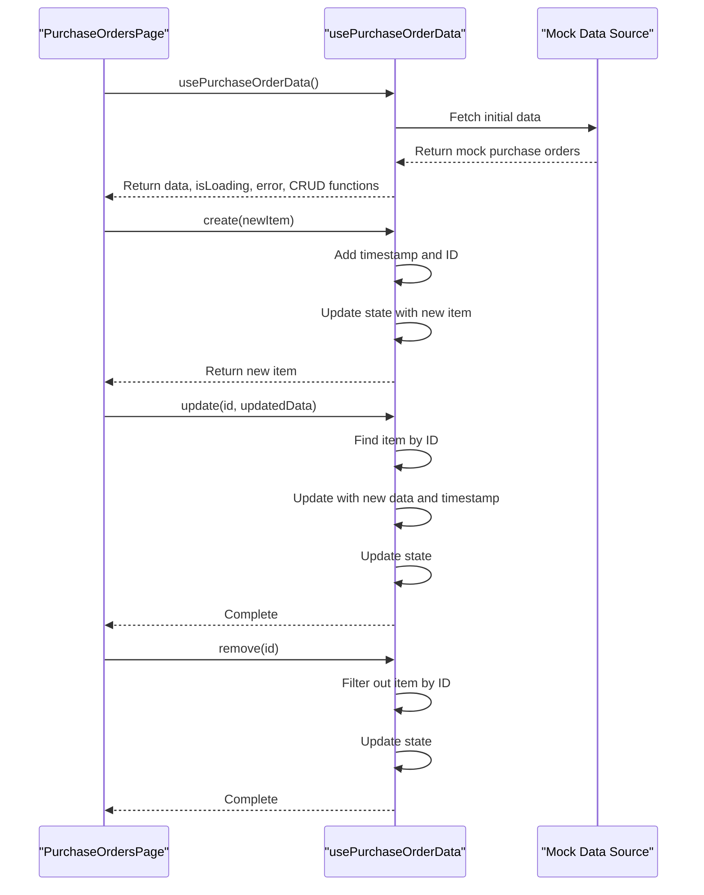
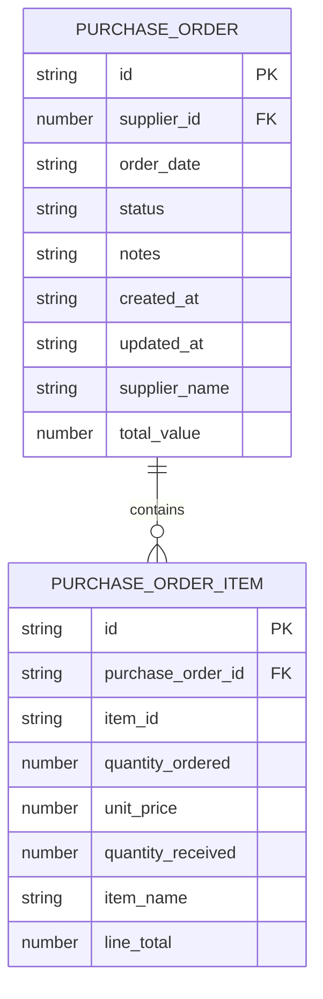
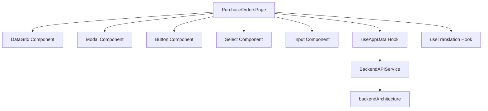

# Purchase Order Processing

<cite>
**Referenced Files in This Document**   
- [PurchaseOrdersPage.tsx](file://src/modules/inventory/pages/PurchaseOrdersPage.tsx)
- [usePurchaseOrderData.ts](file://src/modules/inventory/data/usePurchaseOrderData.ts)
- [types.ts](file://src/core/types.ts)
- [schema.ts](file://src/modules/inventory/data/schema.ts)
- [BackendAPIService.ts](file://src/services/BackendAPIService.ts)
- [backendArchitecture.ts](file://src/config/backendArchitecture.ts)
</cite>

## Table of Contents
1. [Introduction](#introduction)
2. [Project Structure](#project-structure)
3. [Core Components](#core-components)
4. [Architecture Overview](#architecture-overview)
5. [Detailed Component Analysis](#detailed-component-analysis)
6. [Dependency Analysis](#dependency-analysis)
7. [Performance Considerations](#performance-considerations)
8. [Troubleshooting Guide](#troubleshooting-guide)
9. [Conclusion](#conclusion)

## Introduction
The Purchase Order Processing system within the schoolpilot3 application manages the procurement workflow from requisition to vendor payment. This document details the implementation of purchase order creation, management, and integration with financial systems. The system enables users to convert approved requisitions into formal purchase orders, manage vendor relationships, track deliveries, and ensure proper financial controls. Key features include a tabbed interface for managing purchase order items, state management through custom hooks, and integration with backend services for notifications and data persistence.

## Project Structure
The purchase order functionality is organized within the inventory module of the application. The core components are located in the `src/modules/inventory` directory, with specific files handling different aspects of the purchase order lifecycle.

**Diagram sources**
- [PurchaseOrdersPage.tsx](file://src/modules/inventory/pages/PurchaseOrdersPage.tsx)
- [usePurchaseOrderData.ts](file://src/modules/inventory/data/usePurchaseOrderData.ts)
- [types.ts](file://src/core/types.ts)
- [schema.ts](file://src/modules/inventory/data/schema.ts)
- [BackendAPIService.ts](file://src/services/BackendAPIService.ts)
- [backendArchitecture.ts](file://src/config/backendArchitecture.ts)

**Section sources**
- [PurchaseOrdersPage.tsx](file://src/modules/inventory/pages/PurchaseOrdersPage.tsx)
- [usePurchaseOrderData.ts](file://src/modules/inventory/data/usePurchaseOrderData.ts)

## Core Components
The purchase order system consists of several key components that work together to provide a complete procurement solution. The main interface is implemented in `PurchaseOrdersPage.tsx`, which provides a user-friendly interface for creating and managing purchase orders. State management is handled by the `usePurchaseOrderData` hook, which abstracts the data operations for purchase orders. The data structure is defined in the core types system, ensuring consistency across the application.

**Section sources**
- [PurchaseOrdersPage.tsx](file://src/modules/inventory/pages/PurchaseOrdersPage.tsx)
- [usePurchaseOrderData.ts](file://src/modules/inventory/data/usePurchaseOrderData.ts)
- [types.ts](file://src/core/types.ts)

## Architecture Overview
The purchase order processing system follows a component-based architecture with clear separation of concerns. The UI components are responsible for presentation and user interaction, while custom hooks handle data management and business logic. The system integrates with backend services for data persistence and notifications.

**Diagram sources**
- [PurchaseOrdersPage.tsx](file://src/modules/inventory/pages/PurchaseOrdersPage.tsx)
- [usePurchaseOrderData.ts](file://src/modules/inventory/data/usePurchaseOrderData.ts)
- [BackendAPIService.ts](file://src/services/BackendAPIService.ts)

## Detailed Component Analysis

### PurchaseOrdersPage Analysis
The `PurchaseOrdersPage` component implements a comprehensive interface for managing purchase orders with a tabbed design for handling line items. The component uses React hooks for state management and integrates with the `useAppData` hook to access purchase order data and operations.

**Diagram sources**
- [PurchaseOrdersPage.tsx](file://src/modules/inventory/pages/PurchaseOrdersPage.tsx)
- [types.ts](file://src/core/types.ts)

**Section sources**
- [PurchaseOrdersPage.tsx](file://src/modules/inventory/pages/PurchaseOrdersPage.tsx)

### usePurchaseOrderData Hook Analysis
The `usePurchaseOrderData` hook provides state management for purchase orders, implementing CRUD operations for creating, reading, updating, and deleting purchase order records. The hook uses React's useState and useEffect hooks to manage local state and simulate data fetching from a backend service.

**Diagram sources**
- [usePurchaseOrderData.ts](file://src/modules/inventory/data/usePurchaseOrderData.ts)

**Section sources**
- [usePurchaseOrderData.ts](file://src/modules/inventory/data/usePurchaseOrderData.ts)

### Data Model Analysis
The purchase order data model defines the structure of purchase orders and their line items. The model includes both core properties and computed/denormalized fields to optimize for performance and ease of use in the UI.

**Diagram sources**
- [types.ts](file://src/core/types.ts)
- [schema.ts](file://src/modules/inventory/data/schema.ts)

**Section sources**
- [types.ts](file://src/core/types.ts)
- [schema.ts](file://src/modules/inventory/data/schema.ts)

## Dependency Analysis
The purchase order system has several key dependencies that enable its functionality. The component relies on UI components for rendering, hooks for state management, and backend services for data persistence.

**Diagram sources**
- [PurchaseOrdersPage.tsx](file://src/modules/inventory/pages/PurchaseOrdersPage.tsx)
- [BackendAPIService.ts](file://src/services/BackendAPIService.ts)
- [backendArchitecture.ts](file://src/config/backendArchitecture.ts)

**Section sources**
- [PurchaseOrdersPage.tsx](file://src/modules/inventory/pages/PurchaseOrdersPage.tsx)
- [BackendAPIService.ts](file://src/services/BackendAPIService.ts)

## Performance Considerations
The purchase order system implements several performance optimizations to ensure a responsive user experience. The use of React's useState and useEffect hooks provides efficient state management, while the tabbed interface design minimizes initial data loading. The system also implements loading states to provide feedback during data operations.

The `usePurchaseOrderData` hook simulates data fetching with a simple state update, which would be replaced with actual API calls in a production environment. This approach allows for rapid development and testing while maintaining the same interface that would be used with a real backend service.

## Troubleshooting Guide
When encountering issues with the purchase order system, consider the following common problems and solutions:

1. **Purchase orders not loading**: Check that the `useAppData` hook is properly initialized and that the mock data is available. Verify that the component is not stuck in a loading state.

2. **Form validation errors**: Ensure all required fields are filled out before submitting a purchase order. The system requires a supplier, order date, and status to be selected.

3. **Item pricing issues**: When selecting an inventory item, the unit price should automatically populate based on the current price in the inventory system. If this is not happening, verify that the `itemsInv` data is properly loaded.

4. **State update problems**: If changes to purchase orders or items are not persisting, check that the CRUD operations in `usePurchaseOrderData` are properly updating the state.

**Section sources**
- [PurchaseOrdersPage.tsx](file://src/modules/inventory/pages/PurchaseOrdersPage.tsx)
- [usePurchaseOrderData.ts](file://src/modules/inventory/data/usePurchaseOrderData.ts)

## Conclusion
The purchase order processing system in the schoolpilot3 application provides a comprehensive solution for managing procurement workflows. The system's modular architecture, with clear separation between UI components and data management hooks, enables maintainable and scalable code. The implementation of the `PurchaseOrdersPage` component with its tabbed interface design provides an intuitive user experience for managing purchase orders and their line items.

While the current implementation uses mock data for demonstration purposes, the architecture is designed to integrate with a real backend service for data persistence and notifications. The system could be enhanced with additional features such as PDF export functionality, three-way matching for invoices, and vendor performance scorecards to provide a more complete procurement solution.

The codebase demonstrates best practices in React development, including proper state management, component composition, and separation of concerns. These patterns make the system easier to maintain and extend as new requirements emerge.