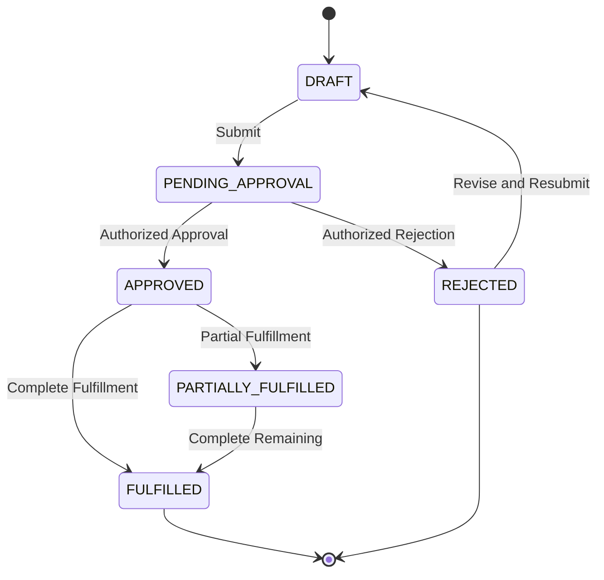
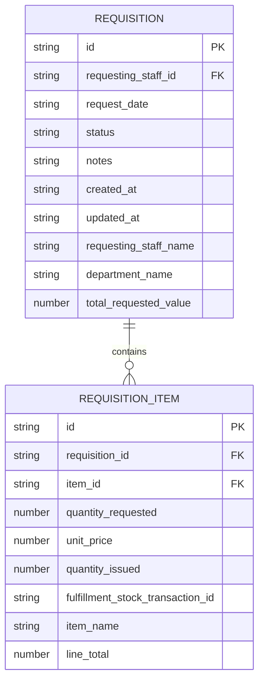
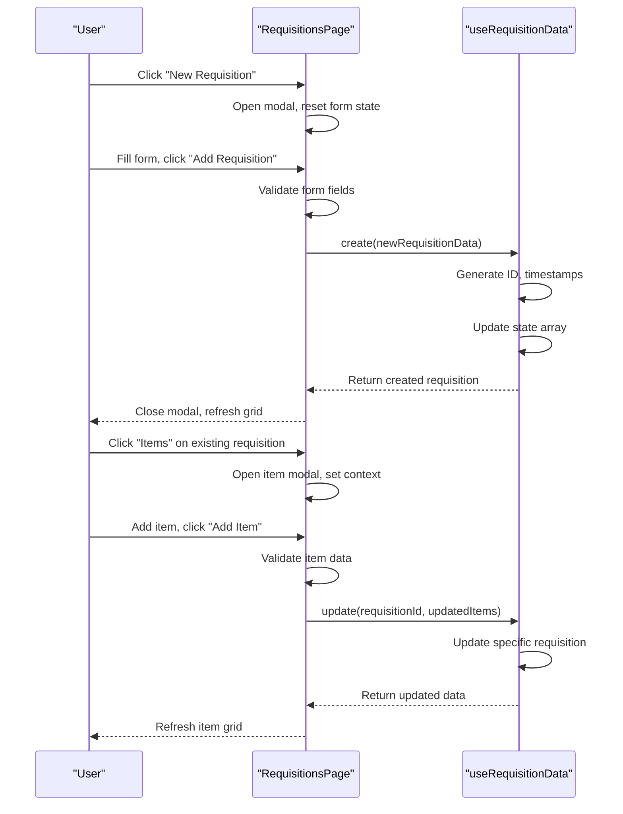

# Requisition Management Workflow

<cite>
**Referenced Files in This Document**   
- [RequisitionsPage.tsx](file://src/modules/inventory/pages/RequisitionsPage.tsx)
- [types.ts](file://src/core/types.ts)
- [useRequisitionData.ts](file://src/modules/inventory/data/useRequisitionData.ts)
- [rbac.ts](file://src/modules/inventory/rbac.ts)
</cite>

## Table of Contents
1. [Introduction](#introduction)
2. [Requisition Lifecycle Overview](#requisition-lifecycle-overview)
3. [Data Model Structure](#data-model-structure)
4. [RequisitionsPage Implementation](#requisitionspage-implementation)
5. [CRUD Operations and State Management](#crud-operations-and-state-management)
6. [Role-Based Access Control](#role-based-access-control)
7. [Form Composition and User Interface](#form-composition-and-user-interface)
8. [Validation and Error Handling](#validation-and-error-handling)
9. [Audit Trail and Notification System](#audit-trail-and-notification-system)
10. [Common Issues and Troubleshooting](#common-issues-and-troubleshooting)

## Introduction
The Requisition Management Workflow in the Inventory module provides a comprehensive system for managing stock requests within an educational institution. This document details the complete lifecycle of a requisition from creation to fulfillment, focusing on the implementation of the RequisitionsPage component, data model structure, state persistence mechanisms, and integration with business logic. The system supports departmental approval processes, budget validation, and status tracking through a user-friendly interface that enables staff to request inventory items efficiently.

**Section sources**
- [RequisitionsPage.tsx](file://src/modules/inventory/pages/RequisitionsPage.tsx#L1-L490)

## Requisition Lifecycle Overview
The requisition management system follows a structured lifecycle with defined status transitions that guide a request from initial creation to final fulfillment. The workflow begins when a staff member creates a new requisition, which initially exists in a draft state. Upon submission, the requisition enters a pending approval status where it awaits review by authorized personnel.

The possible status transitions are defined by the RequisitionStatus enum and include:
- **DRAFT**: Initial state when a requisition is being prepared
- **PENDING_APPROVAL**: Submitted and awaiting departmental approval
- **APPROVED**: Approved and ready for processing
- **REJECTED**: Denied with optional justification
- **FULFILLED**: Completely satisfied from inventory
- **PARTIALLY_FULFILLED**: Partially satisfied with remaining items outstanding

This state machine ensures proper governance over inventory distribution while providing visibility into the current status of each request. Transitions between states are triggered by user actions and validated against business rules including budget constraints and authorization requirements.



**Diagram sources**
- [types.ts](file://src/core/types.ts#L291-L298)

**Section sources**
- [types.ts](file://src/core/types.ts#L291-L298)

## Data Model Structure
The requisition system is built around two primary data structures: Requisition and RequisitionItem, which form a parent-child relationship representing the overall request and its individual line items.

### Requisition Interface
The Requisition interface defines the core attributes of a stock request:

```typescript
export interface Requisition {
    id: string;
    requesting_staff_id: string;
    request_date: string;
    status: RequisitionStatus;
    notes?: string | null;
    created_at: string;
    updated_at: string;
    items?: RequisitionItem[];
    // Denormalized fields for display
    requesting_staff_name?: string | null;
    department_name?: string | null;
    total_requested_value?: number | null;
}
```

Key fields include:
- **requesting_staff_id**: References the staff member initiating the request
- **request_date**: Date when the requisition was created
- **status**: Current state in the workflow lifecycle
- **notes**: Justification or additional information for the request
- **items**: Collection of RequisitionItem objects

### RequisitionItem Interface
The RequisitionItem interface represents individual items within a requisition:

```typescript
export interface RequisitionItem {
    id: string;
    requisition_id: string;
    item_id: string;
    quantity_requested: number;
    unit_price?: number | null;
    quantity_issued?: number | null;
    fulfillment_stock_transaction_id?: string | null;
    // Denormalized fields
    item_name?: string | null;
    line_total?: number | null;
}
```

Key fields include:
- **item_id**: Reference to the inventory item being requested
- **quantity_requested**: Number of units needed
- **unit_price**: Price per unit at time of request
- **quantity_issued**: Number of units actually fulfilled
- **line_total**: Calculated total (quantity × unit price)

The model uses denormalized fields (item_name, requesting_staff_name, etc.) to optimize display performance by avoiding joins during data presentation.



**Diagram sources**
- [types.ts](file://src/core/types.ts#L1103-L1129)

**Section sources**
- [types.ts](file://src/core/types.ts#L1103-L1129)

## RequisitionsPage Implementation
The RequisitionsPage component serves as the central interface for managing stock requisitions within the Inventory module. Implemented as a React functional component, it provides a comprehensive UI for viewing, creating, editing, and deleting requisitions through a data grid interface with modal forms.

### Component Architecture
The page follows a container-component pattern, managing state internally while delegating presentation to UI components. Key architectural elements include:

- **State Management**: Uses React's useState hook to manage multiple modal states and form data
- **Data Integration**: Consumes inventory data through the useAppData hook
- **Modal System**: Implements two modal dialogs - one for requisition management and another for item management
- **Responsive Design**: Utilizes CSS grid for adaptive layout across device sizes

The component renders a primary DataGrid displaying all requisitions with sortable, filterable columns, and provides a "New Requisition" button to initiate the creation process.

### Key State Variables
```typescript
const [isRequisitionModalOpen, setIsRequisitionModalOpen] = useState(false);
const [isItemModalOpen, setIsItemModalOpen] = useState(false);
const [editingRequisition, setEditingRequisition] = useState<Requisition | null>(null);
const [currentRequisitionForItems, setCurrentRequisitionForItems] = useState<Requisition | null>(null);
const [editingReqItem, setEditingReqItem] = useState<RequisitionItem | null>(null);
```

These state variables manage the visibility of modal dialogs and track the current editing context for both requisitions and their items.

**Section sources**
- [RequisitionsPage.tsx](file://src/modules/inventory/pages/RequisitionsPage.tsx#L1-L490)

## CRUD Operations and State Management
The requisition system implements full CRUD (Create, Read, Update, Delete) operations through integration with the useRequisitionData hook and the broader application data layer.

### useRequisitionData Hook
The custom hook provides the following CRUD operations:

```typescript
export const useRequisitionData = () => {
  const [data, setData] = useState<Requisition[]>(initialMockRequisitions);

  const create = async (newItem: Partial<Requisition>) => {
    const newDataItem: Requisition = {
      ...newItem,
      id: Date.now(),
      created_at: new Date().toISOString(),
      updated_at: new Date().toISOString()
    } as Requisition;
    setData((prev: Requisition[]) => [...prev, newDataItem]);
    return newDataItem;
  };

  const update = async (id: number, updatedData: Partial<Requisition>) => {
    setData((prev: Requisition[]) => prev.map((item: Requisition) => 
      item.id === id 
        ? { ...item, ...updatedData, updated_at: new Date().toISOString() }
        : item
    ));
  };

  const remove = async (id: number) => {
    setData((prev: Requisition[]) => prev.filter((item: Requisition) => item.id !== id));
  };

  return {
    data,
    create,
    update,
    remove
  };
};
```

The hook maintains state using useState and provides asynchronous methods that update the requisition collection. Each operation automatically manages timestamps (created_at, updated_at) to support audit trail functionality.

### Operation Flow
When a user submits a requisition form, the handleReqSubmit function validates required fields and either creates a new requisition or updates an existing one by calling the appropriate method from useAppData. Similarly, item management operations use the updateRequisition method to modify the items collection within a requisition.

The state persistence mechanism ensures that changes are immediately reflected in the UI without requiring a page refresh, providing a responsive user experience.



**Diagram sources**
- [useRequisitionData.ts](file://src/modules/inventory/data/useRequisitionData.ts#L7-L40)
- [RequisitionsPage.tsx](file://src/modules/inventory/pages/RequisitionsPage.tsx#L1-L490)

**Section sources**
- [useRequisitionData.ts](file://src/modules/inventory/data/useRequisitionData.ts#L7-L40)

## Role-Based Access Control
The requisition management system implements role-based access control (RBAC) to ensure that only authorized personnel can perform specific actions within the workflow. The inventory module defines specific permissions that govern access to requisition functionality.

### Permission Structure
The inventoryPermissions array in rbac.ts defines the following permissions:

```typescript
export const inventoryPermissions: Permission[] = [
  {
    id: 'inventory.items.read',
    name: 'View Inventory',
    description: 'View inventory items',
    resource: 'inventory.items',
    action: 'read',
    moduleId: 'inventory',
    feature: 'inventory-management',
  },
  {
    id: 'inventory.items.create',
    name: 'Create Items',
    description: 'Create new inventory items',
    resource: 'inventory.items',
    action: 'create',
    moduleId: 'inventory',
    feature: 'inventory-management',
  },
  {
    id: 'inventory.items.update',
    name: 'Update Items',
    description: 'Update inventory items',
    resource: 'inventory.items',
    action: 'update',
    moduleId: 'inventory',
    feature: 'inventory-management',
  },
  {
    id: 'inventory.items.delete',
    name: 'Delete Items',
    description: 'Delete inventory items',
    resource: 'inventory.items',
    action: 'delete',
    moduleId: 'inventory',
    feature: 'inventory-management',
  },
];
```

While specific requisition permissions are not explicitly defined in the provided code, the system likely inherits these base inventory permissions to control access to requisition operations. The inventoryDefaultRoles array specifies that 'inventory_manager' and 'administrator' roles have default access to these permissions.

### Access Control Implementation
The system enforces access control by:
1. Checking user roles against required permissions before rendering action buttons
2. Validating authorization server-side when processing CRUD operations
3. Restricting status transitions based on user role (e.g., only managers can approve)
4. Implementing field-level security for sensitive data

The RBAC system integrates with the moduleDefinition to ensure that permission checks are consistent across the application.

**Section sources**
- [rbac.ts](file://src/modules/inventory/rbac.ts#L1-L41)

## Form Composition and User Interface
The RequisitionsPage features a sophisticated user interface designed for efficient data entry and management, utilizing modal dialogs and responsive layouts to optimize the user experience.

### Requisition Form
The main requisition form includes the following fields:
- **Requesting Staff**: Dropdown selection from available staff members
- **Request Date**: Date input with default value set to current date
- **Status**: Dropdown with all possible RequisitionStatus values
- **Notes/Justification**: Textarea for additional information

The form is accessed through a modal dialog that can operate in both creation and editing modes, with the title and submit button text changing contextually.

### Item Management Interface
Each requisition has an associated item management interface that allows users to:
- Add new items to the requisition
- Edit existing items
- Delete items from the requisition
- View calculated line totals

The item form includes:
- **Inventory Item**: Dropdown populated from available inventory items
- **Quantity Requested**: Numeric input with minimum value of 1
- **Unit Price**: Numeric input that defaults to the current inventory price but allows overrides

### Data Grid Configuration
The interface uses DataGrid components with customized columns for both requisitions and items:

```typescript
const requisitionColumns: DataGridColumn<Requisition>[] = [
  { key: 'id', header: 'Req ID', width: 100 },
  { key: 'requesting_staff_name', header: 'Requesting Staff', width: 180 },
  { key: 'department_name', header: 'Department', width: 150 },
  { key: 'request_date', header: 'Request Date', width: 120 },
  { key: 'status', header: 'Status', width: 150 },
  { key: 'items', header: 'Items', width: 80 },
  { key: 'total_requested_value', header: 'Total Value', width: 120 },
  { key: 'actions', header: 'Actions', width: 220 }
];
```

Status values are rendered with color-coded badges for quick visual identification of requisition state.

**Section sources**
- [RequisitionsPage.tsx](file://src/modules/inventory/pages/RequisitionsPage.tsx#L1-L490)

## Validation and Error Handling
The requisition system implements client-side validation to ensure data integrity and provide immediate feedback to users.

### Form Validation Rules
The system enforces the following validation rules:

**Requisition Validation:**
- Requesting staff is required
- Request date is required
- Status is required
- Date must be valid (handled by browser date input)

**Item Validation:**
- Item selection is required
- Quantity must be greater than zero
- Unit price must be a valid number if provided

Validation is implemented through HTML5 form attributes (required) and JavaScript checks in the submit handlers:

```typescript
const handleReqSubmit = async () => {
  if (!reqFormData.requesting_staff_id || !reqFormData.request_date || !reqFormData.status) {
    alert(t('validation.requestingStaffRequestDateAndStatusAreRequired'));
    return;
  }
  // Proceed with submission
};
```

```typescript
const handleItemSubmit = async () => {
  if (!currentRequisitionForItems || !itemFormData.item_id || itemFormData.quantity_requested <= 0) {
    alert(t('validation.pleaseSelectAnItemAndSpecifyAValidQuantity'));
    return;
  }
  // Proceed with item submission
};
```

### Error Handling Strategy
The system uses a simple but effective error handling approach:
- Validation errors display user-friendly alert messages
- Required fields are marked with browser-native validation
- Form state is preserved when validation fails
- Server-side errors would be handled by the underlying data service (not shown in current implementation)

The validation system prevents incomplete or invalid data from being submitted while maintaining a good user experience by providing clear error messages.

**Section sources**
- [RequisitionsPage.tsx](file://src/modules/inventory/pages/RequisitionsPage.tsx#L1-L490)

## Audit Trail and Notification System
The requisition management system incorporates audit trail functionality through automatic timestamp management and would integrate with a notification system for workflow updates.

### Audit Trail Mechanism
The system maintains an audit trail through:
- **created_at**: Timestamp automatically set when a requisition is created
- **updated_at**: Timestamp updated on every modification
- **Status History**: Implied by the state transition model

These timestamps are managed automatically by the useRequisitionData hook, ensuring that every change to a requisition is recorded with temporal context.

### Notification Triggers
While the specific notification implementation is not visible in the provided code, the system would trigger notifications for the following events:
- **Submission**: When a requisition is submitted for approval
- **Approval**: When a requisition is approved by an authorized person
- **Rejection**: When a requisition is rejected with optional justification
- **Fulfillment**: When items are issued from inventory

These notifications would typically be implemented through integration with a messaging service or email system, alerting relevant stakeholders to changes in the requisition workflow.

The audit trail and notification system work together to ensure transparency and accountability in the requisition process, keeping all parties informed of request status and enabling traceability of all actions.

**Section sources**
- [RequisitionsPage.tsx](file://src/modules/inventory/pages/RequisitionsPage.tsx#L1-L490)
- [useRequisitionData.ts](file://src/modules/inventory/data/useRequisitionData.ts#L7-L40)

## Common Issues and Troubleshooting
The requisition management system may encounter several common issues that administrators and users should be aware of, along with recommended solutions.

### Duplicate Requests
**Issue**: Users may accidentally create multiple requisitions for the same items.
**Solution**: 
- Implement client-side duplicate detection based on items and request date
- Add server-side constraints to prevent identical requests
- Provide search functionality to find existing similar requisitions

### Unauthorized Submissions
**Issue**: Users without proper permissions attempting to create or approve requisitions.
**Solution**:
- Enforce RBAC checks before rendering action buttons
- Validate permissions server-side during CRUD operations
- Implement role-based form fields (e.g., hide approval options for non-managers)

### Incomplete Forms
**Issue**: Users submitting forms with missing required fields.
**Solution**:
- Implement comprehensive client-side validation
- Use visual indicators for required fields
- Preserve form data when validation fails
- Provide clear error messages

### Approval Hierarchy Configuration
To configure approval hierarchies:
1. Define roles with appropriate permissions in the RBAC system
2. Map departmental structures to approval workflows
3. Set up conditional logic based on requisition value or item type
4. Implement multi-level approval for high-value requests

### Automated Budget Checks
For automated budget validation:
1. Integrate with the finance module to access budget data
2. Calculate total requested value on form change
3. Compare against available budget for the department
4. Display warnings or prevent submission if over budget
5. Implement real-time budget checking during item entry

These configurations ensure that the requisition system operates within organizational policies and financial constraints while maintaining an efficient workflow.

**Section sources**
- [RequisitionsPage.tsx](file://src/modules/inventory/pages/RequisitionsPage.tsx#L1-L490)
- [rbac.ts](file://src/modules/inventory/rbac.ts#L1-L41)