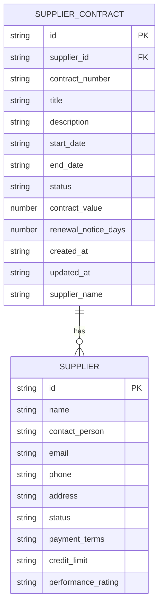
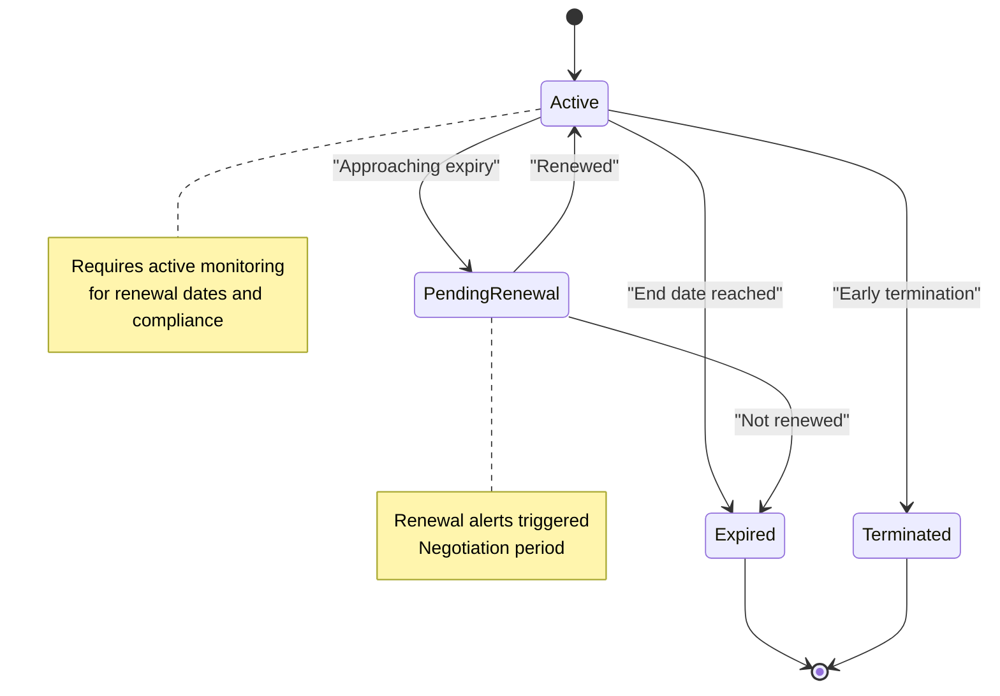
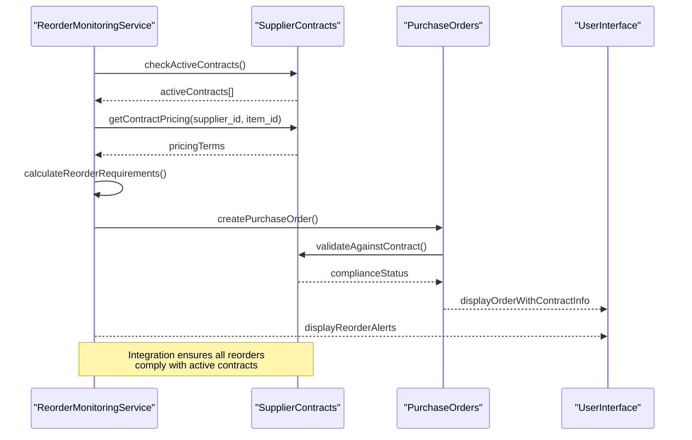
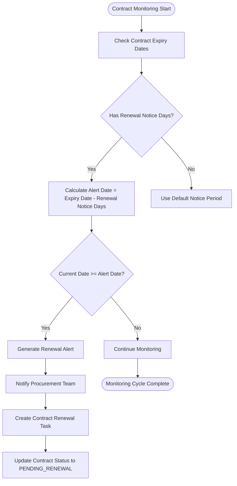

# Supplier Contract Management

<cite>
**Referenced Files in This Document**   
- [useReorderMonitoring.ts](file://src/modules/inventory/hooks/useReorderMonitoring.ts)
- [collections.ts](file://src/modules/inventory/data/collections.ts)
- [schema.ts](file://src/modules/inventory/data/schema.ts)
- [types.ts](file://src/modules/inventory/data/types.ts)
</cite>

## Table of Contents
1. [Introduction](#introduction)
2. [Data Model for Supplier Contracts](#data-model-for-supplier-contracts)
3. [Contract Lifecycle Management](#contract-lifecycle-management)
4. [Integration with Reorder Monitoring](#integration-with-reorder-monitoring)
5. [Compliance and Renewal Monitoring](#compliance-and-renewal-monitoring)
6. [Implementation of SupplierContractsPage](#implementation-of-suppliercontractspage)
7. [Common Challenges and Solutions](#common-challenges-and-solutions)

## Introduction
The Supplier Contract Management system is a critical component of the procurement workflow within the inventory module. It enables organizations to manage master service agreements, pricing contracts, and standing orders through a structured data model and integrated business logic. This document details the implementation of supplier contracts, focusing on contract term management, renewal alerts, compliance monitoring, and integration with automated replenishment systems.

## Data Model for Supplier Contracts

The supplier contract data model is defined in the inventory module's schema and types, providing a comprehensive structure for managing contractual relationships with suppliers. The model supports tracking of contract terms, financial values, statuses, and renewal requirements.

**Diagram sources**
- [schema.ts](file://src/modules/inventory/data/schema.ts#L249-L287)
- [types.ts](file://src/modules/inventory/data/types.ts#L100-L120)

**Section sources**
- [schema.ts](file://src/modules/inventory/data/schema.ts#L249-L287)
- [types.ts](file://src/modules/inventory/data/types.ts#L100-L120)

### Key Fields in Supplier Contract Model
- **contractNumber**: Unique identifier for the contract (field: `contract_number`)
- **vendor**: Reference to the supplier entity (field: `supplier_id`)
- **effectiveDate**: Contract start date (field: `start_date`)
- **expiryDate**: Contract end date (field: `end_date`)
- **status**: Current state of the contract with values from `InvContractStatusEnum`
- **contractValue**: Financial value of the contract (field: `contract_value`)
- **renewalNoticeDays**: Days before expiry when renewal alerts should be triggered
- **SLAs**: Service Level Agreements are managed through contract terms and conditions
- **terminationClauses**: Handled through contract status transitions and documentation

The data model also includes computed fields such as `supplier_name` which is denormalized for efficient display in user interfaces.

## Contract Lifecycle Management

The contract lifecycle is managed through a well-defined state machine implemented via the `InvContractStatusEnum`. This enumeration defines the possible states a contract can occupy throughout its lifecycle.

**Diagram sources**
- [types.ts](file://src/modules/inventory/data/types.ts#L90-L95)

**Section sources**
- [types.ts](file://src/modules/inventory/data/types.ts#L90-L95)

### Contract Status Transitions
The system supports the following contract status transitions:
- **ACTIVE**: The contract is currently in effect and enforceable
- **EXPIRED**: The contract has passed its end date without renewal
- **PENDING_RENEWAL**: The contract is approaching expiry and requires renewal action
- **TERMINATED**: The contract has been terminated before its natural expiry

These states enable the system to trigger appropriate business processes, such as renewal workflows when a contract enters the PENDING_RENEWAL state, or compliance alerts when a contract becomes EXPIRED.

## Integration with Reorder Monitoring

The supplier contract system is tightly integrated with the automated reorder monitoring functionality, ensuring that procurement activities comply with active contracts and pricing agreements.

**Diagram sources**
- [useReorderMonitoring.ts](file://src/modules/inventory/hooks/useReorderMonitoring.ts)
- [schema.ts](file://src/modules/inventory/data/schema.ts)

**Section sources**
- [useReorderMonitoring.ts](file://src/modules/inventory/hooks/useReorderMonitoring.ts)
- [schema.ts](file://src/modules/inventory/data/schema.ts)

### Data Flow Between Contracts and Reordering
The integration between supplier contracts and reorder monitoring is facilitated through the `useReorderMonitoring` hook, which coordinates with contract data to ensure compliance:

1. The system checks for reorder requirements based on current stock levels
2. For each item requiring reorder, the system identifies the preferred supplier from active contracts
3. Contract terms, including pricing and lead times, are automatically applied to purchase recommendations
4. Purchase orders are validated against contract terms before submission

This integration ensures that all procurement activities leverage the most favorable contract terms and maintain compliance with organizational procurement policies.

## Compliance and Renewal Monitoring

The system implements proactive compliance monitoring and renewal alerting to prevent procurement violations and ensure continuous supply chain operations.

### Renewal Alert System
The renewal alert system is based on the `renewal_notice_days` field in the supplier contract model. When a contract approaches its expiry date within the specified notice period, the system triggers alerts through multiple channels:

**Diagram sources**
- [schema.ts](file://src/modules/inventory/data/schema.ts#L265)
- [types.ts](file://src/modules/inventory/data/types.ts#L110)

**Section sources**
- [schema.ts](file://src/modules/inventory/data/schema.ts#L265)
- [types.ts](file://src/modules/inventory/data/types.ts#L110)

### Compliance Monitoring Features
The system enforces compliance through several mechanisms:
- **Contract Validation**: All purchase orders are validated against active contracts
- **Pricing Compliance**: Ensures that purchase prices do not exceed contract rates
- **Preferred Vendor Enforcement**: Prioritizes purchases from suppliers with active contracts
- **Audit Logging**: Tracks all contract-related actions and amendments

These features help prevent non-compliant purchases and ensure that the organization maximizes the benefits of its negotiated contracts.

## Implementation of SupplierContractsPage

The SupplierContractsPage provides a comprehensive interface for managing supplier contracts, integrating contract term management, renewal alerts, and compliance monitoring features.

### Key Components and Functionality
The page implementation leverages several key components and hooks:

- **useSupplierContractData**: Custom hook for retrieving and managing contract data
- **useSupplierData**: Hook for accessing supplier information, enabling automatic pricing lookups
- **ReorderMonitoringService**: Integration point for automated replenishment based on contract terms

The page displays contracts in a tabular format with filtering and sorting capabilities, allowing users to quickly identify contracts that require attention (e.g., those approaching expiry or in pending renewal status).

### User Interface Features
The SupplierContractsPage includes the following key features:
- **Contract Dashboard**: Overview of all contracts with status indicators
- **Renewal Calendar**: Visual representation of upcoming contract expiries
- **Compliance Summary**: Metrics on contract compliance and savings
- **Quick Actions**: One-click access to common tasks like renewal initiation

The interface is designed to provide procurement teams with the information they need to proactively manage contracts and avoid service disruptions.

## Common Challenges and Solutions

The supplier contract management system addresses several common procurement challenges through its design and implementation.

### Expired Contracts
Expired contracts can lead to price increases and supply chain disruptions. The system mitigates this risk through:
- Automated renewal alerts based on the `renewal_notice_days` configuration
- Status tracking that clearly identifies expired contracts
- Integration with procurement workflows to initiate renewal processes

### Non-Compliant Purchases
Non-compliant purchases that bypass negotiated contracts can erode cost savings. The system prevents this through:
- Mandatory contract validation for purchase orders
- Preferred vendor list enforcement
- Real-time pricing validation against contract terms

### Vendor Lock-In
Vendor lock-in can reduce negotiating power and increase costs. The system addresses this by:
- Providing visibility into contract expiration dates
- Facilitating competitive bidding through RFQ integration
- Tracking supplier performance ratings to inform renewal decisions

### Contract Approval Workflows
The system supports contract approval workflows through integration with the broader procurement module, ensuring that all contracts undergo appropriate review and authorization before becoming active.

### Preferred Vendor List Management
The preferred vendor list is maintained through the supplier status system, with active contracts automatically designating suppliers as preferred vendors for specific categories of goods and services.