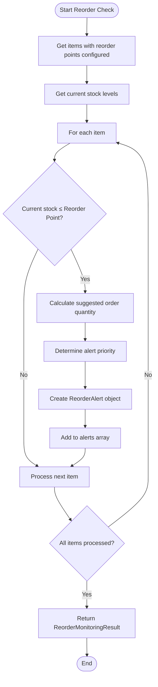
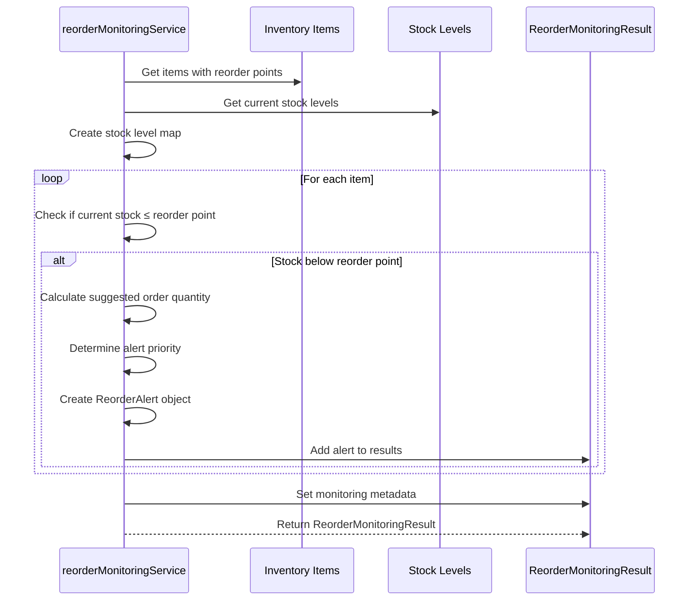
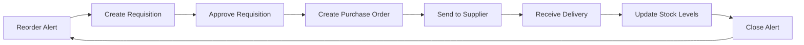

# Reorder Monitoring & Alerts

<cite>
**Referenced Files in This Document**   
- [reorderMonitoringService.ts](file://src/modules/inventory/services/reorderMonitoringService.ts)
- [useReorderMonitoring.ts](file://src/modules/inventory/hooks/useReorderMonitoring.ts)
- [ReorderAlertsPanel.tsx](file://src/modules/inventory/components/ReorderAlertsPanel.tsx)
- [ReorderAlertsPage.tsx](file://src/modules/inventory/pages/ReorderAlertsPage.tsx)
- [schema.ts](file://src/modules/inventory/data/schema.ts)
- [useStockAlertData.ts](file://src/modules/inventory/data/useStockAlertData.ts)
</cite>

## Table of Contents
1. [Reorder Monitoring System Overview](#reorder-monitoring-system-overview)
2. [Automated Reorder Point Calculation Logic](#automated-reorder-point-calculation-logic)
3. [Reorder Monitoring Service Implementation](#reorder-monitoring-service-implementation)
4. [Real-time Monitoring with useReorderMonitoring Hook](#real-time-monitoring-with-usereordermonitoring-hook)
5. [User Interface for Reorder Alerts](#user-interface-for-reorder-alerts)
6. [Stock Alerts Data Model](#stock-alerts-data-model)
7. [Integration with Procurement Workflows](#integration-with-procurement-workflows)
8. [Threshold Configuration and Alert Suppression](#threshold-configuration-and-alert-suppression)
9. [Common Issues and Best Practices](#common-issues-and-best-practices)

## Reorder Monitoring System Overview

The Reorder Monitoring & Alerts system is a critical component of the Inventory module designed to prevent stockouts and ensure optimal inventory levels. The system automatically analyzes inventory consumption patterns, lead times, and safety stock requirements to generate timely reorder recommendations. It provides real-time visibility into stock levels through a comprehensive alerting system that prioritizes alerts based on urgency and business impact.

The architecture follows a service-hook-component pattern where the `reorderMonitoringService.ts` handles the core business logic, the `useReorderMonitoring` hook manages state and provides data to components, and the `ReorderAlertsPanel` component renders the user interface. This separation of concerns ensures maintainability and testability of the system.

**Section sources**
- [reorderMonitoringService.ts](file://src/modules/inventory/services/reorderMonitoringService.ts#L1-L150)
- [useReorderMonitoring.ts](file://src/modules/inventory/hooks/useReorderMonitoring.ts#L1-L170)
- [ReorderAlertsPanel.tsx](file://src/modules/inventory/components/ReorderAlertsPanel.tsx#L1-L500)

## Automated Reorder Point Calculation Logic

The system implements a sophisticated algorithm for calculating reorder points based on multiple factors including consumption rates, lead times, and safety stock levels. The calculation logic is encapsulated in the `checkReorderRequirements` function within the `reorderMonitoringService.ts` file.

### Reorder Point Determination

The system evaluates inventory items against their configured reorder points using the following logic:



**Diagram sources**
- [reorderMonitoringService.ts](file://src/modules/inventory/services/reorderMonitoringService.ts#L45-L137)

### Suggested Order Quantity Calculation

The system calculates the suggested order quantity using a tiered approach that considers multiple inventory parameters:

```typescript
function calculateSuggestedOrderQuantity(
  item: InvItemType,
  stockLevel: InvStockLevelType,
  currentStock: number
): number {
  const reorderQuantity = item.reorder_quantity || 0;
  const maxStockLevel = item.max_stock_level || 0;

  if (reorderQuantity > 0) {
    return reorderQuantity;
  }

  // If no reorder quantity is set, calculate based on max stock level
  if (maxStockLevel > 0) {
    return Math.max(maxStockLevel - currentStock, 1);
  }

  // Default to a reasonable quantity if no parameters are set
  const reorderPoint = item.reorder_point || 0;
  return Math.max(reorderPoint * 2, 10);
}
```

This logic prioritizes user-configured reorder quantities, falls back to max stock level calculations when available, and provides a sensible default when no parameters are configured.

### Alert Priority Determination

Alerts are prioritized based on how far below the reorder point the current stock level is:

```typescript
function determineAlertPriority(
  currentStock: number,
  reorderPoint: number
): 'HIGH' | 'MEDIUM' | 'LOW' {
  if (currentStock === 0) {
    return 'HIGH';
  }

  const percentageBelow = ((reorderPoint - currentStock) / reorderPoint) * 100;

  if (percentageBelow >= 50) {
    return 'HIGH';
  } else if (percentageBelow >= 25) {
    return 'MEDIUM';
  } else {
    return 'LOW';
  }
}
```

The priority algorithm uses percentage thresholds to categorize alerts:
- **HIGH**: Stock is 50% or more below reorder point, or stock is completely depleted
- **MEDIUM**: Stock is 25-49% below reorder point
- **LOW**: Stock is below reorder point but more than 75% of the reorder point remains

**Section sources**
- [reorderMonitoringService.ts](file://src/modules/inventory/services/reorderMonitoringService.ts#L12-L90)

## Reorder Monitoring Service Implementation

The `reorderMonitoringService.ts` file contains the core business logic for inventory analysis and alert generation. The service exports two main functions: `checkReorderRequirements` and helper functions for calculating order quantities and alert priorities.

### Service Interface

The service defines two key interfaces that structure the data flow:

```typescript
export interface ReorderAlert {
  item_id: string;
  item_name: string;
  current_stock: number;
  reorder_point: number;
  reorder_quantity: number;
  suggested_order_quantity: number;
  alert_type: 'LOW_STOCK' | 'REORDER_REQUIRED';
  priority: 'HIGH' | 'MEDIUM' | 'LOW';
}

export interface ReorderMonitoringResult {
  alerts: ReorderAlert[];
  items_below_reorder_point: number;
  total_items_monitored: number;
  last_check: Date;
}
```

These interfaces ensure type safety and provide clear contracts for data exchange between components.

### Core Monitoring Logic

The `checkReorderRequirements` function implements the main monitoring algorithm:



**Diagram sources**
- [reorderMonitoringService.ts](file://src/modules/inventory/services/reorderMonitoringService.ts#L45-L137)

The function processes all inventory items that have reorder points configured, compares their current stock levels against these points, and generates alerts for items that require attention.

**Section sources**
- [reorderMonitoringService.ts](file://src/modules/inventory/services/reorderMonitoringService.ts#L45-L137)

## Real-time Monitoring with useReorderMonitoring Hook

The `useReorderMonitoring` hook provides a React-friendly interface to the reorder monitoring functionality, managing state and exposing actions to components.

### Hook Implementation

```typescript
export const useReorderMonitoring = (): UseReorderMonitoringReturn => {
  const [alerts, setAlerts] = useState<ReorderAlert[]>([]);
  const [monitoringResult, setMonitoringResult] = useState<ReorderMonitoringResult | null>(null);
  const [isLoading, setIsLoading] = useState(false);
  const [error, setError] = useState<string | null>(null);

  const checkReorderRequirementsAction = useCallback(async (items, stockLevels) => {
    setIsLoading(true);
    setError(null);

    try {
      const result = checkReorderRequirements(items, stockLevels);
      setMonitoringResult(result);
      setAlerts(result.alerts);
    } catch (err) {
      const errorMessage = err instanceof Error ? err.message : 'Failed to check reorder requirements';
      setError(errorMessage);
      console.error('Error checking reorder requirements:', err);
    } finally {
      setIsLoading(false);
    }
  }, []);

  // Other actions and computed values...
};
```

### Hook Return Interface

The hook returns a comprehensive interface that provides both state and actions:

```typescript
export interface UseReorderMonitoringReturn {
  // State
  alerts: ReorderAlert[];
  monitoringResult: ReorderMonitoringResult | null;
  isLoading: boolean;
  error: string | null;
  
  // Actions
  checkReorderRequirements: () => Promise<void>;
  getActiveAlerts: () => Promise<void>;
  dismissAlert: (itemId: string) => Promise<void>;
  refreshAlerts: () => Promise<void>;
  
  // Computed values
  highPriorityAlerts: ReorderAlert[];
  mediumPriorityAlerts: ReorderAlert[];
  lowPriorityAlerts: ReorderAlert[];
  totalAlertsCount: number;
}
```

### Periodic Monitoring

The system also provides a `usePeriodicReorderMonitoring` hook that automatically checks reorder requirements at specified intervals:

```typescript
export const usePeriodicReorderMonitoring = (intervalMinutes: number = 60) => {
  const reorderMonitoring = useReorderMonitoring();
  const [isAutoMonitoringEnabled, setIsAutoMonitoringEnabled] = useState(false);
  const [lastAutoCheck, setLastAutoCheck] = useState<Date | null>(null);

  useEffect(() => {
    if (!isAutoMonitoringEnabled) return;

    const intervalMs = intervalMinutes * 60 * 1000;
    
    const performAutoCheck = async () => {
      try {
        await reorderMonitoring.checkReorderRequirements();
        setLastAutoCheck(new Date());
      } catch (error) {
        console.error('Auto reorder check failed:', error);
      }
    };

    // Perform initial check
    performAutoCheck();

    // Set up interval
    const interval = setInterval(performAutoCheck, intervalMs);

    return () => clearInterval(interval);
  }, [isAutoMonitoringEnabled, intervalMinutes, reorderMonitoring]);
};
```

This enables automatic monitoring without requiring user intervention, with a default interval of 60 minutes that can be configured.

**Section sources**
- [useReorderMonitoring.ts](file://src/modules/inventory/hooks/useReorderMonitoring.ts#L1-L170)

## User Interface for Reorder Alerts

The user interface for reorder alerts is implemented through the `ReorderAlertsPanel` component and the `ReorderAlertsPage`, providing a comprehensive view of inventory status and actionable insights.

### ReorderAlertsPanel Component

The `ReorderAlertsPanel` component displays a summary of active alerts and a detailed table of reorder recommendations:

```mermaid
graph TB
Panel[ReorderAlertsPanel] --> Summary[Alert Summary Cards]
Panel --> Controls[Action Controls]
Panel --> Tabs[Tabs for Alert Filtering]
Panel --> Table[Alerts Table]
Panel --> Dialog[Alert Detail Dialog]
Summary --> Total[Total Alerts Card]
Summary --> LastCheck[Last Check Timestamp]
Controls --> Refresh[Refresh Button]
Controls --> CheckAll[Check All Button]
Controls --> Settings[Settings Button]
Tabs --> All[All Alerts Tab]
Tabs --> High[High Priority Tab]
Tabs --> Medium[Medium Priority Tab]
Tabs --> Low[Low Priority Tab]
Table --> Priority[Priority Column]
Table --> Item[Item Name Column]
Table --> CurrentStock[Current Stock Column]
Table --> SuggestedOrder[Suggested Order Column]
Table --> AlertType[Alert Type Column]
Table --> Actions[Actions Column]
```



**Diagram sources**
- [ReorderAlertsPanel.tsx](file://src/modules/inventory/components/ReorderAlertsPanel.tsx#L1-L500)

### Alert Table Structure

The alerts table displays comprehensive information about each reorder recommendation:

```typescript
// Table headers
const tableHeaders = [
  t('reorderAlerts.table.priority'),
  t('reorderAlerts.table.item'),
  t('reorderAlerts.table.currentStock'),
  t('reorderAlerts.table.suggestedOrder'),
  t('reorderAlerts.table.alertType'),
  t('reorderAlerts.table.actions')
];
```

Each row in the table corresponds to a `ReorderAlert` object and provides actions such as viewing details, creating purchase requisitions, or dismissing the alert.

### ReorderAlertsPage

The `ReorderAlertsPage` serves as the main entry point for the reorder monitoring system:

```typescript
const ReorderAlertsPage = () => {
  return (
    <PageContainer>
      <PageHeader 
        title={t('navigation:inventory.reorderAlerts')}
        description={t('reorderAlerts.description')}
      />
      
      <Card>
        <CardHeader>
          <CardTitle>{t('reorderAlerts.activeAlerts')}</CardTitle>
        </CardHeader>
        <CardContent>
          <ReorderAlertsPanel className="w-full" />
        </CardContent>
      </Card>

      <Card>
        <CardHeader>
          <CardTitle>{t('reorderAlerts.settings.globalSettings', 'Global Settings')}</CardTitle>
          <CardDescription>
            {t('reorderAlerts.settings.globalDescription', 'Configure system-wide reorder alert preferences')}
          </CardDescription>
        </CardHeader>
        <CardContent>
          <div className="space-y-4">
            <div className="text-center py-8 text-muted-foreground">
              {t('common.comingSoon', 'Coming Soon')}
            </div>
          </div>
        </CardContent>
      </Card>
    </PageContainer>
  );
};
```

The page layout includes the main alerts panel and a section for global settings (currently marked as "Coming Soon").

**Section sources**
- [ReorderAlertsPanel.tsx](file://src/modules/inventory/components/ReorderAlertsPanel.tsx#L1-L500)
- [ReorderAlertsPage.tsx](file://src/modules/inventory/pages/ReorderAlertsPage.tsx#L1-L300)

## Stock Alerts Data Model

The stock alerts system is built on a well-defined data model that integrates with the broader inventory data schema.

### ReorderAlert Interface

The core data structure for reorder alerts is defined as:

```typescript
export interface ReorderAlert {
  item_id: string;
  item_name: string;
  current_stock: number;
  reorder_point: number;
  reorder_quantity: number;
  suggested_order_quantity: number;
  alert_type: 'LOW_STOCK' | 'REORDER_REQUIRED';
  priority: 'HIGH' | 'MEDIUM' | 'LOW';
}
```

This interface captures all essential information needed to understand and act on a reorder recommendation.

### Database Schema

The underlying database schema for stock alerts includes additional fields for tracking and auditing:

```typescript
// From schema.ts
{
  name: 'stock_alert',
  primaryKey: 'id',
  properties: {
    id: SchemaHelpers.id('Unique identifier for the alert'),
    item_id: SchemaHelpers.string('Reference to inventory item', { maxLength: 100 }),
    warehouse_id: SchemaHelpers.string('Reference to warehouse', { maxLength: 100 }),
    alert_type: SchemaHelpers.string('Type of alert', { maxLength: 50, enum: ['LOW_STOCK', 'REORDER_REQUIRED', 'EXPIRY_WARNING', 'EXPIRED'] }),
    created_at: SchemaHelpers.timestamp('Alert creation timestamp'),
    acknowledged_at: SchemaHelpers.timestamp('Acknowledgment timestamp'),
    acknowledged_by: SchemaHelpers.string('Acknowledged by staff member', { maxLength: 100, nullable: true }),
    item_name: SchemaHelpers.string('Item name (computed)', { maxLength: 200, nullable: true }),
    warehouse_name: SchemaHelpers.string('Warehouse name (computed)', { maxLength: 100, nullable: true })
  },
  required: ['id', 'item_id', 'warehouse_id', 'alert_type', 'created_at'],
  indexes: ['item_id', 'warehouse_id', 'alert_type', 'acknowledged_at']
}
```

The schema includes computed fields like `item_name` and `warehouse_name` for improved query performance and user experience.

### Integration with Requisition Workflow

The system is designed to integrate with procurement workflows through the purchase order schema:

```typescript
// From schema.ts
{
  name: 'purchase_order',
  primaryKey: 'id',
  properties: {
    id: SchemaHelpers.id('Unique identifier for the purchase order'),
    supplier_id: SchemaHelpers.string('Reference to supplier', { maxLength: 100 }),
    order_date: SchemaHelpers.string('Order date', { format: 'date' }),
    expected_delivery_date: SchemaHelpers.string('Expected delivery date', { nullable: true, format: 'date' }),
    status: SchemaHelpers.string('Purchase order status', { maxLength: 50, enum: Object.values(types.InvPurchaseOrderStatusEnum) }),
    notes: SchemaHelpers.string('Purchase order notes', { maxLength: 500, nullable: true }),
    requisition_id: SchemaHelpers.string('Reference to requisition', { maxLength: 100, nullable: true }),
    created_at: SchemaHelpers.timestamp('Record creation timestamp'),
    updated_at: SchemaHelpers.timestamp('Record last update timestamp'),
    items: SchemaHelpers.array('Purchase order items', { nullable: true, default: [], items: SchemaHelpers.object('Purchase order item', { properties: purchaseOrderItemProperties }) }),
    supplier_name: SchemaHelpers.string('Supplier name (computed)', { maxLength: 200, nullable: true }),
    total_value: SchemaHelpers.number('Total value (computed)', { nullable: true, minimum: 0, maximum: 999999.99 })
  },
```

The `requisition_id` field provides a direct link between reorder alerts and procurement workflows, enabling seamless transition from alert to purchase order.

**Section sources**
- [reorderMonitoringService.ts](file://src/modules/inventory/services/reorderMonitoringService.ts#L1-L50)
- [schema.ts](file://src/modules/inventory/data/schema.ts#L180-L286)
- [useStockAlertData.ts](file://src/modules/inventory/data/useStockAlertData.ts#L1-L100)

## Integration with Procurement Workflows

The reorder monitoring system is designed to integrate seamlessly with the broader procurement workflow, enabling efficient transition from alert to purchase.

### Workflow Integration Points

The system integrates with procurement workflows at multiple levels:

1. **Alert to Requisition**: The `ReorderAlertsPanel` provides actions to convert alerts into purchase requisitions
2. **Requisition to Purchase Order**: The system links requisitions to purchase orders through the `requisition_id` field
3. **Purchase Order to Delivery**: The workflow continues through order fulfillment and stock update



**Diagram sources**
- [schema.ts](file://src/modules/inventory/data/schema.ts#L180-L286)

### Module Integration

The inventory module is configured to work with other modules through its module definition:

```typescript
// From moduleDefinition.tsx
{
  moduleId: 'administration',
  version: '^1.0.0',
  required: true
}
```

This dependency ensures that user and role management from the administration module is available for workflow approvals.

### Dashboard Integration

The system provides a dedicated procurement dashboard:

```typescript
// From moduleDefinition.tsx
{
  name: 'navigation:inventory.schoolProcurementDashboard',
  path: '/inventory/school-procurement-dashboard',
  icon: ChartBarIcon,
  page: 'SchoolProcurementDashboardPage'
}
```

This dashboard provides a comprehensive view of the procurement process, including requisitions, purchase orders, and supplier information.

**Section sources**
- [moduleDefinition.tsx](file://src/modules/inventory/moduleDefinition.tsx#L1-L80)
- [schema.ts](file://src/modules/inventory/data/schema.ts#L180-L286)
- [SchoolProcurementDashboardPage.tsx](file://src/modules/inventory/pages/SchoolProcurementDashboardPage.tsx#L1-L50)

## Threshold Configuration and Alert Suppression

The system implements intelligent threshold configuration and alert suppression rules to prevent false alerts and reduce alert fatigue.

### Threshold Configuration

Reorder thresholds are configured at the item level with multiple parameters:

- **Reorder Point**: The stock level that triggers a reorder alert
- **Reorder Quantity**: The default quantity to order when below reorder point
- **Max Stock Level**: The maximum desired inventory level
- **Safety Stock**: Minimum buffer stock to prevent stockouts

These parameters are used in the calculation of suggested order quantities and alert priorities.

### Alert Suppression Rules

While the current implementation does not include explicit alert suppression rules, the system has mechanisms to prevent duplicate alerts:

1. **State-based Management**: Alerts are managed in component state and only updated when new data is available
2. **Loading States**: The UI prevents multiple simultaneous checks through loading states
3. **Periodic Monitoring**: The `usePeriodicReorderMonitoring` hook ensures consistent check intervals

```typescript
// From useReorderMonitoring.ts
const dismissAlert = useCallback(async (itemId: string) => {
  setIsLoading(true);
  setError(null);
  
  try {
    // In a real implementation, this would update the database
    // For now, just remove from local state
    setAlerts(prevAlerts => prevAlerts.filter(alert => alert.item_id !== itemId));
    console.log(`Alert dismissed for item: ${itemId}`);
  } catch (err) {
    const errorMessage = err instanceof Error ? err.message : 'Failed to dismiss alert';
    setError(errorMessage);
    console.error('Error dismissing alert:', err);
  } finally {
    setIsLoading(false);
  }
}, []);
```

The `dismissAlert` function allows users to acknowledge and remove alerts they have addressed, preventing them from reappearing until the next monitoring cycle.

### Future Enhancement Opportunities

The system could be enhanced with additional alert suppression rules:

- **Time-based Suppression**: Prevent re-alerting on the same item for a configurable period
- **Volume-based Suppression**: Suppress alerts for items with recent purchase orders above a threshold
- **Seasonal Adjustment**: Adjust reorder points based on historical seasonal patterns
- **Lead Time Variability**: Account for supplier reliability and delivery time variations

**Section sources**
- [reorderMonitoringService.ts](file://src/modules/inventory/services/reorderMonitoringService.ts#L1-L150)
- [useReorderMonitoring.ts](file://src/modules/inventory/hooks/useReorderMonitoring.ts#L80-L124)
- [schema.ts](file://src/modules/inventory/data/schema.ts#L279-L286)

## Common Issues and Best Practices

### Common Issues

#### False Alerts Due to Data Inaccuracies

False alerts can occur when inventory data is inaccurate. Common causes include:

- **Manual Stock Adjustments**: Unrecorded stock usage or manual adjustments
- **Data Entry Errors**: Incorrect quantities entered during stock receipts
- **System Latency**: Delays in synchronizing stock levels across systems

**Mitigation Strategies**:
- Implement regular stock audits and cycle counting
- Use barcode scanning for accurate stock recording
- Implement approval workflows for manual stock adjustments
- Set up data validation rules to catch obvious errors

#### Alert Fatigue

When too many alerts are generated, users may ignore them, reducing the system's effectiveness.

**Mitigation Strategies**:
- Fine-tune reorder points and safety stock levels
- Use the priority system effectively to highlight critical issues
- Implement alert grouping for related items
- Set up automated suppression rules for resolved issues

### Best Practices for Tuning Reorder Parameters

#### Establish Baseline Consumption Rates

Calculate average daily/weekly consumption based on historical data:

```
Average Daily Consumption = Total Consumption over Period / Number of Days
```

Use this baseline to set initial reorder points.

#### Calculate Safety Stock

Safety stock protects against demand variability and supply chain disruptions:

```
Safety Stock = Z × √(Lead Time × Demand Variance + Average Demand² × Lead Time Variance)
```

Where Z is the service factor corresponding to the desired service level.

#### Set Appropriate Lead Times

Accurately estimate supplier lead times, including:
- Order processing time
- Shipping time
- Customs clearance (if applicable)
- Quality inspection time

#### Regular Review and Adjustment

Reorder parameters should be reviewed and adjusted periodically:

- **Monthly**: Review consumption patterns and adjust for seasonal variations
- **Quarterly**: Evaluate supplier performance and adjust lead times
- **Annually**: Comprehensive review of all inventory parameters

#### Implementation Checklist

When configuring the reorder monitoring system:

1. **Data Accuracy**: Ensure inventory records are accurate before enabling alerts
2. **Parameter Validation**: Verify reorder points, quantities, and lead times
3. **User Training**: Train staff on interpreting and acting on alerts
4. **Process Integration**: Integrate alerts into existing procurement workflows
5. **Monitoring**: Track alert resolution times and system effectiveness

By following these best practices, organizations can maximize the value of the reorder monitoring system while minimizing false alerts and operational disruptions.

**Section sources**
- [reorderMonitoringService.ts](file://src/modules/inventory/services/reorderMonitoringService.ts#L1-L150)
- [useReorderMonitoring.ts](file://src/modules/inventory/hooks/useReorderMonitoring.ts#L1-L170)
- [ReorderAlertsPanel.tsx](file://src/modules/inventory/components/ReorderAlertsPanel.tsx#L1-L500)