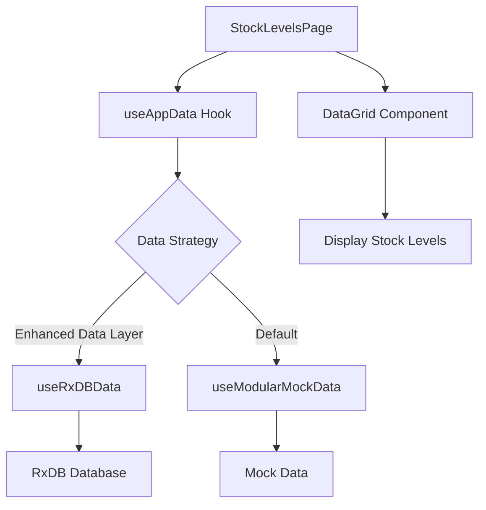
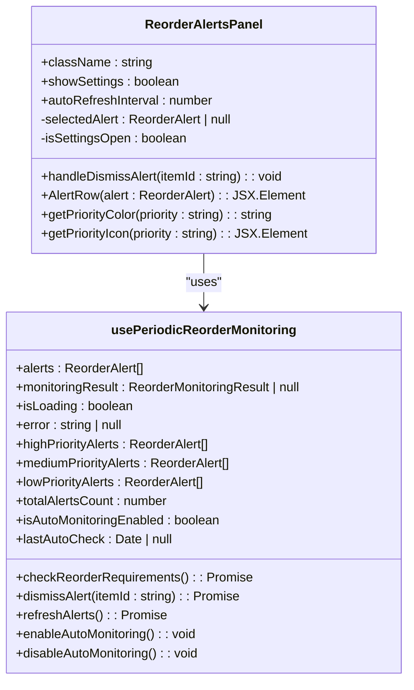
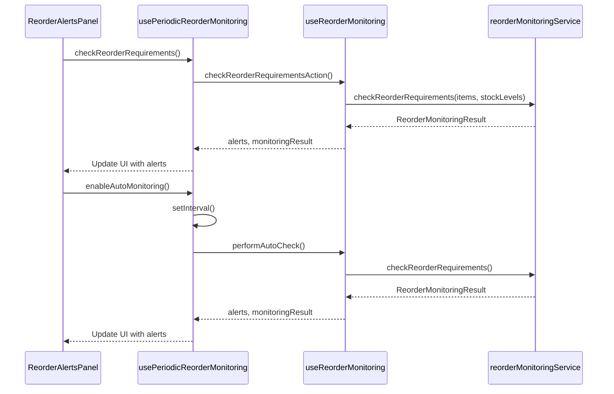
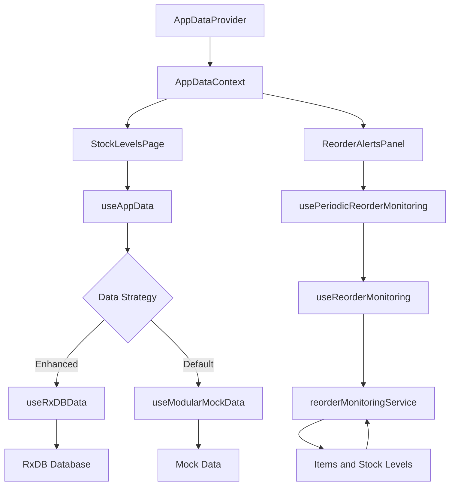

# Real-time Stock Level Tracking and Alerts

<cite>
**Referenced Files in This Document**   
- [StockLevelsPage.tsx](file://src/modules/inventory/pages/StockLevelsPage.tsx)
- [useStockLevelData.ts](file://src/modules/inventory/data/useStockLevelData.ts)
- [ReorderAlertsPanel.tsx](file://src/modules/inventory/components/ReorderAlertsPanel.tsx)
- [useReorderMonitoring.ts](file://src/modules/inventory/hooks/useReorderMonitoring.ts)
- [reorderMonitoringService.ts](file://src/modules/inventory/services/reorderMonitoringService.ts)
- [useAppData.ts](file://src/hooks/useAppData.ts)
- [AppDataContext.tsx](file://src/contexts/AppDataContext.tsx)
- [useRxDBData.ts](file://src/hooks/useRxDBData.ts)
- [useModularMockData.ts](file://src/hooks/useModularMockData.ts)
</cite>

## Table of Contents
1. [Introduction](#introduction)
2. [Stock Levels Page Implementation](#stock-levels-page-implementation)
3. [Data Fetching with useStockLevelData](#data-fetching-with-usestockleveldata)
4. [Reorder Alerts Panel](#reorder-alerts-panel)
5. [Reorder Monitoring System](#reorder-monitoring-system)
6. [Alert Calculation Logic](#alert-calculation-logic)
7. [Data Flow Architecture](#data-flow-architecture)
8. [Common Issues and Best Practices](#common-issues-and-best-practices)
9. [Conclusion](#conclusion)

## Introduction
This document provides a comprehensive analysis of the real-time stock level monitoring system in the Inventory module. The system enables users to track inventory quantities across multiple warehouses, monitor minimum/maximum thresholds, and receive automated reorder alerts. The implementation leverages React hooks for reactive data fetching, RxDB for database operations, and a sophisticated alerting system that calculates reorder requirements based on current stock levels and configured thresholds.

## Stock Levels Page Implementation

The `StockLevelsPage` component serves as the primary interface for viewing current inventory levels across all warehouses. It provides filtering capabilities by warehouse and item category, and displays stock information in a tabular format.



**Diagram sources**
- [StockLevelsPage.tsx](file://src/modules/inventory/pages/StockLevelsPage.tsx)
- [useAppData.ts](file://src/hooks/useAppData.ts)
- [AppDataContext.tsx](file://src/contexts/AppDataContext.tsx)

**Section sources**
- [StockLevelsPage.tsx](file://src/modules/inventory/pages/StockLevelsPage.tsx#L10-L103)

## Data Fetching with useStockLevelData

The `useStockLevelData` hook is responsible for managing stock level data, including fetching, creating, updating, and removing records. Currently, it uses mock data but is designed to interface with RxDB for real-time data operations.

```typescript
const useStockLevelData = () => {
  const [stockLevels, setStockLevels] = useState<any[]>([]);
  const [isLoading, setIsLoading] = useState<boolean>(true);
  const [error, setError] = useState<string | null>(null);

  useEffect(() => {
    try {
      // Simulate fetching data from a mock source
      setStockLevels(initialMockUsers);
      setIsLoading(false);
    } catch (e) {
      setError('Failed to fetch stock levels');
      setIsLoading(false);
    }
  }, []);

  const create = async (newItem: Partial<any>) => {
    const newDataItem: any = {
      ...newItem,
      id: Date.now(),
      created_at: new Date().toISOString(),
      updated_at: new Date().toISOString()
    } as any;
    setStockLevels((prev: any[]) => [...prev, newDataItem]);
    return newDataItem;
  };

  const update = async (id: number, updatedData: Partial<any>) => {
    setStockLevels((prev: any[]) => prev.map((item: any) =>
      item.id === id
        ? { ...item, ...updatedData, updated_at: new Date().toISOString() }
        : item
    ));
  };

  const remove = async (id: number) => {
    setStockLevels((prev: any[]) => prev.filter((item: any) => item.id !== id));
  };

  return {
    data: stockLevels,
    isLoading,
    error,
    create,
    update,
    remove
  };
};
```

**Section sources**
- [useStockLevelData.ts](file://src/modules/inventory/data/useStockLevelData.ts#L7-L54)

## Reorder Alerts Panel

The `ReorderAlertsPanel` component displays active reorder alerts, categorized by priority (HIGH, MEDIUM, LOW). It provides a user interface for viewing alert details, dismissing alerts, and configuring auto-monitoring settings.



**Diagram sources**
- [ReorderAlertsPanel.tsx](file://src/modules/inventory/components/ReorderAlertsPanel.tsx)
- [useReorderMonitoring.ts](file://src/modules/inventory/hooks/useReorderMonitoring.ts)

**Section sources**
- [ReorderAlertsPanel.tsx](file://src/modules/inventory/components/ReorderAlertsPanel.tsx#L57-L469)

## Reorder Monitoring System

The reorder monitoring system consists of two hooks: `useReorderMonitoring` and `usePeriodicReorderMonitoring`. The former handles the core logic for checking reorder requirements and managing alerts, while the latter adds periodic auto-check functionality.



**Diagram sources**
- [useReorderMonitoring.ts](file://src/modules/inventory/hooks/useReorderMonitoring.ts)
- [reorderMonitoringService.ts](file://src/modules/inventory/services/reorderMonitoringService.ts)

**Section sources**
- [useReorderMonitoring.ts](file://src/modules/inventory/hooks/useReorderMonitoring.ts#L30-L134)
- [useReorderMonitoring.ts](file://src/modules/inventory/hooks/useReorderMonitoring.ts#L140-L183)

## Alert Calculation Logic

The alert calculation logic is implemented in the `reorderMonitoringService.ts` file, which contains functions for checking reorder requirements, calculating suggested order quantities, and determining alert priorities.

### Reorder Requirements Check
The `checkReorderRequirements` function evaluates all items with configured reorder points and generates alerts when current stock falls at or below the reorder point.

```typescript
export function checkReorderRequirements(
  items: InvItemType[],
  stockLevels: InvStockLevelType[]
): ReorderMonitoringResult {
  try {
    const itemsWithReorderPoints = items.filter(
      (item: InvItemType) => item.reorder_point !== null && item.reorder_point !== undefined
    );

    const stockLevelMap = new Map<string, InvStockLevelType>();
    stockLevels.forEach((level: InvStockLevelType) => {
      stockLevelMap.set(level.item_id, level);
    });

    const alerts: ReorderAlert[] = [];
    let itemsBelowReorderPoint = 0;

    for (const item of itemsWithReorderPoints) {
      const stockLevel = stockLevelMap.get(item.id);
      if (!stockLevel) continue;

      const currentStock = stockLevel.quantity_on_hand || 0;
      const reorderPoint = item.reorder_point || 0;
      const reorderQuantity = item.reorder_quantity || 0;

      if (currentStock <= reorderPoint) {
        itemsBelowReorderPoint++;

        const suggestedQuantity = calculateSuggestedOrderQuantity(
          item,
          stockLevel,
          currentStock
        );

        const priority = determineAlertPriority(currentStock, reorderPoint);

        const alert: ReorderAlert = {
          item_id: item.id,
          item_name: item.name,
          current_stock: currentStock,
          reorder_point: reorderPoint,
          reorder_quantity: reorderQuantity,
          suggested_order_quantity: suggestedQuantity,
          alert_type: currentStock === 0 ? 'REORDER_REQUIRED' : 'LOW_STOCK',
          priority
        };

        alerts.push(alert);
      }
    }

    return {
      alerts,
      items_below_reorder_point: itemsBelowReorderPoint,
      total_items_monitored: itemsWithReorderPoints.length,
      last_check: new Date()
    };
  } catch (error) {
    console.error('Error checking reorder requirements:', error);
    throw error;
  }
}
```

### Suggested Order Quantity Calculation
The `calculateSuggestedOrderQuantity` function determines the optimal quantity to order based on item configuration.

```typescript
function calculateSuggestedOrderQuantity(
  item: InvItemType,
  stockLevel: InvStockLevelType,
  currentStock: number
): number {
  const reorderQuantity = item.reorder_quantity || 0;
  const maxStockLevel = item.max_stock_level || 0;

  if (reorderQuantity > 0) {
    return reorderQuantity;
  }

  if (maxStockLevel > 0) {
    return Math.max(maxStockLevel - currentStock, 1);
  }

  const reorderPoint = item.reorder_point || 0;
  return Math.max(reorderPoint * 2, 10);
}
```

### Alert Priority Determination
The `determineAlertPriority` function assigns priority levels based on how far below the reorder point the current stock is.

```typescript
function determineAlertPriority(
  currentStock: number,
  reorderPoint: number
): 'HIGH' | 'MEDIUM' | 'LOW' {
  if (currentStock === 0) {
    return 'HIGH';
  }

  const percentageBelow = ((reorderPoint - currentStock) / reorderPoint) * 100;

  if (percentageBelow >= 50) {
    return 'HIGH';
  } else if (percentageBelow >= 25) {
    return 'MEDIUM';
  } else {
    return 'LOW';
  }
}
```

**Section sources**
- [reorderMonitoringService.ts](file://src/modules/inventory/services/reorderMonitoringService.ts#L70-L136)
- [reorderMonitoringService.ts](file://src/modules/inventory/services/reorderMonitoringService.ts#L23-L43)
- [reorderMonitoringService.ts](file://src/modules/inventory/services/reorderMonitoringService.ts#L48-L65)

## Data Flow Architecture

The data flow architecture for the inventory system follows a hierarchical pattern where data is provided through React context and consumed by various components.



**Diagram sources**
- [AppDataContext.tsx](file://src/contexts/AppDataContext.tsx)
- [useAppData.ts](file://src/hooks/useAppData.ts)
- [useRxDBData.ts](file://src/hooks/useRxDBData.ts)
- [useModularMockData.ts](file://src/hooks/useModularMockData.ts)

**Section sources**
- [AppDataContext.tsx](file://src/contexts/AppDataContext.tsx#L25-L142)
- [useAppData.ts](file://src/hooks/useAppData.ts#L8-L14)
- [useRxDBData.ts](file://src/hooks/useRxDBData.ts#L100-L304)
- [useModularMockData.ts](file://src/hooks/useModularMockData.ts#L41-L258)

## Common Issues and Best Practices

### Common Issues

**Negative Balances**
Negative stock balances can occur due to transaction errors or system bugs. The current implementation does not explicitly handle negative balances, which could lead to inaccurate inventory reporting.

**Phantom Stock**
Phantom stock (inventory that exists in the system but not in physical warehouses) can result from poor cycle counting practices or transaction recording errors. The system lacks specific mechanisms to detect and resolve phantom stock issues.

**Threshold Misconfiguration**
Incorrectly configured minimum/maximum thresholds or reorder points can lead to overstocking or stockouts. The system does not validate threshold configurations against historical usage patterns.

### Best Practices

**Cycle Counting**
Implement regular cycle counting procedures to verify physical inventory against system records. This helps identify and correct discrepancies before they become significant.

**Demand Forecasting**
Use historical usage data to forecast future demand and set appropriate reorder points. Consider seasonal variations and growth trends when calculating reorder quantities.

**Automated Reconciliation**
Implement automated reconciliation processes that compare system inventory with physical counts and flag significant discrepancies for investigation.

**Threshold Review**
Regularly review and adjust minimum/maximum thresholds and reorder points based on actual usage patterns, lead times, and business requirements.

**Audit Trails**
Maintain comprehensive audit trails for all inventory transactions to facilitate error detection and correction.

## Conclusion
The real-time stock level monitoring system in the Inventory module provides a solid foundation for tracking inventory across multiple warehouses and generating reorder alerts. While the current implementation uses mock data, it is designed to integrate with RxDB for real-time data operations. The system's modular architecture, with separate hooks for data fetching, monitoring, and alert calculation, allows for flexibility and maintainability. To enhance the system, consider implementing proper validation for negative balances, adding mechanisms to detect phantom stock, and incorporating demand forecasting algorithms to optimize reorder points and quantities.