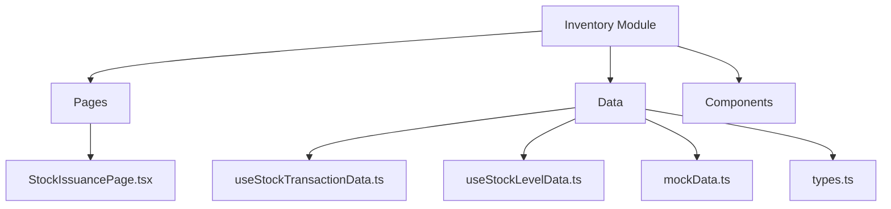
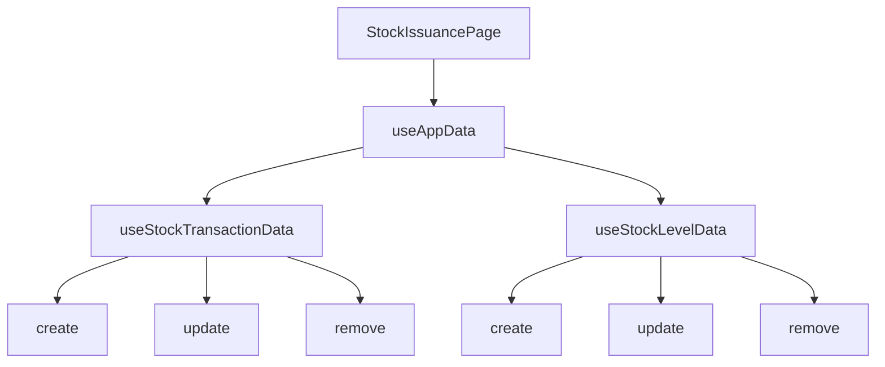
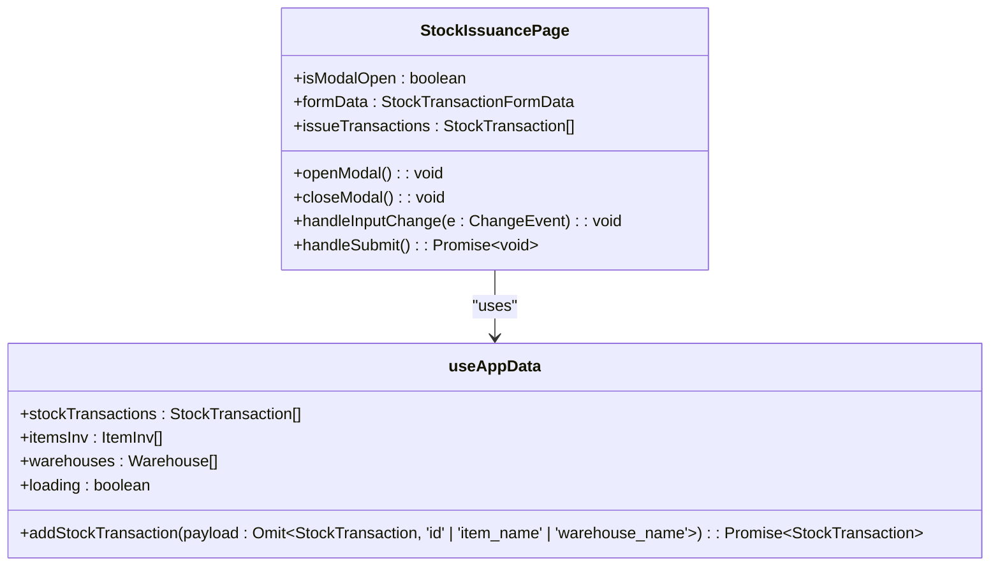
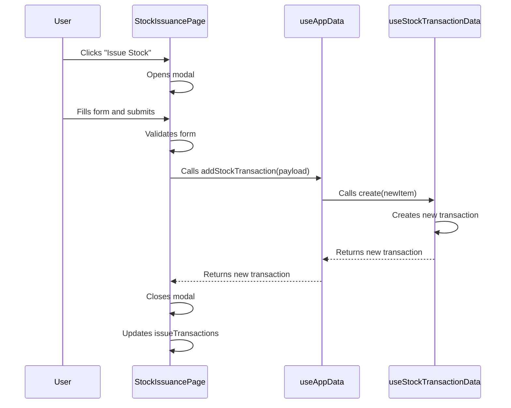
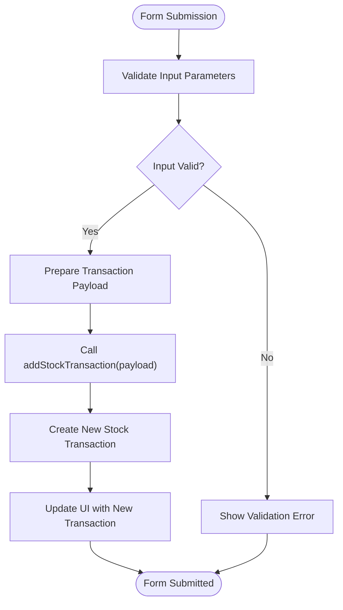
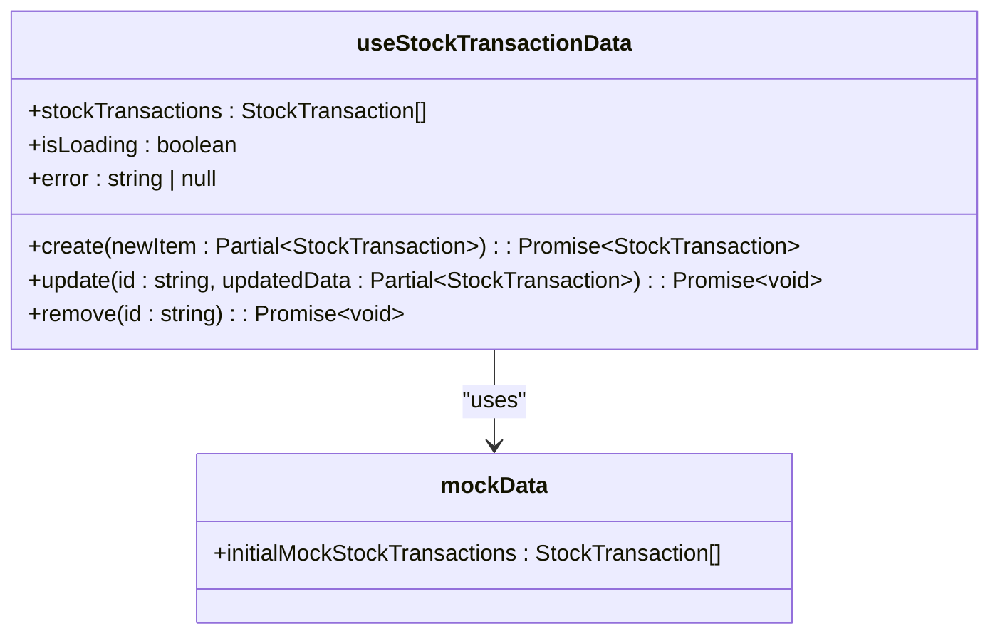
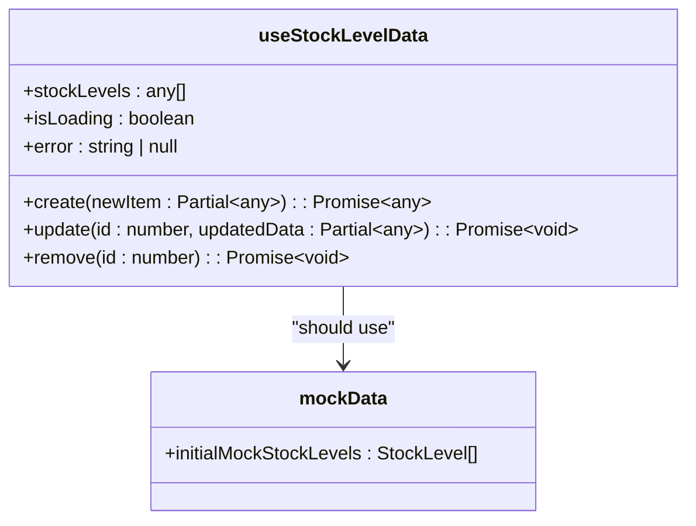

# Stock Issuance and Internal Distribution

<cite>
**Referenced Files in This Document**   
- [StockIssuancePage.tsx](file://src/modules/inventory/pages/StockIssuancePage.tsx)
- [useStockTransactionData.ts](file://src/modules/inventory/data/useStockTransactionData.ts)
- [useStockLevelData.ts](file://src/modules/inventory/data/useStockLevelData.ts)
- [mockData.ts](file://src/modules/inventory/data/mockData.ts)
- [types.ts](file://src/modules/inventory/data/types.ts)
- [core/types.ts](file://src/core/types.ts)
</cite>

## Table of Contents
1. [Introduction](#introduction)
2. [Project Structure](#project-structure)
3. [Core Components](#core-components)
4. [Architecture Overview](#architecture-overview)
5. [Detailed Component Analysis](#detailed-component-analysis)
6. [Dependency Analysis](#dependency-analysis)
7. [Performance Considerations](#performance-considerations)
8. [Troubleshooting Guide](#troubleshooting-guide)
9. [Conclusion](#conclusion)

## Introduction
This document provides a comprehensive overview of the stock issuance operations within the Inventory module of the SchoolPilot system. It details the workflow for distributing inventory to departments or users, including requisition fulfillment, approval workflows, and departmental charge tracking. The implementation of the StockIssuancePage and its integration with useStockTransactionData for creating issue records and updating stock levels are thoroughly analyzed. Practical examples from the codebase illustrate how available stock is validated before issuance, how batch selection is handled, and how transactions are logged for audit purposes. Common issues such as unauthorized requests, insufficient stock, and incorrect item selection are addressed, along with best practices for access control and reconciliation.

## Project Structure
The project structure is organized in a modular fashion, with the Inventory module located under `src/modules/inventory`. The key components relevant to stock issuance are found in the `pages` and `data` directories. The `pages` directory contains the `StockIssuancePage.tsx` component, which is the primary interface for issuing stock. The `data` directory houses the `useStockTransactionData.ts` and `useStockLevelData.ts` hooks, which manage stock transactions and stock levels, respectively. Mock data for the inventory module is provided in `mockData.ts`, and type definitions are centralized in `types.ts`.



**Diagram sources**
- [StockIssuancePage.tsx](file://src/modules/inventory/pages/StockIssuancePage.tsx)
- [useStockTransactionData.ts](file://src/modules/inventory/data/useStockTransactionData.ts)
- [useStockLevelData.ts](file://src/modules/inventory/data/useStockLevelData.ts)
- [mockData.ts](file://src/modules/inventory/data/mockData.ts)
- [types.ts](file://src/modules/inventory/data/types.ts)

**Section sources**
- [StockIssuancePage.tsx](file://src/modules/inventory/pages/StockIssuancePage.tsx)
- [useStockTransactionData.ts](file://src/modules/inventory/data/useStockTransactionData.ts)
- [useStockLevelData.ts](file://src/modules/inventory/data/useStockLevelData.ts)
- [mockData.ts](file://src/modules/inventory/data/mockData.ts)
- [types.ts](file://src/modules/inventory/data/types.ts)

## Core Components
The core components of the stock issuance functionality are the `StockIssuancePage` component and the `useStockTransactionData` and `useStockLevelData` hooks. The `StockIssuancePage` component provides the user interface for issuing stock, while the hooks manage the underlying data operations. The `useStockTransactionData` hook handles CRUD operations for stock transactions, and the `useStockLevelData` hook manages stock levels. These components work together to ensure that stock issuance is recorded accurately and that stock levels are updated accordingly.

**Section sources**
- [StockIssuancePage.tsx](file://src/modules/inventory/pages/StockIssuancePage.tsx)
- [useStockTransactionData.ts](file://src/modules/inventory/data/useStockTransactionData.ts)
- [useStockLevelData.ts](file://src/modules/inventory/data/useStockLevelData.ts)

## Architecture Overview
The architecture of the stock issuance functionality is based on a React component model with custom hooks for data management. The `StockIssuancePage` component uses the `useAppData` hook to access data from the `useStockTransactionData`, `useStockLevelData`, and other data hooks. The `useStockTransactionData` hook provides CRUD operations for stock transactions, while the `useStockLevelData` hook manages stock levels. The `StockIssuancePage` component renders a form for issuing stock, which is submitted to the `useStockTransactionData` hook to create a new stock transaction.



**Diagram sources**
- [StockIssuancePage.tsx](file://src/modules/inventory/pages/StockIssuancePage.tsx)
- [useAppData.ts](file://src/hooks/useAppData.ts)
- [useStockTransactionData.ts](file://src/modules/inventory/data/useStockTransactionData.ts)
- [useStockLevelData.ts](file://src/modules/inventory/data/useStockLevelData.ts)

## Detailed Component Analysis

### StockIssuancePage Analysis
The `StockIssuancePage` component is the primary interface for issuing stock. It renders a form that allows users to select an item, warehouse, quantity, and issuance date, and to add notes. The form is validated before submission, and the data is sent to the `useStockTransactionData` hook to create a new stock transaction. The component also displays a list of existing stock issuance records in a data grid.

#### For Object-Oriented Components:


**Diagram sources**
- [StockIssuancePage.tsx](file://src/modules/inventory/pages/StockIssuancePage.tsx)
- [useAppData.ts](file://src/hooks/useAppData.ts)

#### For API/Service Components:


**Diagram sources**
- [StockIssuancePage.tsx](file://src/modules/inventory/pages/StockIssuancePage.tsx)
- [useAppData.ts](file://src/hooks/useAppData.ts)
- [useStockTransactionData.ts](file://src/modules/inventory/data/useStockTransactionData.ts)

#### For Complex Logic Components:


**Diagram sources**
- [StockIssuancePage.tsx](file://src/modules/inventory/pages/StockIssuancePage.tsx)
- [useAppData.ts](file://src/hooks/useAppData.ts)
- [useStockTransactionData.ts](file://src/modules/inventory/data/useStockTransactionData.ts)

**Section sources**
- [StockIssuancePage.tsx](file://src/modules/inventory/pages/StockIssuancePage.tsx)
- [useAppData.ts](file://src/hooks/useAppData.ts)
- [useStockTransactionData.ts](file://src/modules/inventory/data/useStockTransactionData.ts)

### useStockTransactionData Analysis
The `useStockTransactionData` hook manages stock transactions by providing CRUD operations. It uses React's `useState` and `useEffect` hooks to manage the state of stock transactions. The `create` function adds a new stock transaction to the state, the `update` function updates an existing transaction, and the `remove` function removes a transaction. The hook initializes the state with mock data from `mockData.ts`.

#### For Object-Oriented Components:


**Diagram sources**
- [useStockTransactionData.ts](file://src/modules/inventory/data/useStockTransactionData.ts)
- [mockData.ts](file://src/modules/inventory/data/mockData.ts)

**Section sources**
- [useStockTransactionData.ts](file://src/modules/inventory/data/useStockTransactionData.ts)
- [mockData.ts](file://src/modules/inventory/data/mockData.ts)

### useStockLevelData Analysis
The `useStockLevelData` hook is intended to manage stock levels, but it currently has a bug where it uses `initialMockUsers` from the administration module instead of inventory-specific mock data. This hook should be updated to use `initialMockStockLevels` from `mockData.ts` to correctly manage stock levels.

#### For Object-Oriented Components:


**Diagram sources**
- [useStockLevelData.ts](file://src/modules/inventory/data/useStockLevelData.ts)
- [mockData.ts](file://src/modules/inventory/data/mockData.ts)

**Section sources**
- [useStockLevelData.ts](file://src/modules/inventory/data/useStockLevelData.ts)
- [mockData.ts](file://src/modules/inventory/data/mockData.ts)

## Dependency Analysis
The stock issuance functionality depends on several components and data sources. The `StockIssuancePage` component depends on the `useAppData` hook, which in turn depends on the `useStockTransactionData` and `useStockLevelData` hooks. The `useStockTransactionData` hook depends on `mockData.ts` for initial data, and the `useStockLevelData` hook should depend on `mockData.ts` for stock level data. There is a bug in the `useStockLevelData` hook where it uses `initialMockUsers` instead of `initialMockStockLevels`.

```mermaid
graph TD
A[StockIssuancePage] --> B[useAppData]
B --> C[useStockTransactionData]
B --> D[useStockLevelData]
C --> E[mockData.ts]
D --> F[mockData.ts]
D --> G[administration/data/mockData.ts] : "Bug: Should not depend on this"
```

**Diagram sources**
- [StockIssuancePage.tsx](file://src/modules/inventory/pages/StockIssuancePage.tsx)
- [useAppData.ts](file://src/hooks/useAppData.ts)
- [useStockTransactionData.ts](file://src/modules/inventory/data/useStockTransactionData.ts)
- [useStockLevelData.ts](file://src/modules/inventory/data/useStockLevelData.ts)
- [mockData.ts](file://src/modules/inventory/data/mockData.ts)
- [administration/data/mockData.ts](file://src/modules/administration/data/mockData.ts)

**Section sources**
- [StockIssuancePage.tsx](file://src/modules/inventory/pages/StockIssuancePage.tsx)
- [useAppData.ts](file://src/hooks/useAppData.ts)
- [useStockTransactionData.ts](file://src/modules/inventory/data/useStockTransactionData.ts)
- [useStockLevelData.ts](file://src/modules/inventory/data/useStockLevelData.ts)
- [mockData.ts](file://src/modules/inventory/data/mockData.ts)
- [administration/data/mockData.ts](file://src/modules/administration/data/mockData.ts)

## Performance Considerations
The stock issuance functionality is currently using mock data, which is suitable for development and testing but not for production. In a production environment, the data should be fetched from a backend API or a database. The `useStockTransactionData` and `useStockLevelData` hooks should be updated to use a real data source, and the `useAppData` hook should be updated to handle loading states and errors appropriately. Additionally, the `useStockLevelData` hook has a bug that should be fixed to ensure correct stock level management.

## Troubleshooting Guide
Common issues with the stock issuance functionality include:
- **Insufficient Stock**: The system does not currently validate that there is sufficient stock before issuing an item. This should be implemented in the `handleSubmit` function of the `StockIssuancePage` component.
- **Incorrect Item Selection**: The system allows any item to be selected, but it should validate that the selected item is available in the selected warehouse.
- **Unauthorized Requests**: The system does not currently enforce access control. This should be implemented using the RBAC service.
- **Stock Level Update**: The `useStockLevelData` hook is not correctly updating stock levels because it is using the wrong mock data. This should be fixed by updating the hook to use `initialMockStockLevels`.

**Section sources**
- [StockIssuancePage.tsx](file://src/modules/inventory/pages/StockIssuancePage.tsx)
- [useStockTransactionData.ts](file://src/modules/inventory/data/useStockTransactionData.ts)
- [useStockLevelData.ts](file://src/modules/inventory/data/useStockLevelData.ts)
- [mockData.ts](file://src/modules/inventory/data/mockData.ts)

## Conclusion
The stock issuance functionality in the Inventory module is well-structured and provides a user-friendly interface for issuing stock. However, there are several issues that need to be addressed, including the bug in the `useStockLevelData` hook and the lack of validation for stock availability and access control. By fixing these issues and updating the system to use a real data source, the functionality can be made robust and suitable for production use.