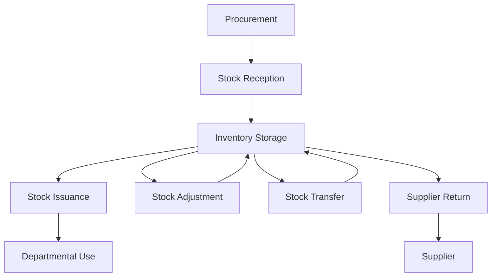
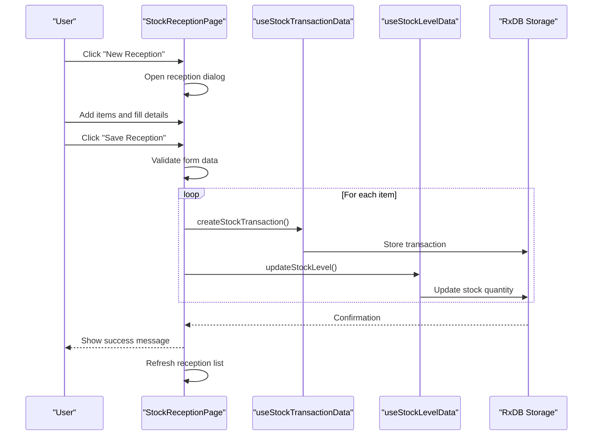
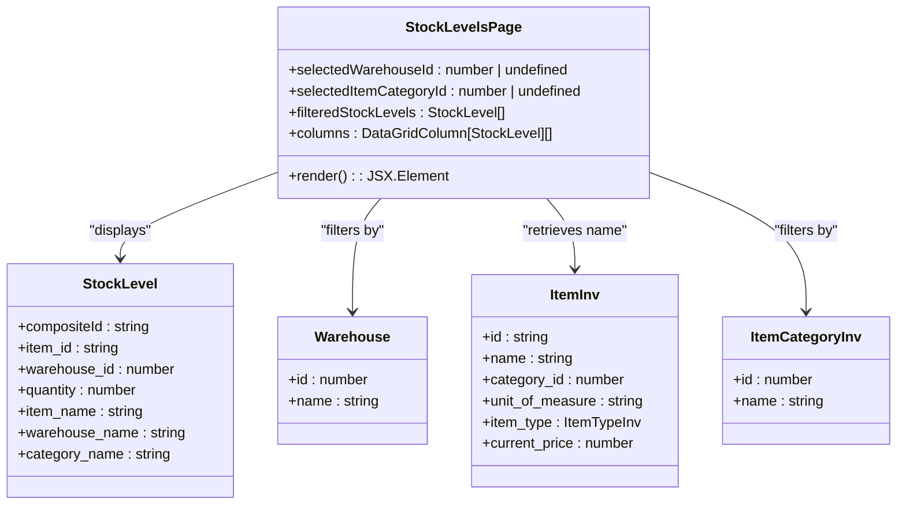
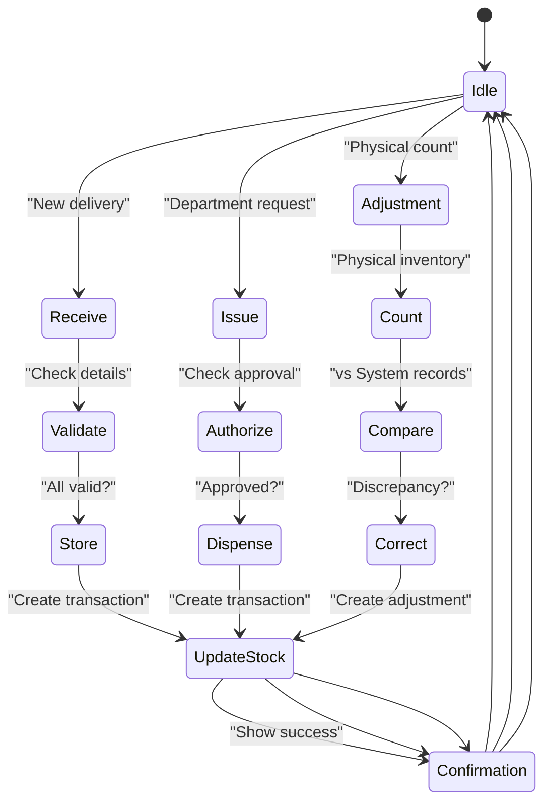

# Stock Management Operations

<cite>
**Referenced Files in This Document**   
- [StockLevelsPage.tsx](file://src/modules/inventory/pages/StockLevelsPage.tsx)
- [StockReceptionPage.tsx](file://src/modules/inventory/pages/StockReceptionPage.tsx)
- [useStockLevelData.ts](file://src/modules/inventory/data/useStockLevelData.ts)
- [useStockTransactionData.ts](file://src/modules/inventory/data/useStockTransactionData.ts)
- [mockData.ts](file://src/modules/inventory/data/mockData.ts)
- [types.ts](file://src/core/types.ts)
</cite>

## Table of Contents
1. [Introduction](#introduction)
2. [Stock Lifecycle Overview](#stock-lifecycle-overview)
3. [Stock Reception Process](#stock-reception-process)
4. [Real-Time Inventory Tracking](#real-time-inventory-tracking)
5. [Data Access and State Management](#data-access-and-state-management)
6. [Stock Transaction Types and Workflows](#stock-transaction-types-and-workflows)
7. [Batch and Expiry Management](#batch-and-expiry-management)
8. [Common Inventory Issues and Best Practices](#common-inventory-issues-and-best-practices)

## Introduction
The Inventory module in the SchoolPilot system provides comprehensive stock management capabilities for educational institutions. This document details the complete lifecycle of stock handling operations, including receipt of goods, internal transfers, issuance to departments, and returns to suppliers. The system is designed to maintain accurate inventory records across multiple warehouses, support batch and serial number tracking, and manage expiry dates for perishable items. The implementation leverages React components and custom hooks to provide a user-friendly interface for inventory management, with data persistence through RxDB-backed storage.

## Stock Lifecycle Overview
The stock management system follows a complete lifecycle from procurement to consumption or disposal. The lifecycle begins with the creation of purchase orders and receipt of goods into designated warehouses. Once received, stock items are available for issuance to various departments such as administration, academics, or kitchen operations. The system tracks all movements through transaction logging, maintaining a complete audit trail. Stock levels are continuously updated in real-time, with support for adjustments to correct discrepancies identified during physical counts. The lifecycle concludes with either the complete consumption of items or their return to suppliers in cases of defects or over-ordering.



**Diagram sources**
- [StockReceptionPage.tsx](file://src/modules/inventory/pages/StockReceptionPage.tsx)
- [types.ts](file://src/core/types.ts)

## Stock Reception Process
The stock reception process is managed through the StockReceptionPage component, which provides a comprehensive interface for recording incoming shipments. Users can create new receptions or view existing ones, with each reception containing multiple items from a single delivery. The interface includes fields for reception date, reference numbers, supplier references, and general notes. For each item received, users specify the item type, quantity, warehouse destination, batch/lot number, expiry date, and item-specific notes.

The reception workflow begins with clicking the "New Reception" button, which opens a dialog form. Users can add multiple items to a single reception by clicking "Add Item" and selecting from the available inventory items. The form includes validation to ensure all required fields are completed before submission. When saving a reception, the system creates stock transaction records for each item and updates the corresponding stock levels in the designated warehouses.



**Diagram sources**
- [StockReceptionPage.tsx](file://src/modules/inventory/pages/StockReceptionPage.tsx#L59-L536)
- [useStockTransactionData.ts](file://src/modules/inventory/data/useStockTransactionData.ts)
- [useStockLevelData.ts](file://src/modules/inventory/data/useStockLevelData.ts)

**Section sources**
- [StockReceptionPage.tsx](file://src/modules/inventory/pages/StockReceptionPage.tsx#L59-L536)

## Real-Time Inventory Tracking
The StockLevelsPage component provides real-time visibility into inventory levels across all warehouses. The interface displays a data grid showing item names, warehouse locations, and current quantities on hand. Users can filter the view by warehouse and item category to focus on specific inventory segments. The page retrieves stock level data through the useAppData hook, which aggregates information from multiple data sources including stock levels, warehouses, items, and item categories.

The filtering functionality allows users to quickly identify items that are running low or have excess inventory. The data grid supports sorting and filtering on all columns, enabling users to organize information based on their specific needs. When stock levels fall below predefined thresholds, the system can trigger reorder alerts through the ReorderAlertsPanel component, helping prevent stockouts.



**Diagram sources**
- [StockLevelsPage.tsx](file://src/modules/inventory/pages/StockLevelsPage.tsx#L10-L103)
- [types.ts](file://src/core/types.ts)

**Section sources**
- [StockLevelsPage.tsx](file://src/modules/inventory/pages/StockLevelsPage.tsx#L10-L103)

## Data Access and State Management
The inventory system utilizes custom React hooks to manage data access and state. The useStockLevelData and useStockTransactionData hooks provide CRUD operations for stock levels and transactions respectively. These hooks encapsulate the data access logic, exposing create, update, and remove functions while maintaining internal state for loading status and error conditions.

The hooks currently use mock data for demonstration purposes, but are designed to interface with RxDB for persistent storage in production environments. The useStockLevelData hook manages stock level records, which are identified by a composite ID combining item ID, warehouse ID, and optionally batch number. The useStockTransactionData hook manages transaction records, which include details such as transaction type, quantity, date, and source information.

```mermaid
classDiagram
class useStockLevelData {
+stockLevels : any[]
+isLoading : boolean
+error : string | null
+create(newItem : Partial~any~) : Promise~any~
+update(id : number, updatedData : Partial~any~) : Promise~void~
+remove(id : number) : Promise~void~
+return : {data, isLoading, error, create, update, remove}
}
class useStockTransactionData {
+stockTransactions : StockTransaction[]
+isLoading : boolean
+error : string | null
+create(newItem : Partial~StockTransaction~) : Promise~StockTransaction~
+update(id : string, updatedData : Partial~StockTransaction~) : Promise~void~
+remove(id : string) : Promise~void~
+return : {data, isLoading, error, create, update, remove}
}
class StockTransaction {
+id : string
+item_id : string
+warehouse_id : number
+transaction_type : StockTransactionType
+quantity : number
+transaction_date : string
+batch_number? : string
+expiry_date? : string
+source_table? : string
+source_id? : string
+notes? : string
+created_at : string
+updated_at : string
}
useStockLevelData --> StockLevel : "manages"
useStockTransactionData --> StockTransaction : "manages"
```

**Diagram sources**
- [useStockLevelData.ts](file://src/modules/inventory/data/useStockLevelData.ts#L7-L54)
- [useStockTransactionData.ts](file://src/modules/inventory/data/useStockTransactionData.ts#L7-L54)
- [types.ts](file://src/core/types.ts)

**Section sources**
- [useStockLevelData.ts](file://src/modules/inventory/data/useStockLevelData.ts#L7-L54)
- [useStockTransactionData.ts](file://src/modules/inventory/data/useStockTransactionData.ts#L7-L54)

## Stock Transaction Types and Workflows
The inventory system supports three primary transaction types: RECEIVE, ISSUE, and ADJUSTMENT. RECEIVE transactions represent the addition of stock to a warehouse, typically from supplier deliveries. ISSUE transactions represent the removal of stock for departmental use or consumption. ADJUSTMENT transactions are used to correct discrepancies between physical counts and system records, accounting for losses, damages, or counting errors.

Each transaction includes metadata such as date, source reference, and notes to provide context. The transaction_type field uses the StockTransactionType enum to ensure data consistency. Transactions are linked to specific items and warehouses, enabling accurate tracking of inventory movements. The system maintains a complete history of all transactions, which can be used for auditing, reconciliation, and reporting purposes.



**Diagram sources**
- [types.ts](file://src/core/types.ts)
- [mockData.ts](file://src/modules/inventory/data/mockData.ts)

## Batch and Expiry Management
The system supports batch/lot number tracking and expiry date management for items that require these controls, such as foodstuffs or laboratory chemicals. When receiving such items, users can specify batch numbers and expiry dates, which are stored with the transaction record and used to update the corresponding stock level. This enables traceability in case of recalls and helps prevent the use of expired materials.

The stock level records can be configured to track inventory by batch, allowing for first-expiry-first-out (FEFO) inventory management. When issuing items with expiry dates, the system can alert users if they are selecting batches that are close to expiration. This functionality is particularly important for kitchen operations and laboratory settings where using expired materials could have safety implications.

**Section sources**
- [StockReceptionPage.tsx](file://src/modules/inventory/pages/StockReceptionPage.tsx#L59-L536)
- [types.ts](file://src/core/types.ts)

## Common Inventory Issues and Best Practices
The inventory system addresses common challenges such as stockouts, overstocking, and negative balances through various mechanisms. Stockouts are prevented through reorder alerts and minimum stock level monitoring. Overstocking is mitigated by purchase order controls and inventory turnover analysis. Negative balances are prevented through transaction validation that ensures sufficient stock is available before processing issues.

Best practices for inventory management include regular cycle counting to maintain accuracy, timely recording of all transactions, and periodic reconciliation of physical and system inventory. The system supports these practices through features like stock adjustment transactions, comprehensive transaction logging, and detailed reporting capabilities. For optimal inventory management, institutions should establish clear procedures for receiving, storing, and issuing stock, and ensure all staff are trained on these procedures.

**Section sources**
- [StockReceptionPage.tsx](file://src/modules/inventory/pages/StockReceptionPage.tsx#L59-L536)
- [StockLevelsPage.tsx](file://src/modules/inventory/pages/StockLevelsPage.tsx#L10-L103)
- [mockData.ts](file://src/modules/inventory/data/mockData.ts)