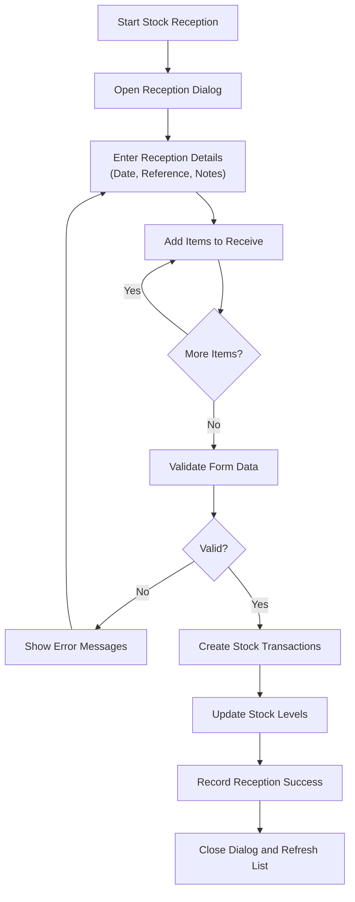
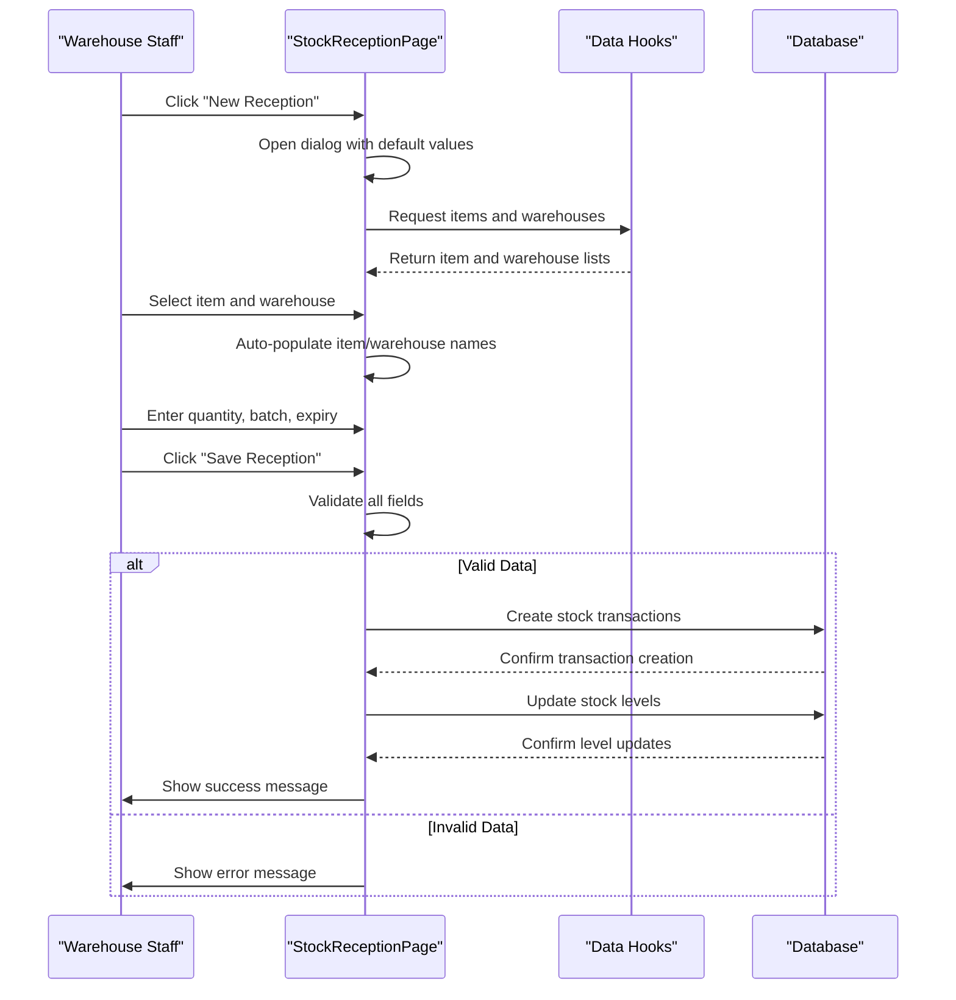
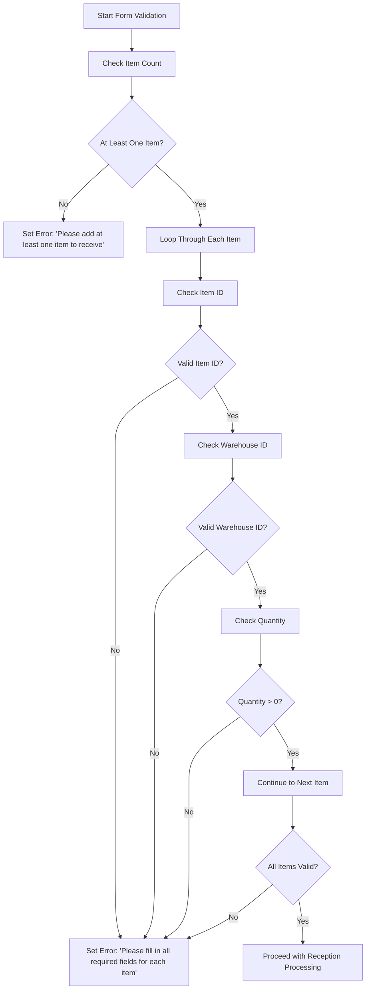
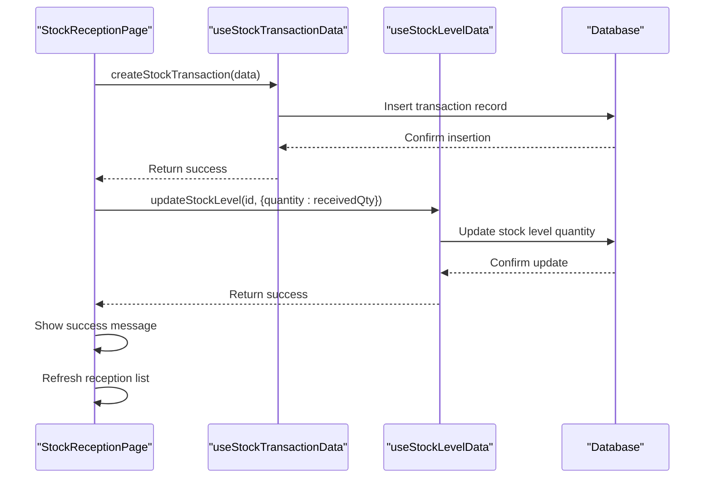
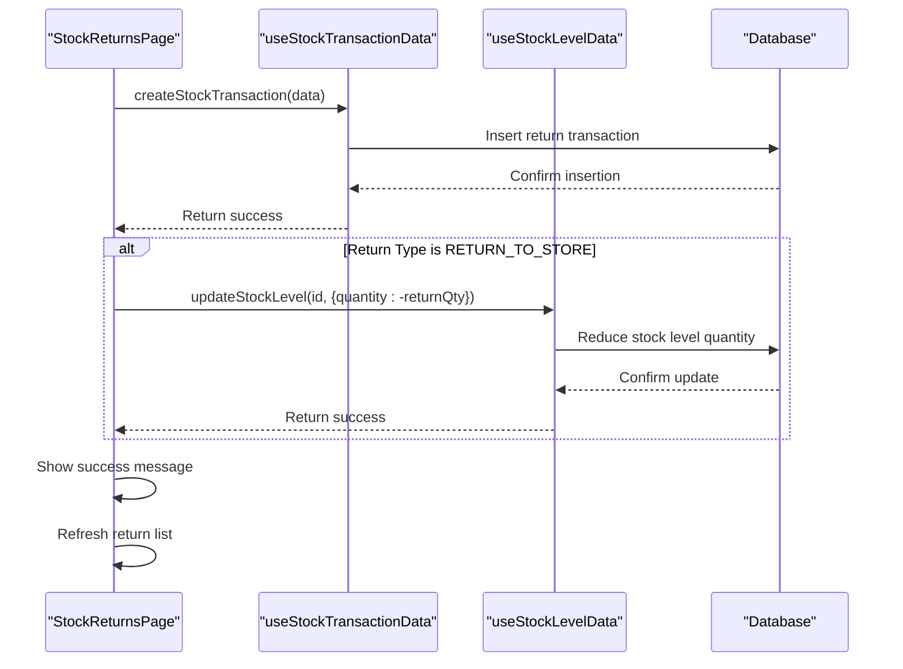
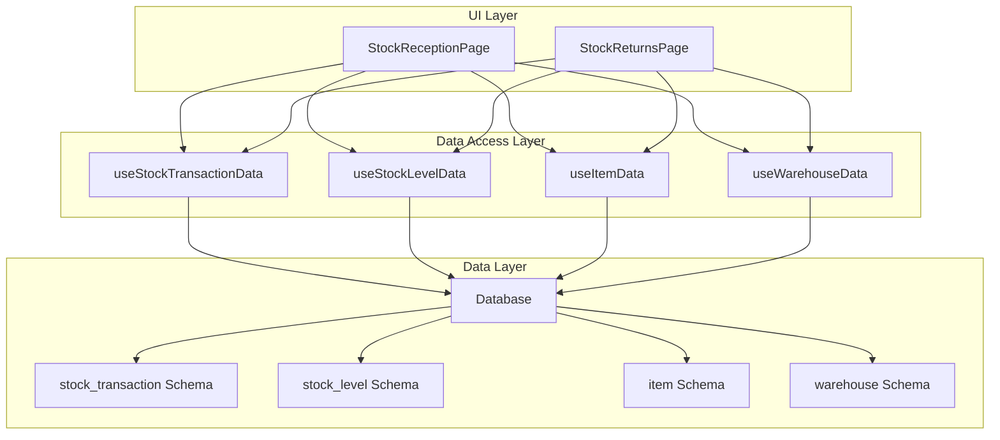

# Stock Reception and Incoming Shipments

<cite>
**Referenced Files in This Document**   
- [StockReceptionPage.tsx](file://src/modules/inventory/pages/StockReceptionPage.tsx)
- [StockReturnsPage.tsx](file://src/modules/inventory/pages/StockReturnsPage.tsx)
- [types.ts](file://src/modules/inventory/data/types.ts)
- [schema.ts](file://src/modules/inventory/data/schema.ts)
- [mockData.ts](file://src/modules/inventory/data/mockData.ts)
</cite>

## Table of Contents
1. [Introduction](#introduction)
2. [Stock Reception Workflow](#stock-reception-workflow)
3. [Purchase Order Matching and Validation](#purchase-order-matching-and-validation)
4. [Form Validation and Data Entry](#form-validation-and-data-entry)
5. [Transaction Creation and Inventory Updates](#transaction-creation-and-inventory-updates)
6. [Handling Partial Deliveries](#handling-partial-deliveries)
7. [Quality Issues and Return Workflows](#quality-issues-and-return-workflows)
8. [Common Issues and Best Practices](#common-issues-and-best-practices)
9. [System Architecture and Data Flow](#system-architecture-and-data-flow)

## Introduction
The Stock Reception module in the Inventory system manages the complete process of receiving goods from suppliers. This document details the workflow for receiving shipments, including purchase order matching, quantity verification, batch/serial number registration, and expiry date recording. The implementation focuses on the `StockReceptionPage` component, which handles form validation, transaction creation via `useStockTransactionData`, and real-time inventory updates. The system supports partial deliveries and integrates with return workflows for quality issues, ensuring accurate inventory tracking and supplier accountability.

**Section sources**
- [StockReceptionPage.tsx](file://src/modules/inventory/pages/StockReceptionPage.tsx#L0-L61)

## Stock Reception Workflow
The stock reception process begins when goods arrive from suppliers and need to be recorded in the system. The `StockReceptionPage` component provides a user interface for warehouse staff to document incoming shipments. The workflow consists of creating a reception record with a reference number, reception date, and supplier reference, then adding individual items received with their quantities, batch numbers, and expiry dates.

The process starts by clicking the "New Reception" button, which opens a dialog form pre-populated with the current date and a generated reference number. Users can add multiple items to the reception, with each item requiring selection of the inventory item, warehouse location, quantity received, and optional batch/lot number and expiry date. The interface includes real-time validation to ensure all required fields are completed before submission.

Upon saving, the system creates stock transaction records for each received item and updates the corresponding stock levels in real time. The reception history is displayed in a table showing reference numbers, dates, item counts, and total quantities, allowing users to view past receptions and verify inventory changes.

**Diagram sources**
- [StockReceptionPage.tsx](file://src/modules/inventory/pages/StockReceptionPage.tsx#L60-L92)
- [StockReceptionPage.tsx](file://src/modules/inventory/pages/StockReceptionPage.tsx#L125-L179)

**Section sources**
- [StockReceptionPage.tsx](file://src/modules/inventory/pages/StockReceptionPage.tsx#L0-L61)
- [StockReceptionPage.tsx](file://src/modules/inventory/pages/StockReceptionPage.tsx#L60-L92)

## Purchase Order Matching and Validation
The system validates received items against purchase orders to ensure accuracy and prevent unauthorized receipts. While the `StockReceptionPage` does not directly enforce purchase order matching in the current implementation, it provides the framework for linking receptions to purchase orders through the `source_id` field in stock transactions. The `InvPurchaseOrderType` interface includes fields for tracking received quantities, enabling reconciliation between ordered and received items.

The validation process checks that each received item has a valid item ID, warehouse ID, and positive quantity before processing. The system uses the `useItemData` and `useWarehouseData` hooks to populate dropdowns with valid inventory items and warehouse locations, preventing entry of non-existent items or locations. When an item is selected, the interface automatically populates the item name, and when a warehouse is selected, it populates the warehouse name, reducing data entry errors.

The `handleSaveReception` function includes validation logic that prevents submission if any item is missing required fields. This ensures data integrity by requiring complete information for each received item. The system also validates that at least one item is added to the reception before allowing submission.

**Diagram sources**
- [StockReceptionPage.tsx](file://src/modules/inventory/pages/StockReceptionPage.tsx#L175-L220)
- [StockReceptionPage.tsx](file://src/modules/inventory/pages/StockReceptionPage.tsx#L217-L250)

**Section sources**
- [StockReceptionPage.tsx](file://src/modules/inventory/pages/StockReceptionPage.tsx#L175-L220)
- [types.ts](file://src/modules/inventory/data/types.ts#L50-L80)

## Form Validation and Data Entry
The `StockReceptionPage` implements comprehensive form validation to ensure data accuracy and completeness. The validation occurs at multiple levels: field-level validation as users enter data, and form-level validation before submission. The system uses React state management to track the editing reception form, with real-time updates as users modify fields.

Field-level validation includes automatic population of item names and warehouse names when their respective IDs are selected. This reduces manual entry errors and ensures consistency in naming. The interface uses Material-UI components like Autocomplete for item selection and Select for warehouse selection, providing a user-friendly experience while maintaining data integrity.

Form-level validation occurs in the `handleSaveReception` function, which checks several conditions before processing the reception:
- At least one item must be added to the reception
- Each item must have a valid item ID, warehouse ID, and positive quantity
- The quantity must be greater than zero

If validation fails, the system displays an appropriate error message and prevents submission. The error messages are user-friendly and specific to the validation failure, helping users quickly correct issues. Success messages are also displayed upon successful reception recording, providing immediate feedback.

**Diagram sources**
- [StockReceptionPage.tsx](file://src/modules/inventory/pages/StockReceptionPage.tsx#L175-L220)
- [StockReceptionPage.tsx](file://src/modules/inventory/pages/StockReceptionPage.tsx#L217-L250)

**Section sources**
- [StockReceptionPage.tsx](file://src/modules/inventory/pages/StockReceptionPage.tsx#L175-L220)
- [StockReceptionPage.tsx](file://src/modules/inventory/pages/StockReceptionPage.tsx#L217-L250)

## Transaction Creation and Inventory Updates
The stock reception process creates transaction records and updates inventory levels through the `useStockTransactionData` and `useStockLevelData` hooks. When a reception is saved, the system creates a stock transaction for each received item with the transaction type set to `RECEIPT`. These transactions are stored in the database with details including item ID, warehouse ID, quantity, batch number, expiry date, source information, and notes.

The transaction creation process is implemented in the `handleSaveReception` function, which iterates through each item in the reception and calls `createStockTransaction` with the appropriate data. The transaction data includes:
- **item_id**: The ID of the inventory item received
- **warehouse_id**: The ID of the warehouse where items are stored
- **transaction_type**: Set to `InvStockTransactionType.RECEIPT`
- **quantity**: The quantity received (positive value)
- **batch_number**: Optional batch/lot number for traceability
- **expiry_date**: Optional expiry date for perishable items
- **source_table**: Set to 'stock_reception' to link to the reception
- **source_id**: The reception reference number
- **transaction_date**: The reception date
- **notes**: Combined notes from reception and item levels

After creating the transaction, the system updates the stock level using `updateStockLevel`. The stock level ID is constructed by combining the item ID, warehouse ID, and batch number (if applicable). The update increments the stock quantity by the received amount, maintaining accurate real-time inventory counts.

**Diagram sources**
- [StockReceptionPage.tsx](file://src/modules/inventory/pages/StockReceptionPage.tsx#L217-L250)
- [StockReceptionPage.tsx](file://src/modules/inventory/pages/StockReceptionPage.tsx#L249-L296)

**Section sources**
- [StockReceptionPage.tsx](file://src/modules/inventory/pages/StockReceptionPage.tsx#L217-L250)
- [types.ts](file://src/modules/inventory/data/types.ts#L30-L40)

## Handling Partial Deliveries
The system supports partial deliveries by allowing users to record received quantities that may be less than the ordered quantities. The `InvPurchaseOrderItemType` interface includes both `quantity_ordered` and `quantity_received` fields, enabling tracking of partial fulfillment. When a partial delivery is received, users enter the actual quantity received in the stock reception form, which updates the `quantity_received` field in the purchase order item.

The stock reception process does not require that the received quantity match the ordered quantity, providing flexibility for suppliers who cannot fulfill entire orders at once. The system maintains the original purchase order with its ordered quantities and updates the received quantities incrementally as partial deliveries arrive. This approach allows purchase orders to remain open until fully received, at which point the purchase order status changes from "Partially Received" to "Fully Received".

The `InvPurchaseOrderStatusEnum` includes "PARTIALLY_RECEIVED" and "FULLY_RECEIVED" statuses, which are updated automatically based on the relationship between ordered and received quantities. This status tracking helps procurement staff monitor order fulfillment and follow up with suppliers on outstanding items.

**Section sources**
- [types.ts](file://src/modules/inventory/data/types.ts#L50-L80)
- [mockData.ts](file://src/modules/inventory/data/mockData.ts#L219-L228)

## Quality Issues and Return Workflows
When quality issues are identified with received items, the system provides a return workflow through the `StockReturnsPage` component. This allows users to process returns either to the store (for items that were mistakenly received or overstocked) or to the supplier (for defective, damaged, or incorrect items). The return process is separate from the reception process, maintaining clear audit trails for both incoming and outgoing inventory movements.

The `StockReturnsPage` implements a form similar to the reception page but with additional fields for return reasons and condition assessment. Users can specify whether items are being returned to the store or to the supplier, with the transaction type set accordingly (`RETURN_TO_STORE` or `RETURN_TO_SUPPLIER`). Each returned item requires a return reason selected from a predefined list that includes "Damaged in transit", "Wrong item received", "Quality issues", "Expired product", and "Defective product".

The return process creates stock transactions with negative quantities to reduce inventory levels. For returns to the store, the system updates stock levels to reflect the reduced quantities. For returns to suppliers, no stock level update is performed since the items are leaving the organization entirely. The transaction notes include the return reason and condition, providing documentation for supplier communication and quality assurance.

**Diagram sources**
- [StockReturnsPage.tsx](file://src/modules/inventory/pages/StockReturnsPage.tsx#L257-L288)
- [StockReturnsPage.tsx](file://src/modules/inventory/pages/StockReturnsPage.tsx#L129-L175)

**Section sources**
- [StockReturnsPage.tsx](file://src/modules/inventory/pages/StockReturnsPage.tsx#L257-L288)
- [types.ts](file://src/modules/inventory/data/types.ts#L30-L40)

## Common Issues and Best Practices
Several common issues can occur during stock reception, and the system provides mechanisms to address them:

**Mismatched Quantities**: When received quantities differ from purchase order quantities, users should record the actual received amount and document the discrepancy in the notes field. For significant discrepancies, a return transaction should be created for the excess items, or follow-up with the supplier should be initiated for short shipments.

**Expired Items Upon Arrival**: If items are received with expired dates, they should be processed as a return to supplier with the reason "Expired product" and condition "EXPIRED". This creates an audit trail and supports supplier accountability for shipping expired goods.

**Incorrect SKUs**: When wrong items are received, they should be recorded as a return to supplier with the reason "Wrong item received" and condition "GOOD" (assuming the items are undamaged). The correct items should then be ordered separately.

Best practices for documentation and supplier communication include:
- Always recording batch/lot numbers and expiry dates for traceability
- Using detailed notes to document any discrepancies or issues
- Creating return transactions promptly for quality issues
- Maintaining clear separation between reception and return processes
- Regularly reviewing stock alerts for expired or expiring items

**Section sources**
- [StockReceptionPage.tsx](file://src/modules/inventory/pages/StockReceptionPage.tsx#L217-L250)
- [StockReturnsPage.tsx](file://src/modules/inventory/pages/StockReturnsPage.tsx#L257-L288)

## System Architecture and Data Flow
The stock reception system follows a component-based architecture with clear separation of concerns between UI, data access, and business logic. The `StockReceptionPage` component handles user interface and form management, while data operations are delegated to custom hooks like `useStockTransactionData` and `useStockLevelData`.

The data flow begins with user interaction in the UI, which updates React state. When the form is submitted, validation occurs, and upon success, the component calls data hook functions to create transactions and update stock levels. These hooks interact with the underlying database through a data service layer, abstracting the database operations from the UI components.

The system uses TypeScript interfaces defined in `types.ts` to ensure type safety across the application. Key interfaces include `InvStockTransactionType`, `InvItemType`, and `InvWarehouseType`, which define the structure of inventory data. The database schema in `schema.ts` enforces data integrity with constraints and indexes, including composite indexes on item ID and warehouse ID for efficient stock level queries.

**Diagram sources**
- [StockReceptionPage.tsx](file://src/modules/inventory/pages/StockReceptionPage.tsx#L60-L92)
- [types.ts](file://src/modules/inventory/data/types.ts#L0-L40)
- [schema.ts](file://src/modules/inventory/data/schema.ts#L116-L135)

**Section sources**
- [StockReceptionPage.tsx](file://src/modules/inventory/pages/StockReceptionPage.tsx#L60-L92)
- [types.ts](file://src/modules/inventory/data/types.ts#L0-L40)
- [schema.ts](file://src/modules/inventory/data/schema.ts#L116-L135)