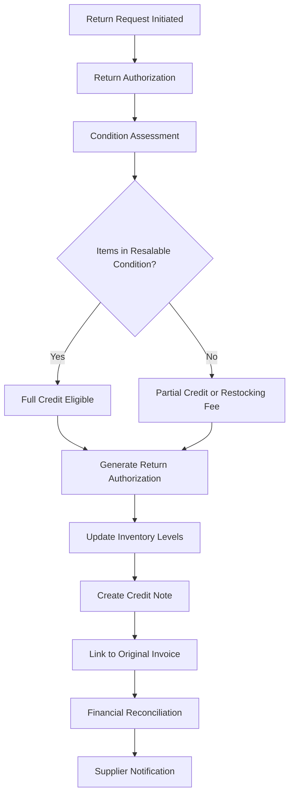
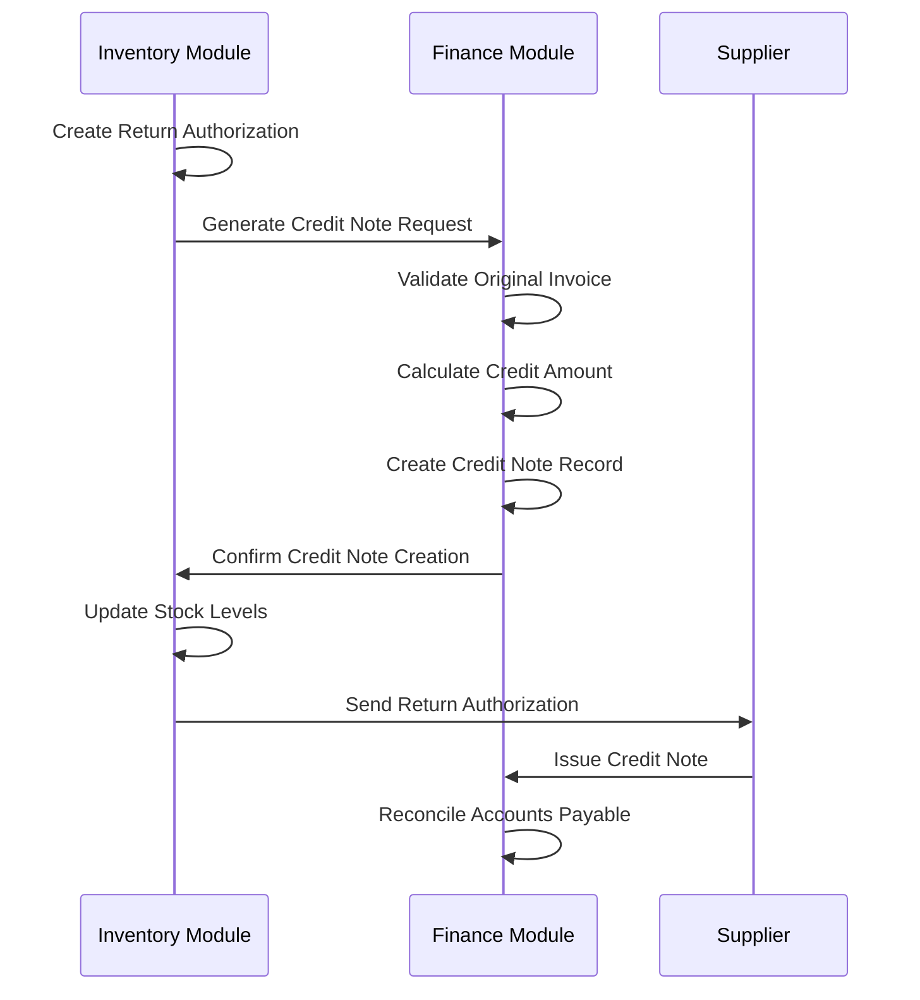
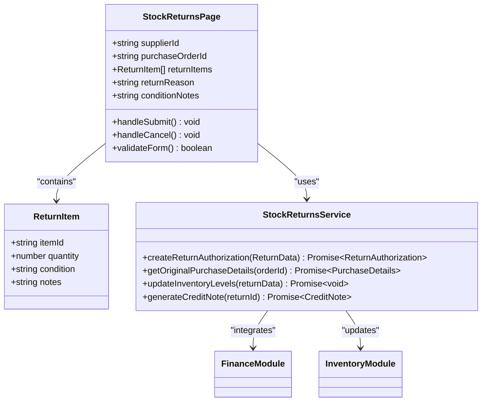
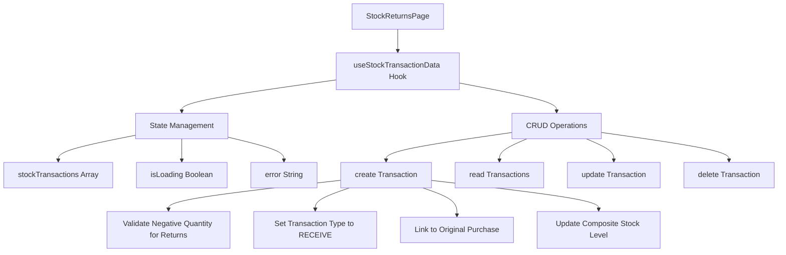
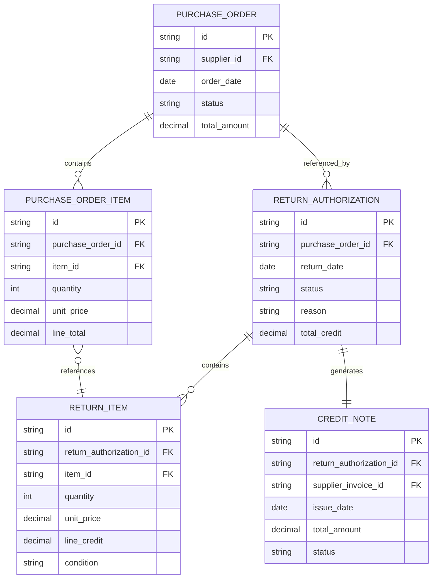

# Stock Returns and Supplier Reconciliation

<cite>
**Referenced Files in This Document**   
- [types.ts](file://src/core/types.ts#L450-L460)
- [mockData.ts](file://src/modules/inventory/data/mockData.ts#L200-L300)
- [useStockLevelData.ts](file://src/modules/inventory/data/useStockLevelData.ts)
- [StockReturnsPage.tsx](file://src/modules/inventory/pages/StockReturnsPage.tsx)
- [useStockTransactionData.ts](file://src/modules/inventory/hooks/useStockTransactionData.ts)
- [inventory.json](file://src/i18n/locales/en/inventory.json)
</cite>

## Table of Contents
1. [Introduction](#introduction)
2. [Stock Return Workflow](#stock-return-workflow)
3. [Return Authorization and Condition Assessment](#return-authorization-and-condition-assessment)
4. [Credit Note Processing and Financial Reconciliation](#credit-note-processing-and-financial-reconciliation)
5. [Implementation of StockReturnsPage](#implementation-of-stockreturnspage)
6. [useStockTransactionData Hook Analysis](#usestocktransactiondata-hook-analysis)
7. [Return Reasons and Categorization](#return-reasons-and-categorization)
8. [Original Purchase Data Reference](#original-purchase-data-reference)
9. [Common Issues and Best Practices](#common-issues-and-best-practices)
10. [Conclusion](#conclusion)

## Introduction
This document provides a comprehensive overview of the stock return procedures within the Inventory module of the SchoolPilot system. The stock return process enables educational institutions to manage the return of goods to suppliers efficiently, ensuring proper inventory reconciliation, financial adjustments, and audit compliance. The workflow encompasses return authorization, condition assessment, credit note generation, and inventory level updates. This documentation details the implementation of the `StockReturnsPage` component and its integration with the `useStockTransactionData` hook to create return records and maintain accurate stock levels. The system supports various return scenarios, including defective items, over-shipments, and quality issues, with appropriate documentation and financial reconciliation.

## Stock Return Workflow
The stock return process in the Inventory module follows a structured workflow to ensure proper authorization, documentation, and financial reconciliation. The workflow begins with a return request initiated by warehouse staff or department heads when items need to be returned to suppliers. The request includes details such as the item(s) to be returned, quantity, reason for return, and supporting documentation. Once submitted, the return request undergoes authorization by inventory managers or designated approvers who verify the validity of the return based on purchase records, condition assessment, and supplier agreements.

After authorization, the physical items are prepared for return, and a condition assessment is conducted to document the state of the goods. This assessment determines whether the items qualify for full credit, partial credit, or if restocking fees apply. The system then generates a return authorization document that serves as the basis for creating a credit note in the finance module. The inventory system updates stock levels by recording a negative receipt transaction, effectively reversing the original stock increase from the purchase. Financial reconciliation is initiated by linking the credit note to the original supplier invoice, adjusting accounts payable and generating necessary journal entries.

**Diagram sources**
- [mockData.ts](file://src/modules/inventory/data/mockData.ts#L200-L300)
- [types.ts](file://src/core/types.ts#L450-L460)

**Section sources**
- [mockData.ts](file://src/modules/inventory/data/mockData.ts#L200-L300)
- [types.ts](file://src/core/types.ts#L450-L460)

## Return Authorization and Condition Assessment
The return authorization process is a critical control point in the stock return workflow, ensuring that only valid returns are processed. Authorization requires verification of the original purchase order, supplier agreement terms, and return policy compliance. The system checks the purchase history to confirm that the items being returned were indeed purchased from the supplier and that the return falls within the allowable timeframe specified in the contract. Inventory managers can view the original purchase details, including order date, invoice number, and pricing, to validate the return request.

Condition assessment is conducted to determine the eligibility for credit and any applicable restocking fees. The assessment considers factors such as packaging integrity, product expiration dates, and physical damage. Items returned in resalable condition with original packaging typically qualify for full credit, while damaged or opened items may receive partial credit or be subject to restocking fees as specified in the supplier agreement. The system provides a standardized assessment form that captures photos, condition notes, and the assessor's signature, creating an audit trail for the return decision. This assessment directly influences the credit amount and any deductions applied to the credit note.

**Section sources**
- [mockData.ts](file://src/modules/inventory/data/mockData.ts#L200-L300)
- [inventory.json](file://src/i18n/locales/en/inventory.json)

## Credit Note Processing and Financial Reconciliation
Credit note processing is the financial component of the stock return procedure, enabling the institution to receive appropriate compensation from suppliers for returned goods. When a return is authorized, the system generates a credit note that references the original supplier invoice and purchase order. The credit note includes details such as the returned items, quantities, unit prices from the original purchase, total credit amount, and any deductions for restocking fees or partial credit due to condition issues.

Financial reconciliation is automated through integration between the Inventory and Finance modules. The credit note is linked to the original supplier invoice in the accounts payable ledger, reducing the outstanding balance accordingly. The system creates corresponding journal entries to debit accounts payable and credit the appropriate inventory or expense accounts, maintaining accurate financial records. For partial credits, the system calculates the adjusted amount based on the condition assessment and applies it to the supplier account. The reconciliation process ensures that both inventory records and financial statements reflect the return transaction accurately, supporting audit requirements and financial reporting.

**Diagram sources**
- [types.ts](file://src/core/types.ts#L450-L460)
- [StockReturnsPage.tsx](file://src/modules/inventory/pages/StockReturnsPage.tsx)

**Section sources**
- [types.ts](file://src/core/types.ts#L450-L460)
- [StockReturnsPage.tsx](file://src/modules/inventory/pages/StockReturnsPage.tsx)

## Implementation of StockReturnsPage
The `StockReturnsPage` component serves as the primary user interface for managing stock return procedures in the Inventory module. This React component provides a comprehensive form for creating and processing return requests, integrating with various hooks and services to ensure data consistency and workflow compliance. The page layout follows a tabbed structure, separating return creation, authorization, and history views to streamline user navigation.

The return creation form includes fields for selecting the supplier, original purchase order, items to return, quantities, return reasons, and condition assessment notes. It leverages the `useStockTransactionData` hook to access current stock levels and transaction history, allowing users to reference original purchase details when creating returns. The form implements real-time validation to ensure all required fields are completed and quantities do not exceed available stock. Upon submission, the component triggers the creation of a return authorization record and updates the inventory system accordingly.

**Diagram sources**
- [StockReturnsPage.tsx](file://src/modules/inventory/pages/StockReturnsPage.tsx)
- [useStockTransactionData.ts](file://src/modules/inventory/hooks/useStockTransactionData.ts)

**Section sources**
- [StockReturnsPage.tsx](file://src/modules/inventory/pages/StockReturnsPage.tsx)

## useStockTransactionData Hook Analysis
The `useStockTransactionData` hook is a custom React hook that provides data management functionality for stock transactions, including returns. This hook abstracts the CRUD operations for stock transaction records, maintaining state and providing methods to create, read, update, and delete transaction data. It serves as an intermediary between the `StockReturnsPage` component and the underlying data storage, ensuring consistent data handling across the application.

The hook manages state for stock transactions, loading status, and error conditions. It exposes methods for creating new transaction records, which are used to record return transactions with the `StockTransactionType.RECEIVE` type and negative quantities to indicate stock reduction. The hook also provides functionality to retrieve historical transaction data, allowing users to reference original purchase details when processing returns. This capability is essential for accurate credit note generation and financial reconciliation.

**Diagram sources**
- [useStockTransactionData.ts](file://src/modules/inventory/hooks/useStockTransactionData.ts)
- [types.ts](file://src/core/types.ts#L450-L460)

**Section sources**
- [useStockTransactionData.ts](file://src/modules/inventory/hooks/useStockTransactionData.ts)

## Return Reasons and Categorization
The system supports a comprehensive categorization of return reasons to facilitate analysis and reporting on return patterns. Return reasons are classified into several categories including quality issues, over-shipment, incorrect items, packaging damage, and expiration. Each category has specific sub-reasons that provide detailed information about the return circumstances. For example, quality issues include sub-reasons such as defective components, manufacturing flaws, and performance failures.

This categorization enables the institution to identify trends in supplier performance, product quality, and ordering accuracy. The return reason selection in the `StockReturnsPage` is implemented as a controlled dropdown that displays appropriate sub-reasons based on the selected category. This structured approach ensures consistent data entry and supports automated decision-making for credit eligibility and restocking fees. The system also allows for free-text notes to capture additional details not covered by the predefined categories, providing flexibility while maintaining data standardization.

**Section sources**
- [inventory.json](file://src/i18n/locales/en/inventory.json)
- [StockReturnsPage.tsx](file://src/modules/inventory/pages/StockReturnsPage.tsx)

## Original Purchase Data Reference
The ability to reference original purchase data is a critical feature of the stock return system, ensuring accurate credit calculation and financial reconciliation. When creating a return, users can search for and select the original purchase order, which automatically populates the return form with item details, quantities, unit prices, and total amounts. This integration prevents errors in credit calculation and ensures that returns are processed at the same prices as the original purchase.

The system maintains a link between the return transaction and the original purchase order, creating an audit trail that connects the financial impact of the return to its source. This linkage enables the finance module to generate accurate credit notes that reflect the exact pricing from the original transaction. For items purchased at different times and prices, the system applies the specific purchase price from the original transaction rather than current pricing, ensuring financial accuracy. This reference capability also supports analysis of return rates by purchase order, supplier, and item category.

**Diagram sources**
- [types.ts](file://src/core/types.ts#L450-L460)
- [mockData.ts](file://src/modules/inventory/data/mockData.ts#L200-L300)

**Section sources**
- [types.ts](file://src/core/types.ts#L450-L460)
- [mockData.ts](file://src/modules/inventory/data/mockData.ts#L200-L300)

## Common Issues and Best Practices
Several common issues can arise during the stock return process, including disputed returns, partial credits, and restocking fees. Disputed returns occur when suppliers challenge the validity of a return, often due to disagreements about condition assessment or return policy interpretation. To address this, the system maintains comprehensive documentation including photos, condition reports, and approval workflows, providing evidence to support the institution's position in disputes.

Partial credits and restocking fees require careful handling to ensure accurate financial reconciliation. The system calculates partial credits based on predefined rules linked to condition categories, with configurable percentages for different levels of damage or usage. Restocking fees are applied according to supplier agreements, with the system automatically calculating the fee amount based on the credit value. Best practices include maintaining clear communication with suppliers, documenting all return decisions thoroughly, and conducting regular reviews of return patterns to identify opportunities for process improvement or supplier performance management.

**Section sources**
- [inventory.json](file://src/i18n/locales/en/inventory.json)
- [StockReturnsPage.tsx](file://src/modules/inventory/pages/StockReturnsPage.tsx)

## Conclusion
The stock return procedures in the Inventory module provide a comprehensive solution for managing the return of goods to suppliers while ensuring accurate inventory and financial records. The integration between the `StockReturnsPage` component and the `useStockTransactionData` hook enables efficient processing of return requests with proper authorization, condition assessment, and financial reconciliation. By maintaining links to original purchase data and supporting detailed return categorization, the system facilitates accurate credit note generation and provides valuable insights into return patterns. The implementation adheres to best practices for documentation and dispute resolution, helping educational institutions maintain strong supplier relationships while protecting their financial interests. Future enhancements could include automated supplier notifications, return trend analysis reports, and integration with supplier portals for streamlined return processing.