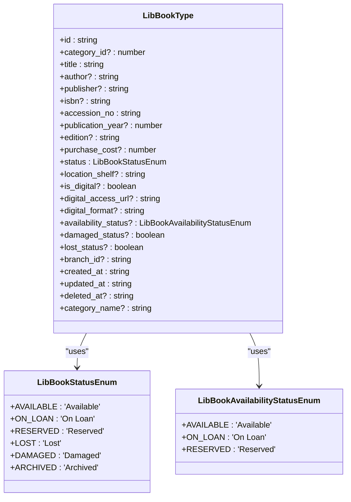
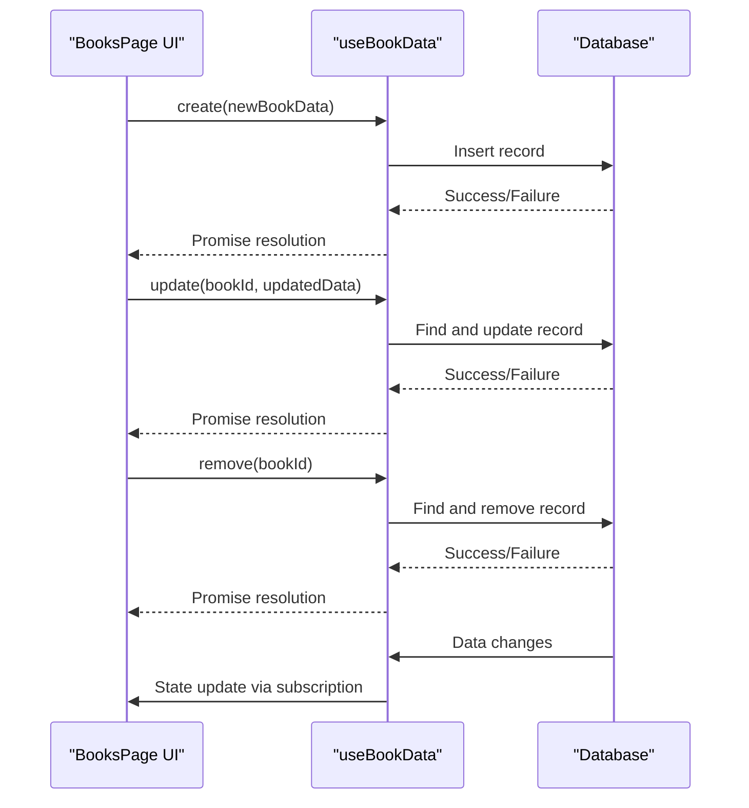
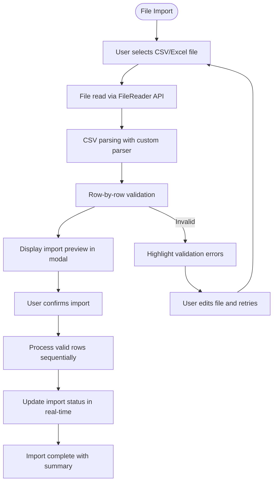
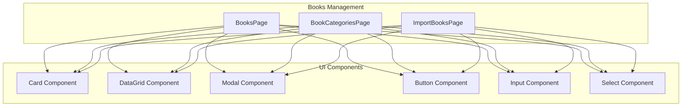
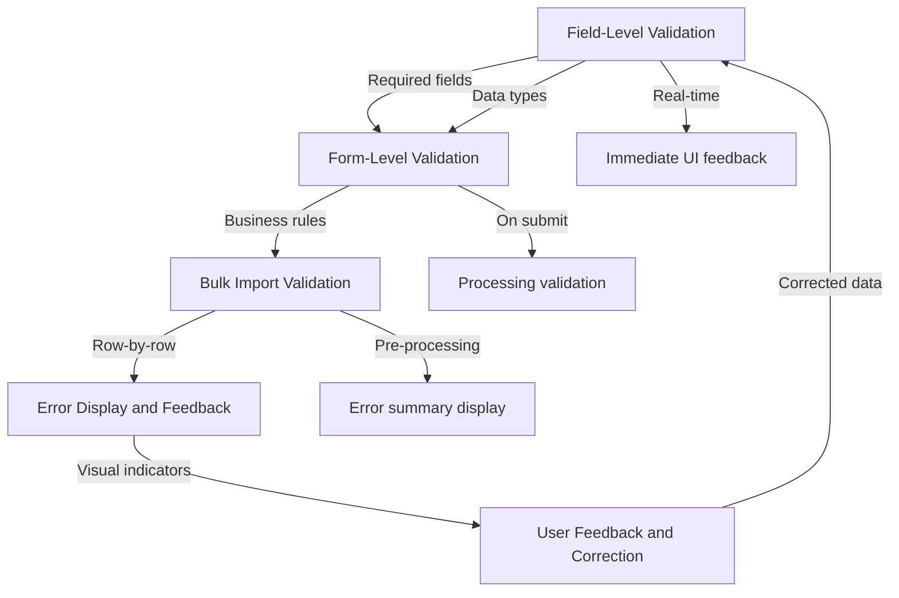
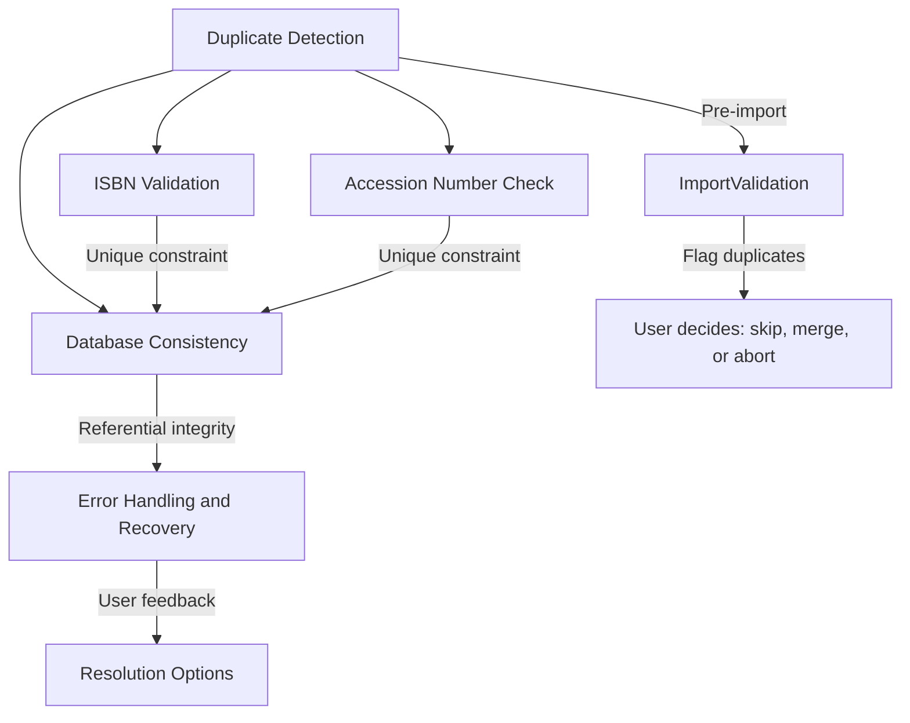
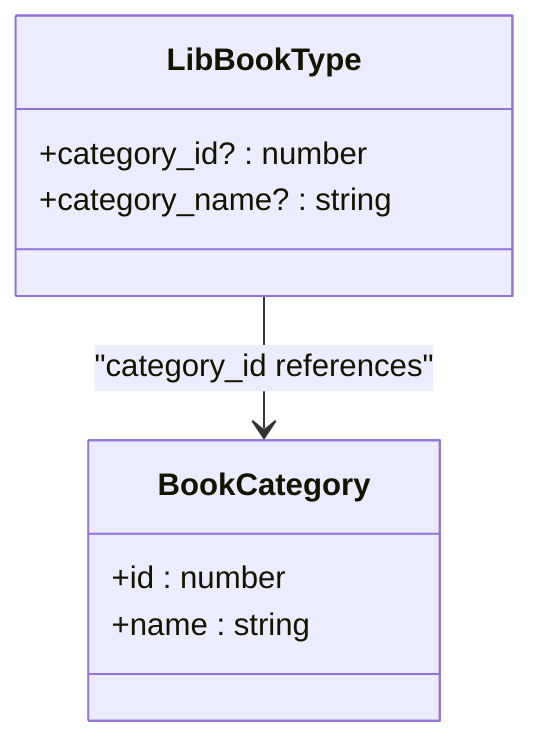

# Book Management

<cite>
**Referenced Files in This Document**   
- [ImportBooksPage.tsx](file://src/modules/library/pages/ImportBooksPage.tsx)
- [useBookData.ts](file://src/modules/library/data/useBookData.ts)
- [useBookCategoryData.ts](file://src/modules/library/data/useBookCategoryData.ts)
- [types.ts](file://src/modules/library/data/types.ts)
- [schema.ts](file://src/modules/library/data/schema.ts)
- [mockData.ts](file://src/modules/library/data/mockData.ts)
- [BooksPage.tsx](file://src/modules/library/pages/BooksPage.tsx)
- [BookCategoriesPage.tsx](file://src/modules/library/pages/BookCategoriesPage.tsx)
- [dataValidation.ts](file://src/utils/dataValidation.ts)
- [validationSchemas.ts](file://src/utils/validationSchemas.ts)
</cite>

## Table of Contents
1. [Introduction](#introduction)
2. [Core Data Structures and Types](#core-data-structures-and-types)
3. [CRUD Operations and Data Hooks](#crud-operations-and-data-hooks)
4. [Bulk Import Functionality](#bulk-import-functionality)
5. [UI Components and User Interfaces](#ui-components-and-user-interfaces)
6. [Form Validation and Error Handling](#form-validation-and-error-handling)
7. [Data Integrity and Duplicate Management](#data-integrity-and-duplicate-management)
8. [Category Hierarchy and Organization](#category-hierarchy-and-organization)
9. [Performance and Optimization](#performance-and-optimization)
10. [Best Practices](#best-practices)

## Introduction

The Book Management system within the Library module provides comprehensive functionality for managing a school's book inventory. This includes cataloging books, organizing them into categories, performing bulk imports, and maintaining data integrity. The system is built with React and leverages custom hooks for data management, ensuring real-time synchronization and efficient CRUD operations. The architecture follows a modular design with clear separation between data, UI components, and business logic.

**Section sources**
- [ImportBooksPage.tsx](file://src/modules/library/pages/ImportBooksPage.tsx)
- [useBookData.ts](file://src/modules/library/data/useBookData.ts)
- [useBookCategoryData.ts](file://src/modules/library/data/useBookCategoryData.ts)

## Core Data Structures and Types

The book management system relies on well-defined TypeScript interfaces and enums to ensure type safety and data consistency. The primary data structure is `LibBookType`, which represents a book in the library catalog.

**Diagram sources**
- [types.ts](file://src/modules/library/data/types.ts#L20-L111)

The `LibBookType` interface includes essential fields such as title, author, ISBN, and accession number, along with metadata like purchase cost, publication year, and location. The system also defines status enums to standardize book states, ensuring consistency across the application. The `accession_no` field is required and serves as a unique identifier for physical books in the library.

## CRUD Operations and Data Hooks

The book management system implements CRUD operations through custom React hooks that provide a clean API for interacting with the underlying database. The `useBookData` and `useBookCategoryData` hooks encapsulate all data operations, enabling real-time synchronization and efficient state management.

**Diagram sources**
- [useBookData.ts](file://src/modules/library/data/useBookData.ts#L20-L168)
- [useBookCategoryData.ts](file://src/modules/library/data/useBookCategoryData.ts#L10-L57)

### useBookData Hook

The `useBookData` hook provides comprehensive CRUD operations for book records:

- **create**: Inserts a new book record with automatic timestamp generation
- **update**: Updates an existing book record with timestamp tracking
- **remove**: Removes a book record by ID
- **search**: Performs client-side search across multiple book fields
- **Bulk operations**: Specialized methods for marking books as damaged, lost, or updating digital status

The hook uses RxDB for real-time data synchronization, subscribing to database changes and automatically updating the component state. This ensures that all UI components display the most current data without requiring manual refreshes.

**Section sources**
- [useBookData.ts](file://src/modules/library/data/useBookData.ts#L20-L168)

### useBookCategoryData Hook

The `useBookCategoryData` hook manages book categories with basic CRUD operations:

- **create**: Adds a new category with auto-generated ID
- **update**: Modifies an existing category
- **remove**: Deletes a category by ID

Unlike the book data hook, the category data hook currently uses mock data and in-memory state management rather than a persistent database. This implementation choice may be suitable for development and demonstration purposes but would need enhancement for production use.

**Section sources**
- [useBookCategoryData.ts](file://src/modules/library/data/useBookCategoryData.ts#L10-L57)

## Bulk Import Functionality

The ImportBooksPage component enables bulk import of books from CSV or Excel files, streamlining the process of adding multiple books to the catalog. This feature includes comprehensive validation, error reporting, and progress tracking.

**Diagram sources**
- [ImportBooksPage.tsx](file://src/modules/library/pages/ImportBooksPage.tsx#L0-L437)

### Import Process Workflow

1. **Template Download**: Users can download a CSV template with all required fields and sample data
2. **File Selection**: Users select a CSV, XLSX, or XLS file for import
3. **File Parsing**: The system reads and parses the file using the FileReader API and a custom CSV parser
4. **Validation**: Each row undergoes validation against business rules and data constraints
5. **Preview**: Validated data is displayed in a preview modal with error highlighting
6. **Execution**: Users confirm the import, and valid rows are processed sequentially
7. **Feedback**: Real-time progress updates and final summary are provided

The import process handles various data types and performs validation for required fields, numeric values, and category references. The system provides immediate feedback on validation errors, allowing users to correct issues before proceeding with the import.

**Section sources**
- [ImportBooksPage.tsx](file://src/modules/library/pages/ImportBooksPage.tsx#L0-L437)

## UI Components and User Interfaces

The book management system utilizes a consistent set of UI components across its pages, ensuring a uniform user experience. The primary interfaces include BooksPage, BookCategoriesPage, and ImportBooksPage.

**Diagram sources**
- [BooksPage.tsx](file://src/modules/library/pages/BooksPage.tsx#L0-L592)
- [BookCategoriesPage.tsx](file://src/modules/library/pages/BookCategoriesPage.tsx#L0-L122)
- [ImportBooksPage.tsx](file://src/modules/library/pages/ImportBooksPage.tsx#L0-L437)

### BooksPage

The BooksPage provides a comprehensive interface for managing individual books with the following features:

- **DataGrid**: Displays books in a sortable, filterable table with status indicators
- **Modal Forms**: Add and edit books through a responsive modal interface
- **Search Functionality**: Client-side search across multiple book fields
- **Batch Actions**: Support for batch editing and operations

The page uses the DataGrid component to present book data with columns for title, author, accession number, status, and actions. Users can add new books or edit existing ones through a modal form that includes all relevant fields.

**Section sources**
- [BooksPage.tsx](file://src/modules/library/pages/BooksPage.tsx#L0-L592)

### BookCategoriesPage

The BookCategoriesPage manages book categories with a simple interface for CRUD operations:

- **Category List**: Displays all book categories in a table format
- **Add/Edit Modal**: Forms for creating and modifying categories
- **Delete Functionality**: Removes categories with confirmation

The page follows the same design patterns as BooksPage, using consistent UI components and interaction patterns.

**Section sources**
- [BookCategoriesPage.tsx](file://src/modules/library/pages/BookCategoriesPage.tsx#L0-L122)

## Form Validation and Error Handling

The system implements robust form validation and error handling to ensure data quality and provide clear feedback to users. Validation occurs at multiple levels: field-level, form-level, and during bulk import operations.

**Diagram sources**
- [BooksPage.tsx](file://src/modules/library/pages/BooksPage.tsx#L113-L147)
- [ImportBooksPage.tsx](file://src/modules/library/pages/ImportBooksPage.tsx#L103-L143)

### Validation Rules

The system enforces the following validation rules:

- **Required Fields**: Title and accession number are mandatory
- **Data Types**: Publication year and purchase cost must be valid numbers
- **Enum Validation**: Status fields must match predefined values
- **Category References**: Category names must exist in the system
- **File Format**: Imported files must be valid CSV, XLSX, or XLS

During bulk import, the system performs row-by-row validation and provides detailed error messages that include the row number and specific validation failure. This granular feedback helps users quickly identify and correct issues in their data files.

**Section sources**
- [ImportBooksPage.tsx](file://src/modules/library/pages/ImportBooksPage.tsx#L103-L143)

## Data Integrity and Duplicate Management

The book management system includes mechanisms to maintain data integrity and prevent duplicate entries, particularly for critical fields like ISBN and accession numbers.

**Diagram sources**
- [schema.ts](file://src/modules/library/data/schema.ts#L20-L108)
- [validationSchemas.ts](file://src/utils/validationSchemas.ts#L469-L519)

### Duplicate Detection

The system prevents duplicate entries through several mechanisms:

- **Schema-Level Constraints**: The database schema defines indexes on critical fields like accession_no, which serves as a unique identifier
- **Application-Level Validation**: Before creating or updating records, the system could check for existing entries with the same ISBN or accession number
- **Consistency Checks**: The global data validator includes duplicate ID detection, which can be extended to check for duplicate ISBNs

Currently, the system does not explicitly validate for duplicate ISBNs in the `useBookData` hook, but this could be implemented by adding a search operation before creating a new book. The database schema includes an index on the isbn field, which would support efficient duplicate checking.

**Section sources**
- [schema.ts](file://src/modules/library/data/schema.ts#L20-L108)
- [validationSchemas.ts](file://src/utils/validationSchemas.ts#L469-L519)

## Category Hierarchy and Organization

The book categorization system provides a simple flat structure for organizing books into categories. While the current implementation does not support hierarchical categories, it offers a flexible foundation that could be extended to support nested categories.

**Diagram sources**
- [types.ts](file://src/modules/library/data/types.ts#L20-L111)
- [mockData.ts](file://src/modules/library/data/mockData.ts#L0-L160)

### Current Implementation

The system uses a simple one-to-many relationship between categories and books:

- Each book belongs to one category
- Categories are identified by ID and name
- Category names are denormalized in the book record for display purposes

The `useBookCategoryData` hook manages the category list, and the BooksPage allows users to assign books to categories through a dropdown selection. The system validates that category references in imported data match existing categories, preventing orphaned category assignments.

**Section sources**
- [useBookCategoryData.ts](file://src/modules/library/data/useBookCategoryData.ts#L10-L57)
- [mockData.ts](file://src/modules/library/data/mockData.ts#L0-L160)

## Performance and Optimization

The book management system incorporates several performance optimizations to handle large catalogs efficiently:

- **Real-time Subscriptions**: The useBookData hook uses RxDB's observable pattern to receive updates without polling
- **Client-side Search**: Search operations are performed in-memory on the client side
- **Batch Processing**: Bulk imports process records sequentially with progress feedback
- **Efficient Rendering**: The DataGrid component likely implements virtualization for large datasets

For very large catalogs, additional optimizations could include:

- **Server-side Search**: Offloading search operations to the database
- **Pagination**: Implementing pagination for the DataGrid to reduce initial load time
- **Lazy Loading**: Loading book details only when needed
- **Index Optimization**: Ensuring database indexes support common query patterns

The current implementation is suitable for small to medium-sized libraries but may require enhancements for institutions with tens of thousands of books.

**Section sources**
- [useBookData.ts](file://src/modules/library/data/useBookData.ts#L20-L168)
- [BooksPage.tsx](file://src/modules/library/pages/BooksPage.tsx#L0-L592)

## Best Practices

Based on the analysis of the book management system, the following best practices are recommended for maintaining data integrity and optimizing performance:

### Data Integrity Best Practices

1. **Enforce Unique Constraints**: Implement validation for duplicate ISBNs and accession numbers at both the application and database levels
2. **Comprehensive Validation**: Extend validation to include ISBN format checking (e.g., valid ISBN-10 or ISBN-13 patterns)
3. **Referential Integrity**: Ensure all category references are valid and prevent deletion of categories with assigned books
4. **Audit Trails**: Maintain logs of all CRUD operations for accountability and recovery

### Performance Best Practices

1. **Index Critical Fields**: Ensure database indexes exist for commonly searched fields (title, author, ISBN, accession_no)
2. **Implement Pagination**: For large catalogs, implement server-side pagination to improve load times
3. **Optimize Bulk Operations**: Use database transactions for bulk imports to ensure atomicity and improve performance
4. **Cache Frequently Accessed Data**: Cache category lists and other reference data to reduce database queries

### User Experience Best Practices

1. **Clear Error Messages**: Provide specific, actionable error messages during data import and form submission
2. **Progress Indicators**: Show progress during long-running operations like bulk imports
3. **Undo Functionality**: Implement undo/rollback for critical operations
4. **Data Preview**: Allow users to preview changes before committing them

These best practices will help ensure the book management system remains reliable, performant, and user-friendly as the library catalog grows.

**Section sources**
- [useBookData.ts](file://src/modules/library/data/useBookData.ts#L20-L168)
- [ImportBooksPage.tsx](file://src/modules/library/pages/ImportBooksPage.tsx#L0-L437)
- [schema.ts](file://src/modules/library/data/schema.ts#L20-L108)