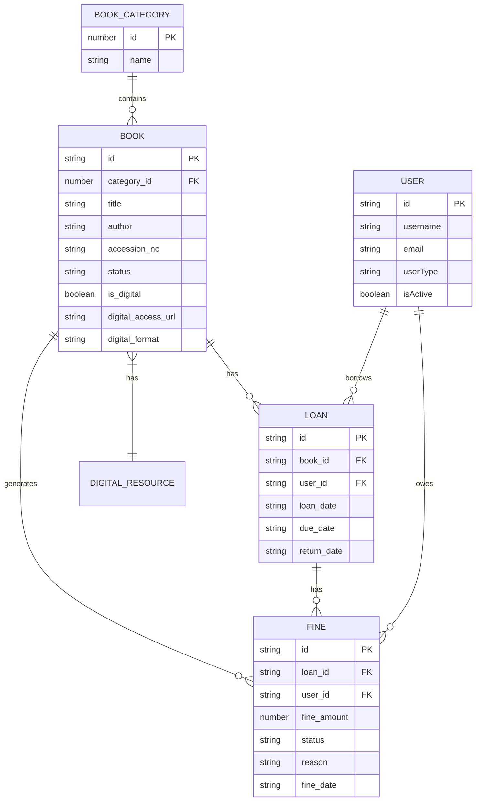

# Data Model

<cite>
**Referenced Files in This Document**   
- [useLibrarySettingsData.ts](file://src/modules/library/data/useLibrarySettingsData.ts)
- [useBookCategoryData.ts](file://src/modules/library/data/useBookCategoryData.ts)
- [mockData.ts](file://src/modules/library/data/mockData.ts)
- [types.ts](file://src/core/types.ts)
- [schema.ts](file://src/modules/library/data/schema.ts)
- [DigitalResourcesPage.tsx](file://src/modules/library/pages/DigitalResourcesPage.tsx)
</cite>

## Table of Contents
1. [Introduction](#introduction)
2. [Entity Relationships](#entity-relationships)
3. [Entity Field Definitions](#entity-field-definitions)
4. [Business Logic and Validation Rules](#business-logic-and-validation-rules)
5. [Sample Data Records](#sample-data-records)
6. [Data Access and Indexing](#data-access-and-indexing)
7. [Data Lifecycle Management](#data-lifecycle-management)
8. [Data Security and Privacy](#data-security-and-privacy)

## Introduction
This document provides comprehensive documentation for the Library module's database schema. It details the entity relationships between Book, BookCategory, Loan, Fine, and DigitalResource. The documentation includes field definitions, data types, primary/foreign keys, and constraints for each collection. It explains data validation rules and business logic such as loan duration limits, renewal policies, and fine accrual calculations. The document also covers data access patterns through RxDB collections, indexing strategies for performance optimization, data lifecycle management, and data security requirements.

**Section sources**
- [useLibrarySettingsData.ts](file://src/modules/library/data/useLibrarySettingsData.ts#L1-L123)
- [mockData.ts](file://src/modules/library/data/mockData.ts#L0-L160)

## Entity Relationships
The Library module's data model consists of five main entities: Book, BookCategory, Loan, Fine, and DigitalResource. These entities are interconnected through various relationships that support the library's operational requirements.



**Diagram sources**
- [schema.ts](file://src/modules/library/data/schema.ts#L0-L108)
- [types.ts](file://src/core/types.ts#L0-L799)

**Section sources**
- [schema.ts](file://src/modules/library/data/schema.ts#L0-L108)
- [types.ts](file://src/core/types.ts#L0-L799)

## Entity Field Definitions
This section details the field definitions, data types, primary/foreign keys, and constraints for each entity in the Library module.

### BookCategory
The BookCategory entity represents categories of books in the library.

**Label Structure Requirements**
- **id**: Unique identifier for the book category (number, required, primary key)
- **name**: Category name (string, required, maximum length: 100 characters)

**Constraints**
- Required fields: id, name
- Indexes: name

**Section sources**
- [schema.ts](file://src/modules/library/data/schema.ts#L4-L15)
- [useBookCategoryData.ts](file://src/modules/library/data/useBookCategoryData.ts#L1-L57)

### Book
The Book entity represents individual books in the library collection.

**Label Structure Requirements**
- **id**: Unique identifier for the book (string, required, primary key)
- **category_id**: Reference to book category (number, required, foreign key to BookCategory)
- **title**: Book title (string, required, maximum length: 255 characters)
- **author**: Book author (string, required, maximum length: 200 characters)
- **publisher**: Book publisher (string, maximum length: 200 characters)
- **isbn**: ISBN number (string, maximum length: 20 characters)
- **accession_no**: Accession number (string, required, maximum length: 50 characters)
- **publication_year**: Publication year (number, minimum: 1000, maximum: 9999)
- **edition**: Book edition (string, maximum length: 50 characters)
- **purchase_cost**: Purchase cost (number, minimum: 0, maximum: 999999.99)
- **status**: Book status (string, required, enum: AVAILABLE, ON_LOAN, LOST, DAMAGED)
- **location_shelf**: Shelf location (string, maximum length: 100 characters)
- **is_digital**: Whether book is digital (boolean)
- **digital_access_url**: Digital access URL (string, maximum length: 500 characters)
- **digital_format**: Digital format (string, maximum length: 20 characters)
- **availability_status**: Availability status (string, enum: AVAILABLE, UNAVAILABLE)
- **damaged_status**: Whether book is damaged (boolean)
- **lost_status**: Whether book is lost (boolean)
- **branch_id**: Branch association (string, maximum length: 100 characters)
- **created_at**: Record creation timestamp (string, required)
- **updated_at**: Record last update timestamp (string, required)
- **deleted_at**: Record deletion timestamp (string)
- **category_name**: Category name (denormalized) (string, maximum length: 100 characters)

**Constraints**
- Required fields: id, title, accession_no, status, created_at, updated_at
- Indexes: title, author, isbn, accession_no, status, category_id, branch_id, damaged_status, lost_status, is_digital

**Section sources**
- [schema.ts](file://src/modules/library/data/schema.ts#L17-L70)
- [types.ts](file://src/core/types.ts#L0-L799)

### Loan
The Loan entity represents book loans made to users.

**Label Structure Requirements**
- **id**: Unique identifier for the loan (string, required, primary key)
- **book_id**: Reference to the book (string, required, foreign key to Book)
- **user_id**: Reference to the user (string, required, foreign key to User)
- **userType**: Type of user (string, required, enum: Staff, Student, Parent, Supplier)
- **loan_date**: Date when book was loaned (string, required)
- **due_date**: Date when book is due (string, required)
- **return_date**: Date when book was returned (string)
- **extended_due_date**: Extended due date if applicable (string)
- **branch_id**: Branch association (string, maximum length: 100 characters)
- **created_at**: Record creation timestamp (string, required)
- **updated_at**: Record last update timestamp (string, required)
- **book_title**: Book title (denormalized) (string, maximum length: 255 characters)
- **user_name**: User name (denormalized) (string, maximum length: 200 characters)

**Constraints**
- Required fields: id, book_id, user_id, loan_date, due_date, created_at, updated_at
- Indexes: book_id, user_id, due_date, return_date, branch_id

**Section sources**
- [schema.ts](file://src/modules/library/data/schema.ts#L72-L100)
- [types.ts](file://src/core/types.ts#L0-L799)

### Fine
The Fine entity represents fines associated with loans.

**Label Structure Requirements**
- **id**: Unique identifier for the fine (string, required, primary key)
- **loan_id**: Reference to the loan (string, required, foreign key to Loan)
- **user_id**: Reference to the user (string, required, foreign key to User)
- **fine_amount**: Fine amount (number, required, minimum: 0, maximum: 999999.99)
- **paid_amount**: Amount paid (number, minimum: 0, maximum: 999999.99)
- **status**: Fine status (string, required, enum: PENDING, BILLED)
- **reason**: Reason for fine (string, required, maximum length: 255 characters)
- **fine_date**: Date when fine was issued (string, required)
- **paid_date**: Date when fine was paid (string)
- **waived_date**: Date when fine was waived (string)
- **waived_by**: Who waived the fine (string, maximum length: 100 characters)
- **notes**: Additional notes (string, maximum length: 500 characters)
- **branch_id**: Branch association (string, maximum length: 100 characters)
- **created_at**: Record creation timestamp (string, required)
- **updated_at**: Record last update timestamp (string, required)
- **user_name**: User name (denormalized) (string, maximum length: 200 characters)
- **book_title**: Book title (denormalized) (string, maximum length: 255 characters)

**Constraints**
- Required fields: id, loan_id, user_id, fine_amount, status, fine_date, created_at, updated_at
- Indexes: loan_id, user_id, status, fine_date, paid_date, branch_id

**Section sources**
- [schema.ts](file://src/modules/library/data/schema.ts#L102-L138)
- [types.ts](file://src/core/types.ts#L0-L799)

### DigitalResource
The DigitalResource entity represents digital versions of books in the library.

**Label Structure Requirements**
- **is_digital**: Whether book is digital (boolean)
- **digital_access_url**: Digital access URL (string, maximum length: 500 characters)
- **digital_format**: Digital format (string, maximum length: 20 characters)

**Constraints**
- These fields are part of the Book entity and are used to represent digital resources.

**Section sources**
- [schema.ts](file://src/modules/library/data/schema.ts#L41-L43)
- [DigitalResourcesPage.tsx](file://src/modules/library/pages/DigitalResourcesPage.tsx#L0-L158)

## Business Logic and Validation Rules
This section explains the data validation rules and business logic for the Library module, including loan duration limits, renewal policies, and fine accrual calculations.

### Loan Duration and Renewal Policies
The library system implements different loan duration and renewal policies based on user types. These policies are defined in the library settings and can be configured for different user types.

**Label Structure Requirements**
- **max_loan_days**: Maximum number of days a book can be loaned (number)
- **max_renewals**: Maximum number of times a loan can be renewed (number)
- **user_types**: List of user types this rule applies to (array of strings)
- **book_categories**: List of book categories this rule applies to (array of strings)

Based on the sample data, there are two main policies:
1. Student Standard Rule: 14-day loan period with 2 renewals allowed
2. Staff Extended Rule: 30-day loan period with 5 renewals allowed

These policies are enforced through the useLibrarySettingsData hook, which provides functions to retrieve settings based on user type.

**Section sources**
- [useLibrarySettingsData.ts](file://src/modules/library/data/useLibrarySettingsData.ts#L1-L123)
- [mockData.ts](file://src/modules/library/data/mockData.ts#L0-L160)

### Fine Accrual Calculations
The library system calculates fines based on overdue books and other violations. The fine calculation rules are defined in the library settings.

**Label Structure Requirements**
- **fine_per_day**: Fine amount per day for overdue books (number)
- **max_books_per_user**: Maximum number of books a user can have on loan (number)
- **is_active**: Whether the rule is currently active (boolean)

Fine types include:
1. Overdue books: Calculated as fine_per_day multiplied by the number of days overdue
2. Lost books: Fixed amount or replacement cost
3. Damaged books: Fixed amount based on damage severity

The system tracks fines through the Fine entity, which is linked to the Loan entity. When a book is overdue, the system automatically creates a fine with status PENDING. When the fine is billed, the status changes to BILLED.

**Section sources**
- [useLibrarySettingsData.ts](file://src/modules/library/data/useLibrarySettingsData.ts#L1-L123)
- [mockData.ts](file://src/modules/library/data/mockData.ts#L0-L160)

## Sample Data Records
This section provides sample data records for each entity in the library module.

### BookCategory Sample Data
```json
[
  {
    "id": 1,
    "name": "Fiction"
  },
  {
    "id": 2,
    "name": "Science"
  },
  {
    "id": 3,
    "name": "History"
  },
  {
    "id": 4,
    "name": "Reference"
  },
  {
    "id": 5,
    "name": "Computer Science"
  }
]
```

**Section sources**
- [mockData.ts](file://src/modules/library/data/mockData.ts#L0-L160)

### Book Sample Data
```json
[
  {
    "id": "BOOK001",
    "category_id": 1,
    "title": "The Great Gatsby",
    "author": "F. Scott Fitzgerald",
    "accession_no": "LIB001",
    "status": "AVAILABLE",
    "created_at": "2024-07-25T10:30:00Z",
    "updated_at": "2024-07-25T10:30:00Z",
    "category_name": "Fiction"
  },
  {
    "id": "BOOK002",
    "category_id": 2,
    "title": "Cosmos",
    "author": "Carl Sagan",
    "accession_no": "LIB002",
    "status": "ON_LOAN",
    "created_at": "2024-07-25T10:30:00Z",
    "updated_at": "2024-07-25T10:30:00Z",
    "category_name": "Science"
  },
  {
    "id": "BOOK003",
    "category_id": 3,
    "title": "Sapiens: A Brief History of Humankind",
    "author": "Yuval Noah Harari",
    "accession_no": "LIB003",
    "status": "AVAILABLE",
    "created_at": "2024-07-25T10:30:00Z",
    "updated_at": "2024-07-25T10:30:00Z",
    "category_name": "History"
  },
  {
    "id": "BOOK004",
    "category_id": 5,
    "title": "Clean Code",
    "author": "Robert C. Martin",
    "accession_no": "LIB004",
    "status": "LOST",
    "created_at": "2024-07-25T10:30:00Z",
    "updated_at": "2024-07-25T10:30:00Z",
    "category_name": "Computer Science"
  }
]
```

**Section sources**
- [mockData.ts](file://src/modules/library/data/mockData.ts#L0-L160)

### Loan Sample Data
```json
[
  {
    "id": "LOAN001",
    "book_id": "BOOK002",
    "user_id": "STU003",
    "loan_date": "2024-06-10",
    "due_date": "2024-06-24",
    "return_date": null,
    "book_title": "Cosmos",
    "user_name": "Jim Halpert",
    "created_at": "2024-07-25T10:30:00Z",
    "updated_at": "2024-07-25T10:30:00Z"
  },
  {
    "id": "LOAN002",
    "book_id": "BOOK004",
    "user_id": "STF001",
    "loan_date": "2024-05-01",
    "due_date": "2024-05-15",
    "return_date": null,
    "book_title": "Clean Code",
    "user_name": "Michael Scott",
    "created_at": "2024-07-25T10:30:00Z",
    "updated_at": "2024-07-25T10:30:00Z"
  }
]
```

**Section sources**
- [mockData.ts](file://src/modules/library/data/mockData.ts#L0-L160)

### Fine Sample Data
```json
[
  {
    "id": "FINE001",
    "loan_id": "LOAN001",
    "amount": 50,
    "status": "PENDING",
    "reason": "Overdue book",
    "book_title": "Cosmos",
    "user_name": "Jim Halpert",
    "loan_due_date": "2024-06-24",
    "created_at": "2024-07-25T10:30:00Z",
    "updated_at": "2024-07-25T10:30:00Z"
  },
  {
    "id": "FINE002",
    "loan_id": "LOAN002",
    "amount": 2500,
    "status": "BILLED",
    "reason": "Lost book",
    "book_title": "Clean Code",
    "user_name": "Michael Scott",
    "loan_due_date": "2024-05-15",
    "created_at": "2024-07-25T10:30:00Z",
    "updated_at": "2024-07-25T10:30:00Z"
  },
  {
    "id": "FINE003",
    "loan_id": "LOAN003",
    "amount": 75,
    "status": "PENDING",
    "reason": "Overdue book - 5 days late",
    "book_title": "To Kill a Mockingbird",
    "user_name": "Pam Beesly",
    "loan_due_date": "2024-07-15",
    "created_at": "2024-07-25T10:30:00Z",
    "updated_at": "2024-07-25T10:30:00Z"
  },
  {
    "id": "FINE004",
    "loan_id": "LOAN004",
    "amount": 100,
    "status": "PAID",
    "reason": "Damaged book cover",
    "book_title": "The Catcher in the Rye",
    "user_name": "Stanley Hudson",
    "loan_due_date": "2024-07-10",
    "created_at": "2024-07-25T10:30:00Z",
    "updated_at": "2024-07-25T10:30:00Z"
  }
]
```

**Section sources**
- [mockData.ts](file://src/modules/library/data/mockData.ts#L0-L160)

## Data Access and Indexing
This section documents data access patterns through RxDB collections and indexing strategies for performance optimization.

### Data Access Patterns
The library module uses React hooks to provide data access patterns for the entities. These hooks abstract the underlying database operations and provide a consistent interface for components.

**Label Structure Requirements**
- **useBookCategoryData**: Hook for book category data management
- **useBookData**: Hook for book data management
- **useLoanData**: Hook for loan data management
- **useFineData**: Hook for fine data management
- **useLibrarySettingsData**: Hook for library settings data management

Each hook provides CRUD operations (create, read, update, delete) and additional utility functions specific to the entity.

For example, the useLibrarySettingsData hook provides functions to:
- Get active settings
- Get settings by user type
- Toggle active status of a setting

The useBookData hook provides a function to filter books by digital status:
```typescript
const getDigitalBooks = async () => {
  return data.filter(book => book.is_digital === true);
}
```

**Section sources**
- [useBookCategoryData.ts](file://src/modules/library/data/useBookCategoryData.ts#L1-L57)
- [useLibrarySettingsData.ts](file://src/modules/library/data/useLibrarySettingsData.ts#L1-L123)

### Indexing Strategies
The database schema defines indexes on fields that are commonly used in queries to optimize performance.

**Label Structure Requirements**
- **Book indexes**: title, author, isbn, accession_no, status, category_id, branch_id, damaged_status, lost_status, is_digital
- **Loan indexes**: book_id, user_id, due_date, return_date, branch_id
- **Fine indexes**: loan_id, user_id, status, fine_date, paid_date, branch_id
- **BookCategory indexes**: name

These indexes support common query patterns such as:
- Finding books by title, author, or ISBN
- Finding books by status (available, on loan, lost)
- Finding books by category
- Finding loans by due date (to identify overdue books)
- Finding fines by status (pending, billed, paid)
- Finding loans and fines by user

The is_digital index on the Book collection supports queries for digital resources, which are managed through the DigitalResourcesPage component.

**Section sources**
- [schema.ts](file://src/modules/library/data/schema.ts#L0-L108)

## Data Lifecycle Management
This section addresses data lifecycle management including book retirement, fine settlement, and digital resource versioning.

### Book Retirement
Books are retired from the collection when they are lost, damaged beyond repair, or deemed outdated. The system tracks this through several fields in the Book entity:

**Label Structure Requirements**
- **status**: Current status of the book (AVAILABLE, ON_LOAN, LOST, DAMAGED)
- **lost_status**: Boolean flag indicating if the book is lost
- **damaged_status**: Boolean flag indicating if the book is damaged
- **deleted_at**: Timestamp when the book was removed from the active collection

When a book is reported as lost or damaged, its status is updated accordingly, and a fine may be generated. Books with status LOST or DAMAGED are effectively retired from circulation.

### Fine Settlement
Fines go through a lifecycle from creation to settlement:

**Label Structure Requirements**
- **status**: Current status of the fine (PENDING, BILLED, PAID)
- **fine_date**: Date when the fine was issued
- **paid_date**: Date when the fine was paid
- **waived_date**: Date when the fine was waived
- **waived_by**: User who waived the fine

The fine lifecycle:
1. PENDING: Fine is created but not yet billed (e.g., for overdue books)
2. BILLED: Fine has been formally issued and is due for payment
3. PAID: Fine has been settled
4. Waived: Fine has been canceled (with waived_date and waived_by recorded)

When a fine is paid, the paid_amount is updated, and the paid_date is set. The system maintains the complete history of fine status changes.

### Digital Resource Versioning
Digital resources are managed as part of the Book entity, with specific fields to track digital versions:

**Label Structure Requirements**
- **is_digital**: Boolean flag indicating if the book has a digital version
- **digital_access_url**: URL where the digital resource can be accessed
- **digital_format**: Format of the digital resource (e.g., PDF, EPUB, MOBI)

When a new version of a digital resource is available, the digital_access_url can be updated while maintaining the same book record. The system does not currently track version history for digital resources, but the updated_at timestamp provides some versioning information.

The DigitalResourcesPage component provides an interface for updating digital resource information, including uploading new files and updating the access URL and format.

**Section sources**
- [schema.ts](file://src/modules/library/data/schema.ts#L0-L108)
- [DigitalResourcesPage.tsx](file://src/modules/library/pages/DigitalResourcesPage.tsx#L0-L158)

## Data Security and Privacy
This section specifies data security requirements for sensitive borrowing history and privacy compliance.

### Sensitive Data Protection
The library system handles several types of sensitive data that require protection:

**Label Structure Requirements**
- **Borrowing history**: Loan records that contain information about which users borrowed which books and when
- **Fine records**: Financial information about fines owed by users
- **User information**: Personal information about library users

Access to this sensitive data should be restricted based on user roles and permissions. The system should implement the following security measures:

1. Role-based access control (RBAC) to ensure only authorized personnel can view or modify sensitive data
2. Encryption of sensitive data at rest and in transit
3. Audit logging of all access to and modifications of sensitive data
4. Data minimization principles to only collect and retain necessary information

### Privacy Compliance
The library system must comply with relevant privacy regulations such as GDPR, FERPA, or local data protection laws. This requires implementing the following privacy features:

**Label Structure Requirements**
- **Data retention policies**: Define how long borrowing history and fine records are retained
- **Right to be forgotten**: Process requests to delete personal data
- **Data portability**: Allow users to export their borrowing history
- **Consent management**: Track user consent for data processing

The system should also provide users with access to their own borrowing history and fine information through a secure self-service portal, while protecting the privacy of other users' borrowing activities.

**Section sources**
- [types.ts](file://src/core/types.ts#L0-L799)
- [useLibrarySettingsData.ts](file://src/modules/library/data/useLibrarySettingsData.ts#L1-L123)