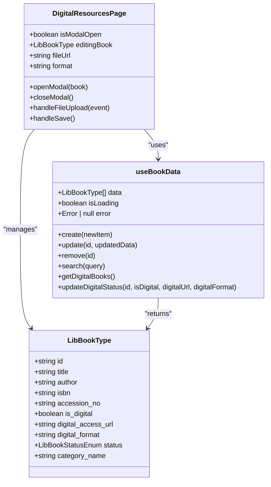
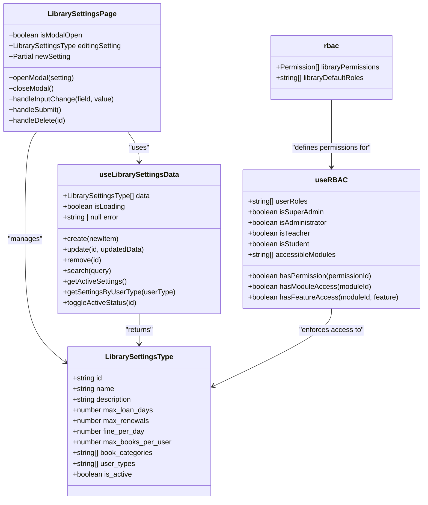
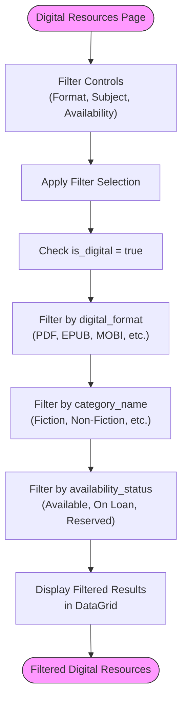

# Digital Resources

<cite>
**Referenced Files in This Document**   
- [DigitalResourcesPage.tsx](file://src/modules/library/pages/DigitalResourcesPage.tsx)
- [LibrarySettingsPage.tsx](file://src/modules/library/pages/LibrarySettingsPage.tsx)
- [useBookData.ts](file://src/modules/library/data/useBookData.ts)
- [types.ts](file://src/modules/library/data/types.ts)
- [useLibrarySettingsData.ts](file://src/modules/library/data/useLibrarySettingsData.ts)
- [rbac.ts](file://src/modules/library/rbac.ts)
- [useRBAC.ts](file://src/hooks/useRBAC.ts)
</cite>

## Table of Contents
1. [Introduction](#introduction)
2. [Digital Resources Management System](#digital-resources-management-system)
3. [Access Control and User Roles](#access-control-and-user-roles)
4. [External Content Integration](#external-content-integration)
5. [Filtering and Availability Features](#filtering-and-availability-features)
6. [Common Issues and Troubleshooting](#common-issues-and-troubleshooting)
7. [Best Practices for Digital Collection Management](#best-practices-for-digital-collection-management)

## Introduction
The Digital Resources feature in the Library module provides a comprehensive system for managing e-books, journals, and other digital media within an educational institution. This documentation details the implementation of digital resource organization, access controls, filtering capabilities, and integration with external systems. The system enables librarians and administrators to efficiently manage digital collections while ensuring appropriate access based on user roles and subscription rules.

## Digital Resources Management System

The digital resources management system is implemented through the `DigitalResourcesPage` component, which provides a user interface for managing digital files linked to books in the library collection. The system allows librarians to upload, update, and manage digital versions of books, including e-books in various formats such as PDF, EPUB, MOBI, DOCX, and TXT.

The system is built on a React-based frontend with a component architecture that leverages reusable UI elements such as Cards, DataGrids, and Modals to ensure consistency across the application. Digital resources are treated as extensions of physical books, with digital access information stored as properties of the book entity rather than as separate entities.

**Diagram sources**
- [DigitalResourcesPage.tsx](file://src/modules/library/pages/DigitalResourcesPage.tsx)
- [types.ts](file://src/modules/library/data/types.ts)
- [useBookData.ts](file://src/modules/library/data/useBookData.ts)

**Section sources**
- [DigitalResourcesPage.tsx](file://src/modules/library/pages/DigitalResourcesPage.tsx)
- [types.ts](file://src/modules/library/data/types.ts)

### Data Structure and Properties
The digital resources are implemented as properties within the `LibBookType` interface, which defines the data structure for all books in the library system. Key properties related to digital resources include:

- **is_digital**: A boolean flag indicating whether the book has a digital version available
- **digital_access_url**: A string containing the URL or file path to access the digital resource
- **digital_format**: A string specifying the format of the digital resource (e.g., PDF, EPUB)

These properties are part of the broader book entity, allowing the system to maintain a unified view of both physical and digital resources while enabling filtering and searching across all book properties.

### Implementation Details
The `DigitalResourcesPage` component implements a data grid interface that displays all books with digital resources. The page uses the `useBookData` hook to retrieve book data from the database and provides filtering to show only digital resources. When a user clicks the "Update" button for a digital resource, a modal dialog appears with fields to modify the digital access URL and format.

The file upload functionality uses the browser's native file input element with accept attributes to restrict uploads to specific digital formats. When a file is selected, the system creates an object URL using `URL.createObjectURL()` to provide a temporary reference to the file before it is permanently stored in the system.

## Access Control and User Roles

Access to digital resources is controlled through a role-based access control (RBAC) system that defines permissions for different user types. The system implements access controls based on user roles, subscription expiration dates, and library settings that specify borrowing rules for different user categories.

**Diagram sources**
- [LibrarySettingsPage.tsx](file://src/modules/library/pages/LibrarySettingsPage.tsx)
- [types.ts](file://src/modules/library/data/types.ts)
- [useLibrarySettingsData.ts](file://src/modules/library/data/useLibrarySettingsData.ts)
- [rbac.ts](file://src/modules/library/rbac.ts)
- [useRBAC.ts](file://src/hooks/useRBAC.ts)

**Section sources**
- [LibrarySettingsPage.tsx](file://src/modules/library/pages/LibrarySettingsPage.tsx)
- [types.ts](file://src/modules/library/data/types.ts)
- [useLibrarySettingsData.ts](file://src/modules/library/data/useLibrarySettingsData.ts)
- [rbac.ts](file://src/modules/library/rbac.ts)

### Role-Based Access Control Implementation
The RBAC system is implemented through the `libraryPermissions` array defined in the `rbac.ts` file, which specifies granular permissions for different actions on library resources. The system defines permissions for viewing, adding, updating, and removing books and loans, with each permission identified by a unique ID following the pattern `module.resource.action`.

The `useRBAC` hook provides the primary interface for enforcing these permissions throughout the application. It determines user roles based on user type (Staff or Student) and checks whether a user has the necessary permissions to perform specific actions. In demo mode, the system grants super admin privileges to all users, while in production mode, it enforces strict role-based access.

### Library Settings and Borrowing Rules
The `LibrarySettingsPage` component allows administrators to define borrowing rules that control access to digital resources based on user types and book categories. Each rule specifies parameters such as:

- **Max Loan Days**: The maximum number of days a digital resource can be borrowed
- **Max Renewals**: The number of times a digital loan can be renewed
- **Fine per Day**: The penalty for overdue digital resources
- **Max Books per User**: The maximum number of digital resources a user can borrow simultaneously
- **User Types**: The categories of users to whom the rule applies (e.g., Student, Staff)
- **Book Categories**: The categories of books to which the rule applies

These rules are stored as `LibrarySettingsType` objects and can be activated or deactivated based on subscription status or institutional policies. The system evaluates these rules when users attempt to access digital resources, ensuring compliance with institutional borrowing policies.

## External Content Integration

The digital resources system is designed to integrate with external content providers and Digital Rights Management (DRM) systems through the `LibrarySettingsPage` interface. While the current implementation focuses on locally hosted digital files, the architecture supports integration with external providers through the digital access URL property.

The system could be extended to support various external content integration scenarios:

- **Subscription-based content**: Digital access URLs could point to authenticated endpoints provided by external publishers
- **DRM-protected content**: The system could integrate with DRM services to manage encryption keys and access tokens
- **API-based content delivery**: The system could use APIs to fetch content from external providers based on user authentication

The `LibrarySettingsPage` provides the foundation for managing these integrations by allowing administrators to configure rules for different content types and user categories. Future enhancements could include fields for API keys, authentication tokens, and subscription expiration dates to fully support external content provider integration.

## Filtering and Availability Features

The digital resources system includes robust filtering capabilities that allow users to search and organize digital media by format, subject, and availability status. These features are implemented through the `useBookData` hook, which provides multiple methods for querying and filtering book data.

**Diagram sources**
- [DigitalResourcesPage.tsx](file://src/modules/library/pages/DigitalResourcesPage.tsx)
- [useBookData.ts](file://src/modules/library/data/useBookData.ts)

**Section sources**
- [DigitalResourcesPage.tsx](file://src/modules/library/pages/DigitalResourcesPage.tsx)
- [useBookData.ts](file://src/modules/library/data/useBookData.ts)

### Filtering Implementation
The filtering functionality is implemented through several methods in the `useBookData` hook:

- **getDigitalBooks()**: Returns all books where `is_digital` is true, providing the base set of digital resources
- **search(query)**: Performs a full-text search across multiple book properties including title, author, ISBN, and category
- **getBooksByAvailabilityStatus(status)**: Filters books by their availability status (Available, On Loan, Reserved)

The `DigitalResourcesPage` component combines these methods to provide a comprehensive filtering interface. Users can search for digital resources by keyword and then further refine results using the DataGrid's built-in filtering capabilities on columns such as Format and Availability.

### Availability Management
Digital resource availability is managed through the `availability_status` property of the `LibBookType` interface, which can have values of "Available", "On Loan", or "Reserved". The system updates this status automatically when users borrow or return digital resources, ensuring accurate availability information.

The current implementation shows a simple "Access File" link for available digital resources, but could be extended to include loan management functionality such as check-out, return, and renewal processes that update the availability status accordingly.

## Common Issues and Troubleshooting

The digital resources system may encounter several common issues that administrators should be prepared to address:

### Broken Links
Broken links to digital resources can occur when files are moved, renamed, or deleted from the storage system. To troubleshoot broken links:

1. Verify that the digital_access_url points to a valid location
2. Check that the file exists at the specified path
3. Ensure that the storage system is accessible and functioning properly
4. Update the digital_access_url with the correct path if the file has been moved

The system should implement periodic link validation to identify and report broken links automatically.

### Expired Subscriptions
For digital resources provided through external subscription services, access may be lost when subscriptions expire. To manage subscription expiration:

1. Implement a subscription management system that tracks expiration dates
2. Create automated alerts for upcoming subscription renewals
3. Deactivate access to subscription-based content when subscriptions expire
4. Maintain a record of previously available content for historical reference

### Bandwidth Limitations
Large digital files such as e-books and journals can strain network bandwidth, particularly during peak usage times. To address bandwidth limitations:

1. Implement content delivery optimization such as file compression
2. Use caching mechanisms to reduce repeated downloads of the same content
3. Schedule large file transfers during off-peak hours
4. Consider implementing a content delivery network (CDN) for frequently accessed resources

## Best Practices for Digital Collection Management

Effective management of digital collections requires adherence to several best practices that ensure optimal organization, accessibility, and sustainability of digital resources.

### Collection Curation
When curating digital collections, consider the following guidelines:

- **Selection Criteria**: Establish clear criteria for selecting digital resources based on curriculum needs, user demand, and quality standards
- **Format Standardization**: Prioritize widely supported formats such as PDF and EPUB to ensure broad accessibility
- **Metadata Quality**: Ensure comprehensive and accurate metadata for all digital resources to facilitate discovery and organization
- **Accessibility**: Verify that digital resources meet accessibility standards for users with disabilities

### License Management
Proper license management is critical for compliance and cost control:

- **License Tracking**: Maintain a comprehensive database of all digital resource licenses, including terms, expiration dates, and usage restrictions
- **Usage Monitoring**: Track usage statistics to evaluate the return on investment for licensed content
- **Renewal Planning**: Establish a calendar for license renewals to avoid service interruptions
- **Compliance Audits**: Regularly audit usage against license terms to ensure compliance

### Usage Statistics and Acquisition Decisions
Usage statistics provide valuable insights for informing acquisition decisions:

- **Usage Analysis**: Regularly analyze metrics such as download counts, search patterns, and user feedback to identify popular and underutilized resources
- **Collection Assessment**: Use usage data to assess the effectiveness of the digital collection and identify gaps in coverage
- **Budget Allocation**: Allocate acquisition budgets based on demonstrated usage and user needs rather than anecdotal evidence
- **User Feedback**: Incorporate user feedback into the acquisition process to ensure the collection meets user expectations

By following these best practices, institutions can build and maintain digital collections that effectively support teaching, learning, and research activities while ensuring responsible stewardship of resources.