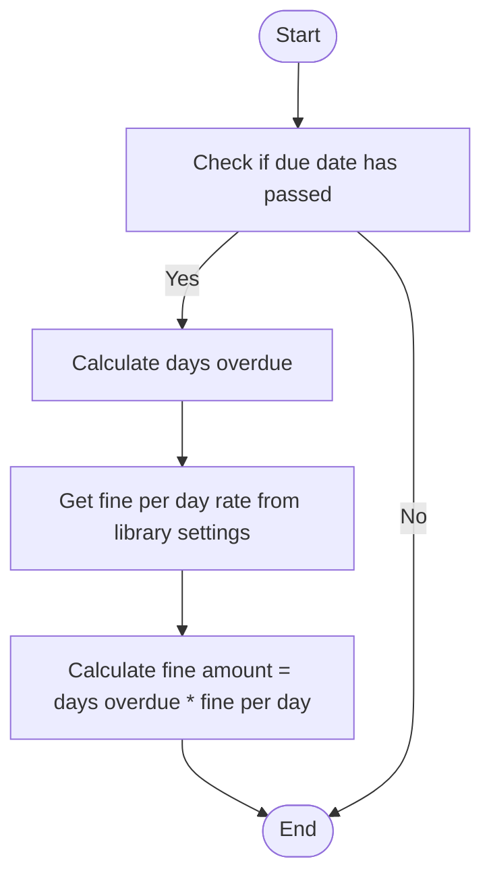
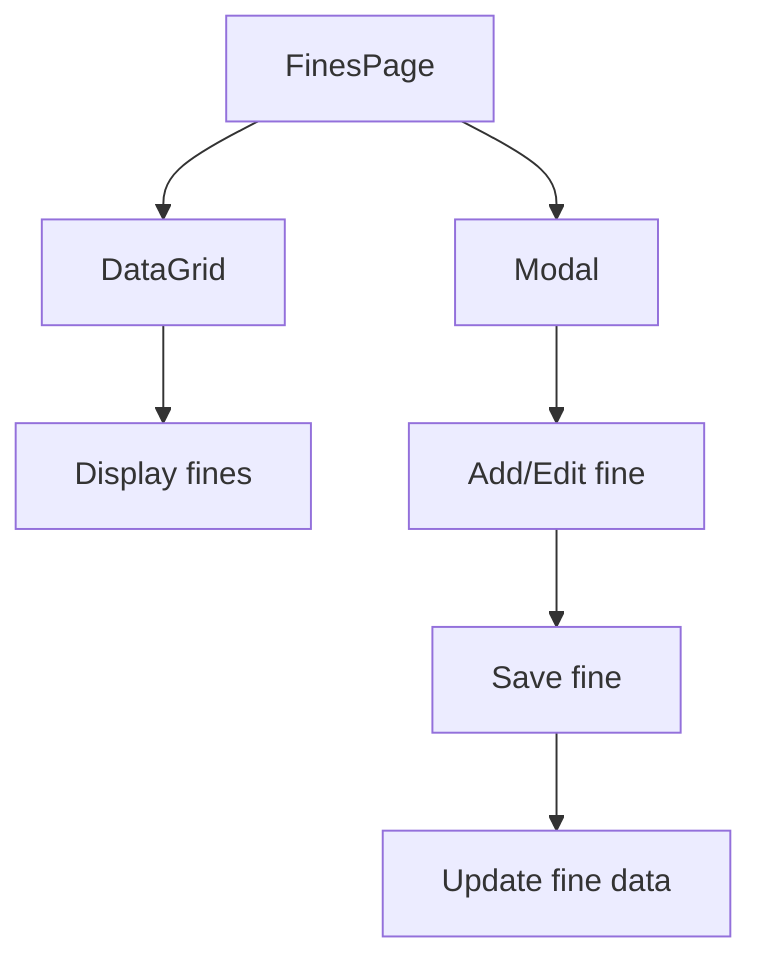
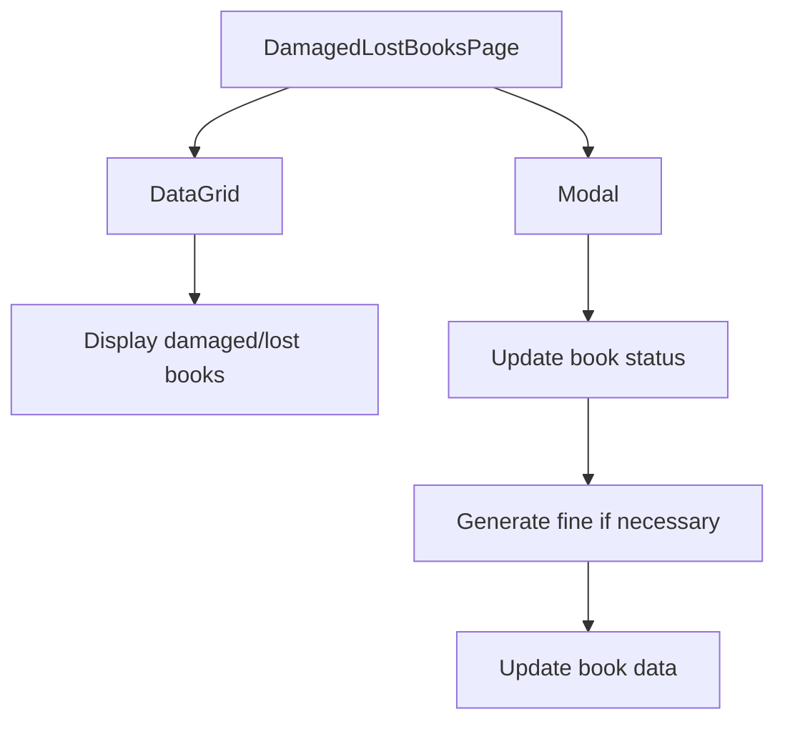
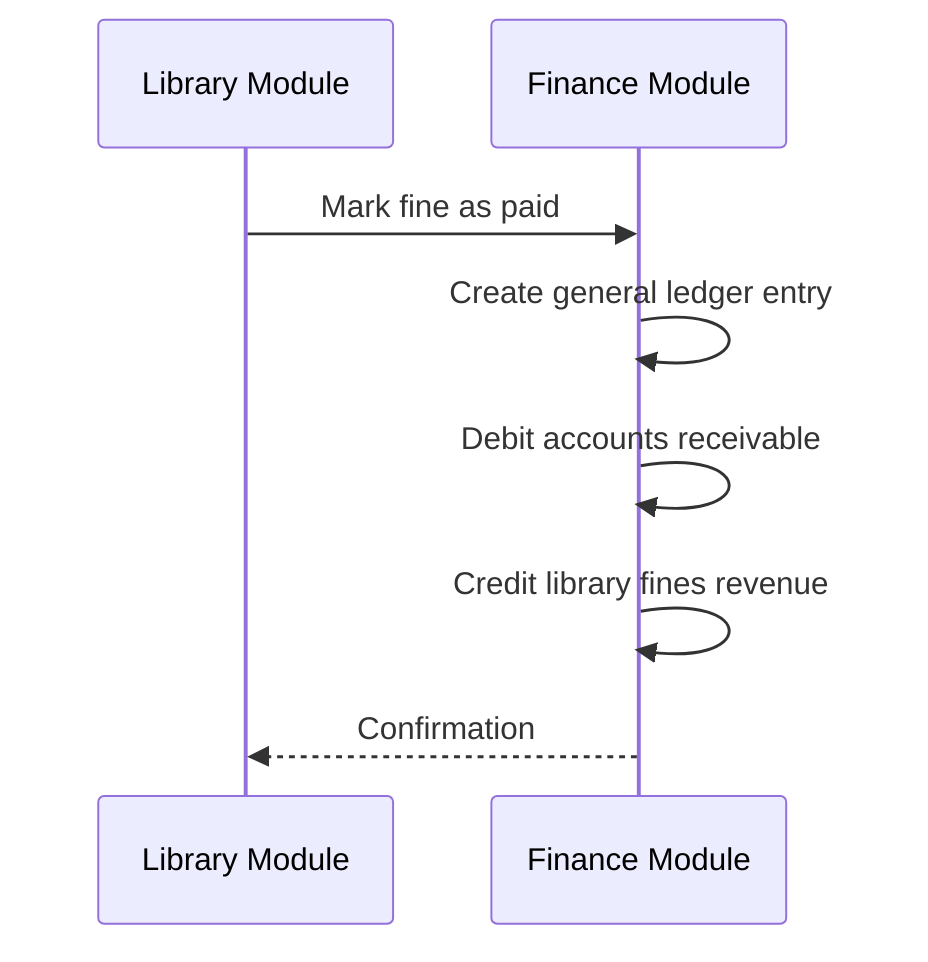

# Fine Management

<cite>
**Referenced Files in This Document**   
- [DamagedLostBooksPage.tsx](file://src/modules/library/pages/DamagedLostBooksPage.tsx)
- [FinesPage.tsx](file://src/modules/library/pages/FinesPage.tsx)
- [useFineData.ts](file://src/modules/library/data/useFineData.ts)
- [useLibrarySettingsData.ts](file://src/modules/library/data/useLibrarySettingsData.ts)
- [mockData.ts](file://src/modules/library/data/mockData.ts)
- [OverdueReport.tsx](file://src/modules/reports/library/OverdueReport.tsx)
- [mockData.ts](file://src/modules/finance/data/mockData.ts)
</cite>

## Table of Contents
1. [Introduction](#introduction)
2. [Fine Calculation Logic](#fine-calculation-logic)
3. [Fine Accrual and Tracking](#fine-accrual-and-tracking)
4. [UI Components and Workflows](#ui-components-and-workflows)
5. [Integration with Finance Module](#integration-with-finance-module)
6. [Common Issues and Best Practices](#common-issues-and-best-practices)

## Introduction
The Fine Management system in the Library module handles the calculation and tracking of overdue fines, damaged book charges, and lost book replacement costs. This document details the implementation of the fine calculation logic, the useFineData hook for tracking fine accrual, payments, and waivers, and the UI components used in the FinesPage and DamagedLostBooksPage. It also covers integration with the Finance module for payment reconciliation and provides best practices for maintaining accurate financial records.

## Fine Calculation Logic

### Overdue Fines
The calculation of overdue fines is based on the number of days a book is overdue and the fine per day rate configured in the library settings. The fine per day rate is determined by the user type and book category, as defined in the library settings.



**Diagram sources**
- [OverdueReport.tsx](file://src/modules/reports/library/OverdueReport.tsx#L34-L72)

### Damaged Book Charges
When a book is marked as damaged, a fine is generated based on the severity of the damage. The fine amount is configurable in the library settings and can vary by book category and user type.

### Lost Book Replacement Costs
If a book is marked as lost, the replacement cost is calculated based on the book's value and any additional administrative fees. The replacement cost is also configurable in the library settings.

## Fine Accrual and Tracking

### useFineData Hook
The `useFineData` hook is responsible for managing fine data, including creating, updating, and removing fines. It also provides methods for marking fines as paid, waived, or billed.

```typescript
const useFineData = () => {
  const [data, setData] = useState<LibFineType[]>([]);
  const [isLoading, setIsLoading] = useState<boolean>(true);
  const [error, setError] = useState<Error | null>(null);

  useEffect(() => {
    let subscription: any = null;
    
    const initializeData = async () => {
      try {
        setIsLoading(true);
        setError(null);
        const db = await getDatabase();
        subscription = db.collections.fines.find().$.subscribe(fines => {
          if (fines) {
            setData(fines);
          }
          setIsLoading(false);
        });
      } catch (err) {
        setError(err instanceof Error ? err : new Error('Failed to initialize database'));
        setIsLoading(false);
      }
    };
    
    initializeData();
    
    return () => {
      if (subscription) {
        subscription.unsubscribe();
      }
    };
  }, []);

  const create = async (newItem: Partial<LibFineType>) => {
    try {
      const db = await getDatabase();
      const fine = await db.collections.fines.insert({
        ...newItem,
        id: newItem.id || Date.now().toString(),
        created_at: new Date().toISOString(),
        updated_at: new Date().toISOString(),
      } as LibFineType);
      return fine;
    } catch (err) {
      throw err instanceof Error ? err : new Error('Failed to create fine');
    }
  };

  const update = async (id: string, updatedData: Partial<LibFineType>) => {
    try {
      const db = await getDatabase();
      const fine = await db.collections.fines.findOne(id).exec();
      if (fine) {
        await fine.update({
          $set: {
            ...updatedData,
            updated_at: new Date().toISOString(),
          },
        });
      }
    } catch (err) {
      throw err instanceof Error ? err : new Error('Failed to update fine');
    }
  };

  const remove = async (id: string) => {
    try {
      const db = await getDatabase();
      const fine = await db.collections.fines.findOne(id).exec();
      if (fine) {
        await fine.remove();
      }
    } catch (err) {
      throw err instanceof Error ? err : new Error('Failed to remove fine');
    }
  };

  const markAsPaid = async (id: string, paymentDate?: string, paymentReference?: string) => {
    return update(id, {
      status: 'Paid' as any,
      paid_date: paymentDate || new Date().toISOString().split('T')[0],
      payment_reference: paymentReference
    });
  };

  const waiveFine = async (id: string) => {
    return update(id, { status: 'Waived' as any });
  };

  const billFine = async (id: string) => {
    return update(id, { status: 'Billed' as any });
  };

  return {
    data,
    isLoading,
    error,
    create,
    update,
    remove,
    search,
    getPendingFines,
    getPaidFines,
    getBilledFines,
    getWaivedFines,
    getFinesByStatus,
    markAsPaid,
    waiveFine,
    billFine
  };
};
```

**Section sources**
- [useFineData.ts](file://src/modules/library/data/useFineData.ts#L7-L154)

## UI Components and Workflows

### FinesPage
The `FinesPage` component displays a list of fines and provides functionality for adding, editing, and managing fines. It uses the `useFineData` hook to interact with the fine data.



**Diagram sources**
- [FinesPage.tsx](file://src/modules/library/pages/FinesPage.tsx#L0-L35)

### DamagedLostBooksPage
The `DamagedLostBooksPage` component allows librarians to manage books that are damaged or lost. It provides functionality for updating the status of books and generating fines.



**Diagram sources**
- [DamagedLostBooksPage.tsx](file://src/modules/library/pages/DamagedLostBooksPage.tsx#L0-L408)

## Integration with Finance Module

### Payment Reconciliation
When a fine is marked as paid, a corresponding entry is created in the Finance module to reconcile the payment. The general ledger entries include both a debit to the accounts receivable account and a credit to the library fines revenue account.



**Diagram sources**
- [mockData.ts](file://src/modules/finance/data/mockData.ts#L223-L235)

## Common Issues and Best Practices

### Common Issues
- **Fine Disputes**: Users may dispute fines, requiring a review process.
- **Partial Payments**: Handling partial payments requires careful tracking to ensure full payment is eventually received.
- **Financial Aid Adjustments**: Financial aid may affect the amount a user is required to pay.

### Best Practices
- **Maintain Accurate Records**: Ensure all fine transactions are accurately recorded and reconciled.
- **Generate Audit Reports**: Regularly generate audit reports to verify the accuracy of fine data.
- **Ensure Compliance**: Follow institutional policies for fine calculation and collection.

**Section sources**
- [mockData.ts](file://src/modules/library/data/mockData.ts#L36-L62)
- [mockData.ts](file://src/modules/finance/data/mockData.ts#L69-L75)