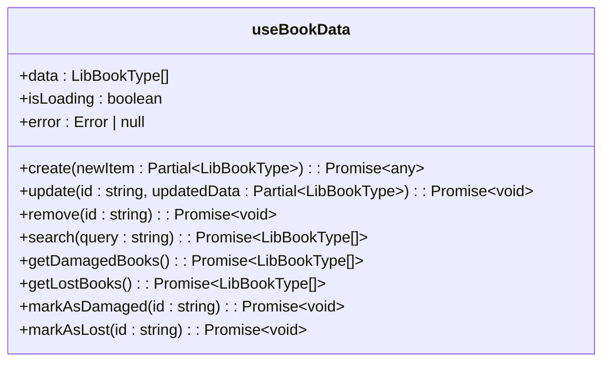
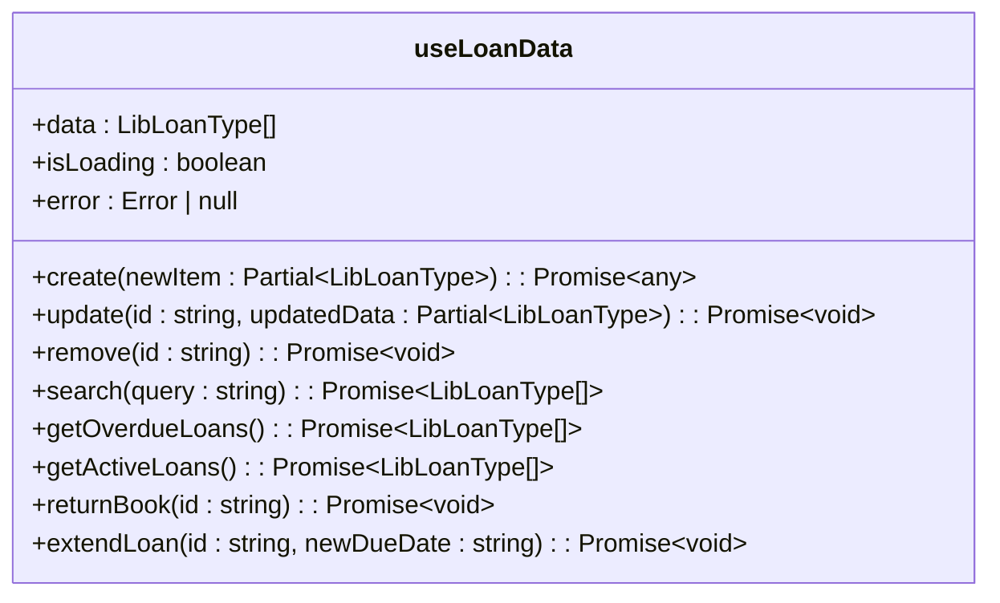
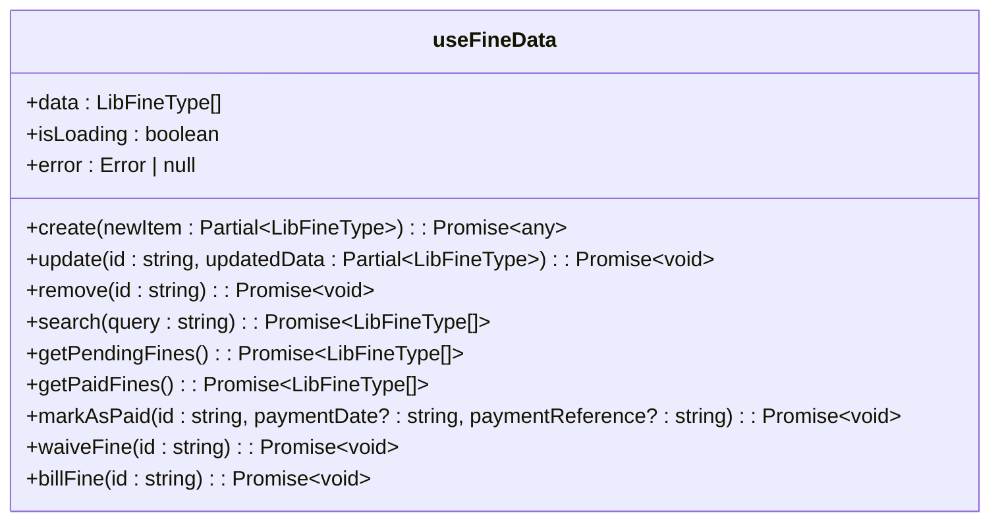
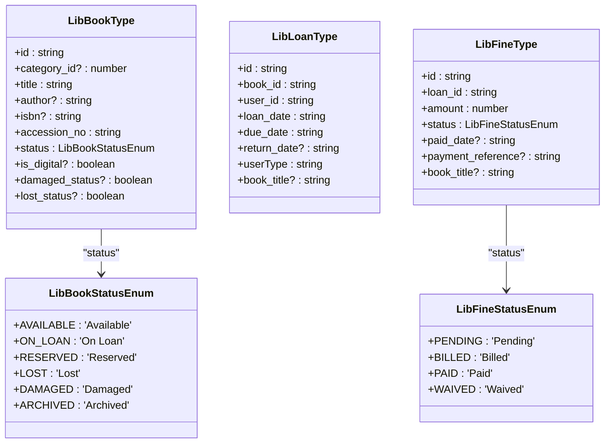
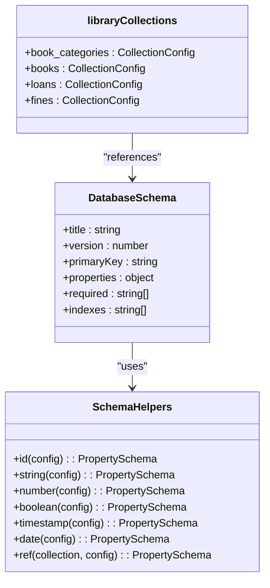

# Library Module Data Access Hooks

<cite>
**Referenced Files in This Document**   
- [useBookData.ts](file://src/modules/library/data/useBookData.ts)
- [useLoanData.ts](file://src/modules/library/data/useLoanData.ts)
- [useFineData.ts](file://src/modules/library/data/useFineData.ts)
- [types.ts](file://src/modules/library/data/types.ts)
- [schema.ts](file://src/modules/library/data/schema.ts)
- [collections.ts](file://src/modules/library/data/collections.ts)
</cite>

## Table of Contents
1. [Introduction](#introduction)
2. [Core Data Access Hooks Overview](#core-data-access-hooks-overview)
3. [useBookData Hook Implementation](#usebookdata-hook-implementation)
4. [useLoanData Hook Implementation](#useloandata-hook-implementation)
5. [useFineData Hook Implementation](#usefinedata-hook-implementation)
6. [Data Structures and Type Definitions](#data-structures-and-type-definitions)
7. [RxDB Collection and Schema Configuration](#rxdb-collection-and-schema-configuration)
8. [Hook Integration and Usage Patterns](#hook-integration-and-usage-patterns)
9. [Error Handling and Retry Mechanisms](#error-handling-and-retry-mechanisms)
10. [Performance Considerations](#performance-considerations)

## Introduction

The Library module in schoolpilot3 implements a comprehensive data access layer through custom React hooks that provide direct interaction with RxDB collections. These hooks follow a self-contained pattern, enabling CRUD operations without dependency on global application context. This documentation details the implementation, interfaces, and integration patterns of the primary data access hooks: `useBookData`, `useLoanData`, and `useFineData`. The hooks facilitate real-time data synchronization, support advanced search capabilities, and integrate with the application's global data strategy system for consistent state management.

## Core Data Access Hooks Overview

The Library module exposes three primary data access hooks that serve as the interface between UI components and the underlying RxDB database:

- **useBookData**: Manages book inventory with comprehensive CRUD operations and specialized methods for book status management
- **useLoanData**: Handles book lending operations with real-time overdue loan notifications and loan lifecycle management
- **useFineData**: Manages fine collection with status-based filtering and payment processing capabilities

All hooks follow a consistent design pattern featuring reactive state management, error handling, and real-time data synchronization through RxDB observables. They are designed as global providers, enabling cross-module usage while maintaining data integrity and consistency.

**Section sources**
- [useBookData.ts](file://src/modules/library/data/useBookData.ts)
- [useLoanData.ts](file://src/modules/library/data/useLoanData.ts)
- [useFineData.ts](file://src/modules/library/data/useFineData.ts)

## useBookData Hook Implementation

The `useBookData` hook provides comprehensive management capabilities for the library's book inventory. It implements a reactive pattern using React's useState and useEffect hooks to maintain synchronization with the RxDB books collection.



**Diagram sources**
- [useBookData.ts](file://src/modules/library/data/useBookData.ts#L7-L164)

### Interface and State Management

The hook maintains three primary state variables:
- **data**: Array of LibBookType objects representing the current book inventory
- **isLoading**: Boolean flag indicating initialization or operation status
- **error**: Error object containing details of any database operation failures

The hook initializes by establishing a subscription to the RxDB books collection observable, ensuring real-time updates when data changes:

```typescript
useEffect(() => {
  let subscription: any = null;
  
  const initializeData = async () => {
    try {
      setIsLoading(true);
      setError(null);
      const db = await getDatabase();
      subscription = db.collections.books.find().$.subscribe(books => {
        if (books) {
          setData(books);
        }
        setIsLoading(false);
      });
    } catch (err) {
      setError(err instanceof Error ? err : new Error('Failed to initialize database'));
      setIsLoading(false);
    }
  };
  
  initializeData();
  
  return () => {
    if (subscription) {
      subscription.unsubscribe();
    }
  };
}, []);
```

### CRUD Operations

The hook implements standard CRUD operations with proper error handling:

- **create**: Inserts a new book record with auto-generated ID and timestamp fields
- **update**: Updates an existing book record with optimistic UI updates
- **remove**: Removes a book record from the collection

Each operation includes comprehensive error handling, wrapping underlying database errors in descriptive messages.

### Advanced Search and Management

The hook provides specialized methods for common library operations:

- **search**: Full-text search across multiple book fields (title, author, ISBN, etc.)
- **getDamagedBooks/getLostBooks**: Filters books by damage or loss status
- **markAsDamaged/markAsLost**: Convenience methods for updating book status
- **updateDigitalStatus**: Updates digital book properties including access URL and format

These methods operate on the client-side data array, providing immediate feedback to users while maintaining data consistency.

**Section sources**
- [useBookData.ts](file://src/modules/library/data/useBookData.ts#L7-L164)

## useLoanData Hook Implementation

The `useLoanData` hook manages the book lending system, providing lifecycle management for book loans and real-time notifications for overdue items.



**Diagram sources**
- [useLoanData.ts](file://src/modules/library/data/useLoanData.ts#L8-L164)

### Overdue Loan Notification System

A key feature of this hook is its built-in overdue loan notification system:

```typescript
const notifyOverdueLoans = (loans: LibLoanType[]) => {
  const today = new Date().toISOString().split('T')[0];
  loans.forEach(loan => {
    if (!loan.return_date && loan.due_date < today) {
      showToast({
        title: 'Overdue Alert',
        message: `Loan for '${loan.book_title}' is overdue!`,
        variant: 'warning',
      });
    }
  });
};
```

This function is called whenever the loan data updates, automatically displaying toast notifications for overdue loans. The hook depends on the `useToast` hook for UI feedback, creating a dependency that is properly managed through the useEffect dependency array.

### Loan Lifecycle Management

The hook provides specialized methods for managing the loan lifecycle:

- **returnBook**: Updates the return_date field to complete a loan
- **extendLoan**: Updates the extended_due_date field for loan renewals
- **getOverdueLoans**: Returns all active loans past their due date
- **getActiveLoans**: Returns all currently borrowed books

These methods simplify common library operations, reducing boilerplate code in UI components.

### Search and Filtering

The hook implements search functionality across key loan fields:
- Book title
- User name
- Branch ID
- User type

Additionally, it provides specialized filtering methods like `getLoansByUserType` for administrative reporting and analysis.

**Section sources**
- [useLoanData.ts](file://src/modules/library/data/useLoanData.ts#L8-L164)

## useFineData Hook Implementation

The `useFineData` hook manages the library's fine collection system, providing status-based tracking and payment processing capabilities.



**Diagram sources**
- [useFineData.ts](file://src/modules/library/data/useFineData.ts#L7-L154)

### Fine Status Management

The hook implements a comprehensive fine status system with specialized methods for status transitions:

- **getPendingFines**: Returns fines awaiting payment
- **getPaidFines**: Returns fines that have been paid
- **getBilledFines**: Returns fines that have been billed
- **getWaivedFines**: Returns fines that have been waived

These methods enable efficient filtering and reporting based on fine status.

### Status Transition Operations

The hook provides convenience methods for common status transitions:

- **markAsPaid**: Updates fine status to "Paid" with payment details
- **waiveFine**: Updates fine status to "Waived"
- **billFine**: Updates fine status to "Billed"

These methods handle the status update operation and automatically update timestamp fields:

```typescript
const markAsPaid = async (id: string, paymentDate?: string, paymentReference?: string) => {
  return update(id, {
    status: 'Paid' as any,
    paid_date: paymentDate || new Date().toISOString().split('T')[0],
    payment_reference: paymentReference
  });
};
```

### Search and Filtering

The hook implements search functionality across key fine fields:
- Book title
- User name
- Reason for fine
- Status

The `getFinesByStatus` method provides flexible filtering by any status value, supporting custom reporting requirements.

**Section sources**
- [useFineData.ts](file://src/modules/library/data/useFineData.ts#L7-L154)

## Data Structures and Type Definitions

The Library module defines comprehensive TypeScript interfaces and enums to ensure type safety and data consistency.



**Diagram sources**
- [types.ts](file://src/modules/library/data/types.ts#L3-L111)

### Key Data Structures

**LibBookType**: Represents a book in the library inventory with properties for identification, classification, status, and location.

**LibLoanType**: Represents a book loan with references to the book and user, loan dates, and denormalized fields for efficient querying.

**LibFineType**: Represents a fine assessment with financial details, status tracking, and payment information.

### Enum Definitions

The module defines enums for consistent status tracking:
- **LibBookStatusEnum**: Standardized book statuses
- **LibFineStatusEnum**: Standardized fine statuses

These enums ensure data consistency and enable type-safe comparisons in the application logic.

**Section sources**
- [types.ts](file://src/modules/library/data/types.ts#L3-L111)

## RxDB Collection and Schema Configuration

The Library module configures its RxDB collections through standardized configuration files that define the database schema and collection structure.



**Diagram sources**
- [collections.ts](file://src/modules/library/data/collections.ts#L1-L22)
- [schema.ts](file://src/modules/library/data/schema.ts#L1-L108)

### Collection Configuration

The `collections.ts` file defines the module's collections:

```typescript
export const libraryCollections = {
  book_categories: {
    schema: schemas.bookCategorySchema,
  },
  books: {
    schema: schemas.bookSchema,
  },
  loans: {
    schema: schemas.loanSchema,
  },
  fines: {
    schema: schemas.fineSchema,
  },
};
```

This configuration is consumed by the central rxdbService to register module-specific collections.

### Schema Definition

The `schema.ts` file defines database-agnostic schemas using a custom schema creation utility:

```typescript
export const bookSchema: DatabaseSchema = createDatabaseSchema({
    title: 'book',
    version: 0,
    primaryKey: 'id',
    type: 'object',
    properties: {
        id: SchemaHelpers.id({ description: 'Unique identifier for the book' }),
        category_id: SchemaHelpers.ref('book_categories', { description: 'Reference to book category' }),
        // ... other properties
    },
    required: ['id', 'title', 'accession_no', 'status', 'created_at', 'updated_at'],
    indexes: ['title', 'author', 'isbn', 'accession_no', 'status', 'category_id', 'branch_id', 'damaged_status', 'lost_status', 'is_digital']
});
```

The schemas include:
- Comprehensive property definitions with validation rules
- Required field specifications
- Database indexes for optimized querying
- Descriptive metadata for documentation

**Section sources**
- [collections.ts](file://src/modules/library/data/collections.ts#L1-L22)
- [schema.ts](file://src/modules/library/data/schema.ts#L1-L108)

## Hook Integration and Usage Patterns

The data access hooks are designed for seamless integration with UI components, following React best practices for state management and side effects.

### Component Integration Example

```typescript
// Example usage in a BooksPage component
const BooksPage = () => {
  const { data: books, isLoading, error, create, update, search } = useBookData();
  const [searchQuery, setSearchQuery] = useState('');

  const handleSearch = async () => {
    const results = await search(searchQuery);
    // Update local state or display results
  };

  if (isLoading) return <LoadingState />;
  if (error) return <ErrorDisplay error={error} />;

  return (
    <div>
      <SearchBar onSearch={handleSearch} />
      <BookList books={books} onEdit={update} />
    </div>
  );
};
```

### Usage Patterns

**Real-time Data Display**: Components consume the `data` property to display current records, automatically updating when the database changes.

**Form Integration**: Create and update operations are typically triggered by form submissions, with appropriate loading and error handling.

**Search and Filtering**: The search methods enable dynamic filtering of data without additional database queries.

**Bulk Operations**: Specialized methods like `markAsDamaged` enable efficient batch updates to book status.

### Global Provider Pattern

All hooks export the `isGlobalProvider` flag, indicating they can be used across modules:

```typescript
export const isGlobalProvider = true;
```

This enables other modules to access library data when needed, promoting data consistency across the application.

**Section sources**
- [useBookData.ts](file://src/modules/library/data/useBookData.ts)
- [useLoanData.ts](file://src/modules/library/data/useLoanData.ts)
- [useFineData.ts](file://src/modules/library/data/useFineData.ts)

## Error Handling and Retry Mechanisms

The hooks implement comprehensive error handling to ensure robust database operations and provide meaningful feedback to users.

### Error Handling Pattern

Each hook follows a consistent error handling approach:

```typescript
try {
  const db = await getDatabase();
  // Database operation
} catch (err) {
  throw err instanceof Error ? err : new Error('Descriptive error message');
}
```

Key aspects include:
- Centralized error handling in the useEffect initialization
- Specific error messages for different operation types
- Type checking to ensure Error objects
- Propagation of errors to calling components

### Error States

The hooks manage error states through:
- **Component-level error state**: The `error` state variable captures operation failures
- **Loading state coordination**: Loading state is properly managed during error conditions
- **Subscription cleanup**: Database subscriptions are properly cleaned up to prevent memory leaks

### Retry Considerations

While the current implementation does not include automatic retry logic, the promise-based interface enables external retry mechanisms:

```typescript
// Example of external retry logic
const createWithRetry = async (bookData, maxRetries = 3) => {
  for (let i = 0; i < maxRetries; i++) {
    try {
      return await create(bookData);
    } catch (error) {
      if (i === maxRetries - 1) throw error;
      await new Promise(resolve => setTimeout(resolve, 1000 * (i + 1)));
    }
  }
};
```

Future enhancements could incorporate exponential backoff and circuit breaker patterns for improved resilience.

**Section sources**
- [useBookData.ts](file://src/modules/library/data/useBookData.ts)
- [useLoanData.ts](file://src/modules/library/data/useLoanData.ts)
- [useFineData.ts](file://src/modules/library/data/useFineData.ts)

## Performance Considerations

The data access hooks incorporate several performance optimizations to ensure efficient operation in long-running library sessions.

### Query Optimization

The hooks leverage RxDB's query capabilities and indexing strategy:

- **Indexed fields**: Critical search fields are indexed in the schema definition
- **Client-side filtering**: Search operations use client-side filtering on already-loaded data
- **Targeted queries**: The initial subscription loads all records, reducing subsequent database queries

### Result Caching

The hooks implement implicit caching through React's state management:

- **Data persistence**: The `data` state maintains a local copy of all records
- **Reduced database roundtrips**: Subsequent operations use the local data for filtering and display
- **Real-time synchronization**: The RxDB observable ensures the local cache stays synchronized

### Memory Management

The hooks include proper cleanup mechanisms:

- **Subscription cleanup**: The useEffect cleanup function unsubscribes from the RxDB observable
- **State management**: React's useState hook handles memory allocation and deallocation
- **Error state cleanup**: Error states are properly reset during initialization

### Optimization Opportunities

Potential improvements include:
- **Pagination**: Implementing pagination for large datasets
- **Lazy loading**: Loading data on demand rather than at initialization
- **Query optimization**: Using RxDB's query capabilities more extensively
- **Memory monitoring**: Adding memory usage monitoring for long-running sessions

The current implementation strikes a balance between performance and simplicity, prioritizing real-time updates and data consistency over advanced optimization techniques.

**Section sources**
- [useBookData.ts](file://src/modules/library/data/useBookData.ts)
- [useLoanData.ts](file://src/modules/library/data/useLoanData.ts)
- [useFineData.ts](file://src/modules/library/data/useFineData.ts)