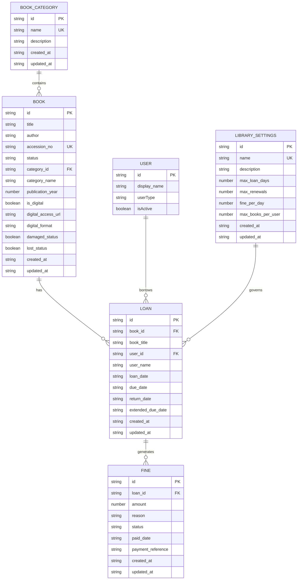

# Library Module Data Model

<cite>
**Referenced Files in This Document**   
- [useLibrarySettingsData.ts](file://src/modules/library/data/useLibrarySettingsData.ts)
- [types.ts](file://src/modules/library/data/types.ts)
- [DigitalResourcesPage.tsx](file://src/modules/library/pages/DigitalResourcesPage.tsx)
- [UserLibraryPortalPage.tsx](file://src/modules/library/pages/UserLibraryPortalPage.tsx)
- [BookLoansPage.tsx](file://src/modules/library/pages/BookLoansPage.tsx)
- [FinesPage.tsx](file://src/modules/library/pages/FinesPage.tsx)
- [useFineData.ts](file://src/modules/library/data/useFineData.ts)
- [archival_service.ts](file://scripts/migration/archival_service.ts)
</cite>

## Table of Contents
1. [Introduction](#introduction)
2. [Core Entities](#core-entities)
3. [Entity-Relationship Diagram](#entity-relationship-diagram)
4. [Business Rules](#business-rules)
5. [Schema Validation and Indexing](#schema-validation-and-indexing)
6. [Data Lifecycle Policies](#data-lifecycle-policies)
7. [RxDB Collections and Offline Synchronization](#rxdb-collections-and-offline-synchronization)

## Introduction
This document provides comprehensive documentation for the Library module in schoolpilot3, detailing the core data model entities, their relationships, business rules, and implementation details. The Library module manages book inventory, loan tracking, fine calculation, and digital resources, with a focus on supporting both online and offline scenarios through RxDB synchronization. The data model is designed to support flexible borrowing rules based on user types and book categories, with automated fine calculation for overdue items.

**Section sources**
- [useLibrarySettingsData.ts](file://src/modules/library/data/useLibrarySettingsData.ts)
- [types.ts](file://src/modules/library/data/types.ts)

## Core Entities

### Book
The Book entity represents physical and digital books in the library collection. Each book has a unique identifier, title, author, accession number, and status indicating its availability.

**: Fields**
- **id**: string (Primary Key) - Unique identifier for the book
- **title**: string - Title of the book
- **author**: string - Author of the book
- **accession_no**: string - Unique accession number for physical tracking
- **status**: BookStatus - Current status (AVAILABLE, ON_LOAN, DAMAGED, LOST)
- **category_id**: string - Reference to BookCategory
- **category_name**: string - Denormalized category name for display
- **publication_year**: number | null - Year of publication
- **is_digital**: boolean - Flag indicating if the book has a digital version
- **digital_access_url**: string | null - URL or file path for digital access
- **digital_format**: string | null - Format of the digital resource (PDF, EPUB, etc.)
- **damaged_status**: boolean - Indicates if the book is damaged
- **lost_status**: boolean - Indicates if the book is lost
- **created_at**: string - Timestamp of creation
- **updated_at**: string - Timestamp of last update

**Section sources**
- [types.ts](file://src/modules/library/data/types.ts)
- [BooksPage.tsx](file://src/modules/library/pages/BooksPage.tsx)

### BookCategory
The BookCategory entity represents categories or classifications for books in the library, enabling organization and filtering of the collection.

**: Fields**
- **id**: string (Primary Key) - Unique identifier for the category
- **name**: string - Name of the category
- **description**: string | null - Optional description of the category
- **created_at**: string - Timestamp of creation
- **updated_at**: string - Timestamp of last update

**Section sources**
- [types.ts](file://src/modules/library/data/types.ts)

### Loan
The Loan entity tracks book borrowing by users, including loan dates, due dates, and return information.

**: Fields**
- **id**: string (Primary Key) - Unique identifier for the loan
- **book_id**: string - Reference to the Book
- **book_title**: string - Denormalized book title for reporting
- **user_id**: string - Reference to the borrower
- **user_name**: string - Denormalized user name for display
- **loan_date**: string - Date when the book was loaned
- **due_date**: string - Date when the book is due to be returned
- **return_date**: string | null - Date when the book was returned
- **extended_due_date**: string | null - New due date after renewal
- **created_at**: string - Timestamp of creation
- **updated_at**: string - Timestamp of last update

**Section sources**
- [types.ts](file://src/modules/library/data/types.ts)
- [BookLoansPage.tsx](file://src/modules/library/pages/BookLoansPage.tsx)

### Fine
The Fine entity represents financial penalties for overdue books or other library policy violations.

**: Fields**
- **id**: string (Primary Key) - Unique identifier for the fine
- **loan_id**: string - Reference to the associated Loan
- **amount**: number - Monetary amount of the fine
- **reason**: string - Reason for the fine (e.g., "Overdue Book")
- **status**: FineStatus - Current status (PENDING, PAID, BILLED, WAIVED)
- **paid_date**: string | null - Date when the fine was paid
- **payment_reference**: string | null - Reference number for payment
- **created_at**: string - Timestamp of creation
- **updated_at**: string - Timestamp of last update

**Section sources**
- [types.ts](file://src/modules/library/data/types.ts)
- [FinesPage.tsx](file://src/modules/library/pages/FinesPage.tsx)

### LibrarySettings
The LibrarySettings entity defines borrowing rules and policies that vary by user type and book category.

**: Fields**
- **id**: string (Primary Key) - Unique identifier for the setting
- **name**: string - Name of the borrowing rule
- **description**: string | null - Description of the rule
- **max_loan_days**: number - Maximum number of days a book can be borrowed
- **max_renewals**: number - Maximum number of times a loan can be renewed
- **fine_per_day**: number - Fine amount per day for overdue books
- **max_books_per_user**: number - Maximum number of books a user can borrow simultaneously
- **book_categories**: string[] - Array of category names this rule applies to
- **user_types**: string[] - Array of user types this rule applies to (Student, Staff)
- **is_active**: boolean - Whether the rule is currently active
- **created_at**: string - Timestamp of creation
- **updated_at**: string - Timestamp of last update

**Section sources**
- [useLibrarySettingsData.ts](file://src/modules/library/data/useLibrarySettingsData.ts)

### DigitalResource
The DigitalResource entity is implemented as properties within the Book entity rather than as a separate collection. Digital resources are linked to books and provide electronic access to content.

**: Fields**
- **is_digital**: boolean - Flag indicating if the book has a digital version
- **digital_access_url**: string | null - URL or file path for accessing the digital resource
- **digital_format**: string | null - Format of the digital file (PDF, EPUB, MOBI, DOCX, TXT)

**Section sources**
- [DigitalResourcesPage.tsx](file://src/modules/library/pages/DigitalResourcesPage.tsx)

## Entity-Relationship Diagram



**Diagram sources**
- [types.ts](file://src/modules/library/data/types.ts)
- [useLibrarySettingsData.ts](file://src/modules/library/data/useLibrarySettingsData.ts)

## Business Rules

### Loan Duration Limits
Loan duration is determined by user type-specific borrowing rules defined in LibrarySettings. The system supports different loan periods for students and staff:

- **Students**: Default 14 days (configurable via LibrarySettings)
- **Staff**: Default 30 days (configurable via LibrarySettings)

When creating a new loan, the due date is automatically calculated based on the borrower's user type and the applicable LibrarySettings rule:

```javascript
const calculateDueDate = (userType: string): string => {
  const rule = getBorrowingRule(userType);
  const loanDays = rule ? rule.max_loan_days : 14;
  const dueDate = new Date();
  dueDate.setDate(dueDate.getDate() + loanDays);
  return dueDate.toISOString().split('T')[0];
};
```

**Section sources**
- [BookLoansPage.tsx](file://src/modules/library/pages/BookLoansPage.tsx)

### Renewal Policies
Books can be renewed based on the following rules:
- Loans cannot be renewed if they are already overdue
- The number of renewals is limited by the max_renewals setting in LibrarySettings
- The system tracks renewals using the extended_due_date field

The renewal logic is implemented as:

```javascript
const canRenewLoan = (loan: LibLoanType) => {
  // Check if loan is overdue
  if (isLoanOverdue(loan)) return false;
  
  const maxRenewals = userBorrowingRules?.max_renewals || 0;
  const renewalsUsed = loan.extended_due_date ? 1 : 0;
  
  return renewalsUsed < maxRenewals;
};
```

When a loan is renewed, the due date is extended by the same number of days as the original loan period.

**Section sources**
- [UserLibraryPortalPage.tsx](file://src/modules/library/pages/UserLibraryPortalPage.tsx)

### Fine Calculation Logic
Fines are calculated based on the number of days a book is overdue and the fine_per_day rate specified in the LibrarySettings:

- **Fine amount**: days_overdue × fine_per_day
- **Calculation timing**: Fines are typically calculated when a book is returned after its due date
- **Fine status**: PENDING (default), PAID, BILLED, or WAIVED

The system allows manual creation of fines through the FinesPage interface, but most fines are generated automatically during the book return process.

**Section sources**
- [FinesPage.tsx](file://src/modules/library/pages/FinesPage.tsx)
- [useFineData.ts](file://src/modules/library/data/useFineData.ts)

## Schema Validation and Indexing

### Schema Validation Rules
The data model enforces validation rules through both application logic and database constraints:

- **Book**: accession_no must be unique
- **Loan**: book_id and user_id are required, due_date must be after loan_date
- **Fine**: amount must be positive, status must be one of the defined FineStatus values
- **LibrarySettings**: max_loan_days, max_renewals, and fine_per_day must be non-negative

### Indexing Strategies
To optimize query performance, the following indexes are recommended:

- **Book**: index on status, category_id, and is_digital for filtering available books
- **Loan**: composite index on user_id and return_date for finding active loans by user
- **Loan**: index on due_date for identifying overdue books
- **Fine**: index on status for filtering fines by payment status
- **LibrarySettings**: index on user_types and is_active for quickly retrieving applicable rules

These indexes support the common query patterns in the application, such as finding all overdue books, listing a user's active loans, or identifying pending fines.

**Section sources**
- [types.ts](file://src/modules/library/data/types.ts)

## Data Lifecycle Policies

### Book Archival
The system includes archival capabilities for historical data through the ArchivalService. Books that are no longer active in the library (marked as LOST or DAMAGED for extended periods) can be archived to a separate database:

```typescript
class ArchivalService {
  async archive(tableName: string, data: any[]) {
    const archiveTable = `archive_${tableName}`;
    await this.archiveDB.query(`CREATE TABLE IF NOT EXISTS ${archiveTable} (data JSON)`);
    for (const item of data) {
      await this.archiveDB.query(`INSERT INTO ${archiveTable} (data) VALUES (?)`, [JSON.stringify(item)]);
    }
  }
}
```

Archived books are moved to long-term storage while maintaining their historical loan and fine records for reporting purposes.

**Section sources**
- [archival_service.ts](file://scripts/migration/archival_service.ts)

### Loan History Retention
All loan records are retained indefinitely, even after books are returned. This creates a complete borrowing history that can be used for:
- Generating overdue reports
- Analyzing book usage patterns
- Resolving disputes about book condition
- Auditing library operations

The system does not delete loan records but may mark them as inactive for UI filtering purposes.

### Fine Settlement Workflows
Fines follow a state-based workflow with the following statuses:
- **PENDING**: Fine has been created but not paid
- **PAID**: Fine has been settled
- **BILLED**: Fine has been included in an invoice
- **WAIVED**: Fine has been canceled (e.g., for extenuating circumstances)

The workflow supports the following transitions:
- PENDING → PAID (when payment is received)
- PENDING → BILLED (when included in billing cycle)
- PENDING → WAIVED (when administrator waives the fine)
- BILLED → PAID (when billed amount is paid)

**Section sources**
- [FinesPage.tsx](file://src/modules/library/pages/FinesPage.tsx)
- [useFineData.ts](file://src/modules/library/data/useFineData.ts)

## RxDB Collections and Offline Synchronization

### RxDB Collections Definition
The Library module defines its collections in the collections.ts file, creating RxDB collections for each entity:

- **books**: Stores Book entities with schema validation
- **book_categories**: Stores BookCategory entities
- **loans**: Stores Loan entities with references to books and users
- **fines**: Stores Fine entities linked to loans
- **library_settings**: Stores LibrarySettings entities

Each collection is defined with a JSON schema that enforces data types, required fields, and validation rules.

### Offline-First Synchronization
The system implements an offline-first architecture using RxDB with the following synchronization strategy:

1. **Local Database**: All operations are performed against the local RxDB instance
2. **Sync Queue**: Changes are added to a sync queue for background processing
3. **Conflict Resolution**: The DataSyncMonitoringService handles conflicts during synchronization
4. **Network Resilience**: When offline, operations continue locally and sync when connectivity is restored

The synchronization process ensures data consistency across devices while providing a seamless user experience regardless of network conditions. The system uses the DataStrategyManager to coordinate sync operations and the NetworkStateManager to monitor connectivity status.

**Section sources**
- [useLibrarySettingsData.ts](file://src/modules/library/data/useLibrarySettingsData.ts)
- [DataSyncMonitoringService.ts](file://src/services/DataSyncMonitoringService.ts)
- [DataStrategyManager.ts](file://src/services/DataStrategyManager.ts)