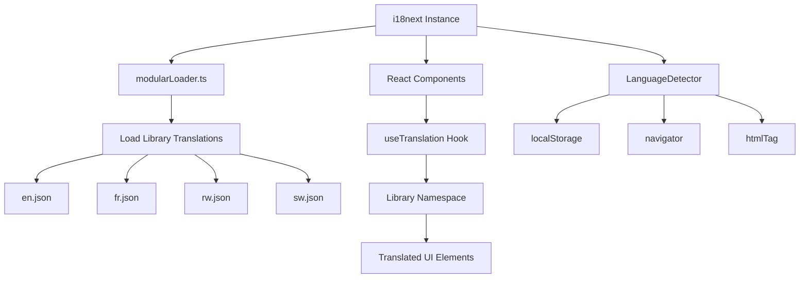
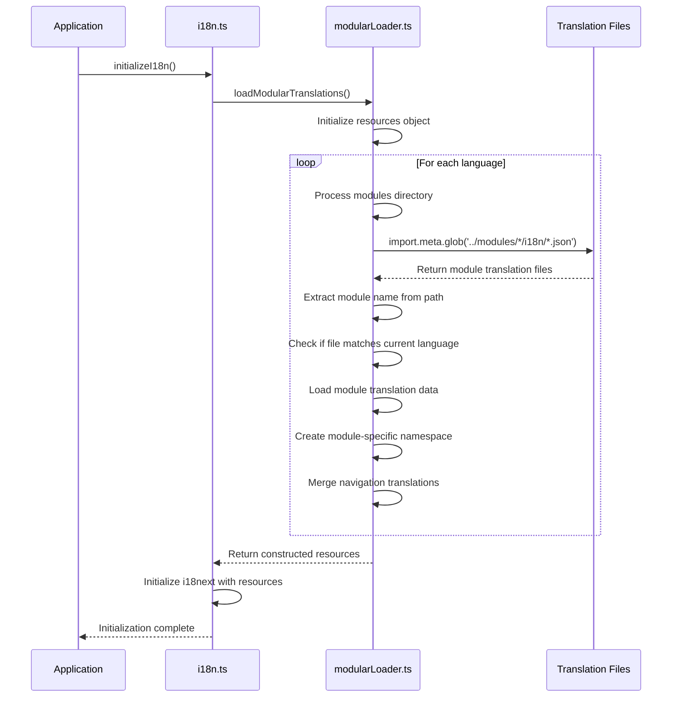

# Library Module Internationalization

<cite>
**Referenced Files in This Document**   
- [modularLoader.ts](file://src/i18n/modularLoader.ts)
- [i18n.ts](file://src/i18n/i18n.ts)
- [en.json](file://src/modules/library/i18n/en.json)
- [fr.json](file://src/modules/library/i18n/fr.json)
- [library.json](file://src/i18n/locales/en/library.json)
- [library.json](file://src/i18n/locales/fr/library.json)
</cite>

## Table of Contents
1. [Introduction](#introduction)
2. [Translation Key Structure](#translation-key-structure)
3. [Internationalization Architecture](#internationalization-architecture)
4. [Language Loading Mechanism](#language-loading-mechanism)
5. [Translation Usage in Components](#translation-usage-in-components)
6. [Language Fallback System](#language-fallback-system)
7. [Adding New Translation Keys](#adding-new-translation-keys)
8. [Challenges in Library Terminology Translation](#challenges-in-library-terminology-translation)

## Introduction
The Library module in schoolpilot3 implements a comprehensive internationalization system that supports multiple languages for all user interface elements related to books, loans, fines, and settings. This documentation provides a detailed overview of the translation implementation, covering the structure of translation keys, the integration mechanism with the global i18next system, and best practices for maintaining multilingual content. The system is designed to support English (en), French (fr), Kinyarwanda (rw), and Kiswahili (sw) languages, with a modular approach that allows for dynamic loading of language resources.

## Translation Key Structure

The Library module's translation keys are organized in a hierarchical structure that reflects the module's functionality and navigation. The primary translation files are located in the `src/modules/library/i18n/` directory, with separate JSON files for each supported language.

### English Translation Keys (en.json)
The English translation file defines the base user interface text for the Library module:

```json
{
  "title": "Library",
  "navigation": {
    "library": {
      "title": "Library",
      "description": "Manage books, loans, fines, and digital resources",
      "dashboard": "Dashboard",
      "books": "Books",
      "bookCategories": "Book Categories",
      "bookLoans": "Book Loans",
      "fines": "Fines",
      "userPortal": "User Portal",
      "digitalResources": "Digital Resources",
      "damagedLostBooks": "Damaged/Lost Books",
      "importBooks": "Import Books",
      "settings": "Settings"
    }
  }
}
```

### French Translation Keys (fr.json)
The French translation file provides localized versions of the interface text:

```json
{
  "navigation": {
    "library": {
      "title": "Bibliothèque",
      "description": "Gérer le catalogue de livres, suivre les prêts et retours, gérer les amendes et superviser les ressources de la bibliothèque.",
      "dashboard": "Tableau de Bord",
      "books": "Livres",
      "bookCategories": "Catégories de Livres",
      "bookLoans": "Prêts de Livres",
      "fines": "Amendes",
      "userPortal": "Portail Utilisateur",
      "digitalResources": "Ressources Numériques",
      "damagedLostBooks": "Livres Endommagés/Perdus",
      "importBooks": "Importer Livres",
      "settings": "Paramètres"
    }
  },
  "dashboard": {
    "title": "TB Bibliothèque",
    "totalBooks": "Total Livres",
    "booksOnLoan": "Livres Empruntés",
    "overdueBooks": "Livres en Retard",
    "pendingFines": "Amendes en Attente",
    "booksByCategoryChartTitle": "Livres par Catégorie",
    "overviewTitle": "Aperçu Portail Bibliothèque",
    "description": "Gérer le catalogue de livres, suivre les prêts et retours, gérer les amendes et superviser les ressources de la bibliothèque."
  },
  "bookCategories": {
    "managementTitle": "Gestion des Catégories de Livres",
    "defineCategories": "Définir les catégories pour les livres de la bibliothèque (ex: Fiction, Science, Histoire, Référence).",
    "addCategory": "Ajouter Catégorie",
    "addNewBookCategory": "Ajouter Nouvelle Catégorie",
    "editBookCategory": "Modifier Catégorie",
    "categoryName": "Nom de la Catégorie",
    "cancel": "Annuler",
    "saveChanges": "Enregistrer les Modifications",
    "title": "Gestion des Catégories de Livres",
    "description": "Définir les catégories pour les livres de la bibliothèque (ex: Fiction, Science, Histoire, Référence).",
    "addButton": "Ajouter Catégorie",
    "modalAddTitle": "Ajouter Nouvelle Catégorie",
    "modalEditTitle": "Modifier Catégorie",
    "nameLabel": "Nom de la Catégorie",
    "deleteConfirm": "Êtes-vous sûr de vouloir supprimer cette catégorie de livres ? Cela pourrait affecter les livres existants."
  },
  "books": {
    "title": "Gestion du Catalogue de Livres",
    "description": "Gérer tous les livres du catalogue de la bibliothèque.",
    "addButton": "Ajouter Livre",
    "modalAddTitle": "Ajouter Nouveau Livre",
    "modalEditTitle": "Modifier Livre",
    "titleLabel": "Titre du Livre",
    "accessionNoLabel": "Numéro d'Acquisition",
    "authorLabel": "Auteur(s)",
    "publisherLabel": "Éditeur",
    "isbnLabel": "ISBN",
    "categoryLabel": "Catégorie",
    "selectCategoryOption": "Sélectionner Catégorie",
    "purchaseCostLabel": "Coût d'Achat (KES)",
    "statusLabel": "Statut",
    "deleteConfirm": "Êtes-vous sûr de vouloir supprimer ce livre ? Cela pourrait affecter les prêts et amendes existants."
  },
  "bookLoans": {
    "title": "Gestion des Prêts de Livres",
    "description": "Prêter des livres aux utilisateurs et gérer les retours. Les livres en retard peuvent générer automatiquement des amendes.",
    "issueLoanButton": "Effectuer Nouveau Prêt",
    "issueButton": "Effectuer Prêt",
    "modalAddTitle": "Effectuer Nouveau Prêt de Livre",
    "modalViewTitle": "Voir Détails du Prêt",
    "bookLabel": "Livre à Prêter",
    "selectBookOption": "Sélectionner Livre",
    "borrowerLabel": "Emprunteur (Élève/Personnel)",
    "selectUserOption": "Sélectionner Utilisateur",
    "dueDateLabel": "Date de Retour Prévue",
    "returnDateLabel": "Date de Retour",
    "markReturnedButton": "Marquer comme Rendu",
    "markReturnedConfirm": "Marquer le livre \"{{title}}\" comme rendu ?",
    "userNotFound": "Utilisateur sélectionné introuvable."
  },
  "fines": {
    "title": "Gestion des Amendes de Bibliothèque",
    "description": "Voir et gérer les amendes de la bibliothèque. Les amendes pour livres en retard sont souvent générées automatiquement lors du retour.",
    "addFineButton": "Ajouter Amende Manuelle",
    "modalAddTitle": "Ajouter Amende Manuelle",
    "modalEditTitle": "Mettre à Jour Statut Amende",
    "loanLabel": "Prêt Associé",
    "selectLoanOption": "Sélectionner Prêt (pour contexte)",
    "amountLabel": "Montant Amende (KES)",
    "reasonLabel": "Raison de l'Amende",
    "statusLabel": "Statut Amende",
    "deleteConfirm": "Êtes-vous sûr de vouloir supprimer cette amende ?"
  },
  "tableHeaders": {
    "id": "ID",
    "name": "Nom",
    "actions": "Actions",
    "accessionNo": "N° Acquisition",
    "title": "Titre",
    "author": "Auteur",
    "category": "Catégorie",
    "status": "Statut",
    "bookTitle": "Titre du Livre",
    "userName": "Nom Utilisateur",
    "userType": "Type Utilisateur",
    "loanDate": "Date Prêt",
    "dueDate": "Date Retour Prévue",
    "returnDate": "Date Retour",
    "amountKES": "Montant (KES)",
    "reason": "Raison",
    "loanId": "ID Prêt"
  },
  "fineStatuses": {
    "pending": "En attente",
    "billed": "Facturée",
    "paid": "Payée",
    "waived": "Annulée"
  },
  "userPortal": {
    "title": "Mon Portail Bibliothèque",
    "description": "Consultez et gérez vos prêts de bibliothèque personnels, renouvellements et réservations.",
    "renewButton": "Renouveler",
    "returnButton": "Retourner",
    "overdueAlert": "En retard!",
    "noLoansMessage": "Vous n'avez aucun prêt actif.",
    "renewSuccess": "Prêt renouvelé avec succès!",
    "returnSuccess": "Livre retourné avec succès!",
    "renewError": "Échec du renouvellement du prêt.",
    "returnError": "Échec du retour du livre."
  },
  "digitalResources": {
    "title": "Ressources Numériques",
    "description": "Gérer les livres numériques, e-journaux et ressources en ligne."
  },
  "damagedLostBooks": {
    "title": "Livres Endommagés et Perdus",
    "description": "Gérer les livres avec statut endommagé ou perdu."
  },
  "importBooks": {
    "title": "Importer Livres",
    "description": "Importation en lot de livres depuis CSV ou fichiers Excel."
  }
}
```

**Section sources**
- [en.json](file://src/modules/library/i18n/en.json)
- [fr.json](file://src/modules/library/i18n/fr.json)

## Internationalization Architecture

The internationalization system in schoolpilot3 follows a modular architecture that allows each module to define its own translation resources while integrating with a global i18next instance. The Library module's translations are part of this larger system, which supports dynamic loading of language bundles and provides a consistent user experience across different languages.



**Diagram sources**
- [modularLoader.ts](file://src/i18n/modularLoader.ts)
- [i18n.ts](file://src/i18n/i18n.ts)

## Language Loading Mechanism

The language loading mechanism is implemented in the `modularLoader.ts` file, which uses Vite's import.meta.glob feature to dynamically import translation files from each module's i18n directory. This approach allows for efficient loading of only the required language resources.



**Diagram sources**
- [modularLoader.ts](file://src/i18n/modularLoader.ts#L0-L66)
- [i18n.ts](file://src/i18n/i18n.ts#L0-L116)

### Modular Translation Loading Process

The `loadModularTranslations` function in `modularLoader.ts` is responsible for constructing the translation resources object that will be used by i18next. The process involves:

1. **Resource Initialization**: Creating an empty resources object for each supported language (en, fr, sw, rw).
2. **Module Discovery**: Using Vite's `import.meta.glob` to discover all translation files in the modules directory.
3. **Language Processing**: Iterating through each language and processing the corresponding translation files.
4. **Namespace Creation**: Creating module-specific namespaces for each module's translations.
5. **Navigation Merger**: Extracting navigation translations and merging them into a unified navigation namespace.

The function returns a resources object that follows the i18next format, with each language containing its translation data organized by namespace.

**Section sources**
- [modularLoader.ts](file://src/i18n/modularLoader.ts#L0-L66)

## Translation Usage in Components

Translation keys are consumed in React components using the `useTranslation` hook from react-i18next. The hook is imported and used with the appropriate namespace to access the Library module's translations.

### Example Component Usage

```typescript
import { useTranslation } from 'react-i18next';

const LibraryComponent = () => {
  const { t } = useTranslation('library');
  
  return (
    <div>
      <h1>{t('title')}</h1>
      <p>{t('navigation.library.description')}</p>
      <button>{t('bookLoans.issueLoanButton')}</button>
    </div>
  );
};
```

The namespace parameter ('library') in the `useTranslation` hook ensures that the component accesses the correct translation namespace. This approach provides type safety and ensures that translation keys are resolved correctly.

### Contextual Translation with Parameters

The system supports contextual translations with parameters, allowing for dynamic content in translated strings:

```typescript
const WelcomeMessage = ({ userName }) => {
  const { t } = useTranslation('library');
  
  return (
    <h2>{t('welcomeMessage', { name: userName })}</h2>
  );
};
```

This feature is particularly useful for personalized messages and dynamic content that needs to be translated.

**Section sources**
- [modularLoader.ts](file://src/i18n/modularLoader.ts)
- [i18n.ts](file://src/i18n/i18n.ts)

## Language Fallback System

The internationalization system implements a robust fallback mechanism to ensure that users always see meaningful text, even when specific translations are missing. The fallback system is configured in the `i18n.ts` file with the following settings:

- **Primary Fallback**: English (en) is set as the fallback language (`fallbackLng: 'en'`)
- **Null Return Prevention**: The `returnNull: false` option ensures that empty strings are returned instead of null values when a translation key is not found
- **Namespace Support**: Multiple namespaces are supported, including common, navigation, dashboard, academics, administration, finance, hr, inventory, library, settings, student, and teacher

When a translation key is not found in the user's selected language, the system automatically falls back to the English translation. If the key is not found in English, an empty string is returned, preventing display of undefined values in the user interface.

The fallback mechanism also includes error handling and recovery strategies. If the primary initialization fails, the system attempts a fallback initialization with basic translation resources. This ensures that the application remains functional even in the event of translation loading errors.

**Section sources**
- [i18n.ts](file://src/i18n/i18n.ts#L0-L116)

## Adding New Translation Keys

Adding new translation keys to the Library module follows a structured process to ensure consistency across languages and proper integration with the existing system.

### Step-by-Step Process

1. **Identify the Need**: Determine the new UI element that requires translation and create an appropriate translation key.
2. **Add to English File**: Add the new key and its English translation to the `en.json` file in the Library module's i18n directory.
3. **Add to Other Languages**: Add the same key with appropriate translations to the `fr.json`, `rw.json`, and `sw.json` files.
4. **Use in Components**: Use the new translation key in the relevant React components with the `useTranslation` hook.
5. **Test**: Verify that the new translation appears correctly in the user interface for all supported languages.

### Best Practices

- **Consistent Key Naming**: Use a consistent naming convention for translation keys, typically following a hierarchical structure (e.g., `bookLoans.issueLoanButton`).
- **Descriptive Keys**: Choose key names that clearly describe the purpose of the translated text.
- **Context Preservation**: Ensure that translations preserve the context and meaning of the original text.
- **Pluralization and Gender**: Consider language-specific requirements for pluralization and gender when creating translations.

The system includes automated tools like `fix-translation-keys.js` and `fix-translation-namespaces.js` that help maintain translation consistency and identify missing keys.

**Section sources**
- [en.json](file://src/modules/library/i18n/en.json)
- [fr.json](file://src/modules/library/i18n/fr.json)

## Challenges in Library Terminology Translation

Translating library-specific terminology presents several challenges due to cultural and linguistic differences across the supported languages.

### Cultural Context Differences

Library management concepts may not have direct equivalents in all languages, requiring careful consideration of cultural context. For example:
- The concept of "fines" for overdue books may be understood differently in various cultural contexts
- Digital resources terminology may vary significantly between languages
- Book categorization systems may differ between educational systems

### Technical Terminology

Some technical terms related to library management may not have established translations in certain languages, requiring the creation of new terms or the use of loanwords. This is particularly challenging for:
- Database-related terms (e.g., accession numbers, ISBN)
- Digital library concepts (e.g., e-books, digital catalogs)
- Loan management terminology (e.g., renewal, reservation)

### Pluralization and Gender

The supported languages have different rules for pluralization and gender agreement, which must be considered when creating translations:
- French has grammatical gender and complex pluralization rules
- Kinyarwanda and Kiswahili have noun class systems that affect agreement
- English has relatively simple pluralization but requires attention to countable vs. uncountable nouns

These challenges require close collaboration between developers, translators, and subject matter experts to ensure that translations are both accurate and culturally appropriate.

**Section sources**
- [en.json](file://src/modules/library/i18n/en.json)
- [fr.json](file://src/modules/library/i18n/fr.json)