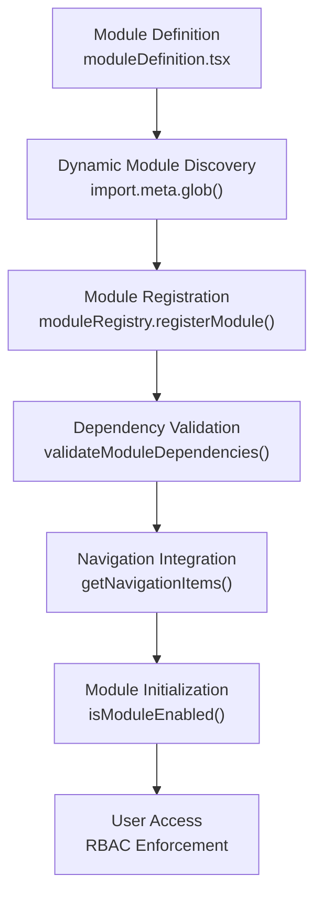
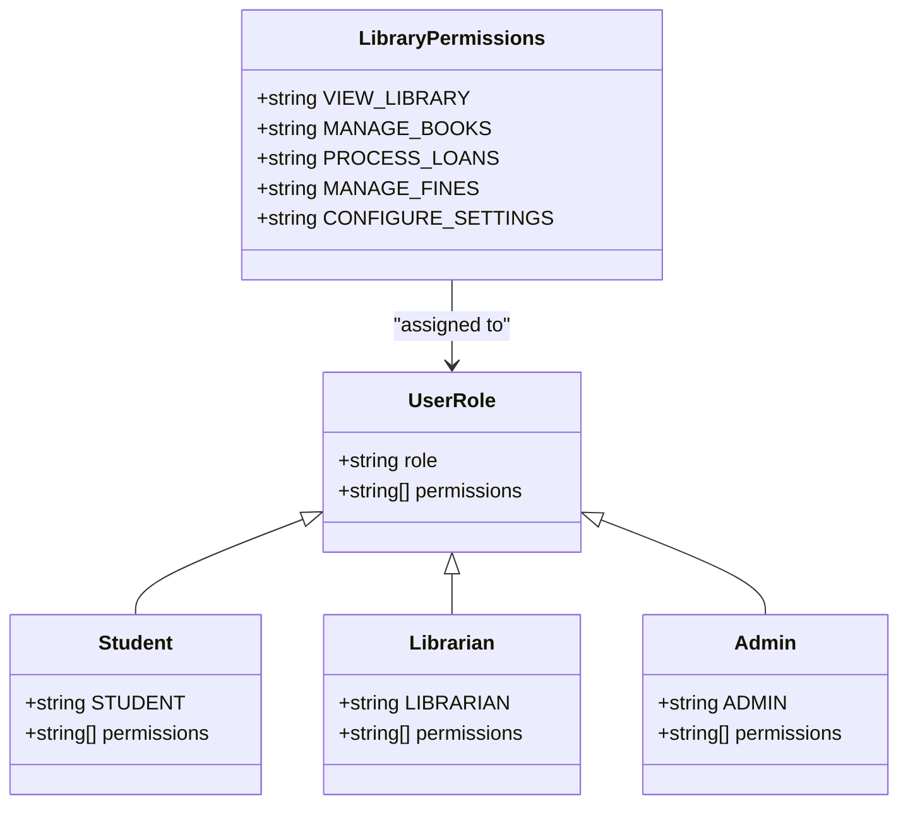
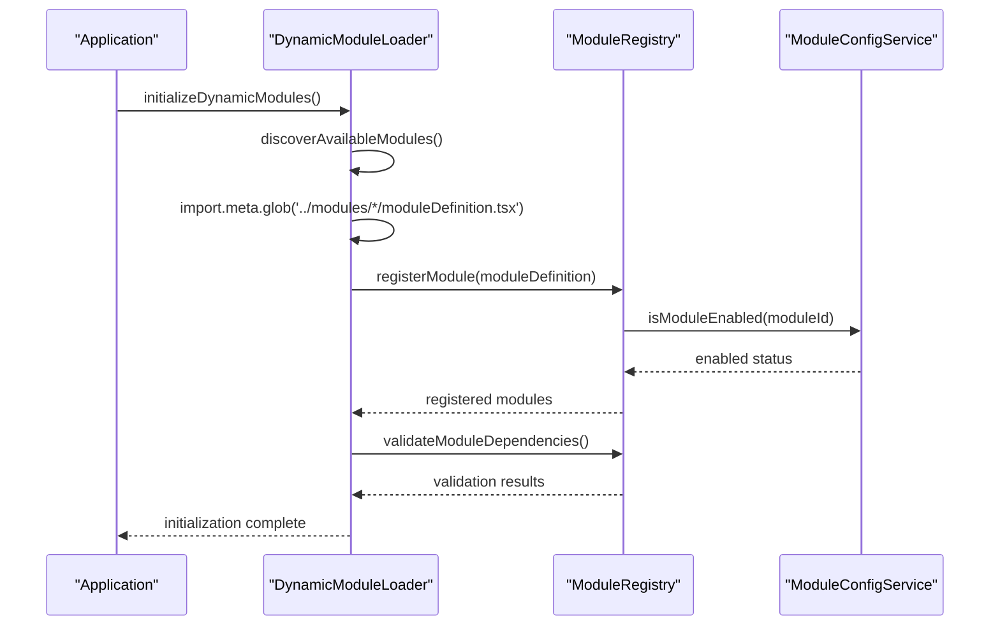
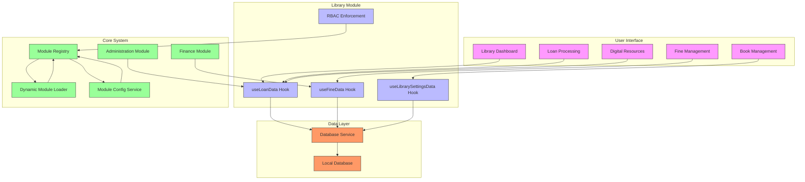

# Library Module Overview

<cite>
**Referenced Files in This Document**   
- [moduleDefinition.tsx](file://src/modules/library/moduleDefinition.tsx)
- [rbac.ts](file://src/modules/library/rbac.ts)
- [useLoanData.ts](file://src/modules/library/data/useLoanData.ts)
- [useFineData.ts](file://src/modules/library/data/useFineData.ts)
- [useLibrarySettingsData.ts](file://src/modules/library/data/useLibrarySettingsData.ts)
- [moduleLoader.ts](file://src/core/moduleLoader.ts)
- [moduleRegistry.ts](file://src/core/moduleRegistry.ts)
- [dynamicModuleLoader.ts](file://src/services/dynamicModuleLoader.ts)
- [moduleConfigService.ts](file://src/services/moduleConfigService.ts)
</cite>

## Table of Contents
1. [Introduction](#introduction)
2. [Module Purpose and Core Functionality](#module-purpose-and-core-functionality)
3. [Module Registration and Lifecycle](#module-registration-and-lifecycle)
4. [Access Control and Permissions](#access-control-and-permissions)
5. [Key Features and Data Management](#key-features-and-data-management)
6. [Integration with Core System](#integration-with-core-system)
7. [Conceptual Architecture Diagram](#conceptual-architecture-diagram)

## Introduction
The Library module in schoolpilot3 is a centralized system designed to manage both physical and digital library resources within an educational institution. It provides comprehensive functionality for book cataloging, loan management, fine calculation, and reporting. The module integrates seamlessly with the core system through dynamic module loading and role-based access control (RBAC), ensuring secure and efficient resource management. This document provides a detailed overview of the module's architecture, functionality, and integration points.

## Module Purpose and Core Functionality

The Library module serves as a complete resource management system for educational institutions, enabling administrators and staff to efficiently manage library operations. Its primary functions include:

- **Book Cataloging**: Comprehensive management of physical and digital book collections, including categorization and metadata tracking.
- **Loan Management**: Tracking of book loans with support for due dates, renewals, and return processing.
- **Fine Calculation**: Automated calculation and management of overdue fines based on configurable borrowing rules.
- **Reporting**: Generation of reports on book usage, overdue items, and financial collections.

The module supports both staff and student users, providing appropriate interfaces and functionality for each role. It includes features such as overdue alerts, digital resource access, and student loan tracking, making it a comprehensive solution for modern educational library needs.

**Section sources**
- [moduleDefinition.tsx](file://src/modules/library/moduleDefinition.tsx#L1-L80)

## Module Registration and Lifecycle

The Library module follows a standardized registration process through the system's dynamic module loading architecture. The module lifecycle begins with its definition in `moduleDefinition.tsx`, where it is configured with essential metadata and navigation structure.



**Diagram sources**
- [moduleDefinition.tsx](file://src/modules/library/moduleDefinition.tsx#L1-L80)
- [dynamicModuleLoader.ts](file://src/services/dynamicModuleLoader.ts#L1-L262)
- [moduleRegistry.ts](file://src/core/moduleRegistry.ts#L1-L194)

**Section sources**
- [moduleDefinition.tsx](file://src/modules/library/moduleDefinition.tsx#L1-L80)
- [dynamicModuleLoader.ts](file://src/services/dynamicModuleLoader.ts#L1-L262)
- [moduleRegistry.ts](file://src/core/moduleRegistry.ts#L1-L194)

The registration process involves several key steps:
1. **Definition**: The module is defined in `moduleDefinition.tsx` with its ID, name, navigation structure, and dependencies.
2. **Discovery**: The dynamic module loader uses Vite's `import.meta.glob()` to discover all module definition files.
3. **Registration**: The module is registered with the central `moduleRegistry`, making it available to the system.
4. **Validation**: Module dependencies are validated to ensure all required modules are available.
5. **Integration**: The module's navigation items are integrated into the system's main navigation.

The module's lifecycle is managed by the core system, with initialization occurring during application startup through the `initializeDynamicModules()` function.

## Access Control and Permissions

The Library module implements a robust role-based access control (RBAC) system defined in `rbac.ts`. Access to module features is controlled through permission levels that correspond to user roles within the educational institution.



**Diagram sources**
- [rbac.ts](file://src/modules/library/rbac.ts)
- [moduleDefinition.tsx](file://src/modules/library/moduleDefinition.tsx#L1-L80)

**Section sources**
- [rbac.ts](file://src/modules/library/rbac.ts)
- [moduleDefinition.tsx](file://src/modules/library/moduleDefinition.tsx#L1-L80)

The RBAC system defines the following permission levels:
- **VIEW_LIBRARY**: Basic access to view library resources and personal loan information.
- **MANAGE_BOOKS**: Permission to add, edit, and remove books from the catalog.
- **PROCESS_LOANS**: Ability to process book loans and returns for users.
- **MANAGE_FINES**: Authority to manage fine calculations, waivers, and payments.
- **CONFIGURE_SETTINGS**: Administrative access to configure library settings and borrowing rules.

These permissions are assigned to default roles such as Student, Librarian, and Admin, ensuring appropriate access levels for different user types. The system enforces these permissions throughout the module's functionality, restricting access to features based on the authenticated user's role.

## Key Features and Data Management

The Library module provides several key features through specialized data management hooks that handle specific aspects of library operations.

### Loan Management
The `useLoanData` hook manages all aspects of book loans, providing CRUD operations and specialized functionality:

```typescript
// Key functions in useLoanData.ts
const {
  data,                    // Current loan records
  isLoading,               // Loading state
  error,                   // Error state
  create,                  // Create new loan
  update,                  // Update existing loan
  remove,                  // Remove loan
  search,                  // Search loans
  getOverdueLoans,         // Retrieve overdue loans
  getActiveLoans,          // Retrieve active loans
  returnBook,              // Process book return
  extendLoan               // Extend loan due date
} = useLoanData();
```

The hook includes automatic overdue loan detection, which triggers user notifications when books become overdue. This proactive alert system helps maintain timely returns and reduces lost materials.

**Section sources**
- [useLoanData.ts](file://src/modules/library/data/useLoanData.ts#L1-L169)

### Fine Management
The `useFineData` hook handles fine calculation and management, with support for different fine statuses:

```typescript
// Key functions in useFineData.ts
const {
  data,                    // Current fine records
  isLoading,               // Loading state
  error,                   // Error state
  create,                  // Create new fine
  update,                  // Update existing fine
  remove,                  // Remove fine
  search,                  // Search fines
  getPendingFines,         // Retrieve pending fines
  getPaidFines,            // Retrieve paid fines
  markAsPaid,              // Mark fine as paid
  waiveFine,               // Waive a fine
  billFine                 // Bill a fine to finance system
} = useFineData();
```

Fines can exist in multiple states (Pending, Paid, Billed, Waived), allowing for flexible management of financial obligations. The system supports fine waivers for exceptional circumstances and can integrate with the Finance module for billing.

**Section sources**
- [useFineData.ts](file://src/modules/library/data/useFineData.ts#L1-L159)

### Library Settings
The `useLibrarySettingsData` hook manages borrowing rules and library configurations:

```typescript
// Key functions in useLibrarySettingsData.ts
const {
  data,                    // Current library settings
  isLoading,               // Loading state
  error,                   // Error state
  create,                  // Create new settings
  update,                  // Update existing settings
  remove,                  // Remove settings
  search,                  // Search settings
  getActiveSettings,       // Retrieve active settings
  getSettingsByUserType,   // Retrieve settings by user type
  toggleActiveStatus       // Toggle settings active status
} = useLibrarySettingsData();
```

Settings include configurable parameters such as maximum loan days, renewal limits, fine rates, and maximum books per user. These rules can be defined separately for different user types (e.g., students vs. staff), allowing for differentiated borrowing privileges.

**Section sources**
- [useLibrarySettingsData.ts](file://src/modules/library/data/useLibrarySettingsData.ts#L1-L123)

## Integration with Core System

The Library module integrates with the core system through several mechanisms, ensuring seamless operation within the broader educational platform.

### Dynamic Module Loading
The module leverages the system's dynamic module loading architecture, which allows for plugin-like extensibility. The loading process is managed by `moduleLoader.ts` and `dynamicModuleLoader.ts`, which discover and register modules at runtime.



**Diagram sources**
- [moduleLoader.ts](file://src/core/moduleLoader.ts#L1-L85)
- [dynamicModuleLoader.ts](file://src/services/dynamicModuleLoader.ts#L1-L262)
- [moduleRegistry.ts](file://src/core/moduleRegistry.ts#L1-L194)
- [moduleConfigService.ts](file://src/services/moduleConfigService.ts#L1-L324)

**Section sources**
- [moduleLoader.ts](file://src/core/moduleLoader.ts#L1-L85)
- [dynamicModuleLoader.ts](file://src/services/dynamicModuleLoader.ts#L1-L262)

### Dependency Management
The Library module has a required dependency on the Administration module, as specified in its module definition:

```typescript
dependencies: [
  {
    moduleId: 'administration',
    version: '^1.0.0',
    required: true
  }
]
```

This dependency ensures that student and staff data from the Administration module is available for loan tracking and user identification. The dependency is validated during module registration, preventing the Library module from loading if the Administration module is not available.

### Configuration Service Integration
The module interacts with the `moduleConfigService` for persistent storage of configuration settings. This service manages module enablement states and settings in localStorage, allowing for configuration that persists across sessions.

**Section sources**
- [moduleConfigService.ts](file://src/services/moduleConfigService.ts#L1-L324)
- [moduleDefinition.tsx](file://src/modules/library/moduleDefinition.tsx#L1-L80)

## Conceptual Architecture Diagram



**Diagram sources**
- [moduleDefinition.tsx](file://src/modules/library/moduleDefinition.tsx#L1-L80)
- [useLoanData.ts](file://src/modules/library/data/useLoanData.ts#L1-L169)
- [useFineData.ts](file://src/modules/library/data/useFineData.ts#L1-L159)
- [useLibrarySettingsData.ts](file://src/modules/library/data/useLibrarySettingsData.ts#L1-L123)
- [moduleLoader.ts](file://src/core/moduleLoader.ts#L1-L85)
- [moduleRegistry.ts](file://src/core/moduleRegistry.ts#L1-L194)
- [moduleConfigService.ts](file://src/services/moduleConfigService.ts#L1-L324)

**Section sources**
- [moduleDefinition.tsx](file://src/modules/library/moduleDefinition.tsx#L1-L80)
- [useLoanData.ts](file://src/modules/library/data/useLoanData.ts#L1-L169)
- [useFineData.ts](file://src/modules/library/data/useFineData.ts#L1-L159)
- [useLibrarySettingsData.ts](file://src/modules/library/data/useLibrarySettingsData.ts#L1-L123)

The conceptual architecture illustrates how the Library module components interact with each other and with the core system. The user interface components interact with specialized data hooks that manage specific aspects of library operations. These hooks communicate with the database service to persist data, while the RBAC system enforces access control. The module integrates with the core system through the module registry and configuration service, and depends on the Administration module for user data and the Finance module for financial transactions.